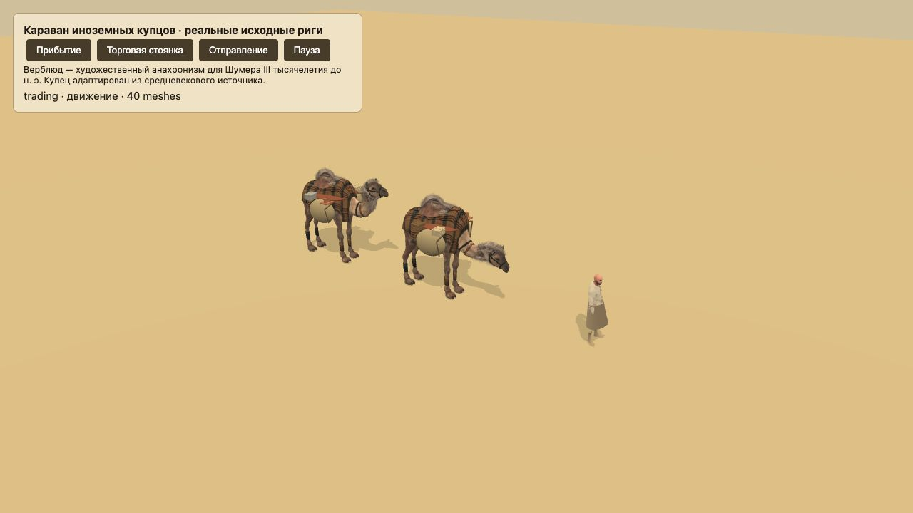
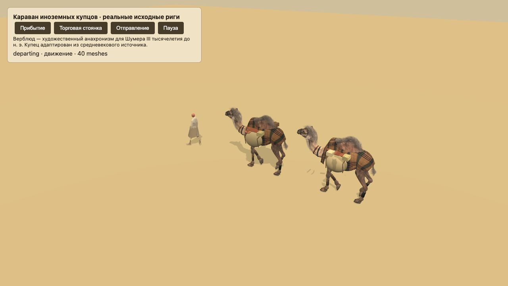

# Караван · 23 октября 2026

Статус: реализовано локально; публикацию подтверждает отдельный выпуск родительской задачи.

Вместо деревянных параллелепипедов используются две настоящие модели верблюда и купец из предоставленных GLB. Лидер идёт первым, животные следуют по уже пройденной части сохранённой дороги с интервалами 3,8 и 7,45 м, в том числе на поворотах. Фигура, поза и груз — только представление существующего `trade.caravan`; правила торговли, деньги, резервы, рынок и формат сохранения не менялись. Речной торговый транспорт сохранён.

## Исторические границы

Для Шумера III тысячелетия до н. э. надёжный ориентир — вьючные ослы и речной транспорт. Обзор [Political Economy of Livestock in Early States](https://www.cambridge.org/core/journals/cambridge-archaeological-journal/article/political-economy-of-livestock-in-early-states/A94F5FBA63DE00BCE461E86D13F4FD89) прямо отмечает роль эквидов и водных путей. Использование предоставленного верблюда оставлено как художественное допущение об иноземном караване, а не подтверждённый облик шумерской торговли. Датировки одомашнивания разных видов верблюдов нельзя смешивать: [обзор Animal Genetics](https://onlinelibrary.wiley.com/doi/10.1111/age.12858) обсуждает ранние свидетельства бактрианов в Центральной Азии, [генетическое исследование PNAS](https://pmc.ncbi.nlm.nih.gov/articles/PMC4914195/) — значительно более поздний процесс для дромадеров. Ни то ни другое не доказывает обыденность такой сцены в Шумере.

Источник купца — средневековый Shaikh Abdul Aziz. Снята отдельная сетка головного убора, приглушены цвета, сглажены складки стёганой одежды/обуви и их нормали, добавлена своя драпированная шерстяная юбка с весами исходного скелета. Лицо, руки и сам скелет сохранены. Это адаптация силуэта, не археологическая реконструкция.

## Ассеты и движение

- `assets/art-courtyard/models/caravan-merchant.glb`: Dr Helmi Norman, CC BY 4.0, [источник](https://sketchfab.com/3d-models/parameswara-chronicles-shaikh-abdul-aziz-ca665011d8a044edaa19d8c678436e7c). Исходный Mixamo-клип оказался стоячей жестикуляцией, поэтому используется только для Idle. Walk — новая двухзвенная IK-анимация на том же скелете с опорной фазой стопы и переносом ноги; не выдаётся за авторскую походку источника.
- `assets/art-courtyard/models/caravan-camel.glb`: исходная атрибуция eb78 / CC BY сохранена в `asset.extras` вместе с точной ссылкой. Все три исходных клипа сохранены по смыслу: WalkCycle → Walk, Idle_01 → Idle, Idle_02 → Idle2. Корректируется только положение корня и опора на землю.
- `scripts/art-courtyard/prepare_caravan.py` воспроизводит производные из `~/Downloads/traider.glb` и `camel.glb`. Запускается Python с NumPy/Pillow, не меняет оригиналы. Проверены настоящие деформированные вершины; модели нормированы к метрам и направлению +Z.
- Фаза шага определяется пройденным расстоянием, а не независимыми часами рендера: 2 м/цикл у верблюда и 1,04 м/цикл у купца. Горизонтальный дрейф исходного корня убран. При паузе `simTime` не меняется, позы и фазы остаются неподвижными. Idle включается на разгрузке/торговой стоянке; переходы смешиваются за 0,25 с.
- Попоны, парные тканевые сумы и перекрёстные верёвки дополняют исходное вьючное снаряжение. Типы и слои видимых товаров определяются только положительным `stock`, не резервами и не неоплаченными заказами. При изменении запаса пересобираются только товарные экземпляры; актёры, кости, материалы и фазы сохраняются.
- Альфа текстур исходных волосяных карточек сохранена в PNG: визуальная проверка поймала и исправила ошибку при первоначальном сжатии в JPEG.

## Проверки

50 целевых тестов: `node --test tests/caravan.test.js tests/game3d-landscape.test.js tests/trading.test.js tests/harbor.test.js tests/market-logistics.test.js`. Проверяются настоящие GLB и независимые скелеты, направление головы вдоль маршрута, заморозка позы, Idle на стоянке, сохранение идентичности актёров при смене запаса, отсутствие изменения состояния и полное освобождение сеток. Существующая проверка ландшафта также проверяет сохранение лодки и её груза; торговые тесты — погрузку/оплату после физической доставки, миграцию и сохранение грузов.

Браузерная изолированная сцена: `scripts/caravan-fixture.html`, состояния «Прибытие», «Торговая стоянка», «Отправление», «Пауза». Проверены настоящие материалы, походка, нормали, прозрачность шерсти, ориентация и расстановка. Это проверка ассетов, не замер FPS большого города; итоговый город на 4× проверяется родительской задачей перед выпуском.

