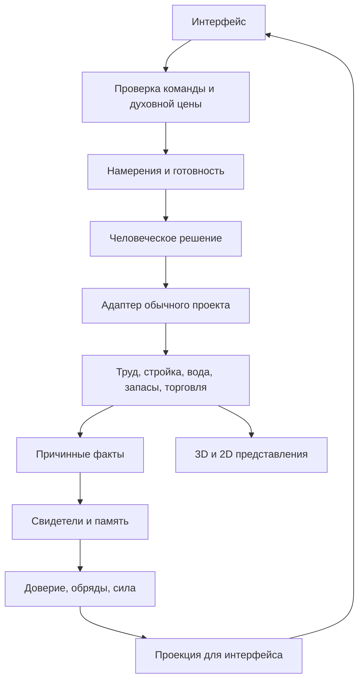

# Новый Вавилон: от первого шёпота до бога города

**Дата:** 20 октября 2026 года.  
**Статус:** цельная предлагаемая концепция и архитектура; игровые изменения по этому документу ещё не реализованы.  
**Назначение:** определить, какую игру строим, как она работает и как перейти к ней от существующего прототипа.  
**Исторический ориентир:** южное Междуречье, прежде всего Шумер около 2600–2350 годов до н. э.; позднее III тысячелетие допускается только с явной пометкой.  
**Все цены, пороги, длительности и вероятности ниже — гипотезы для прототипа, а не проверенный баланс или исторические величины.**

> Ты появился там, где тебя никто не ждёт. Люди уже знают имена великих богов. У тебя нет ни имени, ни дома, ни человека, который оставит тебе чашу воды. Ты не можешь поднять даже тростинку. Но можешь услышать того, кого не услышали другие. Если он решится поступить иначе и запомнит твой ответ, у тебя появится первый верующий.

## Содержание

1. [Обещание игры и выбранный подход](#1-обещание-игры-и-выбранный-подход)
2. [Историческая рамка](#2-историческая-рамка)
3. [Что бог может и чего не может](#3-что-бог-может-и-чего-не-может)
4. [Первые тридцать минут](#4-первые-тридцать-минут)
5. [Вера, сила и вдохновение](#5-вера-сила-и-вдохновение)
6. [Жители, память и самостоятельность](#6-жители-память-и-самостоятельность)
7. [Строительство через людей](#7-строительство-через-людей)
8. [Развитие божества и города](#8-развитие-божества-и-города)
9. [Хозяйство и география](#9-хозяйство-и-география)
10. [Каталог построек и мест](#10-каталог-построек-и-мест)
11. [Вдохновения, обеты и культ](#11-вдохновения-обеты-и-культ)
12. [Имя и характер бога](#12-имя-и-характер-бога)
13. [События и их устройство](#13-события-и-их-устройство)
14. [Сюжетные цепочки](#14-сюжетные-цепочки)
15. [Кампания, поражение и повторная игра](#15-кампания-поражение-и-повторная-игра)
16. [Интерфейс, изображение и звук](#16-интерфейс-изображение-и-звук)
17. [Программная архитектура](#17-программная-архитектура)
18. [Сохранения и переход существующего города](#18-сохранения-и-переход-существующего-города)
19. [Порядок разработки](#19-порядок-разработки)
20. [Проверки и критерии качества](#20-проверки-и-критерии-качества)
21. [Источники и границы уверенности](#21-источники-и-границы-уверенности)
22. [Зафиксированные проектные решения](#22-зафиксированные-проектные-решения)

## 1. Обещание игры и выбранный подход

### 1.1. Главная фантазия

**Игрок не строит город руками бога. Он становится причиной, по которой люди решаются построить его сами.**

В начале слабость ощущается через отсутствие узнавания и узость влияния. В зрелой игре могущество выражается в том, сколько разных людей могут понять общий замысел и продолжить его без постоянного вмешательства. Самая важная перемена — от «один человек прислушался» к «город хранит твоё имя, даже когда ты молчишь».

Жанр: одиночная хозяйственная стратегия с косвенным божественным управлением, личными историями и спокойным наблюдением. Экономика настоящая: работа, дорога, вода, запас, перевозчик, семейный ужин. Религиозная часть связывает эти процессы смыслом и памятью.

### 1.2. Три возможных модели

| Подход | Сильная сторона | Проблема | Решение |
|---|---|---|---|
| Обычный градострой с маной и чудесами | Понятное управление, легко развивать нынешний прототип | Игрок остаётся мэром, а вера становится ещё одним материалом | Не брать за основу |
| Полностью автономные люди и редкие знамения | Убедительная независимость мира | Трудно понять последствия; долго ждать; слабое влияние может раздражать | Заимствовать самостоятельность жителей и живую память |
| **Посредничество: замыслы, исполнители, обеты** | Сохраняет планирование, но каждое действие проходит через человека | Требует ясного интерфейса согласия и причин отказа | **Рекомендуемая основа** |

Игрок выбирает цель и место, видит цену, предлагает замысел подходящему человеку, после принятия управляет общественным проектом. Жители выбирают исполнителей по способностям и обстоятельствам. Бог может изменить приоритет через новое обращение, но не телепортирует людей и товары.

### 1.3. Опорные принципы

1. **Человек раньше здания.** Первое достижение — не амбар, а чьё-то доверие.
2. **Следствие раньше награды.** Принятый замысел ещё не означает спасённого человека или исполненный обет.
3. **Вера связана с памятью.** Известно, кто поверил, почему и что может поколебать его отношение.
4. **Ограничение создаёт выбор.** Бог слышит больше просьб, чем способен поддержать сразу.
5. **Люди умеют жить без команды.** Они едят, заботятся о семье, работают и чинят необходимое сами.
6. **Сильный бог отвечает за ожидания.** Чем шире культ, тем больше несогласных толкований и взаимных обязательств.
7. **Шумер определяет причинность.** Вода, ячмень, глина, шерсть, храмовые и семейные хозяйства, речные связи.

### 1.4. Чего не включать в основной замысел

Тактические армии, аватара бога, ручное вселение в каждого жителя, сотни ресурсов, дерево современных технологий, ежедневный сбор веры кликами, обязательную жестокость ради эффективности. Политику больших держав и войну оставить для отдельного будущего решения о жанре.

## 2. Историческая рамка

### 2.1. Место и время

Игра начинается в небольшом вымышленном поселении в аллювиальной низменности южного Междуречья. Это не восстановленный по раскопкам квартал конкретного города. Опоры — раннединастические города, их ремёсла и религиозная жизнь. Метрополитен датирует рассматриваемую раннединастическую скульптуру 2900–2350 годами до н. э. и связывает её с храмовыми посвящениями. [S01](https://www.metmuseum.org/essays/early-dynastic-sculpture-2900-2350-b-c)

«Новый Вавилон» сохраняется как название проекта. Внутри основного сценария это не столица Навуходоносора и не город с синими воротами Иштар. Название поселения выбирает игрок из проверенного списка либо вводит сам. Вавилон III тысячелетия нельзя автоматически наделять его значительно более поздним величием. [S02](https://www.metmuseum.org/essays/mesopotamian-deities)

Два исторических профиля контента:

- **Основной: раннединастический.** Небольшие священные места, храмовый двор, общественные и семейные хозяйства, писцы и печати, каналы, речная торговля.
- **Поздний: конец III тысячелетия.** Монументальный зиккурат и часть более подробно документированных административных практик. Включается отдельной главой с обозначенным переходом времени либо отдельным сценарием; это не «ещё одно улучшение завтра».

### 2.2. Что подтверждено, а что придумано

| Основа | Как использовать | Граница |
|---|---|---|
| Политеизм и божества разного положения | Люди могут чтить нового покровителя, продолжая обращаться к другим богам | Не моделировать обращение из неверия в единственную правильную религию; [S03](https://oracc.museum.upenn.edu/amgg/index.html) |
| Связь бога и города | Признание покровителем — возможный финал развития | Рождение нового бога из первого доверия — вымысел; [S02](https://www.metmuseum.org/essays/mesopotamian-deities) |
| Храмовые дары и вотивные изображения | Вещь хранит память о конкретном дарителе | Храм не производит силу из пустоты; [S01](https://www.metmuseum.org/essays/early-dynastic-sculpture-2900-2350-b-c) |
| Ирригация и коллективная работа | Канал требует людей, времени и поддержания | Цифровые радиусы воды и цены — условность; [S04](https://www.britishmuseum.org/research/projects/girsu-project) |
| Учёт продуктов и пайков | Физические запасы и человеческая администрация | Конкретная табличка около 2028 года до н. э. относится к Уру III; [S05](https://www.metmuseum.org/art/collection/search/327069) |
| Пивоварение и его хозяйственный учёт | Осмысленная переработка зерна и снабжение | Современный точный рецепт нельзя выдавать за восстановленную древнюю технологию; [S06](https://cdli.earth/articles/cdlj/2012-2) |
| Ограниченность местных дерева, камня и металла | Импорт важен для крупных проектов | Не создавать возле каждого двора возобновляемый каменный карьер и хвойный лес; [S07](https://resources.metmuseum.org/resources/metpublications/pdf/Guide_to_the_Collections_Ancient_Near_Eastern_Art.pdf) |

### 2.3. Обязательные исторические ограничения

- Пантеон не является набором злых конкурентов, которых надо победить. Энки, Инанна, Энлиль, Уту, Нанна существуют в человеческом миропонимании независимо от игрока. Их точные функции и местные культы нуждаются в отдельной проверке текста каждого сценария.
- Доступ к центральному святилищу, вероятно, ограничивался. В игре встречи, раздачи и общие праздники вынесены во дворы и на открытые места; это пространственное решение дизайна. [S01](https://www.metmuseum.org/essays/early-dynastic-sculpture-2900-2350-b-c)
- Нельзя предполагать, что всё имущество всех людей принадлежит одному храму. В модели сосуществуют семейные, общинные и храмовые запасы; степень их самостоятельности здесь — игровое обобщение.
- Нет железной индустрии, средневековых замков, современных монет, стеклянных больниц, университетов и телескопов. Серебро — весовая расчётная величина.
- Для дальних сухопутных перевозок — прежде всего вьючные ослы, не верблюжьи караваны по умолчанию. Крупные грузы лучше связывать с рекой.
- Писцовое обучение не равно всеобщей школе. Современная доступность образования — осознанный выбор дизайна, не установленная практика данного поселения.
- Лечение соединяет практический уход и религиозное понимание болезни; точные профессии и процедуры разных веков не смешиваются без пометки.
- Местные похоронные обычаи не сводятся к обязательному сожжению всех умерших в пустыне. Существующая процессия — художественная сцена прототипа, не основание исторической модели.
- Домашняя кошка как гарантированно характерный «дар шумерского бога» требует более узкого доказательства. Для основного сценария защита зерна обеспечивается хранением и уходом; кошка не является обязательной технологией выживания.

Мотив сна, который ведёт к строительному замыслу, имеет литературную опору в рассказе о храме Нингирсу и Гудеа. Это позднее III тысячелетие и царский сакральный текст. Передача слабого образа обычному человеку в нашей ранней кампании — адаптация мотива, а не засвидетельствованный порядок возникновения культа. [S13](https://etcsl.orinst.ox.ac.uk/section2/tr217.htm)

### 2.4. Земледельческий календарь

Нужна содержательная поправка к нынешнему прототипу: схема «весной посеять, осенью собрать» не должна оставаться историческим объяснением шумерского ячменя. Для южного Ирака исследования описывают преимущественно зимние зерновые: посев осенью, жатва весной; высокий речной уровень также может угрожать урожаю. [S08, Stephanie Rost, с. 142](https://isac.uchicago.edu/sites/default/files/uploads/shared/docs/Publications/OIS/ois13.pdf)

Для новой кампании: осень — подготовка и посев; зима — рост и управление водой; весна — жатва и обмолот; лето — хранение, ремонт и торговля. Четыре равных сезона и двенадцать номеров месяцев сохраняются как интерфейсное упрощение. Старые сохранения не переводятся на другой цикл незаметно: правила перехода описаны в разделе 18.

## 3. Что бог может и чего не может

### 3.1. Строгое правило посредничества

**В основном режиме каждое изменение материального мира исполняет человек или уже существующий природный процесс.** Бог не создаёт еду, здания, воду, кошку, нового жителя или профессию одним нажатием.

| Действие игрока | Реальный исполнитель | Наблюдаемое следствие |
|---|---|---|
| Прислушаться | Бог как точка зрения | Понятна чья-то просьба; запас не меняется |
| Послать образ | Человек, который может его принять | Возникает намерение или сомнение |
| Вдохновить помощь | Согласившийся житель | Он прерывает доступную задачу безопасно, идёт и помогает |
| Показать замысел канала | Организатор и соседи | Обсуждение, принятие, резерв, доставка, земляные работы |
| Поддержать ученика | Ученик и наставник | Практика и обучение, а не мгновенная квалификация |
| Дать обет городу | Группа людей и сам игрок своими будущими приоритетами | Явное обещание с условиями и сроком |

Если когда-нибудь добавляются прямые погодные чудеса, это отдельный режим с изменённым обещанием игры. В рекомендуемую основу они не входят. Нынешние кнопки мгновенной выдачи ресурсов сохраняются только в прежнем режиме и в явно обозначенной отладке.

### 3.2. Какое управление остаётся удобным

Игрок рисует маршрут канала, выбирает площадку храма, сравнивает здания, просматривает запасы и задаёт замысел всему проекту. Не надо вдохновлять каждого носильщика отдельно. После согласия жителей обычная система труда обслуживает проект самостоятельно.

Доступны пауза, скорости 1×/2×/4×, осмотр любого видимого человека и полная диагностика рисков. Слабость бога не оправдывает скрытый отрицательный баланс еды или непонятные правила. Неизвестные личные истории открываются постепенно, но материальная угроза читается сразу.

### 3.3. Масштаб внимания

На старте удерживается один разговор; позднее — два-три параллельных обращения, максимум четыре в основной кампании. Нить внимания занята до принятия, отказа или согласованного завершения короткого действия. Принятый большой строительный проект далее живёт в человеческой очереди и не держит божественный слот месяцами.

Обеты имеют отдельный предел — не более трёх одновременно. Это обязательства, а не каналы постоянной магической работы.

### 3.4. В чём проявляется сверхъестественное могущество

Бог отличается от правителя способностью слышать обращение за стенами и расстоянием, передавать образ без встречи, узнавать связанные истории и быть присутствием сразу для нескольких общин. Вначале удаётся лишь смутный образ одному человеку. Позднее можно поддержать общий сон, в котором несколько знакомых видят один будущий двор, либо связать разделённых расстоянием свидетелей одним знакомым именем.

Это предлагаемые нематериальные чудеса. Они не дают навыка без учёбы, знания неизвестного месторождения без исследования или гарантированной веры каждому увидевшему. **Растёт дальность, ясность и общность ответа.** Кульминация — множество самостоятельных людей узнают одно присутствие и продолжают общий замысел, который бог больше не обязан вести за руку.

Сильное обращение к группе занимает несколько доступных нитей и заранее показывает общую цену. Число адресатов ограничено известной общностью и доверием, а не числом клеток, попавших под курсор. Для первой версии достаточно индивидуального образа; общий сон — развитие того же контракта намерений.

## 4. Первые тридцать минут

### 4.1. Начальное состояние

Поселение уже существует. Предлагаемый состав: двенадцать жителей, из них восемь взрослых и четверо детей, два жилых двора, общие бытовые запасы, береговая добыча пищи и тростника. Поле и старый отвод воды можно дать как наследство поселения. У игрока нет собственного святилища, верующих и расходуемой силы.

Люди не стоят неподвижно в ожидании бога. Они носят воду, едят, работают и спорят. Бог возникает внутри их жизни, не на пустой карте. Ни один стартовый сюжет не требует платить верой, которой ещё не существует.

### 4.2. До первой веры: единственное «эхо»

У нового бога остаётся возможность передать **один слабый образ в уже возникшее человеческое обращение**. Это не покупаемый ресурс, не скрытая бесплатная мана и не физическое чудо. Эхо нельзя копить, превращать в товары, повторять на толпе или использовать в обычном режиме, пока есть действующие последователи.

Человек не мгновенно становится адептом. Сначала он думает: «Я попробую». Вера подтверждается после его поступка и понятного результата.

Первый содержательный выбор игрока — **кого услышать и каким человеком начать своё существование**. Подходящими кандидатами будут взрослые, а не случайно выбранный ребёнок с повышенным шансом успеха.

### 4.3. Стартовая сцена: «Две руки»

Уставшая водоноска не успевает доставить воду в соседний двор. Рыбак рядом собирается уйти к сетям. Никто не погибает через десять секунд: проблема достаточно мала для слабого бога и достаточно важна для конкретной семьи.

Игрок слышит обращение водоноски: «Пусть хоть кто-нибудь увидит». Он может показать рыбаку образ двух людей, несущих одну ношу, либо поддержать её решимость обратиться за помощью самой. Эти ветки меняют первого носителя памяти, но обе ведут к действию доступными средствами.

Согласившийся человек завершает перенос уже взятого груза, подходит к другому, берёт часть реальной ноши и доставляет воду. Ни одной новой единицы воды не появляется. Вечером он оставляет небольшую личную чашу и произносит первое имя: «Услышавший». Это предлагаемое русское игровое имя, не перевод засвидетельствованного шумерского теонима.

### 4.4. Режиссура знакомства

| Время на 1× без долгого чтения | Что делает игрок | Что действительно происходит | Что он понимает |
|---|---|---|---|
| 0:00–0:45 | Осматривается, слышит обрывки жизни | Поселение работает без него; интерфейс почти пуст | Мир существовал до меня |
| 0:45–2:00 | Выбирает первое обращение и образ | Подходящий взрослый принимает короткое намерение | Моё действие проходит через человека |
| 2:00–4:00 | Следит за помощью и первым посвящением | Реальная доставка, личная память, первый верующий | Я существую для кого-то конкретного |
| 4:00–7:00 | Поддерживает ещё одно полезное действие | Второй человек получает собственное основание доверять | Люди верят по разным причинам |
| 7:00–11:00 | Предлагает место чаши/небольшого священного знака | Человек выделяет место и приносит существующие вещи | Даже мой первый «дом» делает человек |
| 11:00–17:00 | Предлагает короткий общий проект | Несколько взрослых соглашаются, несут материалы, строят | Вера помогает объединить, а не заменить труд |
| 17:00–23:00 | Выбирает между двумя просьбами | Одни получают помощь раньше других, появляется ожидание | Я ограничен и отвечаю за выбор |
| 23:00–30:00 | Выполняет первый публичный обет | Семья или квартал переживает понятное улучшение | Моё имя становится общей историей |

В текущем интерфейсе месяц на 1× занимает минуту, сезон — три минуты, год — двенадцать минут. Поэтому тридцать минут могут вместить около двух с половиной условных лет, если не считать паузы. Это уже действующий игровой масштаб, а не реальная длительность древних процессов. Стартовые главы привязать к выполненным действиям, а не к обязательному дедлайну по минутам.

### 4.5. Защита от тупика и скуки

- Первый сюжет допускается только при существующем исполнителе, запасе, маршруте и подходящем времени. В подготовленной сцене принятие доступного доброго намерения гарантировано; это не бросок 40%.
- Если исполнитель занят, интерфейс показывает, что он завершает доставку, и предлагает второго подходящего взрослого. Нет потери попытки из-за внутренних очередей.
- До первого посвящения не запускаются голодные катастрофы, болезни со смертельным таймером и разрушение стартовой инфраструктуры.
- Если игрок выбирает невозможное действие, оно не тратит эхо. Причина понятна до подтверждения.
- Отказ от подсказки не останавливает время навсегда. Видно действие «снова прислушаться» с другим доступным обращением.
- После полной утраты последователей эхо возвращается только в состоянии «Забытый», для одного нового локального обращения. Оно не даёт силу напрямую; попытки помощи одному и тому же человеку не создают повторную стартовую награду.

### 4.6. Проверяемая трасса силы в знакомстве

Первое место посвящения предлагает сам человек; игрок бесплатно согласует место и вид, не оплачивая чужую инициативу. Это не отдельное платное «малое место памяти» из дальнейшего каталога. Для подготовленного знакомства нужна следующая достижимая трасса, **без расчёта на пассивное ожидание**:

| Шаг | Расход / вклад | Доступный F после шага |
|---|---:|---:|
| Первое признание после дела | Единственный за историю стартовый вклад +3 | 3 |
| Помочь другому взрослому | −1 | 2 |
| Второй человек завершил дело и сам признал связь | Однократное новое свидетельство +1 | 3 |
| Согласовать личное место посвящения | 0; материал и труд остаются настоящими | 3 |
| Принять первый общий проект двух дворов | −3 | 0 |
| Проект помог двум людям в новом бытовом цикле | Два различных подтверждённых свидетельства, по +1 | 2 |
| Принять первый публичный обет | −2 | 0 |
| Люди выполняют уже принятые работы | 0 F; расходуется обычный труд/запас | 0 плюс завершённые добровольные обращения |

Для этой сцены два получателя и возможность их реального знакомства с замыслом подготовлены сценарным условием. Это гарантии обучения, не автоматическое правило «любая стройка обращает двоих». Если результат или свидетельство задержались, предлагается бесплатное человеческое обращение и разбор причины; новые проекты за F не навязываются таймером.

Проект должен завершиться в цикле, следующем после первого личного вклада второго человека, чтобы не обходить суточный предел. Первое знакомство не требует набрать F выше стартовой ёмкости. Регулярный доход помогает дальнейшей свободной игре, но не служит единственным мостом через обучение.

## 5. Вера, сила и вдохновение

### 5.1. Не смешивать три сущности

| Сущность | Значение | Расходуется? |
|---|---|---|
| **Личное доверие Bᵢ, 0–100** | Насколько конкретный человек признаёт именно этого покровителя | Нет; меняется от опыта и памяти |
| **Сила веры F, 0–Fmax** | Сколько новых обращений бог способен поддержать сейчас | Да; тратится на вмешательство, постепенно восстанавливается |
| **Вдохновение Iᵢ** | Принятый человеком замысел, готовность попробовать и удерживаемое намерение | Не валюта; имеет стадию, адресата, причину и срок |

В интерфейсе можно кратко писать «сила веры: 3/6» и «признают тебя: 1». В карточке человека — его доверие и основания. Отдельный склад «очков вдохновения» не нужен.

Доверие к игроку не измеряет всю религиозность человека. Нулевое Bᵢ не означает, что шумерский житель атеист. Он может чтить других богов и совершенно не знать нового покровителя.

### 5.2. Ступени отношения

| Bᵢ | Состояние | Поведение |
|---|---|---|
| 0–9 | Не знает или не связывает события с тобой | Слышит через свидетеля, близкого или предмет памяти |
| 10–29 | Допускает присутствие | Может попробовать уместное простое действие |
| 30–59 | Признаёт покровителя | Может обращаться лично и участвовать в посвящении |
| 60–84 | Доверяет | Поддерживает общий проект при приемлемой цене |
| 85–100 | Хранит традицию | Может стать наставником культа и передавать память |

Порог первого верующего — Bᵢ ≥ 30 **и конкретная запись о первом признании**. Одного числового бонуса от праздника недостаточно. Переход ниже порога не стирает прошлое; человек становится сомневающимся, а не «никогда не верившим».

### 5.3. Откуда приходит сила

Сила восстанавливается от завершённых добровольных обращений, благодарности и поддерживаемого людьми культа. Для первой пробы:

`qᵢ = 0,5 × (Bᵢ / 100) × Vᵢ` за один бытовой цикл человека.

Здесь Vᵢ равно 1, когда взрослый действительно совершил добровольное обращение, и 0, когда этого не было. Сильный голод, уход за больным, опасность и отсутствие времени могут отменить обращение; никакого штрафа человеку за это нет. Пассивное начисление от каждого сыто поевшего жителя исключается.

**Бытовой цикл здесь — одни сутки симуляции:** сейчас 60 sim s, то есть примерно четыре реальные минуты на 1× без пауз. Цикл не равен сезону или месяцу интерфейса. Для молитв не нужен отдельный полный выход из дома: короткое признанное обращение может происходить во время обычного отдыха/заботы, если состояние человека позволяет.

Баланс состоит из `available` и `reserved`: `Ftotal = available + reserved`. Резервирование переносит сумму между ними, принятие расходует резерв, отмена возвращает тот же резерв. Обычный вклад ограничивается `max(0, Fmax − available − reserved)`. Нельзя заполнить свободный остаток до Fmax при занятом резерве, а затем отменой превысить предел. Наследованный избыток старого города — отдельное обозначенное исключение.

Один человек даёт не более одного обычного вклада за бытовой цикл, независимо от числа чаш, алтарей и храмов. Уникальное подтверждённое свидетельство может дать разовый вклад 1 F: не больше одного такого вклада на человека за цикл и только один раз для связки «причина–человек». Первое признание даёт разовый стартовый отклик 3 F вместо обычной стартовой награды, единственный за всю историю этого бога. Все эти числа нуждаются в проверке темпа.

Вера не хранится в инвентаре, не переносится носильщиком и не считается материалом стройки. Чаша воды или хлеб материальны; значение посвящения возникает из действия человека, а не из исчезновения груза в интерфейсе.

### 5.4. Предварительные цены и ёмкость

| Обращение | Цена F | Ограничение |
|---|---:|---|
| Услышать/осмотреть/прочитать причину | 0 | Всегда доступно |
| Короткий личный образ, посильная помощь | 1 | Один адресат, существующая возможность |
| Поддержать обучение или примирительный разговор | 2 | Нужны время и второй человек |
| Предложить небольшой общий проект | 3 | Организатор и реальные участники |
| Созвать обсуждение квартального проекта | 5 | Общее основание и доступные материалы |
| Принять публичный обет | 2 | Предварительная проверка выполнимости |
| Изменить уже принятый общий приоритет | 1–3 | Люди заканчивают взятые грузы; доверие реагирует на частые перемены |

Fmax по главам: 6 → 12 → 24 → 40; внимание: 1 → 2 → 3 → 4. Переход требует признания и доказанной связи с людьми, а не накопления F у предела.

Цена резервируется при подтверждении допустимого обращения. До принятия человеком при отмене возвращается полностью. При явном осознанном отказе расходуется только цена самой попытки, заранее показанная игроку; повтор в том же контексте закрыт. Если исполнение невозможно из-за сбоя маршрута или изменения условий до принятия, резерв возвращается. Взятие обета не гарантирует его исполнения.

### 5.5. Готовность человека вместо слепого броска

На принятие влияют: соответствие замысла реальной потребности, доверие, склонности, родство, доступность времени, здоровье, безопасность, пример знакомого и цена для семьи. Интерфейс показывает причины: «хочет помочь», «боится потерять дневную пищу», «не знает, как строить».

Три результата предварительной оценки:

- **Готов:** выполнимый близкий замысел принимается надёжно.
- **Сомневается:** можно подготовить условия, найти посредника или выбрать менее затратную цель.
- **Не готов:** отказ и его причина известны заранее; бессмысленный повтор не предлагается.

Случайность допускается в необязательном содержательном исходе разговора. Её результат фиксируется **по смысловому contextKey** до показа, сохраняется и не меняется от перезагрузки. Отмена и новое обращение с другим UID не дают новый бросок в том же контексте. Новым контекстом считается объявленное изменение условий: появившийся наставник, законченная забота, иное посильное предложение. Появление единственного необходимого лекаря, строителя или первого верующего от такого броска не зависит.

### 5.6. Чего не превращать в источник силы

Самостоятельно созданный голод; циклы сноса/постройки алтаря; одинаковая помощь одному человеку; повторное принятие и отмена; массовое страдание как выгодная стратегия; чудо, которое платит верой за создание веры; тестовая выдача ресурсов. Причина кризиса и вклад в его решение учитываются раздельно. Полезное исправление своей ошибки может восстановить доверие, но не выдаёт новую уникальную награду за «спасение».

### 5.7. Нижняя граница влияния

Если F меньше цены простого обращения и за предыдущий бытовой цикл не было духовного вклада, появляется **один бесплатный малый ответ на существующую человеческую просьбу за цикл**. Он возможен и при живом последователе, который занят уходом или переживает лишения. Не нужно сначала доводить его до отказа от бога.

Это только личное посильное действие: услышать, поддержать просьбу о помощи, предложить рассказ или заботу. Нельзя бесплатно запускать крупный проект, общий сон, менять приоритет города или брать публичный обет. Сам восстановительный ответ не выдаёт стартовые 3 F и разовую награду 1 F; он позволяет восстановить связь, после чего обычное добровольное обращение снова даёт обычный вклад.

Период и причина льготы сохраняются; перезагрузка и намеренная трата остатка не обнуляют прошедший цикл. Даже если восстановление отношения затянулось, у игрока остаётся по одному осмысленному малому действию, а у людей — самостоятельное выживание. Во время совершенно нового пролога действует только его стартовое эхо; два механизма не суммируются.

## 6. Жители, память и самостоятельность

### 6.1. У человека есть жизнь помимо игрока

Сохраняются постоянный ID, внешность, дом, родственники, возраст, навыки, призвание, здоровье, настроение, текущая работа и груз. Добавляются отношение к новому богу, известные свидетельства, открытые обязательства и несколько важных воспоминаний.

Не вводить заранее фиксированную касту «верующих работников». Неверующий каменщик может честно строить общинный амбар; верующий может отказаться от опасного распоряжения. Вера не является пропуском к хлебу, лечению или жилью.

### 6.2. Четыре уровня самостоятельности

1. **Быт:** еда, вода, отдых, семья, перенос уже взятого груза.
2. **Поддержание:** возвращение на работу, мелкий ремонт, уход за запасом и привычным каналом.
3. **Инициатива:** предложение нового дома, места раздачи, ученика, расчистки; её можно увидеть и поддержать.
4. **Общий замысел:** значимое расширение, необычный маршрут, изменение распределения; здесь особенно полезен бог.

Частота самостоятельных предложений ограничена, чтобы город не застроил карту без участия игрока. Новые крупные проекты показываются как подготовленные человеческие предложения с местом и ценой; без подтверждения они не резервируют общественные ресурсы.

**Согласование пространства подготовленной человеческой инициативы бесплатно: 0 F.** Игрок проверяет размещение и расход общих ресурсов, не посылает новое вдохновение. Организатору полезного дома или водозабора не требуется высокая Bᵢ. F оплачивает именно новое божественное обращение, создающее непривычную координацию.

Минимальные меры выживания не ждут такого подтверждения бесконечно: временный перенос набора воды, помощь соседней семье, назначение преемника критического снабжения и безопасный ремонт могут начаться людьми самостоятельно. Они имеют настоящую цену в труде, удобстве и потерянной продукции, но не в F; крупное постоянное расширение остаётся проектом для согласования.

### 6.3. Память причин

Запись должна отвечать: **что случилось, кто действовал, кто видел, кому помогло, почему это связали с богом**.

Пример: «Весной третьего года Амал принёс воду семье Шубы после общего сна. Шуба видел доставку, его дочь услышала историю от отца. Амал считает, что помог из дружбы; Шуба связывает помощь с Услышавшим».

Люди могут по-разному объяснять один результат. Это естественная основа разнообразной религиозной жизни. Модель не требует доказать сверхъестественное явление как физический факт.

### 6.4. Передача веры

Свидетель рассказывает знакомому во время существующего контакта: совместной работы, ужина, раздачи, праздника или обучения. Слух слабее личного опыта; не меняет Bᵢ всего города мгновенно. Дети перенимают семейную память постепенно, но не используются как дешёвый способ массового обращения.

Хранить небольшой граф значимых связей: семья, наставник, рабочая группа, близкий сосед. Не пересчитывать отношения каждой пары жителей каждый кадр.

### 6.5. Смерть и наследование

Смерть первого верующего — важное позднейшее событие, а не обнуление партии. Если остались ученик, семейный рассказ, посвящение или архивная запись, имя продолжает жить. Хроника различает естественную смерть, предотвратимую утрату и нарушение обещания.

Нельзя автоматически называть бога жестоким из-за любой старости. Репутация меняется от причин и выбора, а не только от счётчика умерших.

## 7. Строительство через людей

### 7.1. Два независимых условия

Для постройки нужны **человеческое согласие** и **материальная выполнимость**. Высокая вера не заменяет кирпич, а богатый склад не гарантирует, что люди захотят тратить последнее зерно на храм.


### 7.2. Полный цикл проекта

1. Игрок выбирает проблему: например, до воды далеко.
2. Указывает подходящее место и видит маршрут, цену, рабочих и эффект.
3. Выбирает организатора из готовых людей либо принимает их собственное предложение.
4. Система показывает согласие, возражения и последствия для других работ.
5. После принятия создаётся **один** строительный заказ и резерв в конкретных складах.
6. Жители доставляют партии и строят стадиями; груз в пути остаётся у своего перевозчика.
7. По завершении здание начинает работать, но вера ещё не начисляется за один факт завершения.
8. Польза становится свидетельством: семья получила воду, поле полилось, пиво дошло на праздник.

Один организатор не обязан сам носить все материалы. Обычные роли, очереди и приоритеты продолжают работать. Вдохновение создаёт человеческое основание проекта, а не новый конкурирующий движок строительства.

### 7.3. Почему игрок всё ещё чувствует контроль

Разместить проект можно точно. До принятия его свободно двигать и менять. После принятия видны сроки, занятые руки и причина задержки. Бог может попросить изменить приоритет, предложить остановку или альтернативный путь. Снести жилой двор без переселения и объяснения людям нельзя.

Изменение площадки после резерва — отмена прежнего заказа и создание нового, с действующими правилами возврата. Перенос груза на новую площадку без учёта запрещён.

### 7.4. Храм как общая жертва возможностей

На раннем этапе выбор между храмовым двором и укреплением канала должен быть настоящим. Храм даёт место хранения памяти, регулярных посвящений и встречи посредников; канал даёт устойчивую еду. Большой храм без работающего хозяйства и добровольных посетителей остаётся дорогим пустым зданием.

## 8. Развитие божества и города

| Глава | Масштаб | Новая возможность | Проверка перехода |
|---|---|---|---|
| 0. Неуслышанный | Ни одного последователя | Единственное эхо в открытое обращение | Человек совершил дело и признал присутствие |
| I. Чаша у порога | Один человек и его близкие | Личное вдохновение, первое место памяти | Несколько независимых свидетельств; поддержка минимум двух домохозяйств |
| II. Имя двора | Небольшая община | Организатор, общий проект, первый публичный обет | Проект дал пользу, люди способны поддерживать его сами |
| III. Покровитель квартала | Несколько хозяйств | Согласование распределения и обучения, храмовый двор | Два квартала связаны снабжением; пережит первый сезонный риск |
| IV. Бог города | Городская общность | Длительная традиция, архив, внешние посетители | Первое поколение передало память следующему; обязательства исполняются |
| V. Имя за рекой | Внешнее признание | Посольство, посвящение в другом поселении | Люди вне города сохраняют имя без прямого обращения |

Пороги Fmax и внимания поддерживают эти главы, но не заменяют условия. Население — рекомендуемый масштаб, а не обязательная гонка за цифрой. Небольшой устойчивый город может закончить кампанию без гигантской стройки.

Постоянно открытая возможность не исчезает при временной потере силы. Но согласие конкретных людей и доступность материалов проверяются всякий раз.

## 9. Хозяйство и география

### 9.1. Три слоя экономики

- **Семейный:** личная еда, вода, одежда, жилище, время ухода и обучения.
- **Общий:** склады, дороги, каналы, переправы, резерв на бедствие.
- **Культовый:** добровольно выделенные продукты, храмовое хозяйство, посвящённые предметы, служение.

В первой реализации эти различия можно выразить назначением резерва и владельцем партии поверх существующего складского учёта. Не нужно одновременно вводить частную собственность на каждую тростинку, налоги и долговой рынок.

Добровольное участие, защита бытового минимума и отсутствие обязательного обращения ради благ — социальные правила этой игры. Они не означают, что историческое храмовое и дворцовое хозяйство целиком держалось на свободных личных пожертвованиях. Ранние институциональные выдачи и организация труда требуют отдельного рассмотрения. [S18](https://cdli.earth/articles/cdlj/2013-3.pdf)

### 9.2. Ресурсы

Основа сохраняет уже существующие материальные товары: еда, глина, тростник, дерево, камень, шкуры, шерсть, ткань, одежда, сырцовый и обожжённый кирпич, керамика, пиво. Вода остаётся локальной физической системой, серебро — торговым расчётом. Сила веры и общественное признание материальными грузами не являются.

Единая еда — сознательное упрощение. Она может иметь отметку происхождения «ячмень/рыба/финики» для истории партии и праздников без трёх новых самостоятельных складских балансов. Семенной резерв защищён отдельно. Новые ресурсы «масло» и «металл» разрешены только в последующем срезе со всем циклом поставки, хранения, рецепта, цены, UI и миграции.

### 9.3. Цепочки, которые определяют игру

| Цепочка | Работа | Выбор игрока |
|---|---|---|
| Река → канал → поле → жатва → ток → амбар → дом | Вода и сезонный труд | Расширить посев или оставить людей для ремонта |
| Берег → водоносы → сосуды → дом/мастерская | Локальная доставка | Второй водозабор или более короткий путь |
| Глина + тростник + вода → сырец → кладка | Формовка и сушка | Подождать сухую погоду или расходовать дорогой обжиг |
| Сырец + топливо → обожжённый кирпич | Печь и остывание | Защитить уязвимое место либо украсить святилище |
| Овцы → шерсть → ткань → одежда/экспорт | Уход, прядение, ткачество | Одеть семьи или подготовить торговую поставку |
| Глина + вода + топливо → сосуды | Формовка, сушка, обжиг | Бытовая тара, торговля или посвящённый сосуд |
| Зерно + вода + тара → пиво → раздача/праздник | Переработка и доставка | Пир сейчас или продовольственный резерв |
| Экспорт → лодка/вьючная партия → дерево/камень | Договор и транспорт | Большая стройка зависит от выполненного обязательства |

### 9.4. Карта должна создавать отношения

На одном берегу могут быть поле и амбар, на другом — мастерская и семья. Глобальная цифра еды не спасает от отсутствия пути. Вода приходит сверху по сети; ремонт одного ответвления отнимает время у другого. Заболоченный берег богат тростником и рыбой, но неудобен под жильё. Финиковый сад — многолетнее вложение, а не мгновенный источник зрелых пальм.

Местный древесный участок даёт ограниченные хозяйственные заготовки, не бесконечный строительный лес. Камень для монумента преимущественно ввозят. Новый основной сценарий может обходиться без лесорубной хижины и каменоломни рядом со стартом; старые постройки сохраняются в прежних городах.

### 9.5. Сезонные опасности

Угроза идёт от состояния мира: недостатка воды, высокого уровня реки, запоздалой расчистки, неправильного резерва или слишком длинного пути. Засоление — медленно накапливающийся риск; в дизайне он появляется на поздней стадии с диагностикой и возможностью отдыха участка/дренажа, а не случайным штрафом каждому полю каждый месяц. Климат не изображается как суровая европейская зима, требующая обязательного лесного отопления.

## 10. Каталог построек и мест

### 10.1. Как читать каталог

Ниже **48 позиций полного целевого каталога**, включая сооружения и помещения. Это граница предлагаемой игры, а не обещание сразу реализовать 48 отдельных зданий. Часть позиций — модули одного двора или виды работ на существующей площадке. Например, храмовые кухня, кладовая и двор не обязаны занимать три клетки и иметь три независимых склада.

Исторические метки:

- **РД:** функция уверенно совместима с раннединастической средой; конкретная форма постройки всё равно является реконструкцией.
- **Р:** правдоподобное игровое выделение занятия или сооружения; самостоятельное типовое здание не доказано.
- **П:** поздний профиль либо содержание, которое требует отдельной датировки.

Главы I–V обозначают доступность в дизайне. «Исходно» значит, что часть объектов уже существует до рождения бога. Приписывать игроку их строительство нельзя.

Опоры каталога: городская ткань и ремёсла Лагаша — [S09](https://www.penn.museum/research/project.php?pid=219); хозяйственный водный ландшафт — [S10](https://www.penn.museum/sites/expedition/a-new-story-of-sumers-first-cities/); ранние учётные практики — [S20](https://www.metmuseum.org/art/collection/search/325500). Разделение на клетки, рабочие места и уровни — дизайн.

### 10.2. Жизнь, пища и сырьё

| ID / объект | Открытие / история | Работа и снабжение | Игровой смысл и ограничение |
|---|---|---|---|
| B01. Жилой двор | Исходно; РД | Дом, семейная еда, локальная вода, одежда; уход и ремонт | Личности и родство, а не генератор населения. Улучшение увеличивает удобство/кладовую; дети не появляются за плату верой |
| B02. Домашняя кладовая | Исходно; Р | Комната или зона дома; получает только реально принесённую еду | Позволяет пережить перебой доставки. Это тот же физический запас, не копия еды ближайшего амбара |
| B03. Тростниковый двор | Исходно/I; РД | Заготовка в конкретных зарослях, сушка и связки | Корзины, кровли и топливо. Истощение не должно лишать старт единственного пути продолжения |
| B04. Глиняная выработка | I; РД | Выемка на подходящем участке, перенос глины | Основное сырьё. Не производит готовый кирпич без формовки и воды |
| B05. Рыбацкий двор | Исходно/I; РД | Рыба из доступного водоёма, доставка и обработка | Резерв между урожаями. Улов не бесконечен и не зависит от молитвы как от производственного рецепта |
| B06. Промысловый навес | II; Р | Ограниченная охота/сбор в болотной или степной зоне; еда и шкуры | Дополнение, не необходимая лесная охота. Не размножать крупных животных через минуту как историческое объяснение |
| B07. Финиковый сад | II; РД | Подходящая земля, уход, вода, долгий рост | Многолетняя устойчивость. Существующие пальмы плодоносят раньше новой посадки |
| B08. Ячменное поле | Исходно/I; РД | Семена, осенний посев, вода, весенняя жатва | Главный сезонный выбор труда. Нужен защищённый посевной резерв |
| B09. Ток | II; Р | Площадка и работники: снопы → зерновая еда | Видна разница между срезанным урожаем и едой на складе; может быть модулем поля |
| B10. Овчарня | II; РД | Стадо, пастухи, кормовая нагрузка, сбор шерсти | Стадо — живые объекты. Утрата овец уменьшает выпуск; содержание не бесплатно |
| B11. Двор заготовки дерева | II; Р | Местные доступные породы, конечный участок, сортировка | Небольшой источник бытовой древесины. Качественный лес для крупных работ импортируется |
| B12. Каменный разбор / внешняя выработка | IV или особая карта; Р | Конечный доступный камень либо поставка с внешнего пункта | В южной стартовой низменности не гарантируется. Прежние каменоломни — наследие прототипа |

### 10.3. Вода, пути и запасы

| ID / объект | Открытие / история | Работа и снабжение | Игровой смысл и ограничение |
|---|---|---|---|
| B13. Береговой водозабор | I; Р | Водоносы, сосуды, проход к воде | Вода попадает в дом или мастерскую переноской; близость реки сама по себе не наполняет кувшин |
| B14. Оросительная канава | II; РД | Земляные работы, укрепление, периодическая расчистка | Связная сеть от реки. Не ставить воду на несвязанной клетке |
| B15. Головной отвод воды | III; Р | Земляное сооружение, регулирование долей и графика | Позволяет договориться о распределении. Никаких современных насосов и металлического автоматического шлюза |
| B16. Береговая насыпь | III; Р | Глина/сырец/тростник, работы до высокого уровня | Снижает конкретный риск размыва. Можно переборщить и ухудшить соседний доступ |
| B17. Отводная канава | IV; Р | Земля и обслуживание, связанный сток | Долгая забота о поле и подтоплении. Не универсальная антисолевая магия |
| B18. Мостки и переправа | II–III; Р | Малый настил через канаву; для большой реки — отдельный дорогой проект или перевоз | Связность берегов. Огромный мост через любую реку — условность прежнего прототипа; в новом сценарии выбирать исторически правдоподобный масштаб |
| B19. Улица и укреплённый проход | Исходно/II; РД/Р | Протаптывание; на плохих местах настил/укладка и ремонт | Удобный маршрут без превращения всей карты в каменную мостовую; планируется целым путём |
| B20. Амбар и склад | II; РД | Реальные локальные партии, кладовщик, защита от влаги и потерь | Основа резерва и снабжения. Вместимость и право расхода — разные свойства |
| B21. Раздаточный двор | II; Р | Носильщики пополняют местный запас, семьи забирают доли | Видна помощь отдалённому кварталу. Новые очереди раздачи не должны дублировать домашние запасы |
| B22. Двор общих работ | III; Р | Место сбора ремонтной группы и инструмента | Плановое содержание каналов/насыпей. Можно реализовать как назначение у склада, а не новое здание |

### 10.4. Ремёсла и обмен

| ID / объект | Открытие / история | Работа и снабжение | Игровой смысл и ограничение |
|---|---|---|---|
| B23. Кирпичный двор | II; РД | Глина + растительная примесь + вода, формовка и солнце | Сырец имеет стадии и погодный риск; не расходуется как готовый до сушки |
| B24. Печь для кирпича | III; РД/Р | Сырец, топливо, обжиг, остывание | Дорогая долговечность для избранных частей здания. Не требовать обжига для каждой хижины |
| B25. Гончарный двор | II; РД | Глина, вода, топливо, формовка, сушка, обжиг | Сосуды для быта, торговли и посвящения; у партии есть происхождение |
| B26. Плетельный навес | II; Р | Тростник → корзины/циновки как услуга или поздний товар | Сначала визуальное занятие и доступная тара. Отдельный ресурс вводить лишь при самостоятельном выборе снабжения |
| B27. Ткацкий двор | II; РД | Шерсть, прядение и ткачество, подготовленный мастер | Первая полноценная экспортная специализация; семейная и храмовая мастерская — варианты организации |
| B28. Мастерская одежды | III; Р | Ткань, мастер, отделка и доставка | Семейная потребность прежде храмового украшения; навык формируется учением |
| B29. Пивоваренное хозяйство | III; РД | Зерновая еда, вода, сосуды, подготовка и время | Угощение, пайки и торговля. Не сжигает защищённые семена ради автоматического роста веры |
| B30. Помольная кухня | II–III; Р | Ручной помол и приготовление пищи; готовая трапеза остаётся видом выдачи | Общественная работа и место общения. Ветряной мельницы нет; отдельный хлебный ресурс необязателен |
| B31. Двор инструментов | III–IV; Р | Ремонт, дерево/камень; металл для частей преимущественно привозной | Сначала обслуживание существующих инструментов. Местная металлообработка допустима исторически; в игре нужен полный учёт сырья |
| B32. Речная пристань | III; РД/Р | Подход лодки, разгрузка, носильщики, склад, безопасный берег | Основной канал крупных внешних грузов. Покупка не равна доставке |
| B33. Торговый двор | II–III; РД/Р | Торговец, весовое серебро, вьючные партии, переговоры | Продажа оплачивается по фактической погрузке. Не рынок мгновенного обмена со всем миром |
| B34. Лодочный двор | IV; Р | Ремонт/постройка, тростник и привозное дерево; специальные материалы позднее | Надёжность реки. Сначала ремонтный модуль пристани; собственный флот — отдельный срез |
| B35. Двор вьючных животных | III–IV; Р | Ослы, корм, уход и погрузка | Доступ к сухопутной связи без обязательных верблюдов; отдельные нормы содержания — игровой баланс |

### 10.5. Культ, память и общественные места

| ID / объект | Открытие / история | Работа и снабжение | Игровой смысл и ограничение |
|---|---|---|---|
| B36. Место личного посвящения | I; Р | Чаша/знак в существующем дворе, добровольный даритель | Первый след существования бога. Само по себе не даёт работников, склада или потока силы |
| B37. Малое святилище | II; РД/Р | Сырец, тростник, уход хранителя, личные посвящения | Хранит имя и предметы памяти; не обязательная точка доступа ко всем действиям |
| B38. Храмовый двор | III; РД | Место внешних встреч и служебные помещения, организаторы | Объединяет несколько хозяйств; внутреннее святилище отдельно от общей площадки |
| B39. Храмовая кладовая | III; РД/Р | Материальные подношения и выделенный резерв | Явная доля для культа и помощь при кризисе. Не второй баланс того же амбара |
| B40. Кухня подношений | III; Р | Работа и продукты, подготовка обряда | Служебный модуль комплекса; продукты действительно расходуются/выдаются по выбранному действию |
| B41. Мастерская посвящений | III–IV; РД/Р | Глина/камень, мастер, заказ дарителя, имя на вещи | Вотивный образ человека отличается от культового образа бога. Дорогой камень не требуется первому посвящению |
| B42. Площадка общего пира | III; Р | Подготовка, пища, пиво, сидячие места, время людей | Встреча и передача историй; не бесконечный процент к настроению за повторение |
| B43. Дом писца и архив | III; РД | Таблички, учёт, опытный писец | Договоры, память проектов и имён. Не раскрывает все мысли жителей |
| B44. Место ученичества | III; РД/Р | Наставник, ученик, время и таблички | Передача навыка внутри дома/двора. Типовая большая эдубба по поздним образцам — отдельный профиль |
| B45. Дом знающего уход | II–III; Р | Помощник, вода, пища, покой; осторожно с конкретными лекарственными составами | Уход за больными. Не современная больница и не гарантированное исцеление любого диагноза |
| B46. Дом собрания / хозяйственный дом руководителя | IV; РД/Р | Представители хозяйств и писец; дворцовый вариант в отдельном сценарии | Разбор долей труда и внешних обязательств. Бог влияет на людей, не заменяет все институты |
| B47. Место погребения и памяти | II–III; РД/Р | Семья, помощники, место, краткий обряд | Утрата и наследование памяти. Простой обычай не копирует исключительные царские гробницы |
| B48. Храмовая терраса / большой зиккурат | IV–V; РД для осторожной платформы, П для монумента типа Ура | Поэтапный общественный труд, запасы и импорт; классический вариант — поздний сценарий | Возможная кульминация, не обязательная победная фабрика веры |

Ранние храмовые платформы нельзя объявлять несуществовавшими: British Museum описывает в Телло раннюю двухступенчатую предшественницу. Но известный монументальный зиккурат Ура относится к другому историческому горизонту. [S12](https://www.britishmuseum.org/our-work/international/iraq-scheme/tello), [S11](https://www.penn.museum/sites/expedition/ur-and-its-treasures/)

### 10.6. Уровни зданий

Уровень — вложение в конкретное качество, а не обязательное универсальное ×2 производства:

- дом: лучше бытовой запас и укрытие, затем дополнительное жилое пространство;
- амбар: вместимость, защита, удобство выдачи;
- мастерская: рабочее место ученика, затем качество/надёжность партии;
- святилище: вместимость памяти, уход и доступность посвящения, затем сложность общественных обрядов;
- канал: связность, содержание, управляемость; увеличение пропускной способности отдельно от «уровня»;
- пристань: обработка груза и надёжность подхода, затем способность обслужить более крупную партию.

Старые I–III уровни сохраняют прежние эффекты в прежних сохранениях. Новые описания и баланс не должны задним числом уменьшать дом и выселять семью.

### 10.7. Размер первой законченной версии

В первой версии достаточно 16 каталожных позиций: B01, B02, B03, B04, B05, B08, B09, B13, B14, B18, B20, B21, B23, B36, B37, B45. Из них часть уже поддерживается текущим ядром. Следующая группа — шерсть/ткань, ремесло, пристань и архив. Остальной каталог нужен для целостности будущей игры, а не для задержки первого проверяемого опыта на год.

## 11. Вдохновения, обеты и культ

### 11.1. Каталог божественных обращений

Каждая способность создаёт человеческое намерение. Эффект ниже — желаемый результат работы, который может быть отложен обстоятельствами, а не мгновенный бонус.

| ID / обращение | Адресат и условие | Действие людей | Цена и риск |
|---|---|---|---|
| A01. Услышать | Любая открытая просьба | Ничего не навязывается; становится понятен контекст | 0 F, доступно всегда |
| A02. Тихий образ | Подходящий человек | Замечает доступную помощь или возвращается к забытому намерению | 1 F; не меняет материю |
| A03. Разделить ношу | Два доступных взрослых | Один помогает другому в реальной переноске/уходе | 1 F; время отнято у собственной работы |
| A04. Сберечь семя | Хозяин запаса/община | Принимает продовольственный минимум и резерв на посев | 1 F; меньше можно потратить на пир/продажу |
| A05. Увидеть путь | Организатор и доступная местность | Предлагает маршрут воды или груза | 2 F; маршрут ещё нужно построить |
| A06. Собрать руки | Несколько хозяйств | Обсуждают небольшой общий проект | 3 F; не все захотят одинаковую долю труда |
| A07. Передать ремесло | Мастер и ученик | Наставничество и практика | 2 F; временно ниже выпуск мастера |
| A08. Выслушать соседа | Стороны спора | Примирительный разговор, поиск очередности/компенсации | 2 F; истощённые люди могут отложить встречу |
| A09. Заботиться о больном | Семья и помощник | Вода, покой, пища, освобождение от тяжёлого труда | 1–2 F; не гарантирует спасение при любой болезни |
| A10. Хранить имя | Свидетель и писец/близкий | Рассказ, посвящение, запись | 2 F; память может передаться в неполном виде |
| A11. Приготовить общий стол | Организатор, запас и свободное время | Доставка продуктов и пир с участием соседей | 3 F за необычную инициативу; сам обычный праздник не требует платы F |
| A12. Принять обет | Общность и выполнимая цель | Люди видят обязательство, бог выбирает поддерживать его | 2 F; нарушение влияет на доверие именно затронутых |

Нельзя выдавать профессию за одно применение A07. Человек выбирает учиться; навык приходит после практики. Детям можно передать историю или интерес к будущему занятию, но нельзя назначить взрослую производственную работу.

### 11.2. Обет как главный источник напряжения

Обет формулируется проверяемо: «До следующей жатвы у трёх домов дальнего берега будет запас на два ужина». Указаны получатели, срок по симуляции, состояние до обещания, необходимые действия и условие успеха. «Сделаю всех счастливыми» не является допустимым системным обетом.

Обеты не выдаются богом как юридический приказ людям. Это публичное принятие ответственности, которое человеческий посредник выражает понятным общине образом. Язык и точная обрядовая форма — авторская стилизация.

Доступны четыре завершения:

1. Исполнен: условие реально достигнуто и засвидетельствовано.
2. Частично исполнен: кто-то получил помощь, но обещание в целом не выполнено; нет полной награды.
3. Пересогласован до срока: люди приняли новую цель или срок с показанной ценой доверия.
4. Нарушен: срок истёк, обещание забыто либо бог отдал нужные руки другому делу без согласования.

Не создавать обет с невозможной текущей топологией без явного проекта восстановления. Бог может отказаться от обещания до его принятия без скрытого штрафа.

### 11.3. Подношения и храмовое хозяйство

Даритель выделяет посильную часть собственных или согласованных общих запасов. Продукт сохраняет источник и назначение; переносится к месту обряда, расходуется по его правилам либо после обряда раздаётся людям. Один и тот же хлеб не может одновременно быть съеден и возвращён на склад.

Участие добровольное. Бытовой минимум и семена защищены. Дар не покупает богу обязанность всегда спасать дарителя, но рождает человеческое ожидание, которое можно услышать. Большая жертва не обязана давать больше силы, чем маленькая искренняя благодарность; формула специально имеет предел по человеку и циклу.

Хранитель святилища — работа с людьми, местом и вещами. Он помогает помнить и проводить обряд, а не добывает невидимую руду «вера». Пустой храм с двумя назначенными работниками не начисляет поток F.

### 11.4. Другие боги

В основной игре другие культы проявляются через жителей, традиции, гостей и соседние учреждения. Не нужен всемогущий ИИ каждого божества. Новый покровитель может восприниматься как помощник в одной сфере и не вытеснять Энки или Инанну.

Конфликт возникает вокруг труда, календаря, расходов и толкования, а не вокруг обязательного уничтожения чужих святилищ. Возможны совместное празднество, общий ремонт и несколько символов в одной семье. Исторически конкретное совмещение культов должно проверяться для выбранного сценария.

## 12. Имя и характер бога

### 12.1. Имя заслуживается последствиями

Текущее имя выводится из крупных свидетельств и ожиданий, а не из числа нажатий кнопки домена. Для признания нужны минимум два независимых подтверждённых результата, связанные с разными хозяйствами. Один и тот же пир десять раз не создаёт десять ступеней божества.

Шесть направлений сохраняют преемственность с прототипом, но меняют содержание:

| Направление | О чём оно | Какие результаты считаются |
|---|---|---|
| Вода | Совместное владение жизненным путём | Исправленная доставка, справедливый отвод, пережитый высокий уровень |
| Урожай | Забота до наступления нужды | Сохранённые семена, своевременная жатва, пережитый неурожай |
| Жизнь | Уход и близость | Помощь больному, неоставленная семья, наставничество заботы |
| Ремесло | Умение и достойный труд | Ученик стал мастером, заказ выполнен без истощения людей |
| Мудрость | Память, договор и согласование | Сохранённое свидетельство, разрешённый спор, исполненный общий обет |
| Свет | Понятность, открытое обещание и гостеприимство | Объявленные правила, встреченный чужак, помощь без требования признания |

«Свет» здесь — игровая трактовка, а не заявленная отдельная шумерская религиозная доктрина. Реальные боги не сводятся к этим шести ячейкам.

### 12.2. Имена и противоречия

Примеры русских авторских эпитетов: «Услышавший», «Разделивший ношу», «Хранящий семя», «Соединивший берега», «Помнящий имена». Мрачные имена должны иметь ясную историю: «Обещавший и промолчавший», «Оставивший дальний берег».

У бога может быть основное имя города и другое имя у обиженной семьи. Это не две глобальные шкалы добра и зла. Интерфейс показывает: кто употребляет имя и на какие события ссылается.

Старое имя остаётся в истории. Реальное исправление меняет нынешнее отношение, но не удаляет запись о потере. Естественная смерть и сознательное пренебрежение различаются.

### 12.3. Специализация без запирания партии

Повторяющиеся полезные действия снижают цену подготовки похожего разговора или помогают лучше видеть соответствующие нужды; они не дают материал из ничего. Бог воды раньше замечает заиливание, бог ремесла лучше видит кандидатов в ученики. Базовые вода, еда и лечение доступны любому стилю игры. Узкая специализация не должна блокировать единственный ответ на кризис.

## 13. События и их устройство

### 13.1. Событие вырастает из состояния города

Применяются три источника: наблюдаемая хозяйственная ситуация, отношения конкретных людей, внешний визит с заранее существующими условиями. Случайность выбирает подходящий повод и детали, но не создаёт без предупреждения обязательную катастрофу.

У события есть ID, причина, участники, предвестник, срок, доступные ответы, человеческие исполнители, подтверждённый результат и свидетели. Два события одной нехватки воды не должны дважды отнять еду и дважды наградить за ремонт.

Перед угрозой показывается минимум один понятный сигнал и хотя бы один доступный немагический ответ. Если пути решения нет из-за стартовой генерации, событие не допускается. Исключение — уже объяснимый итог осознанно рискованного решения, а не внезапный бросок.

### 13.2. Ритм

- Мелкие наблюдения и хорошие новости идут в хронику без остановки мира.
- Значимая просьба подсвечивается; до подтверждения можно поставить паузу.
- Необратимый выбор автоматически останавливает симуляцию на чтение.
- Одновременно показывается одно большое решение; связанные сигналы объединяются.
- Между тяжёлыми кризисами нужен спокойный период восстановления. Начальная гипотеза — один большой внешний повод не чаще двух сезонов; порог проверяется в игре.
- Быстрые скорости не увеличивают количество происшествий на единицу игрового времени. Скрытая вкладка ничего не накапливает.

### 13.3. Каталог: люди и дом

**Все 48 событий ниже — авторские истории. Источники подтверждают среду и занятия, а не эти конкретные случаи.** Варианты A и B — разные решения с ценой; последний столбец показывает, что мир делает при отсутствии божественного вмешательства. F оплачивает обращение по разделу 5, а не материальный исход.

| ID / повод и предвестник | Вариант A | Вариант B | Если силы мало или бог молчит |
|---|---|---|---|
| E01. Две руки: взрослый не успевает с водой; путь и помощник видны | Поддержать просьбу о помощи; сосед тратит часть рабочего дня | Вдохновить встречное предложение; помощник меняет порядок собственных дел | Человек приносит меньше воды, отдыхает; в стартовой сцене остаётся другое доступное обращение |
| E02. Усталый носильщик: растёт время пути и пропускается отдых | Предложить сменщика; замедлится другая доставка | Сократить рейс через местный запас; нужны место и перестройка снабжения | Он снижает темп и бережёт себя; груз не исчезает |
| E03. Больной в семье: меньше активности, близкий остаётся дома | Помочь организовать уход; один взрослый временно не производит | Пригласить знающего уход; семья ждёт и делится запасом | Близкие заботятся сами; исход зависит от состояния, без обязательного обряда за плату |
| E04. Два ученика, один мастер: оба проявляют интерес | Начать с более подготовленного; второй ждёт и может обидеться | Учить по очереди; выпуск мастера снижается дольше | Мастер выбирает сам, решение можно обсудить позже |
| E05. Дом переполнен: семья заранее ищет место | Новый двор; материал и строительные руки | Расширение/переселение по согласию; меньше затрат, меняется соседство | Новые рождения откладываются; существующих жителей не выселяют |
| E06. Соседский проход: новая кладовая мешает привычному маршруту | Передвинуть проект до резерва; потерять удобство участка | Договориться о проходе и сделать настил; материал и обслуживание | Используется длинный путь; нет внезапного телепорта через стену |
| E07. Стареющий первый верующий: он чаще отдыхает и рассказывает прошлое | Найти добровольного хранителя рассказа; время встречи | Заказать простое посвящение с именем; труд мастера и вещь | Память остаётся у семьи, но передаётся менее надёжно |
| E08. Молодой наследник меняет обычай: повторение родительского обряда ему чуждо | Сохранить смысл, изменить форму; часть старших недовольна | Отпустить его и найти иных добровольцев; культ меньше | Он остаётся горожанином с собственными взглядами, доступ к благам не меняется |

### 13.4. Каталог: вода и земля

| ID / повод и предвестник | Вариант A | Вариант B | Если силы мало или бог молчит |
|---|---|---|---|
| E09. Заиливание: поток падает на конкретном отрезке | Собрать расчистку сейчас; снять руки с ремесла | Поливать меньшую площадь; потерять часть урожая, сохранить труд | Общие работники обслуживают приоритетный отвод по обычному правилу |
| E10. Верхний и нижний участок спорят о воде: один получает меньше | Очередность полива; верхние ждут | Расширить отвод после расчёта; стройка, время и риск уровня | Действуют существующие доли, нижний участок сообщает о потере |
| E11. Подъём реки: несколько месяцев виден рост уровня | Укрепить конкретный берег; материалы и руки | Унести запас и перенести уязвимую работу; простои и длинный путь | Люди спасают себя и переносимые вещи; неподготовленный участок может пострадать |
| E12. Низкая вода: несколько точек забора стали неудобны | Перенести забор к доступному руслу; короткая стройка | Устроить цепочку доставки; больше носильщиков | Люди временно набирают у доступной воды сами: больше труда, меньше другого выпуска, 0 F |
| E13. Солевой след: несколько циклов падает отдача поля | Дать участку отдых и сократить посев; меньше еды сейчас | Подготовить дренаж по условиям земли; долгий труд и неопределённость | Земледельцы предлагают уменьшить нагрузку; бедствие развивается постепенно |
| E14. Повреждённые мостки: виден износ, путь медленнее | Починить заранее; дерево и руки | Временно направить обход; больше времени на рейс | Небезопасный проход закрывается до падения людей в воду |
| E15. Канал и дорога пересекаются: конфликт виден в плане | Настил в проекте; выше цена | Иной маршрут канавы; длиннее сеть и обслуживание | Непринятый проект остаётся чертежом, старый путь работает |
| E16. Рыбный участок истощён: уловы падают несколько рейсов | Дать участку отдых; больше еды взять из другого источника | Поставить временную добычу дальше; длинный путь и новые руки | Рыбаки уменьшают вылов, не продолжают создавать одинаковую партию из пустоты |

### 13.5. Каталог: пища и резерв

| ID / повод и предвестник | Вариант A | Вариант B | Если силы мало или бог молчит |
|---|---|---|---|
| E17. Семена предлагают съесть: прогноз показывает недостачу ужинов | Сохранить посев; рыбалка/покупка и ограничение пира | Съесть часть резерва; меньше засеять в следующем цикле | Семейный минимум имеет приоритет, прогноз будущего урожая уменьшается |
| E18. Жатва и храмовая стройка совпали: не хватает рук | Остановить культовую стройку; задержать обещанное величие | Сократить жатву до посильной площади; меньше резерв | Люди сначала собирают ближайший пригодный урожай по принятому плану |
| E19. Снопы готовы, обмолот отстаёт: растёт очередь | Перевести временную группу на ток; другой выпуск ниже | Сохранить снопы под навесом; материал и риск хранения | Обмолот идёт обычным темпом; виден прогноз возможных потерь |
| E20. Зерно портится у сырой стены: первые реальные потери | Переложить запас; носильщики и свободное место | Улучшить хранение; временно закрыть часть ёмкости и потратить материал | Кладовщик изолирует партию; не заражает магически весь город |
| E21. Сторож против грызунов: потери малы, но постоянны | Назначить уход и проверку тары; постоянный труд | Перестроить уязвимую часть хранилища; начальная цена выше | Пассивные потери остаются в объяснимом пределе; кошка не единственный ответ |
| E22. Пир до нового урожая: организатор показывает меню и резерв | Скромный стол; меньше гостей и меньше расход | Отложить до пополнения; ожидание и возможное разочарование | Семьи едят обычный ужин; отказ от пира не вызывает катастрофу |
| E23. Дальний двор пропускает долю: общие запасы есть, местного пути не хватает | Местный раздаточный пункт; стройка и носильщики | Изменить маршруты/доли; у других доставка станет позже | Соседи организуют минимальную местную доставку/добычу за 0 F; изоляция требует реального пути, запаса или переселения |
| E24. Урожай лучше ожиданий: появился реальный излишек | Сохранить резерв и часть раздать; занять склад | Экспортировать; подготовить погрузку и оставить меньше запаса | Земледельцы складывают доступное, община предлагает план излишка |

### 13.6. Каталог: ремесло, стройка и обучение

| ID / повод и предвестник | Вариант A | Вариант B | Если силы мало или бог молчит |
|---|---|---|---|
| E25. Сырец застал дождь: партия ещё сохнет | Перенести под укрытие; люди и место | Отложить кладку; время, часть сырца надо переформовать | Партия остаётся сырой; готовые дома не распадаются из-за единого броска |
| E26. Печь требует ремонта: мастер видит трещину до загрузки | Остановить и чинить; задержка заказа | Снизить размер партии; меньше выпуск, расход труда выше | Мастер не запускает явно опасную печь |
| E27. Неудачная керамика: партия уже посчитана браком | Переработать пригодный материал; потеря топлива и времени | Использовать безопасную часть для простых задач; меньше товарной ценности | Брак остаётся браком; молитва не превращает его в целые сосуды |
| E28. Мастера нет, ученик не готов: срок виден заранее | Дольше наставлять; ниже выпуск сейчас | Пригласить внешнего мастера; жильё, пища и договор | Община использует более простое изделие или покупает недостающее |
| E29. Ткань нужна семье и торговому заказу: две явные заявки | Сначала одежда; задержка экспорта | Частичная внешняя поставка и частичная выдача; меньше доход и неполное снабжение | Действует защищённый минимум семьи, торговец видит изменившийся объём |
| E30. Стройка забрала всех свободных: прогноз труда краснеет | Снизить приоритет проекта; перенос срока | Упростить проект до нового подтверждения; меньше пользы/престижа | Автоматический минимум быта не позволяет снять последних водоносов |
| E31. Организатор проекта умер или выбыл: заказ и груз существуют | Найти добровольного преемника; разговор и ожидание | Законсервировать/отменить незавершённое; точный возврат по правилам заказа | Критическое снабжение получает временного преемника за 0 F; прочие работы после безопасной разгрузки ждут решения |
| E32. Новый мастер хочет свой двор: вырос навык и самостоятельность | Помочь отдельной мастерской; стройка и меньше централизованного контроля | Договориться о самостоятельной части общего двора; меньше вместимость | Он продолжает доступную работу и ждёт; не исчезает из населения |

### 13.7. Каталог: культ и толкование

| ID / повод и предвестник | Вариант A | Вариант B | Если силы мало или бог молчит |
|---|---|---|---|
| E33. Чаша без еды: даритель сам голоден | Поддержать помощь человеку; расход общественного резерва | Изменить посвящение на рассказ/заботу; традиционалисты могут возразить | Человек сохраняет пищу для семьи, не теряя право обращаться |
| E34. Обещание хранителя больше настоящего обета: версии расходятся | Уточнить границы через посредника; часть людей разочарована сейчас | Предложить меньшую проверяемую цель; новое обязательство и труд | Слух остаётся местным, не считается автоматически подписанным богом обещанием |
| E35. Заслугу работников назвали чудом: участники рассказывают разное | Почтить конкретных исполнителей; меньше мгновенного возвеличивания | Принять благодарность без гарантии повтора; выше ожидания | Разные толкования сосуществуют; сам рассказ не создаёт готовые ресурсы |
| E36. Два святилища хотят общий запас: потребности и остатки видны | Разделить по объявленному правилу; никто не получает всего | Отложить одно посвящение по согласию; перенос встречи | Обычный семейный минимум защищён, спор решается людьми |
| E37. Праздник после утраты: одни готовятся, другие скорбят | Разнести по времени; меньше общего участия | Тихая общая трапеза; меньше веселья, больше поддержки | Семьи проводят разные встречи; урожай не отменяется |
| E38. Обет не успевает: прогноз заранее показывает срыв | Публично пересогласовать срок/цель; потеря части доверия | Выполнить меньшую помощь и возместить ущерб; запас и труд | По сроку записывается нарушение с настоящей причиной, без повторной платы за окно |
| E39. Благодарные соседи забыли третий двор: карта помощи неравномерна | Исправить распределение; первые получатели ждут | Объяснить приоритет и дать посильный отдельный обет; предел ответственности | Обиженные ищут помощь другими связями; не становятся врагами всех горожан |
| E40. Никто больше не обращается: активных последователей нет, память сохранилась | Принять малую просьбу восстановительным эхом; реальное дело без стартового бонуса | Остаться именем памяти до нового добровольного обращения; меньше управления | Город продолжает жить; доступны объяснение утраты и завершение истории |

### 13.8. Каталог: внешний мир и институты

| ID / повод и предвестник | Вариант A | Вариант B | Если силы мало или бог молчит |
|---|---|---|---|
| E41. Лодка задержана мелководьем: видна стадия подхода | Перенести разгрузку к доступному месту; временный путь и труд | Ждать уровня и использовать резерв; отложить стройку | Оплаченный груз остаётся у своего рейса, не исчезает по отъезду торговца |
| E42. Поставщик не довёз дерево: до стройки известен остаток | Уменьшить/отложить проект; согласовать новый срок | Заключить другую поставку; дороже и дольше | Человеческий проект ждёт материал, повторная вера не списывается |
| E43. Купец просит встречный груз раньше: его запас и срок видны | Подготовить часть экспорта; меньше домашний резерв | Пересогласовать обмен; потерять выгодную цену | Продажа не совершается без фактической погрузки |
| E44. Повреждён оплаченный товар: количество у рейса изменилось | Принять уцелевшее с пересчётом договора; меньше материал | Потребовать замены/возмещения; задержка и переговоры | Сохраняются фактический остаток и требование по договору; нет двойного возврата |
| E45. Пришли новые семьи со своим культом: видно жильё и запас | Пригласить с отдельным местом обычая; выше нагрузка снабжения | Дать временную помощь и договор о позднем переселении; расход резерва | Они не обязаны признавать игрока ради пищи и безопасности |
| E46. Посланец соседнего поселения: просит людей для общей расчистки | Выделить рабочую группу; меньше труда дома | Отправить припасы/инструмент вместо части людей; материальная цена | Посланец уходит с принятым людьми ответом, отношения меняются постепенно |
| E47. Писец обнаружил ошибку в выдаче: табличка не сходится с партией | Открыто исправить и компенсировать; запас и доверие к учёту | Проверить соседние записи; время писца и временная задержка выдачи | Ошибка не создаёт новый запас; люди сверяют действительные вещи |
| E48. В другом поселении поставили чашу с твоим именем: пришёл свидетель | Поддержать обмен и взаимную помощь; расход и новое ожидание | Принять посвящение без нового обета; медленнее внешнее влияние | Чужая община хранит свой вариант истории, не становится подконтрольной клеткой |

### 13.9. Общие последствия и защита от эксплуатации

Награда выдаётся за **фактический результат**, а не за выбор ответа. Если сосед обещал принести воду, но путь закрыт, событие остаётся в работе. Если игрок сам перекрыл путь и затем открыл, новый уникальный подвиг не засчитывается.

Повторяемые события имеют контекстный ключ: тип + причина + участник/место + период. Успех одного ремонта не обнуляет ухудшение всех каналов. Повторный посев создаёт новый хозяйственный цикл, но не переписывает историю старого голода.

Один тяжёлый исход не должен одновременно создавать пять независимых штрафов «голод», «неисполненный обет», «недовольство», «плохое имя», «вражда» без общей причины на экране. Механически последствия могут быть разные, но игрок видит один объяснимый узел истории и способы исправления.

## 14. Сюжетные цепочки

### 14.1. Чаша у порога

E01 → помощь → первое посвящение B36 → E33 → выбор между долей культа и нуждой семьи. В конце бог узнаёт, что право на дар не даёт права на последний хлеб. Возможны имя заботы или имя требовательного покровителя; голод не вознаграждается силой.

### 14.2. Два берега

Удлинённый путь → E23 → проект переправы/раздачи → E10 → распределение воды. Один берег может первым признать бога, второй — только его реальную пользу. Финал — самостоятельный договор между соседями либо долгая локальная обида. Нельзя решить цепочку одним глобальным бонусом к счастью.

### 14.3. Семя следующего года

E17 → сохранённый или уменьшенный посев → E18 → E19 → следующая жатва. Решения дают следствие через сезон, а не сразу. Кульминация — люди добровольно оставляют резерв, даже без нового обращения бога. Это свидетельство сложившейся традиции заботы.

### 14.4. Руки, которые умеют

E04 → A07 → постепенное обучение → E28 → E32. Мастер может не хотеть отдавать время ученику, семья ученика — терять его обычный труд. Финал не обязательно большая мастерская: меньший самостоятельный двор тоже может быть успехом. Навык переживает смену веры.

### 14.5. Дом для имени

B36 → B37 → E36 → B38 → E34. Чем больше культ, тем труднее совпасть в толковании. Бог выбирает, укреплять ли единый большой центр, поддерживать домашние посвящения или сочетать их. Большой храм — больше встреч и обслуживания, но не доказательство превосходства над другими богами.

### 14.6. Первый, кто услышал

Первый верующий взрослеет/стареет → E07 → передача рассказа или предмет → смерть → E08. Город продолжает работать; часть поколения меняет обычай. Финал главы — имя произносит человек, никогда лично не знавший первого события. Восстановленный из архива рассказ может отличаться от семейного.

### 14.7. Лес с далёкой реки

Потребность в качественном дереве → B32/B33 → экспорт ткани → E41/E42 → действительная разгрузка → общественный проект. Внешний мир имеет собственный темп. Можно отказаться от монумента и использовать материал на переправу; это полноценное решение, а не провал обязательного квеста.

### 14.8. Имя, которое ушло из города

E45 → гостеприимство без обращения → рассказ гостя → E46 → E48. Внешний культ возникает через человеческую связь. Завершение не открывает прямое строительство в чужом городе. Новый горизонт — обязательства и признание, а не немедленная карта завоеваний.

### 14.9. Три истории, которые должна уметь породить система

**«Корзина».** Бог подсказал позвать соседа. Тот сначала закончил доставку собственной семье и лишь затем помог. Благодарной стала водоноска; помощник счёл поступок обычной дружбой. Позже именно он отказался от храмовой стройки ради больного ребёнка. Игрок понял, что быть услышанным не означает владеть человеком.

**«Верхний берег».** Канал спас первых почитателей, но оставил меньше воды ниже по течению. Верхние благодарили, нижние молчали. Бог предложил очередь полива. Первые назвали его непостоянным, вторые впервые оставили чашу. Успех изменил не только запас еды, но и смысл имени.

**«Малая печь».** Бог поддержал мечту старого мастера о большой печи. После передачи дела ученикам люди построили меньшую — на неё хватало топлива. Мастер расстроился, ученик сохранил ремесло. После смерти мастера одна семья помнила неисполненное величие, другая — умение продолжать работу. Обе версии опирались на реальные события.

## 15. Кампания, поражение и повторная игра

### 15.1. Длительность и главы

Первая законченная кампания ориентировочно занимает 3–5 часов с чтением и паузами. Это цель для проверки, не расчёт из нынешней скорости возраста. Первые 20–30 минут должны уже показать полную малую петлю: услышать → предложить → дождаться дела → увидеть доверие → выбрать следующий долг.

Развитие истории задаётся вехами, а не обязательным десятым годом. Пока темп взросления двух лет за игровой год сохраняется, жизнь поколения занимает много игровых лет; менять её ради красивого таймера без отдельного баланса нельзя.

### 15.2. Несколько достойных завершений

- **Бог очагов:** устойчивые семьи, сохранённая память, небольшой культ без монумента.
- **Бог общей воды:** разные кварталы поддерживают договор и сеть после кризиса.
- **Бог мастерства:** работают ученики следующего поколения, город выполняет внешние обязательства.
- **Бог города:** признанное общее имя, обслуживаемый храмовый комплекс, исполненные обещания.
- **Имя за рекой:** внешний человек хранит посвящение, не завися от прямого управления игрока.

Большой зиккурат — отдельное позднее достижение. Успешная раннединастическая кампания не требует перепрыгнуть в Ур III.

### 15.3. Утрата влияния

При нуле силы бог сохраняет наблюдение, слышимые просьбы и малый восстановительный ответ по разделу 5.7. При нуле последователей появляется состояние «Забытый»: нет платных замыслов, но возможен один восстановительный контакт. Готовые стройки, навыки и семейные запасы не исчезают.

Если некому хранить имя и нет живых человеческих связей с ним, предлагается спокойное завершение истории: «Город жил дальше без этого имени». Игрок может продолжить наблюдение либо начать новую историю. Полная гибель населения завершает хозяйственную кампанию, но не должна быть единственным содержательным поражением.

### 15.4. Что меняется между партиями

География воды, расстояния, достаток стартовых семей, первые адресаты, известные ремёсла, внешние связи, причина первого обращения и сохраняемые рассказы. Никаких постоянных бонусов «в следующей жизни +20% маны», которые делают первого слабого бога фикцией. Открываются хроники и варианты сценариев, а не обязательное превосходство над новым игроком.

## 16. Интерфейс, изображение и звук

### 16.1. Интерфейс растёт вместе с узнаваемостью

Сначала — карта, одно слышимое обращение, имя человека и действие «прислушаться». После первого признания — сила веры и карточка связи. Затем — замыслы, человеческие проекты, обеты, община и архив.

Ресурсы и прогнозы появляются тогда, когда понадобились, но угроза не скрывается ради загадочности. Все уже освоенные панели доступны повторно без поиска по обрядам. На старом городе интерфейс не притворяется, будто игрок никогда не видел склад.

### 16.2. Пять главных представлений

1. **Просьбы:** кто обратился, чего хочет, как срочно, что будет без вмешательства.
2. **Связь с человеком:** доверие, причины, родные, навык, текущая ноша, готовность услышать.
3. **Замыслы и работы:** предложено / обсуждается / принято / ждёт материал / строится / приносит пользу.
4. **Обеты:** получатели, срок, прогноз, цена пересогласования, фактический прогресс.
5. **Имя и память:** какие события сделали бога таким в глазах разных людей.

### 16.3. Карточка перед обращением

«Амал готов помочь. Сейчас несёт 4 еды домой. Начнёт после разгрузки. Путь свободен. Его мастерская потеряет часть утренней работы. Цена обращения: 1 силы веры». Подтверждение только отдельной кнопкой; открытие описания не списывает ресурс.

Если не готов: «Не может уйти: он единственный, кто ухаживает за больным. Возможные пути: другой помощник; подождать смены; сначала организовать уход». Это полезная информация, а не заставка отказа.

### 16.4. Могущество видно в поведении

Первый человек замечает образ; позже двое обсуждают проект; затем группа сама собирается у работы; через поколение ребёнок слышит историю у старого посвящения. Люди приносят реальные чаши и грузы. На карте нет постоянной сияющей линии от бога к каждому последователю.

Храм растёт из скромного места среди домов. Масштаб и фактура важнее гигантского свечения: сырцовые стены, тростник, глиняные сосуды, тень, пыль и работа рук. Исторические формы проверяются отдельно от художественной палитры.

### 16.5. Звук

До первого верующего слышна жизнь поселения, но нет торжественной божественной темы. Первое признание — пауза, дыхание и тихий голос. Большее влияние означает больше человеческих голосов и узнаваемый повторяемый мотив, а не обязательный оркестровый разгон.

Для обряда рекомендовано направление прежних музыкальных проб: низкий одиночный голос, узкий диапазон, неровное дыхание, без современной куплетной формы. Это предложение современной стилизации, не утверждение о принятом или внедрённом аудио. Шумерский текст, если используется, брать из научного корпуса с указанием источника, даты сохранившейся копии и условий использования; произношение и мелодию не называть восстановленной древней практикой.

### 16.6. Доступность

Текст дублирует цвет и звук. Есть снижение движения, отключение звука, масштаб интерфейса и клавиатурное управление. Таймеры решений останавливаются вместе с паузой; чтение не наказывается гибелью человека. На узком экране карта и один выбранный контекст важнее шести одновременно раскрытых панелей.

## 17. Программная архитектура

### 17.1. Что в проекте уже есть

Аудит относится к рабочему дереву на 20 октября 2026 года. Это факты чтения кода, а не утверждение, что новая концепция уже работает. Рабочая папка может одновременно изменяться другими задачами; при реализации повторно сверить точки интеграции.

| Текущее ядро | Что сохраняем | Что меняется для новой игры |
|---|---|---|
| `engine.js`, `createGame()` | Мир, часы, общие проверки и координацию | Новая фабрика пролога: без готового культа и стартовой силы; нынешний старт остаётся прежнему режиму |
| `construction.js`, `inventory.js`, `district-logistics.js` | Физический резерв, партии, пути, работу и отмену | Перед созданием обычного заказа появляется принятие человеческого проекта |
| `workforce.js`, `households.js`, `wellbeing.js` | Жителей, грузы, распорядок, ужин, личные состояния | Новые намерения входят на безопасной границе работы; сытость не равна автоматической молитве новому богу |
| `management.js`, `education.js` | Отложенную смену роли после доставки и обучение | Слепой повторяемый бросок заменяется готовностью и практикой |
| `divinity.js` | Историю заслуженных имён и домены как представление | Основание имени — причинные результаты и локальные отношения, не число чудес |
| `definitions.js` | Материалы и известные типы построек | Отдельные определения духовных действий и профилей контента |
| `app.js`, `ui-*`, основной 3D/резервный 2D | Камеру, выбор, отображение того же мира | UI посылает команды намерения; рендер не меняет хозяйство и веру |
| `engine.js`, `encode/decode`, формат v23 на момент аудита | Строгую валидацию и прежние миграции | Следующая явная версия и отдельные фикстуры перехода |

Сейчас новый город получает двенадцать жителей, готовое святилище и 25 силы веры; личная вера по умолчанию равна 60. Это уже существующий покровитель, поэтому новое начало требует собственного состояния, а не только другого вступительного текста.

В текущем производственном пути святилища `faith/prestige` могут проходить через `c.cargo`, хотя они не входят в `MATERIALS`. Это конкретная граница, которую нужно исправить при внедрении отдельного духовного учёта, сохранив незавершённый старый доход ровно один раз.

### 17.2. Необходимая структура

Не нужен сервер, внешняя языковая модель для каждого человека, новый рендер или переписывание всей симуляции. Остаётся локальное приложение с модулями JavaScript и одним каноническим состоянием.



Предлагаемые новые модули:

| Модуль | Ответственность | Граница |
|---|---|---|
| `divine-actions.js` | Предусловия команды, духовная цена, квитанция | Не меняет груз, положение человека или готовность здания |
| `intentions.js` | Предложено → обдумывается → принято/отказ → исполнение/завершение | Не дублирует физический автомат работника |
| `human-planning.js` | Редкая оценка нужд, готовность, организатор и бюджет труда | Не перебирает все пары людей каждый кадр |
| `project-adapter.js` | Принятый замысел превращается в обычный `build/upgrade/transfer` | Повторно проверяет существующие условия, не обходит их |
| `belief.js` | Личное признание, завершённый обряд, баланс F | Не производит материальные товары |
| `causal-memory.js` | Важные факты, свидетели, передача и наследование | Не хранит бесконечную ленту каждого шага |
| `domain-events.js` | Упорядоченные свершившиеся факты и защита от повторной обработки | Не асинхронная глобальная шина и не полное восстановление игры из событий |
| `vows.js` | Проверяемая цель, получатели, срок и результат обета | Не превращает истечение срока в несколько несвязанных наказаний |
| `scenario-profiles.js` | Пролог/прежний режим, исторический профиль, содержание эпохи | Не меняет правила загруженного города молча |

Названия — предложения; цель — ясные границы. Если модуль получается маленьким и не имеет собственной ответственности, объединить его с соседним, а не плодить файлы ради схемы.

### 17.3. Команда и свершившийся факт

**Команда:** `OfferImage`, `SuggestProject`, `SupportLearning`, `AcceptVow`, `WithdrawProposal`. Она может быть отклонена до платы и ничего не обещает о результате.

**Факт:** `IntentionAccepted`, `ProjectCreated`, `ConstructionCompleted`, `WaterDelivered`, `LearningCompleted`, `OfferingCompleted`, `BeliefAcknowledged`, `CitizenDied`. Факт появляется после подтверждённого изменения и имеет одну причину.

Для каждой команды используется уникальный `commandId` и сохраняемая монотонная последовательность `commandSeq` внутри партии. Повтор в окне квитанций возвращает прежнюю квитанцию и не списывает цену второй раз. Для старой уже уплотнённой команды возвращается «уже обработано», повторное исполнение запрещено по сохранённой границе последовательности. Команды вне порядка сначала упорядочиваются, а не перескакивают эту границу. У принятого проекта есть `originIntentId`; два уведомления о принятии не создают две стройки.

### 17.4. Порядок шага симуляции

1. Принять и проверить команды по текущему миру; зарезервировать F и записать квитанцию.
2. На нужной границе симуляционного времени оценить подготовленные человеческие решения.
3. Принятые материальные проекты провести через действующие проверки места, резерва и связности.
4. Выполнить прежнее физическое ядро: движение, вода, еда, производство, стройка, торговля, уход.
5. Сформировать факты только для завершившихся действий; назначить получателей и возможных свидетелей.
6. Последовательно применить личные последствия и духовные вклады; записать факт обработки.
7. На бытовой/сезонной границе обновить обещания, память и поколения; сохранить очереди и часы.
8. Отдать UI и рендеру читаемое представление.

Новая логика должна встраиваться в реальные подшаги `advanceTime/advanceWorkers`, а не выполняться один раз на отрисованный кадр. Стартовая гарантия воспроизводимости — одинаковое сохранение, команды и последовательность dt дают одинаковый результат. Независимость от любого разбиения dt требует отдельно сохраняемого фиксированного аккумулятора и теста; её нельзя считать уже доказанной.

### 17.5. Предлагаемые данные

Схема иллюстрирует контракт, это не готовый код реализации:

```js
state.cult = {
  schema: 1,
  deityUid: 'deity-1',
  chapter: 'unheard',
  firstBelieverId: null,
  echo: { state: 'available', targetId: null },
  power: { available: 0, reserved: 0, capacity: 6 },
  attention: { capacity: 1, activeIntentIds: [] },
  nextIntentSeq: 1,
  nextProjectSeq: 1,
  nextEventSeq: 1,
  nextEntitySeq: 1,
  processedCommandThroughSeq: 0,
  nextDecisionAt: 0,
  pendingEvents: [],
  processedThroughSeq: 0,
  activeVowIds: [],
  milestones: []
};

citizen.belief = {
  deityUid: 'deity-1',
  confidence: 0,
  recognition: 'unknown',
  memoryIds: [],
  firstAcknowledgementEventId: null,
  lastOfferingCycle: -1,
  pendingIntentId: null
};

intent = {
  uid: 'intent-1', commandId: 'command-1',
  kind: 'share_burden', source: 'divine',
  actorId: 17, beneficiaryIds: [9],
  causeEventId: 'event-4',
  contextKey: 'water-help:17:9:cycle-2',
  state: 'considering',
  quotedCost: 1, reservedPower: 1,
  readinessReasons: ['has_time', 'knows_neighbor'],
  decidedOutcome: null, // хранится и в реестре contextKey независимо от intent uid
  startsAfter: 'current_cargo_delivered',
  resolutionEventId: null
};

project = {
  uid: 'project-1', originIntentId: 'intent-2',
  organizerId: 17, supporterIds: [17, 9],
  state: 'discussing',
  proposal: { type: 'canal', x: 12, y: 9 },
  physicalOrderKey: null,
  entityUid: null,
  blocker: 'need_materials'
};

fact = {
  uid: 'event-7', seq: 7, type: 'WaterDelivered',
  simTime: 42,
  causeId: 'intent-1', actorIds: [17],
  beneficiaryIds: [9], witnessIds: [9, 21],
  placeEntityUid: 'entity-3',
  physicalResult: { deliveredWater: 2 },
  attribution: 'interpretable',
  legacy: false
};
```

В `pendingEvents` сохраняются ещё не обработанные факты, строго по порядку. Указатель `processedThroughSeq` продвигается только после непрерывно обработанного диапазона. Нельзя записать просто максимальный увиденный seq и пропустить более раннее необработанное событие. Состояние и указатель сохраняются одним снимком.

Распределение награды имеет собственный ключ «eventId + citizenId + effectKind». Квитанции активных операций сохраняются; старые обработанные диапазоны уплотняются. Предел очереди ограничивает генерацию/обработку работы, но не выбрасывает неисполненные важные факты.

### 17.6. Идентификаторы: особенно опасное место

Постоянные числовые ID жителей уже существуют. Их не заменять индексом массива. Имя и внешность должны оставаться связанными с прежним человеком после смерти другого, смены веры или роли.

У построек есть ловушка: `definitions.js` может выбирать `b.id`, тогда как часть складского учёта использует координатный ключ `x,y`. Поэтому нельзя просто добавить поле `id` всем зданиям. Сначала вводится **другое поле `entityUid`**, а нынешний `locationKey` продолжает работать для дома, работы, склада и стройки.

Новые воспоминания ссылаются на `entityUid`: дом, снесённый на клетке, и новый дом на той же клетке — разные места истории. Перевод старых физических ссылок на UID — отдельная миграция, не побочная часть добавления веры.

### 17.7. Ограниченная память и дешёвое планирование

- До 8 обычных важных воспоминаний на живого человека плюс закреплённые активные обязательства.
- Первое признание и судьба основателя хранятся как вехи, а не выталкиваются первым новым праздником.
- Завершённые повторения сворачиваются в итог; неоплаченный товар и незавершённый обет не сворачиваются как старые новости.
- Решения людей — по событию или примерно раз в одну симуляционную секунду, с ограниченным пакетом кандидатов.
- Связи индексируются по семье, работе и ближайшему кругу. Нет расчёта «все с каждым».
- Изменение Bᵢ не инвалидирует геометрию, дорожную сеть, меши и складские маршруты.
- Тексты историй строятся по шаблону из фактов; языковая модель в игровом цикле не требуется.

### 17.8. Двенадцать инвариантов

1. Духовная команда не создаёт материю и не выполняет физическую работу.
2. Личность, семья и ID сохраняются; умерший ID не используется для нового человека.
3. Доверие человека, запас F и материальные товары имеют разные источники истины.
4. Каждая материальная единица находится ровно в одном физическом состоянии; резерв не считается вторым запасом.
5. Предложение не является зданием; стройка создаётся после принятия и проверки ровно один раз.
6. Повтор команды, факта или загрузки не повторяет плату, заказ, дар и обращение.
7. Новое намерение не уничтожает текущий груз, оплаченный рейс, лечение или семенной резерв.
8. Перезагрузка и посторонние действия не перебрасывают решение того же контекста.
9. Изменение доверия имеет получателя и причину; весь город не становится свидетелем автоматически.
10. Пауза останавливает и хозяйство, и память, и доход; скорости меняют темп одних правил.
11. Состояние ограничено, но важные необработанные факты и действующие обязательства не теряются.
12. Миграция сохраняет реальные итоги и не выдумывает старым людям истории, которых сохранение не знает.

## 18. Сохранения и переход существующего города

### 18.1. Два разных входа

**Новая история:** пролог слабого бога, неизвестность для жителей, профиль земледелия новой кампании.

**Продолжить прежний город:** текущий мир не теряет здания, людей, грузы, веру, запасы и победные вехи. Он остаётся в совместимом прежнем режиме до отдельного осмысленного перехода. Игрок не обязан снова добиваться первого верующего в уже построенном городе.

Это не повод вечно содержать два полностью разошедшихся движка. Физическое ядро общее; профиль выбирает духовные правила, сценарий и часть контента. После устойчивой проверки новый режим становится стандартом для новых партий, прежний — совместимостью.

### 18.2. Порядок миграции

1. Прочитать и проверить старую версию; сохранить исходную резервную копию до первой перезаписи.
2. Добавить новый профиль и поля через явную версию формата. Номер назначать по актуальной версии при реализации, а не заранее жёстко считать следующим v24.
3. Сопоставить `entityUid` существующим постройкам, не меняя координатные ссылки физических систем.
4. Сохранить старое Bᵢ и запас F как наследованные данные с пометкой неизвестного происхождения. Не генерировать фиктивные рассказы о спасениях.
5. Если включается новая духовная система, отдельно учесть незавершённые старые `faith/prestige` в руках работников: выплачивать только ещё не начисленное и только один раз, убрать только духовные поля из старого грузового пути.
6. Старый запас сверх нового предела не конфисковывать: сохранить превышение, приостановить новый обычный доход до расхода ниже предела.
7. Уже начатые стройки заканчиваются по прежнему резерву; текущие эффекты старых чудес доживают свой срок. Прошедшую материализацию нельзя задним числом отменить.
8. Проверить все связи, суммы, очереди и повторный encode/decode; только затем разрешить обычное сохранение нового снимка.

Общественное признание постепенно отделяется от прежнего расходуемого `prestige`. Старое значение остаётся в совместимом профиле; в новой кампании открытия определяются вехами и человеческим согласием. Нельзя сначала потратить старый престиж, а затем перенести его как нетронутую сумму в новую валюту.

### 18.3. Перенос земледельческого цикла

У полей, уже засеянных по старым правилам, до ближайшей законченной жатвы сохраняется старый цикл. Новая сезонная схема включается по помеченной границе для следующего посева. Сохраняются семена, снопы, стадия поля, вода и домашний прогноз.

Недопустимо при загрузке летом объявить весь готовый осенний урожай просроченным. Для сомнительного состояния нужен совместимый переходный год с явным прогнозом, а не молчаливое уничтожение продукции.

### 18.4. Фикстуры миграции

Отдельно проверить: носильщик с едой; духовный груз старого храма; строительный резерв и груз у площадки; купленный товар на пристани; продажа до оплаты; вода по пути домой; ученик в процессе обучения; недомолоченные снопы; семейная процессия; переправа с человеком; старый запас сверх вместимости; умерший основатель, упомянутый в истории.

Два последовательных перехода и десять загрузок одного снимка не меняют итоговую материальную сумму, F, личности и число выплаченных наград.

## 19. Порядок разработки

### 19.1. Сначала доказать центральное переживание

Не начинать с расширения каталога до 48 позиций. Первый прототип содержит одного услышанного человека, настоящее короткое дело, личную память и одну маленькую стройку. Если игрок всё равно ощущает себя оператором очереди, новые храмы это не исправят.

| Срез | Уже переживаемый результат | Граница и приёмка |
|---|---|---|
| 0. Контракты и профиль | Старый город продолжает жить | Фикстуры текущего формата, духовный баланс, entityUid, команды и факты; без изменения хозяйства |
| 1. Первый человек | Бог получает первое признание через реальную помощь | Пролог без храма/F; гарантированно достижимое дело; сохранение в каждой фазе |
| 2. Объяснимое вдохновение | Человек принимает или откладывает предложение с понятной причиной | Один тип действия; без переброса; текущий груз доезжает |
| 3. Первый общий замысел | Несколько людей принимают проект и строят | Адаптер к существующему резерву; нет двойного заказа; вера не материал |
| 4. Подношение и память | Реальный результат связывают с богом конкретные люди | Единственный духовный учёт; пустой храм не даёт F; чужой прохожий не получает мгновенный бонус |
| 5. Самостоятельная община | Жители поддерживают быт и предлагают полезное дело | Минимум труда на еду/воду, отказ от непосильного, участие неверующих |
| 6. Обет и сезонный выбор | Помощь одному месту создаёт цену для другого | 8–12 событий из E01–E24/E33–E39, прогноз срыва, пересогласование |
| 7. Ремесло и река | Ученик, экспорт и реальная поставка меняют возможности | Один полный внешний договор, без десяти новых товаров одновременно |
| 8. Наследие | Первый верующий уходит, имя сохраняют другие | Память поколения, локальные эпитеты, несколько завершений кампании |
| 9. Полный контент | Каталог и события расширяют доказанную петлю | Остальные позиции добавляются группами; поздний профиль отдельно |

Эта таблица — очерёдность развития продукта, не готовый список автоматически разрешённых изменений. Перед каждым срезом нужен конкретный ограниченный дизайн, актуальный код и проверяемый результат.

### 19.2. Первый проверяемый набор цен

Для малого среза можно начать с существующих физических стоимостей, а не перенастраивать всё хозяйство одновременно. Примерные новые исключения:

| Проект | Материальная цена для первой пробы | Духовная цена |
|---|---|---|
| Личная чаша/знак в имеющемся дворе | Существующий сосуд/простая глина и краткий труд, без нового здания | Первый — в рамках первого признания; последующие личные дары инициируют люди |
| Малое место памяти | 4 глины, 2 тростника, короткая настоящая работа | 1 F за новое личное предложение |
| Обычный дом | Сначала прежний рецепт ядра | 0 F при самостоятельной подготовленной инициативе людей; 3 F при необычном общем замысле |
| Малый отрезок канала | Сначала прежний рецепт и настоящий труд | 3 F за согласование проекта маршрута целиком, не за каждую клетку |
| Малое святилище | Сначала прежний рецепт святилища, но без стартовой выдачи | 3 F за общественную инициативу; нет регулярной платы F за существование |
| Общая забота о больном | Настоящая вода/еда и время помощника | 1–2 F за обращение; обычный уход семьи бесплатен |

Это временная экспериментальная сетка. После проверки темпа отдельно измерить производство, длительность пути, свободный труд и частоту доступного F. Точные цены всего каталога назначаются по этим измерениям; сейчас изображать их окончательно сбалансированными было бы недостоверно.

### 19.3. Что отложить до доказательства основы

Дворцовую политику, полноценную металлургию, свои торговые флоты, долговые обязательства домохозяйств, сложные заболевания, военное управление, моделирование всех известных богов. Глубина первого опыта важнее количества кнопок.

### 19.4. Рабочий порядок выпусков

После согласованной реализации каждого игрового среза: профильные проверки → миграционные фикстуры → большой город на фактической 4× → проверка браузера → публикация GitHub Pages → подтверждение опубликованных файлов и загрузки → отдельный снимок в `docs/versions/` и короткая строка `GAME_DESIGN.md`.

Этот документ сам по себе не является игровым выпуском. Он не требует выдавать новой версии статус опубликованной и не служит разрешением перезаписать старые города.

## 20. Проверки и критерии качества

### 20.1. Сначала проверить чувство божественности

Плейтест с 5–8 людьми, не видевшими проект; игрокам не объяснять заранее желаемую формулировку. Первое окно — 20–30 минут, затем короткий разговор и просмотр одной истории.

| Вопрос | Предварительный критерий |
|---|---|
| Кто изменил материальный мир? | Большинство игроков называют человека/группу, а не мгновенную кнопку |
| Кто первым поверил и почему? | Не менее 4 из 5 помнят человека и конкретное дело |
| Понятна ли слабость? | Игрок может назвать ограничение охвата, согласия или ответственности; не только «мало маны» |
| Есть ли собственный выбор? | Игрок объясняет, почему помог одному, отложил другое и какова цена |
| Понятен ли отказ? | Находит причину и хотя бы один путь подготовки без повторного клика на удачу |
| Есть ли жизнь без приказа? | За 3–5 минут наблюдения замечает хотя бы одно самостоятельное полезное действие |
| Вера отличается от довольства? | Может показать довольного неверующего и верующего, который возражает |
| Хочется ли продолжить? | Интерес к судьбе человека/обету появляется до открытия большого храма |

Это цели будущей приёмки. Сейчас они не измерены. Если игрок говорит только «я заплатил за здание», основной замысел ещё не достигнут, даже когда все автоматические тесты проходят.

### 20.2. Проверки правил

- Пролог проходим без F, храма, редкой профессии и тестовой выдачи; есть второй доступный адресат при изменении обстоятельств.
- Нельзя запустить стройку одной духовной командой без принятия; никакой запас не меняется от предпросмотра.
- Неверующий может участвовать в полезном общем деле; отказ не лишает семьи еды и лечения.
- Первый дар, повторный вклад, награда обета и переход главы выдаются ровно один раз.
- Пустой храм, одинаковый повторный пир и перезагрузка не создают доход.
- Быт и начатые проекты продолжаются при нуле F; потеря верующих не стирает навык.
- Взятый груз доезжает до безопасного завершения; отмена/смерть/смена инициатора не копируют материал.
- Голод, смерть от старости, смерть из-за провала снабжения и нарушенный обет дают разные объяснимые последствия.
- На 1×/2×/4× одинаковое игровое время не меняет число обязательных решений из-за render-кадров.
- Новые поля не ломают v23 и другие поддерживаемые форматы; неверное сохранение отвергается с понятным сообщением и исходной копией.

### 20.3. Длительные сценарии

Один последователь и никакого храма; сто жителей с малым культом; двести жителей с несколькими кварталами; полностью забытый бог; два поколения после смерти основателя; разрыв снабжения на другом берегу; незаконченный храм и наступившая жатва; несколько неоплаченных/оплаченных торговых партий; максимальный объём памяти и активных обязательств.

Не заменять эти сценарии тестом формулы Bᵢ. Важны последствия и целостность мира.

### 20.4. Производительность

При аудите v23-среза, **до параллельных изменений рабочего дерева**, отдельно измерено время CPU симуляции в Node, **без рендера**. Это база конкретного прочитанного состояния; при реализации измерения нужно повторить на её актуальном коммите:

| Сценарий 129 построек / 200 жителей | Медиана шага | p95 | Ограничение |
|---|---:|---:|---|
| Существующий `npm run benchmark:4x`, 900 шагов по 4/60 sim s | 0,949 мс | 2,618 мс | Усиленный синтетический стресс прежнего масштаба dt |
| Текущая UI 4× при условных 60 Hz, 3600 шагов по 1/60 sim s | 0,763 мс | 2,283 мс | Модель темпа UI без браузерного рендера |

Оба окна охватывают 60 симуляционных секунд. В календаре сейчас `BASE_TIME_RATE = .25`; поэтому старое имя benchmark не означает точное соответствие нынешней кнопке 4×. Эти результаты не являются FPS, новой гарантией производительности или доказательством ускорения. Изолированные максимумы были значительно выше p95; нужны повторные профили редких пиков.

Для внедрения: сохранить одинаковую фикстуру, runtime и последовательность команд; сделать 3–5 повторов с прогревом; измерять median/p95/p99/max и размер сохранения. Начальный бюджет новой социальной логики — не более 10–15% добавки к p95 CPU относительно одновременно измеренной базы; это инженерная цель, не уже выполненный результат.

В браузере отдельно измерять RAF FPS, интервалы кадров, CPU симуляции и рендера, паузы сохранения и фактический прогресс времени. Одинаковые камера, качество, фаза дня и город на настоящей 4×. Высокая графика нынешнего большого города уже бывает тяжёлой; новую механику нельзя считать исправлением рендера.

### 20.5. Что проверено при подготовке этого документа

Прочитаны текущие правила, журнал, историческое исследование и основные контракты кода; выполнены два CPU-прогона; исторические тезисы сопоставлены с институциональными источниками; концепция прошла отдельное историческое и логическое чтение. Финальная проверка документа включает полноту разделов, количество объектов/событий, ссылки и отсутствие незаполненных мест.

Игровая реализация по этой концепции, новый баланс, пользовательский плейтест, новая миграция и публикация по этому документу **не выполнялись**. Другие изменения рабочего дерева к результату этой задачи не относятся.

## 21. Источники и границы уверенности

### 21.1. Метод

Проверка выполнена 20 октября 2026 года по музейным коллекциям, археологическим проектам и научным публикациям. Часть карточек доступна через индекс официального каталога при нестабильном открытии полной страницы. Отсутствие доступной страницы не превращается в доказательство тезиса: ключевые решения дополнительно опираются на открытые институциональные публикации.

Ссылка подтверждает определённую практику или предмет, а не весь придуманный игровой объект. Историческая уместность функции не доказывает существование отдельного здания с нашим названием. Числа экономики, гарантированный первый контакт, F, нити внимания, распределение ролей и модель согласия принадлежат дизайну.

### 21.2. Реестр источников

| ID | Источник | Что подтверждает / что нельзя переносить автоматически |
|---|---|---|
| S01 | The Met, [Early Dynastic Sculpture, 2900–2350 B.C.](https://www.metmuseum.org/essays/early-dynastic-sculpture-2900-2350-b-c) | Вотивные изображения и надписи дарителей; вероятно ограниченный доступ в центральное святилище. Не описание всей социальной жизни храма |
| S02 | Ira Spar, The Met, [Mesopotamian Deities](https://www.metmuseum.org/essays/mesopotamian-deities) | Связь городов и божеств, культовый образ и его обслуживание. Обзор многих эпох, а не единый пантеон 2600 года |
| S03 | ORACC / Penn, [Ancient Mesopotamian Gods and Goddesses](https://oracc.museum.upenn.edu/amgg/index.html) | Политеизм и исследовательский справочник божеств. Каждая деталь требует своей датировки |
| S04 | British Museum, [The Girsu Project](https://www.britishmuseum.org/research/projects/girsu-project) | Исследования Гирсу, священных пространств и водной сети; ссылки на научные результаты проекта |
| S05 | The Met, [Record of rations of beer, bread, oil, and onions for messengers](https://www.metmuseum.org/art/collection/search/327069) | Административный учёт снабжения, около 2028 года до н. э., Ур III. Не раннединастический образец |
| S06 | Peter Damerow, CDLI, [Sumerian Beer: The Origins of Brewing Technology in Ancient Mesopotamia](https://cdli.earth/articles/cdlj/2012-2) | Пивоварение и ограничения реконструкции. Сохранившиеся копии «Гимна Нинкаси» значительно позднее основной эпохи |
| S07 | The Met, [Guide to the Collections: Ancient Near Eastern Art](https://resources.metmuseum.org/resources/metpublications/pdf/Guide_to_the_Collections_Ancient_Near_Eastern_Art.pdf) | Материалы региона и обмен сельскохозяйственного излишка на недостающие сырьевые ресурсы |
| S08 | Stephanie Rost, ed., UChicago ISAC, [Irrigation in Early States: New Directions, OIS 13](https://isac.uchicago.edu/publications/irrigation-early-states-new-directions), глава Stephanie Rost, с. 142 | Сезонность южномесопотамского земледелия: осенний посев, весенняя жатва, несовпадение водного режима и потребностей зерна |
| S09 | Penn Museum, [Lagash Archaeological Project](https://www.penn.museum/research/project.php?pid=219) | Дома, кварталы, ремесленные и административные пространства, связь с болотами и водными путями |
| S10 | Reed Goodman, Penn Museum, [A New Story of Sumer’s First Cities](https://www.penn.museum/sites/expedition/a-new-story-of-sumers-first-cities/) | Изменчивый водный ландшафт; не сводить упадок поселений к одной доказанной причине |
| S11 | Lee Horne, Penn Museum, [Ur and Its Treasures](https://www.penn.museum/sites/expedition/ur-and-its-treasures/) | Привозные материалы, погребения и позднейший зиккурат. Старые реконструкции исключительных царских погребений не делать бытовой нормой |
| S12 | British Museum, [Tello](https://www.britishmuseum.org/our-work/international/iraq-scheme/tello) | Ранние платформы и святилище Нингирсу. Не отождествлять протозиккурат с монументом Ура |
| S13 | University of Oxford, ETCSL, [The building of Ningirsu’s temple: translation](https://etcsl.orinst.ox.ac.uk/section2/tr217.htm) | Сон, толкование и храмовый замысел Гудеа; позднее III тысячелетие, литературное и царское свидетельство |
| S14 | Susanne Paulus, ed., UChicago ISAC, [Back to School in Babylonia](https://isac.uchicago.edu/publications/back-school-babylonia) | House F и писцовое обучение в старовавилонскую эпоху. Не готовый раннединастический школьный корпус |
| S15 | Jonathan Taylor, CDLI, [Collations to ED Lu C and D](https://cdli.earth/articles/cdlb/2003-3) | Раннединастические списки профессий и учебная табличная традиция; не доказательство всеобщей школы |
| S16 | CDLI, [P269190 / CBS 14221](https://cdli.earth/artifacts/269190) | Шумерские медицинские предписания; каталог даёт раннединастическую датировку, расходящуюся с S17 |
| S17 | Penn Museum, [Medical Tablet, CBS14221](https://www.penn.museum/collections/object/218008) | Та же табличка, карточка содержит около 2200 BCE и иной периодный ярлык. Не надёжное основание точной даты больницы |
| S18 | Eric Cripps, CDLI, [Messengers from Šuruppak](https://cdli.earth/articles/cdlj/2013-3.pdf) | Ранние посланцы, лодочники, выдачи и организация обмена; ряд реконструкций автора предположителен |
| S19 | British Museum, [Tablet BM 102081](https://www.britishmuseum.org/collection/object/W_1906-0512-2) | Ячменные пайки работников и детей в Гирсу; конкретные величины не являются игровым рационом |
| S20 | The Met, [Cuneiform tablet: distribution of copper knives](https://www.metmuseum.org/art/collection/search/325500) | Раннединастический Ниппур, выдача конкретных вещей людям. Не современные денежные зарплаты |
| S21 | Penn Today, [At a southern Iraq site, unearthing the archaeological passing of time](https://penntoday.upenn.edu/news/lagash-southern-iraq-site-unearthing-archaeological-passing-time) | Общественное место питания Лагаша около 2700 года; «таверна» — современная интерпретационная метка |
| S22 | Musée du Louvre, [Le Code de Hammurabi](https://www.louvre.fr/le-code-de-hammurabi) | XVIII век до н. э.; отделяет поздний знаменитый свод от выбранной эпохи |
| S23 | Staatliche Museen zu Berlin, [From Fragment to Monument: The Ishtar Gate in Berlin](https://www.smb.museum/en/museums-institutions/pergamonmuseum/exhibitions/detail/from-fragment-to-monument/) | Ворота Навуходоносора II; их образ не относится к основной эпохе игры |
| S24 | CDLI, [Synchronization of the Drehem, Nippur, and Umma Calendars During the Latter Part of Ur III](https://cdli.earth/articles/cdlj/2016-1) | Различающиеся местные календари позднего III тысячелетия; не основание считать наши четыре равных сезона древним стандартом |

### 21.3. Темы, которые требуют отдельной исторической проверки при воплощении

Конкретные названия должностей, имена жителей и теофорные формы; ритуальный текст и дата копии; точная форма домашнего посвящения; лечебные составы; обряды погребения выбранного места; большие мосты; материалы лодок; местные культы и календарь праздников. Пока используются нейтральные русские названия и сдержанная реконструкция.

Уверенность высокая для значимости воды, глины, институционального учёта и городского культа; ниже — для деталей повседневного личного обращения, универсальной планировки специальных домов и точных ритуальных жестов. Новый бог, его система силы и намеренное участие игрока в чужих мыслях — явная фантастика.

## 22. Зафиксированные проектные решения

### 22.1. Рабочая версия концепции

1. Основная кампания — вымышленный город раннединастического южного Шумера.
2. Игрок начинает без собственного культа и материальных рук.
3. Первый содержательный шаг — получить первого признающего человека через реальную помощь.
4. Одно стартовое эхо решает логический тупик «для первой веры уже нужна вера».
5. Доверие — личное отношение, F — расходуемая сила, вдохновение — принятое намерение.
6. Бог может слышать и связывать людей сверхъестественным образом; физическую работу делают люди.
7. Быт, навыки и полезный общественный труд не требуют признания игрока.
8. Строительство проходит через организатора и согласие, затем через прежний физический движок.
9. Храм хранит и обслуживает культ; пустое здание не добывает веру.
10. Обет имеет конкретных получателей, срок и проверяемый результат.
11. Имя складывается из последствий и может различаться между группами.
12. Целевая игра имеет 48 типов мест/построек, 48 поводов для событий, 12 базовых обращений и 8 длинных сюжетных цепочек; разработка начинается с малой части.
13. Земледелие новой кампании следует осеннему посеву и весенней жатве; старый цикл мигрирует отдельно.
14. Монументальный зиккурат и более поздние образцы не маскируются под один раннединастический момент.
15. Существующие личности, грузы, оплаченные партии и стройки сохраняются; новая история не обнуляет прежний город.

### 22.2. Что должно решить первое испытание

Достаточно ли одной расходуемой силы и ограниченного внимания для чувства слабости; не превращается ли восстановление F в ожидание; остаётся ли выбор места удобным при согласии жителей; запоминается ли первый человек; создают ли два берега разные отношения; хочется ли беречь людей после появления большого храма.

Рабочий ответ уже выбран в этом документе. Испытание может привести к замене F на ёмкость поддерживаемых связей, если расходуемая сила всё ещё ощущается как мана. Это направленная проверка центрального риска, а не незаполненное правило первой версии.

### 22.3. Финальный образ

В начале ты не можешь поднять чужую чашу. В конце по городу несут сотни чаш люди, которые знают твоё имя, спорят о нём и передают детям разные истории. Твоё могущество — в том, что общего дела больше не удержать одной парой рук, но оно продолжается.

**Первый прототип должен доказать именно этот переход — хотя бы между двумя людьми, прежде чем обещать целый город.**


