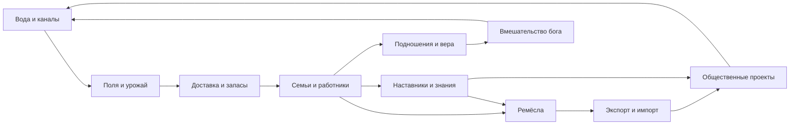

# Новый Вавилон: исследование игры и направления развития

Дата: 19 октября 2026. Проверен код коммита `825641d`, версия сохранений 11.

**Статус:** аудит существующей игры и предложения. Описанные ниже новые механики не реализованы. Числа для прототипов — гипотезы баланса, а не исторические сведения.

## 1. Какой должна стать игра

Предлагаемое направление: **история нескольких поколений города, который учится жить с рекой, создаёт ремёсла и постепенно делает своего бога известным за пределами долины.**

Главное переживание: «Я помню эту семью, этого лекаря и первый канал. Теперь их потомки живут в городе, который мы вместе вырастили».

Уже сложились две сильные стороны: материальный город, где жители действительно выполняют работу, и эмоциональная связь людей с богом. Их стоит связать водой, общественными решениями и памятью поколений.

Первоначальный текст предлагал империю, армии, богов-соперников и религиозную экспансию. Позже появился более конкретный ориентир — Banished, семьи, хозяйство и наблюдение за жизнью. Я бы сохранил большой мифологический горизонт, а ближайшую игру строил вокруг одного города. Влияние на соседей сначала показывать через торговлю, паломников и истории о чудесах. Армии и управление несколькими городами отложить.

### Предлагаемые связи систем

Каждая стрелка должна означать видимое действие или понятное ограничение. Одного численного бонуса недостаточно.

## 2. Что действительно есть сейчас

Основание этого раздела — исходники, а не только README: часть описаний и первоначальный GAME_SPEC уже отстают от реализации.

### Полная карта систем

| Система | Реализовано | Основное ограничение |
|---|---|---|
| Мир | Карта 40 × 32, извилистая река, четыре генерируемых озера, плодородная полоса, месторождения | Почти постоянная география; нет управляемой воды и состояния почвы |
| Производство | Добыча еды, глины, тростника, дерева, камня, шкур; настоящие рейсы работников | Почти нет переработки; работа привязана к бесконечным точкам |
| Строительство | Материалы в резерве, носильщики, строители, стадии, приоритеты, отмена, снос | Много ручного обслуживания; улучшения преимущественно численные |
| Дороги | Автоматическое появление, три уровня, физические работы, ускорение движения | Улучшение маршрутом описано в планах, но текущая кнопка заказывает отдельный участок |
| Переправа | Строящийся и улучшаемый мост соединяет сети берегов | Единственный способ освоить другой берег; нет лодок и парома |
| Торговля | Караваны, рынок, серебро, покупки и продажи с физической доставкой | Нет торговых специализаций, постоянных договоров и речных перевозок |
| Склад | Все материалы, ограничения хранения, запасы на земле без амбара | Основной запас общий для города, а не отдельный физический инвентарь каждого склада |
| Семьи | Постоянные личности, пары, дети, переселение, поколения и старость | Нужны более понятный прогноз работников и связь семейной истории с хозяйством |
| Дом | Жильцы, родители, дети, кровати, домашняя еда, доставки, вечерние ужины, свет | Много нагрузки на индивидуальные походы за едой; мало инструментов решения проблем снабжения |
| Состояние человека | Голод, здоровье, настроение, вера; влияние на труд | Основной системный источник потери здоровья — недоедание; у лекаря пока узкая роль |
| Профессии | Авто, строитель, носильщик, производство, лекарь; вдохновение и призвание | «Производство» объединяет очень разные занятия; вдохновение может превращаться в повторные клики |
| Обучение | Лекарь идёт в храм, учится, получает квалификацию | Единственная сложная специальность; храм временно служит универсальным учебным местом |
| Мастерство | У лекаря пять уровней, ежегодный рост при наличии практики | Любой положительной практики достаточно для следующего годового повышения |
| Религия | Личная вера, молитвы, храмовая работа, шесть направлений бога, титулы и память имён | Рост доменов в основном считает применения; вера и престиж даже проходят как рабочий груз |
| Чудеса | 12 способностей: погода, запасы, урожай, ремесло, движение, настроение, прирост людей, престиж | Есть дублирующие результаты и обходы хозяйственных ограничений |
| Смерть | Старость, голод, малые семейные обряды и большая процессия с факелами и шакалами | Обряд с шакалами — авторская условность; не следует выдавать его за обычную практику Шумера |
| Живая среда | Погода, растительность, дневное освещение, дети, животные, детали архитектуры | Животные и растительность слабо связаны с состоянием хозяйства |
| История | Новости, события, достижения, победа с зиккуратом, 30 жителями и десятым годом | События часто календарные; после первой победы не хватает новых задач |
| Техника | Сохранение маршрутов и грузов, миграции, кеши земли/зданий/путей, тесты | Большие новые системы потребуют контроля CPU, графики и совместимости |

### Все 15 зданий: решение по каждому

| Сейчас | Решение | Почему и во что развивать |
|---|---|---|
| Дом | Сохранить и углубить | Двор, тень, семейный запас, родовая память. Улучшение должно менять быт, а не только высоту и кровати |
| Ячменное поле | Существенно переработать | Посев, полив, рост, жатва и обмолот вместо непрерывной выдачи еды |
| Глиняный карьер | Сохранить, переосмыслить | Глиняная выработка на берегу; позднее часть глины даёт расчистка каналов. Не магическая жила руды |
| Тростниковый двор | Сделать опорой ранней игры | Возобновляемое болотное сырьё: крыши, циновки, корзины, лодки. Сохранение болот становится решением |
| Святилище | Сохранить, поменять хозяйственный смысл | Принимать реальные подношения, служить местом общины и временного обучения; не «добывать мешки веры» |
| Финиковый сад | Сохранить, дать время и место | Посадка на подходящей орошаемой земле, созревание, урожай и тень. Ограничивать условиями, а не вечной единственной точкой |
| Амбар и склад | Сохранить все виды хранения | Добавить местные запасы и распределение между кварталами; не заводить отдельное здание на каждый материал |
| Великий зиккурат | Сделать большим общественным проектом | Несколько строительных очередей, снабжение, праздник посвящения, новая глава игры |
| Мост | Сохранить как крупное решение | Ранняя лодочная переправа даёт более дешёвый, но ограниченный вариант освоения берега |
| Рыбацкая хижина | Укрепить значение | Страховка между урожаями; река и болота должны давать различные возможности |
| Охотничий домик | Сохранить как дополнение | Птицы болот и степная дичь; не основной бесконечный мясной завод. Не добавлять жёсткое истощение без альтернативной еды |
| Лесорубная хижина | Изменить роль | Скудная местная древесина, уход за деревьями, дорогая вырубка сада. Большие строительные лесоматериалы выгоднее ввозить |
| Каменоломня | Убрать из ядра новой южной карты | Камень получать торговлей; карьер оставить для будущих иных регионов. Уже построенные карьеры и запасы в старых городах не удалять |
| Дом лекаря | Сохранить и связать с городом | Снабжение, безопасная вода, умеренная нагрузка, помощь ученика, преемственность. Старость не лечится до бессмертия |
| Рынок | Сохранить, дополнить пристанью | Караван — небольшая партия дорогого товара; лодка — крупная партия тяжёлого груза. Разные транспортные роли |

### Что проверено дополнительно

- В текущем состоянии прошли **203 автоматических теста**. Это свидетельство технической проверяемости, а не доказательство интересного баланса.
- Отдельный прогон: пять игровых лет без строительства, чудес и торговли, решения событий отклонялись через штатную функцию. К началу шестого года: **14 жителей, 0 смертей, 200 еды в общем запасе, 220 еды вместе с домашней, около 269 веры, 53,52 престижа; средние здоровье и настроение — 100**. Это один фиксированный старт, не все сценарии. Самодостаточный старт полезен для спокойного знакомства; одновременно видно, что вера и благополучие быстро достигают избытка без развития.
- Проверка «Новой жизни»: при 12 жителях и 16 кроватях чудо подняло население до 16, а здоровье выбранного больного осталось 40. Сейчас это прирост людей, не лечение.
- В `demography.js` проверка запаса для рождения использует общегородской `totalFood`, а не запас конкретного дома. Это расходится с формулировкой «семье нужна еда на два сезона». Нужно выбрать и явно показать правило.
- Обычный дождь из визуальной системы погоды не равен эффекту чуда: множитель урожая в `workforce.js` смотрит на игровые `rain`/`drought`. Видимый ливень и хозяйственная обеспеченность водой сейчас могут различаться.

Ключевые исходники: [здания и чудеса](../definitions.js), [правила](../engine.js), [труд и доставка](../workforce.js), [семьи](../demography.js), [домашнее хозяйство](../households.js), [самочувствие](../wellbeing.js), [обучение](../education.js), [торговля](../trading.js), [божество](../divinity.js), [мир](../world.js), [погода](../environment.js).

## 3. Какую Месопотамию выбираем

Предлагаю художественный город южного Междуречья с основным ориентиром на **конец III тысячелетия до н. э.** Позднейшие свидетельства можно использовать как вдохновение, обозначая перенос, а не смешивая всё в одну «древность».

Название «Новый Вавилон» можно сохранить как авторское название. Оно не обязывает сейчас строить Вавилон Навуходоносора с узнаваемыми синими воротами. Существующее название города «Эриду» требует аккуратности: у исторического Эриду есть собственная религиозная идентичность. Варианты — явно художественная версия либо вымышленный город; в историческом сценарии меняются эпитеты известного бога. Связь Энки с Эриду описана в [академическом справочнике ORACC](https://oracc.museum.upenn.edu/amgg/listofdeities/enki/).

### Исторические опоры и границы вывода

| Опора | Проверяемое основание | Следствие для игры — уже моя рекомендация |
|---|---|---|
| Земля и вода | Исследования Лагаша описывают сочетание аллювиальных полей, болот, рыбы, птиц, тростника и лодочного сообщения. Это конкретный региональный пример, не схема каждого шумерского города. [Penn Museum](https://www.penn.museum/sites/expedition/back-to-lagash/) | Сделать влажные угодья ценным соседством, а не рисовать всю карту пустыней |
| Земледелие — последовательная работа | «Наставления земледельца» описывают осмотр каналов, подготовку инструментов, посев, полив, жатву и обмолот. [ETCSL, Oxford](https://etcsl.orinst.ox.ac.uk/section5/tr563.htm) | Сезонные пики труда и осмысленная подготовка к урожаю |
| Засоление | Исследовательская модель рассматривает засоление, залежь и промывку как связанные факторы устойчивости земледелия. Модель не доказывает единственную причину гибели Шумера. [UCL](https://discovery.ucl.ac.uk/id/eprint/1412087/) | Медленная проблема почвы с понятными средствами восстановления, не внезапный штраф |
| Дефицит сырья | Южному Междуречью недоставало прежде всего металлов, камня и строительной древесины; обмен был существенен. [The Met, обзор коллекции](https://resources.metmuseum.org/resources/metpublications/pdf/Ancient_Near_Eastern_Art_The_Metropolitan_Museum_of_Art_Bulletin_v_41_no_4_Spring_1984.pdf) | Развивать экспорт, а не обеспечивать город всем сырьём в радиусе трёх клеток |
| Письменное снабжение | Табличка из Уммы около 2028 года до н. э. фиксирует выдачи пива, хлеба, масла и лука посланникам. [The Met](https://www.metmuseum.org/art/collection/search/327069) | Писцы, пайки и обязательства имеют хороший материальный образ |
| Городское общение | В Лагаше найдено общественное место питания примерно 2700 года до н. э. с печью, скамьями и сосудами. [Penn Today](https://penntoday.upenn.edu/news/lagash-southern-iraq-site-unearthing-archaeological-passing-time) | Общая кухня/место встреч уместнее абстрактной площади, которая просто даёт процент счастья |
| Серебро и ремесло | Серебро учитывали по весу; ткани были важны для обмена. [Penn Museum](https://www.penn.museum/sites/expedition/mesopotamian-city-life/) | Оставить серебро, заменить монетную образность весами; шерсть и ткани — сильная экспортная цепочка |
| Обучение | Богатые свидетельства эдуббы относятся к старовавилонскому времени; обучение могло идти в небольших частных домах. [ORACC](https://oracc.museum.upenn.edu/obmc/oldbabylonianschool/index.html) | Не объявлять храм исторически точным университетом всех профессий. Развивать наставничество и мастерские |
| Врачевание | Ниневийский медицинский корпус сочетает назначения, заклинания и ритуальные процедуры, но относится к существенно более позднему времени. [British Museum](https://www.britishmuseum.org/research/projects/reconstructing-2500-year-old-medical-encyclopaedia) | Лекарь в игре — исторически мотивированный художественный образ; точные проценты лечения и единый храмовый курс — условность |
| Погребение | В Уре известны погребения под полами домов, особенно старовавилонского времени. [Penn Museum](https://www.penn.museum/sites/expedition/city-of-the-moon/) | Семейная память исторически ближе, чем объявление отдачи всех умерших шакалам обычной нормой |
| Зиккурат | Ур-Намму строил зиккураты в нескольких южных городах около 2100 года до н. э. [The Met](https://www.metmuseum.org/it/essays/ur-the-ziggurat) | Крупный храмовый проект хорошо подходит выбранному ориентиру; не делать его случайной универсальной ранней постройкой |

Реальная история не требует превращать игру в тяжёлую реконструкцию. Запрет детского труда до 16 лет, ускоренные поколения, единая еда, универсальный амбар и настоящее вмешательство бога можно сохранить как осознанные правила нашей игры.

## 4. Что лишнее или требует изменения

### 4.1. Слишком много названий чудес при небольшом числе разных решений

Сейчас «Благословение» и «Новая жизнь» оба добавляют людей и настроение; «Откровение» и «Мудрость звёзд» преимущественно дают валюты; несколько способностей повышают настроение. Двенадцать кнопок не обязательно дают двенадцать интересных ситуаций.

Предлагаю шесть основных действий, а позднее — варианты внутри направлений:

| Действие | Особое решение |
|---|---|
| Вернуть воду | Спасти выбранную оросительную ветвь, не гарантировать бесконечное плодородие всей карты |
| Спасти урожай | Помочь уже подготовленному полю; не заменить посев и рабочих |
| Услышать больного | Стабилизировать конкретного тяжёлого пациента, пока идёт лекарь |
| Вдохновить | Открыть призвание или помочь важному обучению |
| Дать знамение | Раньше получить сведения об угрозе, состоянии воды или дороге каравана |
| Укрепить общину | Помочь пережить утрату, провести праздник или общественную работу |

«Изобилие» можно оставить редкой дорогой помощью в бедствии. Прямое создание ресурсов и людей не должно становиться обычным способом обходить город. Новые взрослые — лучше прибывшие люди с историей и затратами, а не безымянная прибавка к счётчику. Чудо лечения должно действительно взаимодействовать с больным.

### 4.2. Престиж без работы

Он требуется для зиккурата, но не расходуется на обычные решения. Добавление ещё одного производителя престижа усилит проблему.

Я бы трактовал расходуемый престиж как **готовность города поддержать крупное общее дело**. Траты: пир посвящения, памятный двор, приглашение мастера, снаряжение посольства, дополнительный общественный подряд. У каждого — физическое снабжение и работа, а не мгновенная кнопка.

Достижения и историческая слава сохраняются после траты. Не нужны ещё три параллельные шкалы «влияние/легитимность/почёт»: сначала дать назначение существующей.

### 4.3. Вера как мешок товара и награда за нажатия

Храмовые выходы `faith` и `prestige` сейчас кладутся в `cargo`, а потом доставляются на склад. Для прототипа это единая модель производства, но смысл слабый.

Лучше нести в храм еду, ткань или сосуд; при завершении настоящего обряда возникает вера. Не нужно создавать мешок «0,85 веры» в руках носильщика.

Титул бога стоит связывать с результатом: сколько семей пережило нехватку воды, сколько заболевших спасено, насколько долго работал канал. Применения чудес и безрезультатные повторы не должны сами по себе создавать великое имя. Сейчас любое успешное вдохновение усиливает направление ремесла, включая лекаря; для сложных профессий нужна более подходящая связь с жизнью/знанием.

### 4.4. Микроуправление, которое не создаёт выбора

Улучшение десятков дорожных рёбер и многократное нажатие «вдохновить» дают занятость, но быстро утомляют. Нужны заказ маршрута целиком, минимум запасов для торговли, резерв работников на жатву и выбор кандидатов в ученики.

Сложное вдохновение сохраняем. Но повторная попытка должна рассказывать что-то о человеке: склонность, накопленный интерес, совет наставника. Редкого специалиста нельзя делать обязательным условием выживания, зависящим только от серии неудачных бросков.

### 4.5. Добавления, которые я бы пока отложил

- Каменные замки, европейские лесопилки и зимнее отопление как основа выживания.
- Хаммурапи, позднеассирийская медицина и нововавилонские синие ворота в одной якобы точной эпохе без пояснения.
- Железную промышленность, полноценные армии, тактические сражения и богов с большим ИИ.
- Десятки отдельных видов еды и амбар для каждого материала.
- Систему болезней из двадцати диагнозов, сложные налоги и обязательную долговую кабалу.
- Постоянные случайные пожары, нашествия и эпидемии до появления понятных средств предупреждения.
- Новую огромную карту до появления осмысленной географии на нынешней.

Пустынную процессию с факелами не предлагаю молча удалять: это выбранная автором сцена. Можно оставить её особым бедственным обрядом художественного мира. Обычная смерть и память семьи заслуживают более спокойного, отдельного развития. Ни один вариант не нужно выдавать за универсальный исторический обычай.

## 5. Главная механика: город строит свой ландшафт

### «Река → канал → поле → урожай → город»

Река должна создавать возможности и ограничения. Игрок проводит канал; жители выкапывают его, выносят глину, укрепляют берега. По подключённой ветви приходит вода. Прежде сухая земля меняет цвет и становится пригодной для посевов и сада.

**Выбор:** провести короткий канал к небольшому числу полей или длинный — с большим будущим урожаем, но дорогой расчисткой и обслуживанием.

Одна ветвь может питать поля, сад и общественный двор. Болото нельзя просто объявить бесполезной зоной: там рыба, птицы, тростник, лодочные пути. Осушение увеличивает пашню, но отнимает часть других возможностей.

**Состояния, которые игрок должен понимать:** подключено к реке; воды достаточно/мало; канал заилен; опасный высокий уровень. Первым прототипом достаточно связности и двух-трёх состояний, без настоящей гидродинамики.

**Пример:** перед посевом носильщики заканчивают дом на другом берегу. Канал заилился. Игрок переносит общественный приоритет на расчистку и откладывает дом. Вода доходит до поля, земля темнеет, земледельцы начинают работу. Бог получает имя за спасённый урожай, а не за количество нажатий «дождь».

**Дальше:** сезонные колебания уровня, берегоукрепление, отдельные редкие повреждения. Засоление вводить только после появления дренажа/отдыха поля и ясной причины в интерфейсе. Предупреждать за несколько циклов, а не внезапно обнулять урожай.

**Не делать:** тяжёлую жидкость по каждой клетке каждый кадр; непрерывный обвал всех каналов; ситуацию, в которой первая ошибка необратимо убивает город.

## 6. Вторая механика: год, к которому надо готовиться

Сейчас поле отдаёт еду регулярными рейсами во всех сезонах, хотя множители различаются. Следующий уровень — накопление будущего урожая.

1. Подготовка и посев: нужны люди, вода и семенной резерв.
2. Рост: требуется обслуживание, но часть работников можно временно отправить на стройку.
3. Жатва: короткое окно с большим спросом на людей и переноску.
4. Обмолот и помещение в амбар: выращенное ещё не равно доставленному съедобному запасу.
5. Между урожаями город живёт запасом, рыбой и прочими источниками.

Еда остаётся одним ресурсом. Семенной резерв — помеченная защищённая доля этой же еды, не ещё одна обязательная валюта. Его разрешается съесть в кризис, но с явным предупреждением о будущем посеве.

**Главный выбор:** успеть закончить зиккурат к празднику или вернуть рабочих на жатву. Приоритет «сначала урожай» назначается одной городской политикой; грузы в руках люди заканчивают безопасно.

**Нужная информация:** «до жатвы столько-то времени», «нужно 6 работников, доступно 4», «прогноз — 80 еды, ещё 35 не хватит до следующего урожая». Не заставлять игрока вручную складывать производительность каждой семьи.

Не переносить немедленно все поля на один жёсткий урожай: сначала проверить прототип на одной отрасли. На миграции старого города сохранить уже заработанную еду и дать переходный запас/первый готовый урожай.

## 7. Третья механика: кварталы, общие пайки и настоящая доставка

Уже есть сильная идея: общий запас не равен ужину семьи. Но её развитие должно давать игроку инструменты, а не больше случайно голодных людей.

**Предлагаемые роли:**

- Амбар — хранение всех материалов, с местным инвентарём.
- Раздаточный двор — один организованный маршрут продуктов на квартал.
- Общая кухня/место питания — снабжение дальних работников и помощь в кризис; не замена обычных семейных вечеров.
- Дом — собственный запас и семейная жизнь, как сейчас.

Между складами можно установить правила «держать минимум», «не продавать», «отправлять излишек в этот квартал». При этом наверху остаётся общий итог, а карточка показывает место и доступность.

**Сильная ситуация:** еды в городе много, но новый берег плохо снабжается. Игрок открывает раздаточный двор и выделяет перевозчика; по мосту идёт осёл с корзинами. На новом берегу зажигаются окна семей, которые раньше поздно получали еду.

Осёл/тележка должны перевозить конкретные партии с владельцем и назначением. Не превращать их в ещё сотню индивидуальных существ с полным человеческим распорядком.

**Принцип:** если жители голодают из-за логистики, игрок должен за несколько секунд увидеть причину: нет поставщика, слишком далеко, груз ждёт перехода, резерв занят продажей. Общий счётчик «еда 200» не должен скрывать проблему.

## 8. Четвёртая механика: мастер может умереть, знание — остаться

Начало уже есть в системе лекаря. Я бы развивал его через преемственность.

Опытный лекарь берёт ученика. Первое время приём идёт медленнее: часть рабочего дня потрачена на объяснения. Затем ученик помогает. Если наставник состарится, квалификация не исчезает из города вместе с ним.

Писец записывает опыт на глиняной табличке. Архив сохраняет часть знаний и ускоряет обучение следующего поколения. Табличка здесь — документ/достижение учреждения, а не новый массовый ресурс, который надо носить тысячами.

**Выбор:** лечить всех максимально быстро прямо сейчас или выделить время будущему специалисту. Если единственный мастер тяжело болен, наличие ученика становится настоящей историей.

Будущие сложные занятия: лекарь, писец, мастер общественных водных работ. Квалифицированные ремесленники получают опыт в своей работе. Обычный переносчик не обязан проходить храмовый курс.

Текущий ежегодный уровень — понятный первый вариант, но положить один камешек практики в год слишком легко. Более сильный вариант: годовая ступень плюс достаточная осмысленная практика и обучение. Опыт за завершённые случаи/работы, а не за намеренное создание травм или повторную перекладку одного груза.

В карточке семьи появляется важная связь: «Дочь учится у того, кто спас её отца». Это формируется из уже произошедших событий; вручную написанного романа для каждого жителя не требуется.

## 9. Пятая механика: ремесло кормит внешнюю торговлю

Первая полноценная цепочка:

**Пастбище → овцы → шерсть → ткачество → ткань → экспорт → строительная древесина/камень.**

Она добавляет несколько связанных решений вместо нескольких одинаковых добывающих зданий. Пастбищу нужна площадь; большой выпуск ткани отвлекает людей от других работ; экспорт оплачивает то, чего нет в долине.

Ткань имеет и местное применение: одежда, тенты, снабжение общественных мест и подношения. Качество жизни растёт постепенно; отсутствие дорогой одежды не должно мгновенно убивать бедные семьи.

Вторая короткая цепочка: **глина → гончар → сосуды**. Сосуды нужны рынку, лекарю, общему питанию и обрядам. Не добавлять одновременно отдельные категории «миска», «кувшин», «банка», «амфора».

**Пристань:** лодка привозит тяжёлую партию камня или леса, жители разгружают её на береговую площадку, затем везут на склад. Караван остаётся полезен: не каждому городу доступна хорошая пристань, не вся торговля идёт по воде.

**Договор:** соседний город просит ткань к празднику и обещает древесину. Игрок резервирует товар и транспорт заранее. Невыполнение уменьшает доверие, но не стирает город. Первые договоры без бесконечных долгов и без необъяснимой потери уже оплаченных грузов.

Серебро сохраняется как расчётная величина. Лучше весы и слитки, чем обязательная монетная казна. Исторический обмен не следует сводить к примитивному бартеру; игра может держать понятные цены, покупки и продажи.

## 10. Шестая механика: бог существует в памяти людей

Вера должна ощущаться отношением города, а не только синей маной.

Семьи несут подношения. В храме готовят обряд. На празднике собирается квартал. После помощи возникают небольшой предмет, табличка или деталь святилища: память об определённом событии.

**Пример:** во время нехватки воды спасён сад, который кормил несколько семей. Они называют бога «Тем, кто вернул воду». В храмовом дворе появляется посвящение с годом и именами. Проходящий купец увозит историю в соседний город.

Дальнее влияние можно выразить через приглашённых мастеров, паломников, торговые условия, ответные дары и маленькие святилища за пределами карты. Это сохраняет первоначальное «бог растёт вместе с городом» без ранней военной игры.

Пантеон при этом не исчезает: игрок — покровитель своего города в политеистическом мире, а не единственный бог, который заменил все местные культы. Реальные формы культовой жизни различались; наша система влияния — художественная модель.

Скорбь не обязана превращать каждую естественную смерть в обвинение. Здесь уже сделано полезное различие между старостью и бедствием. К нему можно добавить благодарность за прожитую жизнь и память семей.

Не допускать безвыходной петли «голод → плохая работа → ещё меньше еды → нет веры → невозможно помочь». Нужны доступные общественные меры: временная общая раздача существующего запаса, экстренное перераспределение работников, один кризисный призыв. Помощь имеет цену и пределы, но даёт шанс восстановиться.

## 11. Какие новые здания действительно нужны

Не все сразу. Новая постройка должна менять решения или видимую повседневность.

| Приоритет | Здание/объект | Что добавляет |
|---|---|---|
| Первый | Канал и двор водных работ | Управляемая пригодность земли, расчистка и общественные приоритеты |
| Первый | Ток / площадка обмолота | Видимая стадия превращения урожая в запас; можно как часть хозяйства поля |
| Первый | Раздаточный двор / общая кухня | Понятное решение проблем снабжения и общественная жизнь |
| Следующий | Овчарня с загоном | Хозяйственное стадо, шерсть, потребность в земле |
| Следующий | Ткацкая мастерская | Первая экспортная специализация, одежда и тенты |
| Следующий | Гончарная мастерская | Утварь для нескольких существующих систем |
| Следующий | Пристань | Грузовая речная логистика и крупные поставки |
| Следующий | Кирпичный двор / печь | Сырец как стадия стройки; обожжённый кирпич для важных сооружений |
| Позже | Дом писца / эдубба и архив | Наставники, документы, устойчивость знаний, подготовка договоров |
| Позже | Пивоварня и место встреч | Часть еды на напиток для обрядов и встреч; это ремесленный товар, не второй основной счётчик еды |
| Позже | Дом мастера / двор общественного проекта | Заказы за престиж, приглашённые специалисты, памятные работы |

Для ранних каналов не нужен отдельный специалист высшей квалификации: иначе город не сможет развить земледелие до обучения. Опытный мастер повышает качество крупных работ, но не запрещает копать первую канаву.

## 12. Как ограничить число ресурсов

Сохранить обязательные решения: **ЕДА — одна**, склад хранит всё.

Ближайшие добавления: шерсть, ткань, керамика. Обожжённый кирпич — следующим отдельным товаром, только если у него несколько реальных применений. Медь — позже, когда инструменты и торговля создадут для неё спрос.

Сырец можно формовать из доставленной глины в рамках строительного заказа. Таблички — индивидуальные документы. Качество воды — характеристика доступа. Увлажнение и солёность — состояния поля. Не превращать всё это в новые цифры верхней панели.

Не надо одновременно вводить муку, хлеб, рыбу, мясо, финики, пиво, масло, лук, воду, солому и лекарства как одиннадцать обязательных складских цепочек. Набор реальных продуктов может быть виден в иллюстрациях, событиях и качестве пайка при едином количестве еды.

## 13. Красота должна объяснять хозяйство

- У работающего канала темнеет земля; на краю появляются тростник и птицы.
- Поле проходит видимые стадии, на жатве собирается несколько людей, затем появляются снопы и работа на току.
- Во дворе лежат кирпичи на сушке; рядом видны заготовки, а не случайные декоративные ящики.
- В ткацкой висят ткани; овцы существуют в загоне и связаны с выпуском шерсти.
- У причала виден разгружаемый корабль, затем именно эти партии едут на склад.
- Дети играют маленькими глиняными лодками и фигурками; взрослые отдыхают в тени и иногда играют в настольную игру. Подобные игрушки и игры известны по находкам. [Penn Museum](https://www.penn.museum/sites/expedition/mesopotamian-city-life/)
- Во дворах больше навесов, циновок, сосудов и разных занятий, а не обязательно больше этажей.
- Подсветка появляется по запросу: вода, снабжение, здоровье. Избегать постоянно светящейся сетки на всей карте.

Звук важен не меньше частиц: тростник на ветру, вода, ткацкий станок, рыночные голоса, вечерняя музыка. В спокойном городе должно быть приятно просто сидеть и смотреть.

## 14. События, которые вырастают из систем

| Ситуация | Выбор и последствия |
|---|---|
| Заилился канал перед посевом | Снять людей со стройки или рисковать частью будущего урожая |
| Последний лекарь стареет, ученика нет | Сейчас сократить приём ради обучения или сохранить производительность и зависимость от одного человека |
| Пришла большая партия леса одновременно с жатвой | Разгрузить корабль вовремя или оставить людей на полях; помогает заранее назначенный резерв перевозчиков |
| Молодая семья хочет отдельный двор | Отложить монумент и построить дом или потерять время рождения следующего поколения |
| Купец предлагает высокий доход за еду | Продать излишек либо сохранить резерв; подсказка показывает запас до следующего урожая |
| На поле постепенно белеет почва | Дать участку отдых и изменить водоотвод или выжать ещё один урожай |
| Квартал пережил трудный год | Провести общий пир за запасы и престиж; визуальное событие и восстановление связей |
| Соседи слышали о спасении урожая | Принять гостей и подарки, пригласить мастера либо отложить обязательства |

Часть историй можно порождать сочетанием событий: смерть наставника + работающий ученик; нехватка припасов + завершённый договор; рождение + старый семейный дом. Это дешевле и разнообразнее, чем бесконечные одинаковые модальные «выбери А/Б».

## 15. Как должна выглядеть одна интересная сессия

**Начало:** небольшой самостоятельный город, знакомство с семьями и запасами. Нет обязанности немедленно исправить десять аварий.

**Первое расширение:** первый канал и новое поле. Игрок понимает связь воды, площади и рабочих рук.

**Первый риск:** часть работников занята домом, а приближается жатва. Решение меняет запас на следующий цикл.

**Первая личная история:** вдохновлённый лекарь заканчивает обучение, помогает конкретному жителю; затем берёт ученика.

**Средняя игра:** шерсть и ткань оплачивают импорт, пристань меняет городскую географию, новый квартал требует снабжения.

**Большое дело:** город собирает средства, материалы и общественную поддержку для зиккурата. На посвящение приезжают гости. Старые семьи узнаваемы в толпе.

**Продолжение:** новые поколения, освоение неудобного берега, особая торговая роль, известность бога, крупные водные работы. Зиккурат открывает новый масштаб задач.

Текущие «30 жителей + десятый год» подходят как завершение первой главы. Для основной игры лучше несколько путей процветания, а не единственная лестница храмов.

## 16. Порядок разработки

### Этап 0. Сделать нынешние причины видимыми

Обзор еды по семьям и доставки; понятный прогноз запаса; объяснение работы лекаря и воды; выбор согласованного правила рождения; название и действие чудес без противоречий. Заказ улучшения дороги маршрутом. Новые системы не нужны, чтобы убрать эти трения.

### Этап 1. Небольшой водный прототип

Одна ветвь канала, одна бригада расчистки, несколько полей и визуальная смена пригодности земли. Работает через нынешнее строительство и переноску. Пока без разрушения домов разливом, сложного засоления и нового специалиста как обязательного барьера.

Проверка: канал меняет хотя бы одно решение о том, где и когда строить поле; его польза видна без открытия пяти карточек.

### Этап 2. Урожай и сезонный труд

Стадии поля, общий семенной резерв, жатва и обмолот, временный городской приоритет. Рыболовство страхует переходный период. Первый старый урожай и сохранённые запасы не исчезают при миграции.

Проверка: игрок заранее готовится к жатве, а не узнаёт о голоде после падения чисел.

### Этап 3. Снабжение кварталов

Местные запасы, раздаточный двор, правила минимумов, партии на перевозке. Это более серьёзная переделка учёта, чем новое декоративное здание; делать отдельно.

Проверка: на обоих берегах есть объяснимый путь еды от поставки до конкретного семейного ужина. Никакой покупки или продажи дважды и никакого телепорта между изолированными складами.

### Этап 4. Одна экспортная специализация

Овцы → шерсть → ткань, затем пристань и договор на недостающее сырьё. Гончарство добавлять после проверки первой цепочки, а не вместе с десятком новых ресурсов.

Проверка: торговля нужна для развития города и создаёт подготовку, а не служит кнопкой продажи переполненного склада.

### Этап 5. Наследие и культ

Наставники, семейные истории, архив, общественные дела за престиж, реальные подношения и титулы за последствия. Приглашения и паломники как первый шаг внешнего влияния.

Проверка: игрок может вспомнить историю конкретной семьи и объяснить, почему его бог носит это имя.

### После этого

Засоление и продвинутый дренаж; региональные варианты карт; дипломатия; более сложная медицина; большие межгородские отношения. Война — отдельное решение о жанре, а не ещё одна строка в списке построек.

## 17. Ограничения реализации и проверки

- Одна новая большая причинная связь за этап. Сначала рабочая вертикальная часть с доставкой и сохранением, потом новые варианты.
- Связность воды и каналов — граф и редкие пересчёты при изменениях/сезоне. Освещение и рябь — отдельная визуализация. Не пересчитывать всё для каждого жителя в каждом кадре.
- Канал не должен случайно уничтожить рабочую дорогу или маршрут груза. Нужны явные пересечения, мостки и проверка строительства.
- Работы на поля и общественные объекты переключаются после завершения уже взятой доставки. Стабильные ID сохраняются.
- Новые локальные запасы требуют отдельной миграции общего ресурса; нельзя размножить общую цифру по каждому амбару.
- Цели воды/пищи/лечения должны быть прогнозируемыми. Игрок видит угрозу и имеет хотя бы один доступный ответ.
- Не усложнять 60-секундные сутки обязательными мелкими поручениями. Сначала проверить, хватает ли времени дороге и ужину при большой карте.
- Есть три разных темпа: день 60 секунд, сезон 45 секунд, год 180 секунд; возраст растёт на два года за год города. Это игровая абстракция. Будущие сезоны земледелия требуют её сознательной настройки, а не случайного копирования реалистичных сроков.
- Контроль производительности на 200 жителях при 4×: отдельно CPU симуляции, рендер/растеризация браузера, ночное освещение, очереди грузов и интерфейс. Старые результаты CPU не являются обещанием FPS новых каналов и лодок.
- Тесты сохранений: человек по пути в храм; недособранный урожай; глина из канала в руках; товар между лодкой и складом; семья на другом берегу; смерть перевозчика или наставника; отменённый проект.

### Что измерять в игровых проверках

| Вопрос | Наблюдаемый признак |
|---|---|
| Понятна ли причина проблемы? | Игрок находит нужную семью/канал/маршрут и объясняет нехватку без чтения кода |
| Есть ли осмысленное решение? | Между двумя вариантами есть цена во времени, людях, запасе или будущем развитии |
| Стало ли меньше лишних действий? | Путь улучшается одним заказом; квартал не требует двадцати отдельных назначений |
| Работает ли подготовка? | Запас, наставник и резерв труда реально помогают при наступившем риске |
| Сохраняется ли удовольствие наблюдать? | Есть спокойные периоды; город продолжает рассказывать о работе без непрерывных окон |
| Не душит ли случайность? | Неудачное вдохновение редкого специалиста не оставляет единственный путь спасения |
| Появляется ли своя история? | Игрок помнит семью, мастера или общественный проект и связывает их с состоянием города |

Это критерии будущего плейтеста. Исследование кода и исторических материалов не заменяет наблюдения за новыми игроками.

## 18. Предлагаемое ближайшее решение

**Следующий большой прототип — канал, который жители действительно строят, и поле, которое становится продуктивным благодаря проведённой воде.**

Параллельно — только необходимые инструменты понимания снабжения и удобное управление дорогами. Затем сезонная жатва, квартальная доставка и первая ремесленная торговая цепочка.

Эта последовательность использует уже сделанные семьи, труд, строительство, торговлю, лекаря и веру. У города появится причина быть именно городом Междуречья, а у игрока — история, которую хочется продолжать.
