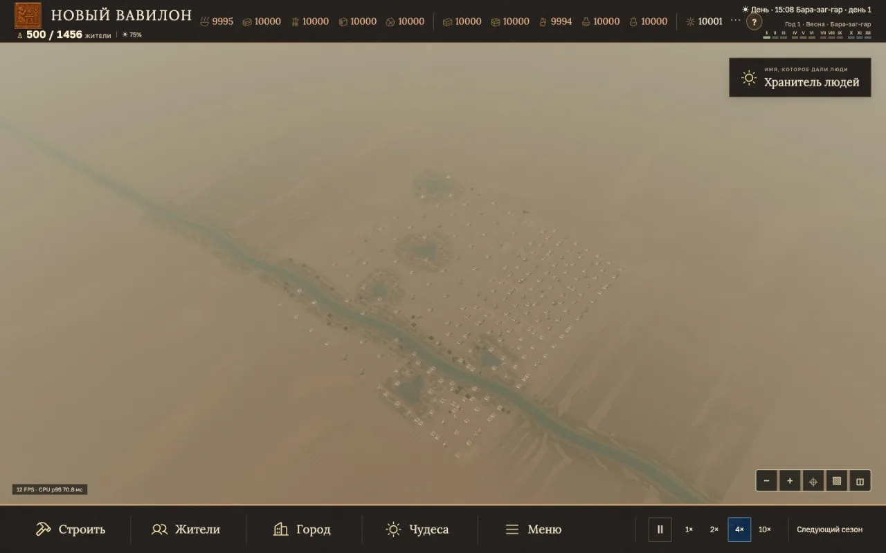
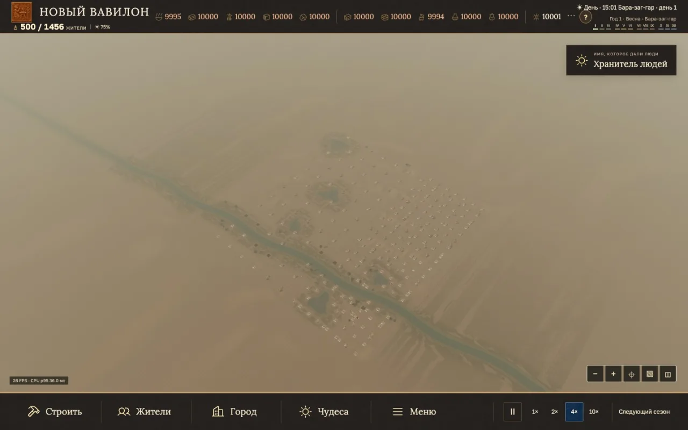

# Большой город на 4× · 500 жителей

Один файл сохранения, 500 жителей, 250 зданий, карта 64 × 64, зерно 137. Chrome WebGL на Apple M2, окно 1440 × 900, 3D-область 1440 × 750. Полный обзор, высокое качество, обычный HUD, тени и автосохранение. Измерение по интервалам кадров. Цель — не менее 30 FPS в двух последовательных прогонах.

[Скачать сохранение для повторения замера](benchmarks/city500-save-2026-11-13.json). Загрузите его через «Сохранения», включите полный обзор, высокое качество и 4×. После прогрева измерьте 30 секунд с обычным HUD.

## Замеры в игре

| Версия и метод | Средний FPS | p95 кадра | Автосохранения |
| --- | ---: | ---: | ---: |
| Публичная `b9941c0d`, прямой контроль 30 с | 14,12 | 100,0 мс | 10 |
| Публичная `b9941c0d`, профиль 30 с | 16,84 | 83,3 мс | 10 |
| Промежуточный кандидат, прямой контроль 30 с | 23,16 | 66,6 мс | 10 |
| Полный ландшафт, контроль 1 · 30 с | 31,58 | 50,0 мс | 10 |
| Полный ландшафт, контроль 2 · 30 с | 32,75 | 33,5 мс | 10 |

В двух полных прогонах FPS вырос в 2,24 и 2,32 раза относительно прямого контроля Pages. За интервал кандидат прошёл около 15 секунд внутренней симуляции на 4×, без паузы, диалогов и ошибок страницы. Автосохранение восстановилось побайтно. Самые долгие кадры заняли 467 и 400 мс. Есть отдельные рывки, несмотря на средние 30+ FPS. Ещё один промежуточный прогон исключён из сравнения: из-за ошибки загрузился упрощённый ландшафт.

## Узкие места и решения

- **Хозяйство.** Индексы маршрутов, работников и запасов ускоряют распределение задач. В 900 фиксированных шагах p95 CPU обеспеченного города снизился с 18,95 до 4,56 мс, при дефиците еды — с 34,76 до 5,54 мс. Финальные сохранения совпали по SHA-256 в каждом сценарии. Отдельные прогоны прошли границу сезона, дали 543 жителя и по шесть совпавших промежуточных сохранений с загрузкой.
- **Жители.** Пространственный поиск соседних людей дал те же координаты в 120 последовательных кадрах. Подготовка запасных 3D-моделей шла даже на перегруженных кадрах. После ограничения этой работы среднее время прогрева снизилось с 15,50 до 0,044 мс в отдельном профиле. Дальние позы семплируются напрямую, чтобы движок лишний раз их не обновлял.
- **Ландшафт.** Повторно используются зарегистрированные меши и отпечаток статической геометрии. Строительство и изменение троп по-прежнему обновляют нужные слои.
- **Тени.** В полном обзоре от 300 жителей карта теней обновляется через кадр. Движение камеры, смена состояния освещения и длительный кадр вызывают немедленное обновление. Ближние планы, фоторежим и церемонии используют обычное обновление. В разрешении 3D сохранены исходные настройки.
- **Отклонённые пробы.** Группировка геометрии зданий уменьшила число активных объектов, но почти не изменила число вызовов отрисовки и ухудшила FPS в парном замере. Уменьшение разрешения дало 19,69 → 21,90 FPS в короткой паре и исключено. Отключение всех теней и животных использовалось как диагностика.
- **Профиль до итогового замера.** В 30-секундной диагностике кандидат показал в среднем 30,84 мс в Babylon, из них 12,45 мс — оценка видимых мешей, 5,03 мс — обновление анимаций, 3,41 мс — проход теней. Эти числа измеряют время CPU отдельных участков.

## Задержки отдельных кадров

Оба контрольных прогона дали один длинный кадр около 14:00 игрового времени. В отдельном повторе симуляции в этот момент число видимых жителей выросло с 58 до 116: 58 человек одновременно вышли за водой. Топология построек и ландшафта при этом не менялась. Массовый выход и первичная подготовка 3D-моделей остаются кандидатами для проверки причин рывка.
