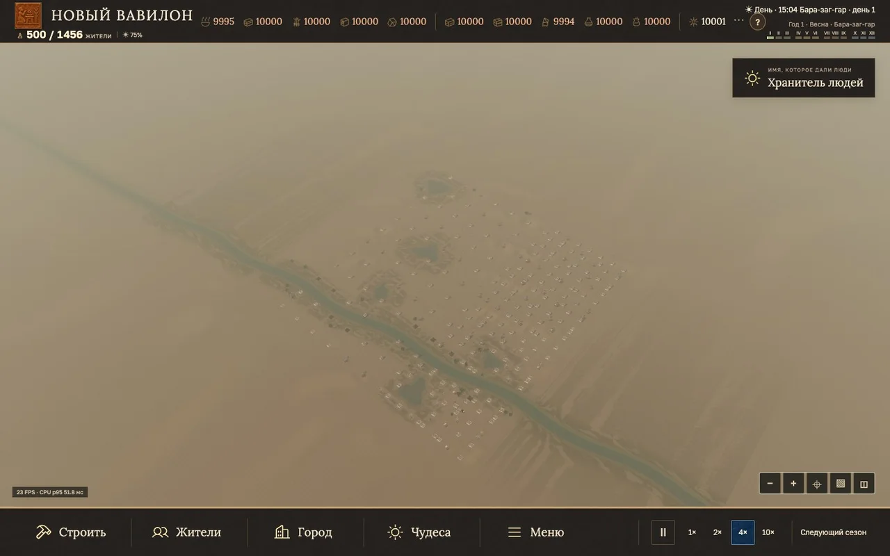

# Большой город на 4× · 16 ноября

[Тот же файл сохранения](benchmarks/city500-save-2026-11-13.json): 500 жителей, 250 зданий, карта 64 × 64, зерно 137. Для ручного повтора: загрузить сохранение, оставить высокий режим качества, включить полный обзор, 4×, обычный HUD и автосохранение. После прогрева измерять интервалы кадров в Chrome 30 секунд. Проверить, что симуляция идёт, автосохранения создаются, а загрузка восстанавливает последнее сохранение без изменений.

## Массовый выход за водой

Около 14:00 количество рейсов в контрольном городе за один шаг меняется с 2 до 58. Раньше для каждого нового адреса отдельно просматривался граф сухих проходов. Теперь один обратный проход от всех пригодных узлов берега даёт расстояния для всей карты. Выбор следующего шага использует прежний порядок соседей, поэтому сохраняется и путь при равной длине маршрутов. Перестройка графа при изменении берега, стен или паводка сбрасывает эти расстояния.

Изолированная проверка этой правки: одинаковый исходный код и одно сохранение, меняется только модуль воды. 600 шагов по 0,1 секунды, 31 одинаковый контрольный снимок по SHA-256 с побайтной загрузкой. Сам шаг с 56 новыми рейсами в контрольной паре: **20,67 → 5,41 мс CPU**. Это время шага симуляции; частота кадров измеряется отдельно.

Повтор шага: `node scripts/benchmark-water-burst.mjs`. [Предыдущий отчёт с профилем отрисовки](PERFORMANCE_CITY_500_2026-11-13.md).

## Полный обзор в браузере

Apple M2, Chrome WebGL/ANGLE Metal. Окно 1440 × 900, холст 1440 × 750, тени включены, высокое качество, полный обзор, 4×, обычный HUD. Каждый замер длится 30 секунд после прогрева. Оценка по интервалам кадров; окна наблюдения пересекают массовый выход за водой. Число жителей и зданий неизменно. Источник всех результатов в таблице — локальный стенд.

| Сборка | Средний FPS | p95 кадра | Самый длинный кадр | Сохранений |
| --- | ---: | ---: | ---: | ---: |
| Исходный коммит `7bbc12c8` | 25,63 | 50,1 мс | 483,3 мс | 9 |
| Первый кандидат с новыми сценами | 23,43 | 66,6 мс | 550,0 мс | 10 |
| Предварительная подготовка жителей | 26,72 | 50,1 мс | 116,7 мс | 10 |
| Итоговая сборка, прогон 1 | **27,32** | 50,0 мс | **116,7 мс** | 10 |
| Итоговая сборка, прогон 2 | **26,40** | 50,1 мс | **133,3 мс** | 10 |

Последнее сохранение в каждом прогоне восстановилось побайтно. Нет скрытия вкладки, паузы, диалогов и ошибок Chrome. При том же качестве самый длинный кадр стал короче примерно в 3,6–4,1 раза относительно сегодняшнего исходного замера. Средние 30 FPS в этих прогонах не достигнуты. Результаты публичного прогона от 13 ноября (33,20 FPS) относятся к другой сессии и отдельно сохранены в старом отчёте.

[Данные прямых замеров и побайтных проверок](benchmarks/2026-11-16-city500-frames.json).

## Что изменилось в отрисовке

- Рендерер понемногу готовит модели жителей из домов, которым скоро понадобится вода, и держит их вне активной сцены до выхода. Назначение рейсов, личности, грузы и время выхода определяет прежняя симуляция. Это сняло основной скачок при одновременном появлении людей.
- Расчёт углов рабочих площадок переиспользуется, пока размеры, вода и крупные постройки не изменились. Результат сверяется с исходным поиском.
- У статичных растительных групп переиспользуется проверка попадания в камеру. Для движущихся объектов, смены камеры и изменения границ действуют обычные проверки.

Диагностический профиль первого кандидата до пикового эпизода: в среднем 9,38 мс CPU на обработку видимых объектов Babylon, 4,28 мс CPU на обновление людей и животных, 2,64 мс CPU на ландшафт. Участки вложены в общий кадр. Следующая задача для устойчивых 30 FPS — сократить обработку неизменной геометрии домов и дворов, сохраняя выбор мышью, объекты и тени. Повторное уменьшение качества или разрешения в выпуск не включено.
