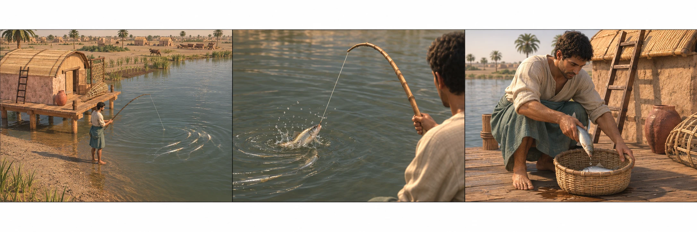
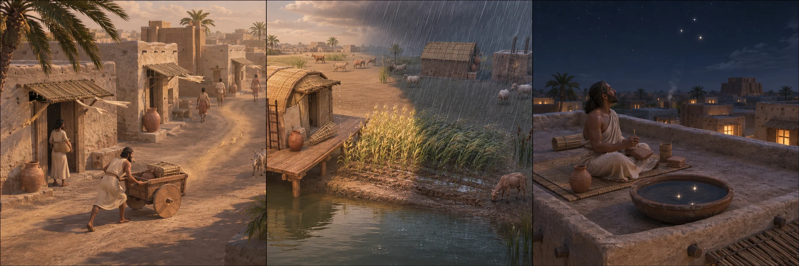

# От рыбацкого двора до храма

**Проект развития хозяйства и чудес · 21 ноября 2026 · предложение.**

**Статус первой очереди.** Сушка в рыбацком дворе, доставка через амбар семье и сцена «Богатого улова» реализованы. Остальные четыре цепочки и постановки других даров остаются предложениями. [Игровые кадры и приёмка первой очереди](../roadmap/reports/2026-11-21-fishery.md)

Первую цепочку теперь можно проследить от удочки до семейного стола. Следующей предлагается молочная кладовая. У неё уже есть поставщик, рабочее место и производство сыра.

## Пять производственных цепочек

| Очередь | Путь товара | Какое решение получает игрок | Что видно с улицы |
| --- | --- | --- | --- |
| 1. Рыбацкий двор | Улов → семье сразу **или** на тростниковую раму → сухой паёк в амбар | Оставить весь улов для сегодняшней раздачи или отложить часть до нехватки еды. Пайки можно выдать вручную, а при исчерпании обычной еды амбар открывает запас сам. Дождь задерживает сушку. | Рыбак выкладывает улов на циновку, развешивает рыбу. Носильщик забирает корзину только после сушки. Пустая и полная рамы различимы издалека. |
| 2. Столярный двор | Привозная древесина → столярные детали → колёса, ось и кузов → вторая тележка выбранного амбара, склада или рынка | Отдать дефицитное дерево речникам или разгрузить сухопутный маршрут. У загруженного склада два носильщика смогут одновременно везти по 24 единицы. | Столяр соединяет доски колеса, насаживает его на ось. Готовую тележку катят к месту выдачи. Колея появляется там, где действительно проехали. |
| 3. Рыбацкий двор и пристань | Часть улова → сосуд с рыбьим жиром → пропитка судового каната при ремонте лодки | Потратить рыбу и гончарный сосуд, чтобы лодка выдержала ещё одну разгрузку до следующего ремонта. Это дополнительная работа к уже доступному ремонту. | Носильщик ставит сосуд у стапеля. Лодочник протягивает канат через промасленную ткань, сматывает тёмную бухту и крепит её на борту. |
| 4. Финиковый сад и рынок | Срезанные грозди → сортировка под навесом → корзина отборных плодов для каравана, остальные плоды в городскую кладовую | Принять заказ к приходу торговца или отдать весь сбор семьям. Пропущенный заказ разрешает выдать отложенные плоды в городе. | Садовник опускает гроздь, перебирает плоды над циновкой. На торговую корзину кладёт плетёную крышку. У выхода видно, сколько корзин ждёт носильщика. |
| 5. Ткацкая и храм | Шерсть → ткань → заказ на праздничный навес → храмовый двор | При достатке одежды принять разовый заказ. До окончания праздника горожане могут собираться в тени навеса. Это видимый итог труда нескольких мастерских. | Ткач снимает полотно со станка. На площади двое разворачивают его между столбами. В обычный день столбы и крепления остаются открытыми. |

**Как вводить по очереди.** Сначала нужен один полный рейс от рыбака через сушку до семейного стола. Затем можно добавить тележку и проверить её у самого загруженного склада. Третью цепочку стоит открывать городу с действующей пристанью, четвёртую — с плодоносящим садом и караванным заказом, пятую — после появления ткацкой и храма. Для каждой нужны место работы, назначенный житель и получатель готовой вещи. Пустующие здания сами заказов не исполняют.

**Как считать груз.** Сейчас улов и финики пополняют общий запас еды. Выбор назначения нужен в момент сдачи улова или сбора грозди, пока известно происхождение партии. Например, из шести порций улова две переданы семьям, четыре висят на раме. После сушки на раме ноль, в амбаре четыре пайка. Их расход закроет четыре порции еды. Для тележек нужен отдельный номер каждой в одном дворе, чтобы отмена одного рейса возвращала именно выданную тележку. Старые сохранения начинают с привычной едой и одной тележкой у каждого действующего пункта выдачи.

### Исторические ориентиры

- В хозяйственном тексте из Гирсу прямо записаны 1800 сушёных рыб. В текстах III тысячелетия до н. э. засвидетельствовано и применение рыбьего жира в судовом хозяйстве. Устройство рамы, число порций и дополнительная разгрузка — решения для игры. [Табличка № 206 в издании Ка-Фоскари](https://edizionicafoscari.unive.it/media/pdf/books/978-88-6969-413-4/978-88-6969-413-4-ch-04_MSLHnY2.pdf#page=104) · [А. Греко о рыбьем жире и судовых снастях](https://www.ub.edu/ipoa/wp-content/uploads/2024/03/20232AuOrGreco.pdf)
- У повозок из Ура засвидетельствованы сплошные деревянные колёса из трёх частей. Это ориентир для работы столяра. Для ручной грузовой тележки и порядка её выдачи используется игровая реконструкция. [Археологические изображения колёс, рис. 9–10](https://books.ub.uni-heidelberg.de/propylaeum/catalog/view/1382/2485/115819)
- В табличке из Гирсу учтены участок со 140 финиковыми пальмами и ответственный садовник. Там же, в эпоху III династии Ура, выдавали шерсть для изготовления заказанных тканей. Сортировка плодов для каравана и раскрой праздничного навеса — предлагаемые игровые сцены. [Табличка о саде, CDLI P206298](https://cdli.earth/artifacts/206298) · [Р. Фёрт о ткачестве в Гирсу](https://ejournals.lib.uoc.gr/Ariadne/article/download/1855/1764/3500)

## Четыре следующих заказа · предложение

| Очередь | Что делает человек | Кому достаётся результат |
| --- | --- | --- |
| Молочная кладовая | Из коровника приносят молоко. В кладовой работница снимает жир, томит масло в горшочке и разливает его в небольшие кувшины. Оставшееся молоко идёт в действующую форму для сухого сыра. | Выбор перед праздником — доставить кувшин семье для общей трапезы или выполнить заказ святилища. Одна исходная партия молока даёт два связанных выхода с общим учётом расхода. |
| Кожаные сандалии | Охотник сдаёт шкуру. Кожевник скоблит её на раме, вырезает две подошвы, продевает ремешки. На колодке у входа видно, что пара готова. | Сначала обуть пастуха дальнего стада или носильщика на длинной дороге. Игровой эффект пары — реже останавливаться для отдыха на пешем переходе. |
| Опечатанная корзина | Плетельщик даёт корзину, работник амбара кладёт в неё уже высушенную рыбу. Писец прижимает глину к перевязи и прокатывает по ней цилиндр. | У каравана принимают конкретную опечатанную партию. При нехватке еды можно разломить пломбу в амбаре, вернуть тот же паёк семьям и уступить торговый заказ. |
| Лазуритовые бусы | Караван привозит камень. Камнерез сверлит заготовки над светлой подложкой. При нанизывании короткая синяя нить на подносе постепенно удлиняется. | В позднем городе подвоз лазурита занимает грузовое место наравне с рабочей медью. Готовую нить можно отдать святилищу или обменять со следующим караваном. |

Масло и сыр учитывались вместе в хозяйстве III династии Ура и поступали в святилище. Кожаная обувь известна по хозяйственным документам. Оттиск на глиняной укупорке из Ура сохранил след шнура. Бусы из привозного лазурита найдены в царском некрополе Ура. Распределение между семьями и храмом, условия заказа, сокращение отдыха и действия конкретного персонажа — предложения для игры. [Учёт молочного хозяйства](https://cdli.earth/artifacts/131589) · [Поставка в святилище](https://cdli.earth/artifacts/315742) · [Исследование обуви](https://unora.unior.it/retrieve/0a9f481f-4f3e-4d9c-9d74-905b0b12e670/Borrelli%202024%20%28Notizia%29_JANEH_compresso.pdf) · [Пломба из Ура](https://collections.penn.museum/collections/object/322292) · [Бусы из Ура](https://www.metmuseum.org/art/collection/search/322910)

## Как должны выглядеть чудеса

С высоты города у каждого чуда свой силуэт. У «Богатого улова» это согласный поворот косяка, у дождя — полоса тени, пересекающая квартал, у «Дыхания земли» — цветущий островок среди сухой земли. Вблизи взгляд переходит к рукам человека и материалу под ними. Для воды есть местный художественный мотив — потоки с рыбами на аккадской цилиндрической печати III тысячелетия. Движение косяка в игре — авторская постановка. [Печать № 195, Музей и библиотека Моргана](https://www.themorgan.org/seals-and-tablets/83817)

### Богатый улов · 7–9 секунд

Концепт по двум кадрам игрового берега. Ракурсы показывают работу рук и снасти. Во время обычной игры камерой управляет игрок. [Открыть раскадровку в полном размере](../roadmap/assets/rich-catch-storyboard-2026-11-21.webp)

1. **Выбор двора.** Короткая рябь у его свай подтверждает, какой двор благословили. Если рыбак ещё в пути или место истощено, на этом сцена останавливается.
2. **Первая успешная поклёвка, 0–2 с.** Косяк у самого настила поворачивает как одно целое. На мгновение видны серебристые бока, потом их снова скрывает мутная вода. Издалека заметен один изгиб светлой полосы.
3. **2–5 с.** Рыбак упирается ногой в доску. Леска натягивается, удилище гнётся, рыба ударяет хвостом у поверхности. Слышны короткий всплеск и скрип настила.
4. **5–8 с.** Рыбак опускает рыбу в стоящую рядом корзину. С руки капает на сухую доску. Дальше этот улов идёт на еду или на сушку по выбору игрока. Для оставшихся удачных поклёвок хватает короткого отблеска у лески.

Правило дара уже действует — до шести успешных уловов выбранного двора получают прибавку 50% до смены сезона. Полную сцену запускает первый подтверждённый улов после благословения. Величину прибавки берём из этой партии.

### Небесный дождь · 7–9 секунд

После применения тень облака проходит по крышам и полю. Первые тяжёлые капли выбивают тёмные точки на глине. У края навеса они сливаются в струйку. В ближайшей ячменной борозде влажная полоса медленно огибает комья земли. В звуке сначала различима каждая капля на тростнике, потом вступает весь двор. Эффект дождя уже охватывает поля долины на два сезона. Этот крупный план помогает увидеть его масштаб через знакомое игроку поле. В городе без посевов первые капли видны на грунте.

### Дыхание земли · 8–10 секунд

В выбранной точке колышется одна травинка. Волна проходит по соседним стеблям, из пыли проступает зелень, над ней раскрываются мелкие светлые цветы. На общем плане видна неровная кромка сада, через которую местами просвечивает почва. Следом слышны насекомые. Уже существующий волшебный сад живёт около минуты, а прибавка к сбору еды и фиников действует три сезона. Модель ячменя на соседнем поле сохраняет настоящую стадию роста.

**Следом — два камерных чуда.** У «Рук творца» в глиняном карьере мастер поддевает пласт, который отходит целиком. У сборщика тростника одним движением ложится плотный сноп. Жест привязан к фактической увеличенной добыче. У «Тишины сердец» жители, которые уже сидят рядом во дворе, опускают напряжённые плечи и поворачиваются друг к другу. Слышно шуршание ткани и возвращение негромкого разговора. Для этого достаточно двух людей, занятых отдыхом.

## Первый прототип и приёмка

| Что проверить | Когда переходить дальше |
| --- | --- |
| Экономика | Провести одну и ту же партию до семьи и через сушку, включая дождь, занятый амбар и отмену доставки. Сверить сумму еды на руках, в мастерской, в запасе и у получателя. Карточка производства показывает действующий рецепт. |
| Читаемость | Снять один реальный причал в обычную поклёвку и под благословением с той же камеры. На общем плане различим двор, вблизи — удочка, рыба и корзина. Пустой двор и исчерпанный участок дают только подтверждение выбора. |
| Повтор и сохранение | Сохраниться с рыбой на раме и с грузом в пути. Проверить старый город, пропуск сцены, повтор просмотра и загрузку после чуда. Каждая партия, выдача тележки и трата веры учитывается один раз. |
| Скорость и настройки | Проверить WebGL и Canvas, ближний и дальний зум, 1× и 4×. Для режима уменьшенного движения оставить короткий неподвижный знак и результат в карточке. Пропуск и повтор короткого ролика управляют только показом. |
| Производительность | Сравнить до и после на одном сохранении с 500 жителями и 250 зданиями при 4×, с одинаковыми камерой, погодой и скоростью. По три прогона после прогрева, средний FPS и 95-й перцентиль времени кадра. Предлагаемый допуск для обоих показателей — до 5% ухудшения. |

Порядок работ — рыба и выдача пайка, «Богатый улов» на этом же дворе, затем дождь и сад. Короткие ролики для повторного просмотра уже включены в отдельную задачу roadmap. При обычной игре всё существенное должно быть видно на самой карте. [Действующий заказ на ролики](ASSET_BRIEF_2026-11-13.md) · [Предыдущий план чудес](MIRACLES_AWAKENING_AND_VISUALS_2026-11-02.md)

## Как узнать чудо на карте · предложение

Концепт по игровым видам улицы, поля и жилой крыши. Слева направо — «Попутный ветер», «Небесный дождь» и «Мудрость звёзд». Чаша на крыше — художественная деталь. В игре для последнего кадра нужно брать место действительного наблюдения.

| Дар | Что видно с обычной высоты камеры | Что видно вблизи |
| --- | --- | --- |
| Попутный ветер | Порыв последовательно приподнимает навесы вдоль улицы, за ними пробегают сухие стебельки. | Порыв догоняет идущего работника, бахрома на грузе отклоняется, шаг ускоряется. |
| Небесный дождь | Косой край ливня пересекает поле. Влажные борозды остаются тёмными позади него. | Капли бьют в землю, вода собирается в углублениях. Соседнее поле темнеет, когда до него доходит видимый фронт. |
| Мудрость звёзд | Вечером несколько отдельных звёзд проступают над кварталом реального наблюдателя. | Наблюдатель переводит взгляд с неба на табличку. В профиле с прогнозом знак закрепляется в момент записи. |
| Золотое сияние | При принятии подношения золотой отблеск проходит поперёк храмовой стены. Вертикальный луч остаётся знаком праздника. | Свет начинается с края чаши в руках человека, скользит по штукатурке и гаснет. |
| Пробуждение глубин | На фоне дождя мокрая полоса поворачивает вместе с выбранным каналом. Если целью был водозабор, вода поднимается в его приёмнике. | Глина темнеет до новой ватерлинии. В варианте чуда с одним дождём видны только дождь и капли на поверхности. |
| Руки творца | На добывающем дворе растёт сноп тростника или куча свежесрезанной глины. | После состоявшейся добычи работник связывает увеличенный сноп или выгружает более полную корзину. |
| Повеление глине | У точки выдачи появляются две узнаваемые партии для принятой стройки — глина и связанный тростник. | Груз исчезает со штабеля частями в руках настоящих носильщиков. Применимо к профилю с физической доставкой. |
| Изобилие | Пустое место в выбранном хранилище заполняют корзины. | Высота насыпи соответствует принятой еде. При нулевой выдаче сохраняется исходный уровень. |
| Тишина сердец | В выбранном квартале стихает гул, сидящие во дворе поворачиваются друг к другу. | Один собеседник расслабляет плечи, другой отвечает. Идущий мимо носильщик продолжает рейс. |
| Зов новых жителей | С края долины идёт небольшая группа с узлами. Фигуры доходят до отведённых им домов. | Принимающий житель встречает прибывших у входа. Состав сцены берётся из прибывающей группы. |
| Благословение | Теплеют несколько обитаемых дворов, жители откликаются друг другу от порога к порогу. | Один поднимает ладонь, сосед отвечает. Настроение можно показать и при полностью занятом жилье. |
| Откровение | В момент выбора совета на освещённой глине проступают углубления от тростникового стилоса. | Человек поворачивает табличку к свету. Выбранную ветвь совета можно прочесть в карточке. |
| Память земли | В пыли проступает контур старого двора. На сезонных откликах открываются новые фрагменты. | Камера может показать одного из живых свидетелей. Его имя берётся из истории чуда. |
| Покров Инанны | На пороге амбара проходит синяя львиная тень, затем исчезает в кладке. | Мышь замирает у зерна. Потери и спасённую долю определяет хозяйственный расчёт. |
| Кошка — дар бога | Процессия приводит кошку к выбранному хранилищу. | Предлагаем задержать взгляд на первой настоящей охоте кошки у амбара. |
| Дыхание земли | Уже действует цветущий сад в выбранной точке. | При следующей доработке можно раскрывать цветы от центра к краям. |
| Богатый улов | Уже действует поворот косяка перед первой благословлённой поклёвкой. | Рыбак вытягивает ту же добычу, которая попадает в корзину и на сушилку. |

Первым визуальным прототипом предлагается «Попутный ветер». Его можно сравнить на одном и том же маршруте носильщика при обычном шаге и под даром, днём и в сумерках. У дальней камеры достаточно движения двух-трёх навесов, у ближней — полоски мякины и ткани на грузе. При уменьшенном движении остаются наклон стеблей и ускоренный шаг. Повтор показа сцены не меняет груз и время рейса.
