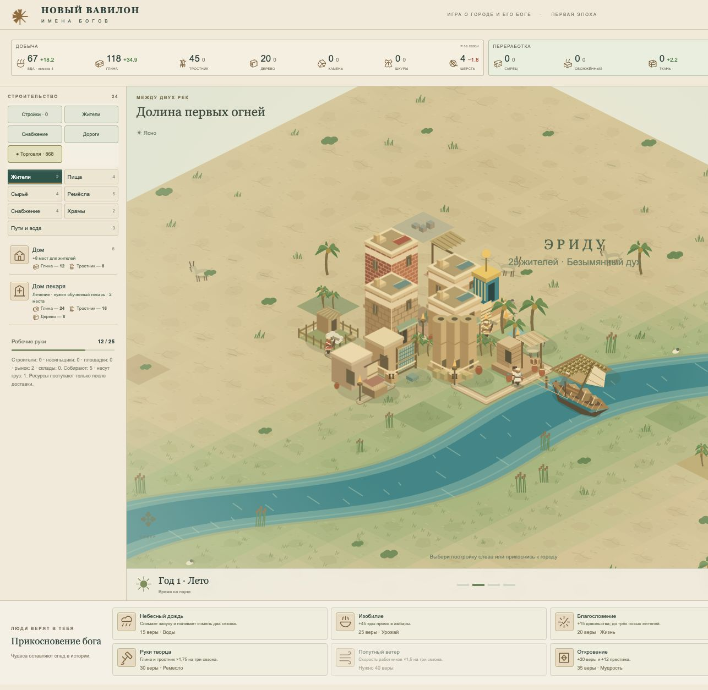

# 19 октября 2026 · 02 — Речной город

Выпуск: `river-city-20261019-1`. Формат сохранений: **21**. Предыдущий снимок: [2026-10-19](2026-10-19.md).

## Что сделали

- Добавили речную пристань в группу «Пути и вода». Она строится жителями из 28 глины, 22 тростника, 12 дерева и 12 сырца; ставится на сухом берегу главной реки.
- Грузовые лодки идут по руслу от края карты, швартуются, разгружаются и открывают торговлю. Лес и камень в ассортименте — втрое большими партиями; кошелёк речных купцов тоже втрое больше обычного.
- При наличии рынка и пристани новые визиты чередуются: нечётные сухопутные, чётные речные. Если доступна только пристань, все новые визиты речные. Текущий караван продолжает свой прежний маршрут.
- Покупки носят с причала на склад; проданные ресурсы несут со склада в лодку. Серебро за продажу приходит после фактической погрузки.
- Лодка ждёт незавершённые продажи. Купленные товары остаются у пристани после отплытия; снос занятой пристани запрещён.
- Сохранили совместимость городов, личности, счета и грузы. Карточка каждого торгового двора показывает свои поставки.
- Привели карту к спокойной палитре земли, охры и бирюзовой воды; сгладили цветовые переходы берегов и добавили мелководье.
- Сделали жителей крупнее, уточнили детали одежды и головы; у животных — тени, детали силуэта, хвосты, овечья шерсть и спокойные движения. Существующие профессии и износ одежды сохранены.
- Нарисовали пристань с навесом, сосудами и швартовочными столбами; лодку с грузами, лодочником, отражением и следом на воде. Под мостом парус складывается, судно рисуется под настилом.
- Сделали ночь светлее, сохранили тёплые огни, улучшили контраст ночного заголовка.
- Увеличили полезную высоту карты и стартовое приближение. Обзор всей долины остался отдельной кнопкой.
- По скриншоту пользователя убрали непонятный коричневый блок на старте: это был декоративный настил, который рисовался без построенной пристани. Убрали и прежнюю бесцельную декоративную лодку.

## Историчность

[Penn Museum, Lagash Archaeological Project](https://www.penn.museum/research/project.php?pid=219) описывает лодочное сообщение внутри поселений и между ними в ландшафте Лагаша. Речная торговля уместна для выбранного шумерского контекста. Вид пристани, расписание, объёмы, цены и проход под мостами — игровые обобщения.

## Проверки

- **372 автоматических теста прошли**: строительство пристани, река против озера, недоступный берег, прибытие/отплытие, покупки/продажи, отмена, сохранения и прежние игровые системы.
- Регрессия коричневого блока: прежний renderer воспроизводит 5 лишних элементов настила; новый — 0.
- Отдельное ревью логистики не выявило ошибок; 4 000 состояний рейса с торговлей прошли сохранение и загрузку.
- Браузер: стартовая карта, дневной/ночной город, люди, животные, карточка пристани, торговля и ширина 390 px. Подтверждены доставка 12 камня и погрузка 8 глины с начислением 48 серебра. Ошибок консоли в проверенных сценах нет.
- 130 построек / 200 жителей с работающей пристанью, 4×: шаг симуляции **CPU медиана 0,81 мс / p95 2,59 мс**. Это не измерение FPS.
- Синтаксис JavaScript и `git diff --check` проверены.

## Вид города

Скриншот из изолированного тестового города: он показывает оформление, а не изменение сохранения пользователя.

## Публикация

- Коммит реализации: `bf3233b` — отправлен в `origin/main`.
- [Запуск GitHub Pages](https://github.com/reinekes/new_babylon_demo/actions/runs/39280052668) на момент последней проверки остаётся в очереди (`queued`); задание сборки ещё не началось, ошибок сборки не получено.
- Обычный адрес игры отвечает HTTP 200, но пока содержит прежний выпуск. Публикация новой версии и совпадение живых файлов ещё не подтверждены.
- Локальная реализация, тесты и браузерная проверка завершены; задержка находится на этапе очереди публикации GitHub Pages.
