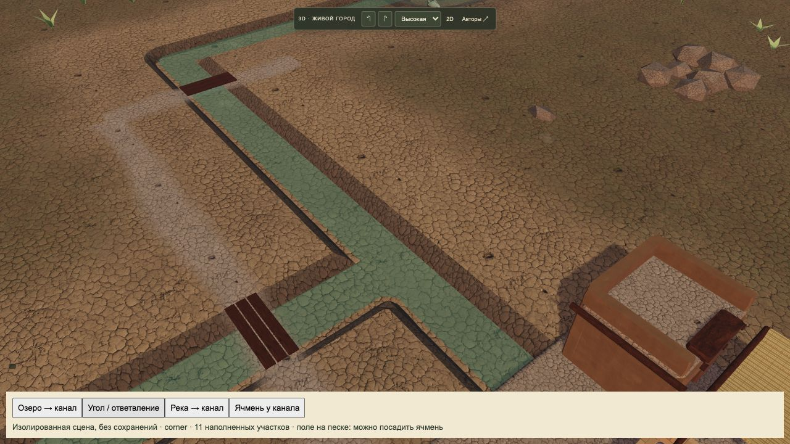
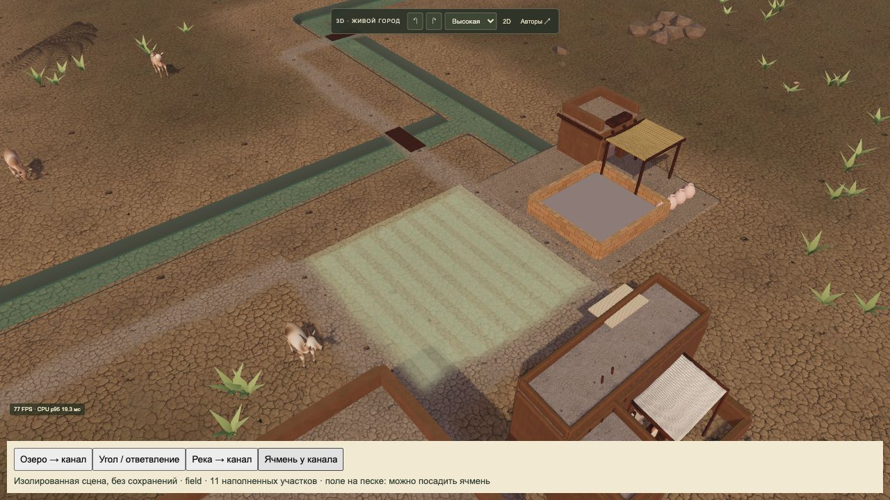
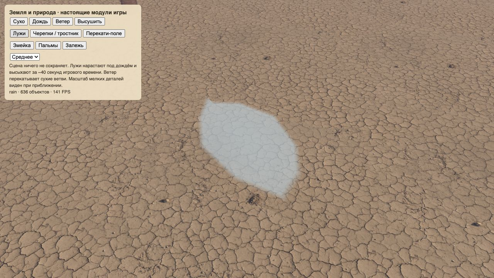

# Выпуск 2026-10-22-01 · Каналы и животные

- Статус: опубликован и проверен.
- Идентификатор: `canal-water-20261022-1`.
- Игровой коммит: `c74286d9a9ddeaea201f9fbd8c8ed7f043a177ce`.
- GitHub Pages: [39745468664](https://github.com/reinekes/new_babylon_demo/actions/runs/39745468664), build/deploy/report-build-status — success.
- Сайт: https://reinekes.github.io/new_babylon_demo/

## Реализовано

- Сохранённые озёра учитываются источниками оросительной сети. Канал соединяется с водой у реального видимого берега; L/T-повороты имеют общую поверхность без перекрывающих стенок.
- Ячмень разрешён на сухой клетке рядом с наполненным каналом. Сеть из незавершённых/разорванных участков не передаёт воду; занятый каналом участок не превращается в поле.
- Лужи увеличены с0,38–0,98до0,95–2,30м при прежнем числе объектов; сохранены дождь, высыхание и отступы от препятствий.
- Закрыты торцы и продольные швы процедурных животных, соединены шея/морда, убраны накладки живота/спины/боков; скорректированы пропорции и расчёт ног по пройденному расстоянию.
- Геометрия каналов кешируется отдельно от прогресса посторонних строек. 150участков: холодный расчёт3,54→0,50с; повторный p950,125мс. Это CPU расчёта геометрии, не FPS.
- [Подробный разбор моделей](../ART_MODELS_2026-10-22.md): фактическое устройство GLB, исправления, ограничения и план художественной замены.

## Проверки

- `npm test`: **626/626**, финальный полный прогон66,2с.
- `node --check` изменённых основных3Dмодулей; `git diff --check` — успешно.
- Независимое ревью нашло повторную генерацию каналов; блокер исправлен и покрыт тестом кеша/инвалидации.
- В браузере: озеро/река, угол/ответвление, разрешённый предпросмотр поля, четыре вида животных, увеличенная лужа и исчезновение после высыхания.
- Большой город129зданий/200стартовых жителей на4×: высокая графика **4FPS**, CPUкадраp95 **326,7мс** в наблюдаемой фазе. Производительность по-прежнему плохая; ускорение всей игры этим выпуском не заявляется.
- На публичном сайте: **12/12 SHA256** изменённых игровых файлов совпали; старое сохранение8года загрузилось без ошибок консоли, ожидавшее решение игрока не изменялось.
- Формат сохранений26, личности жителей и учёт грузов не менялись. Тесты орошения проверяют изменённые озёра и разрыв сети отдельно.

## Историчность и границы

[Табличка УрIII в Spurlock Museum](https://www.spurlock.illinois.edu/collections/search-collection/details.php?a=1913.14.0522) документирует устройство ложа канала и работу на поле. Канальное орошение уместно для выбранного времени. Любое игровое озеро питает сеть без расчёта перепада уровня — упрощение.

Процедурные животные ещё уступают цельной овце со скелетом и семью готовыми анимациями. Художественные GLB для остальных видов и новая библиотека рабочих анимаций людей **не реализованы** в этом выпуске.

## Снимки

