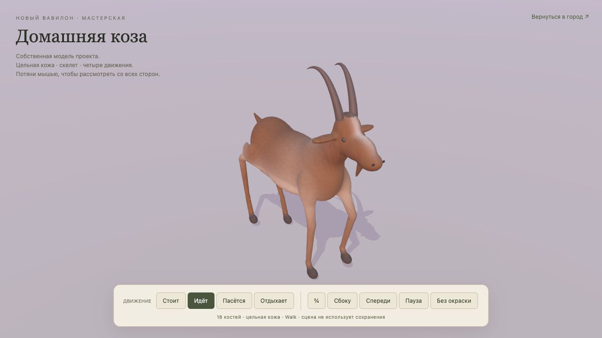

# Выпуск 2026-10-22-02 · Собственная коза

- Статус: опубликована отдельная мастерская; модель города не заменена.
- Идентификатор: `authored-goat-20261022-1`.
- Коммит: `cd1a3d3c0d1ad5e918b62a73ccf6cc75b4ecfb45`.
- [Посмотреть козу](https://reinekes.github.io/new_babylon_demo/goat-studio.html).
- [Публикация Pages39755687497](https://github.com/reinekes/new_babylon_demo/actions/runs/39755687497): build/deploy/report — success.

Создана оригинальная стилизованная GLB-модель: цельная замкнутая кожа,18костей, отдельные гладкие рога и глаза, четыре клипа Idle/Walk/Graze/Rest. Скульптура, веса, окраска и фактура воспроизводятся исходным Python-скриптом; сторонние модели не использованы. Мастерская показывает три ракурса, вращение, паузу и форму без окраски.

Проверки: полный629/629; после регрессии границ времениGLB —4/4профильных теста. Проверены связность/замкнутость кожи, нормализация весов, клипы и конечные координаты. Независимое ревью выявило отсутствовавшие временные min/max — исправлено. Анализ всех кадров не нашёл существенного проваливания в пол. Браузер проверил четыре состояния и вид без окраски; публичная страница загружается и переключает ходьбу без ошибок консоли. SHA256 страницы и GLB совпали2/2.

Ограничения: подробный прототип83788треугольников/4000280байт; LOD, смешивание переходов и привязка шага к городскому маршруту пока не реализованы. Сохранения и симуляция не читаются. Большой город4× повторно не проверялся: его рендер/модель козы этим выпуском не изменены.

[Происхождение и границы](../AUTHORED_GOAT_2026-10-22.md). Козы уместны для УрIII; точная порода/окраска — художественное приближение, не археологическая реконструкция.

