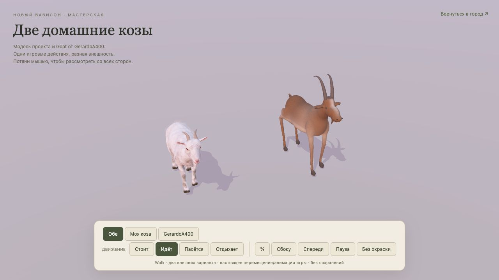
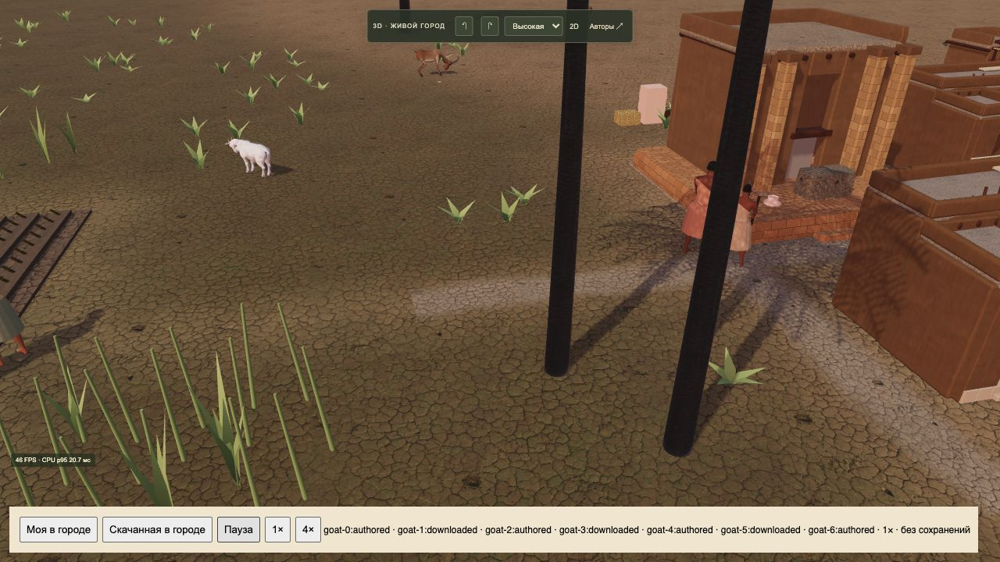

# Выпуск 2026-10-22-03 · Две козы в городе

- Статус: опубликованы обе модели в основной 3D-игре.
- Идентификатор: `two-goats-20261022-1`.
- Коммит: `7554eae44a4e8c4cf75643a320abacfaef53d17e`.
- [Игра](https://reinekes.github.io/new_babylon_demo/) · [Сравнить модели и движения](https://reinekes.github.io/new_babylon_demo/goat-studio.html).
- [Pages39763019415](https://github.com/reinekes/new_babylon_demo/actions/runs/39763019415): build/deploy/report — success; SHA256 опубликованных страниц, кода, моделей, исходника и credits совпали11/11.

Собственная коричневая и скачанная белая коза — два внешних варианта одного игрового животного. Стабильный хеш ID сохраняет выбор после загрузки, формат26 и состояние симуляции не изменены. Добавлены независимые скелеты при общей геометрии, плавные переходы, шаг по расстоянию, пауза, смерть, выбор, тени и резервная модель при отказе загрузки.

Собственная городская модель облегчена до32684треугольников/1,65МБ; подробный исходник сохранён. Скачанный Goat — GerardoA400, CC BY4.0: исходный файл сохранён, текстуры уменьшены до1k, добавлены собственные Walk/Graze/Rest. Исходный rigAction сохранён как осматривание на месте. Белая коза отдыхает стоя; полноценное лежание для неё не заявляется. Автор, источник, лицензия и изменения перечислены в титрах.

Проверки:640/640; после исправления manifest без Finderметаданных —3/3 профильных; синтаксис и diffcheck пройдены. Независимое ревью без блокеров. В браузере обе козы видны в настоящем городском рендерере, сравнительная сцена переключает движения, публичная мастерская работает без ошибок консоли. Основная игра загрузила прежний город8года и ожидающее решение праздника без ошибок; решение пользователя не выбиралось. Большой город129зданий/200стартовых жителей4× при высокой графике: около4FPS, CPU p95303–354мс; оптимизация большого города остаётся необходимой. Измерения — локальная проверка, не гарантия скорости на других устройствах.

История: козы подтверждены документами УрIII ([Carlos Museum](https://collections.carlos.emory.edu/objects/22060/cuneiform-tablet-goats-taken-puzrisdagan)); окраски, породы и добавленные движения — художественная интерпретация.

[Памятка: создание, подготовка, подключение и ограничения моделей](../3D_ANIMAL_MODEL_WORKFLOW.md).

