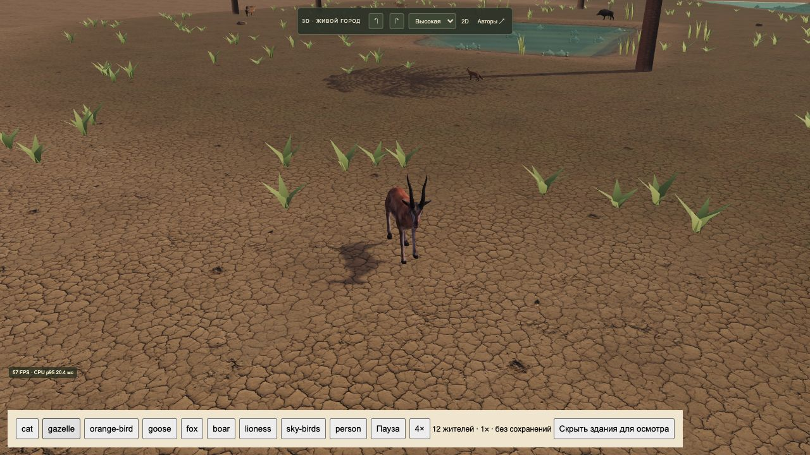
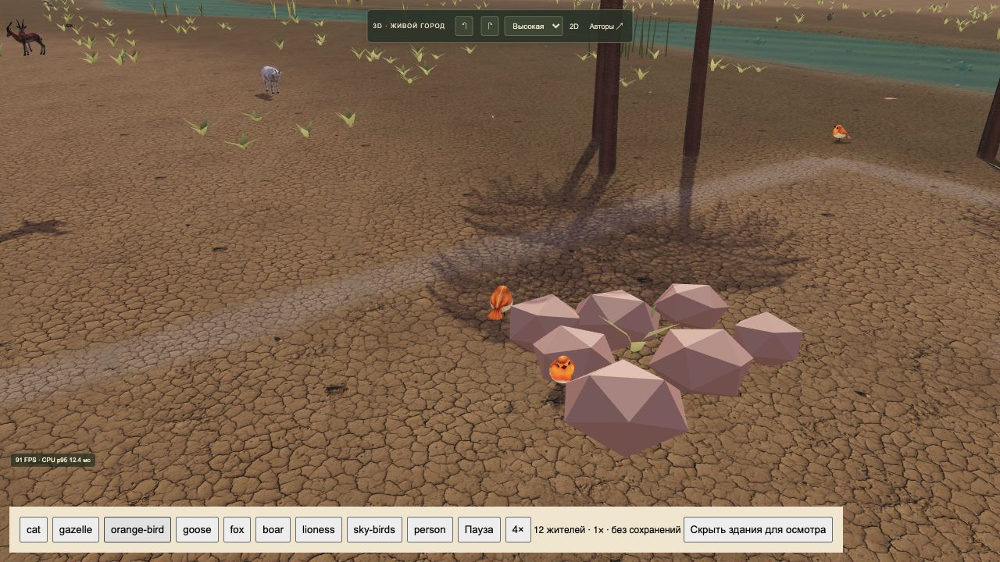

# Выпуск2026-10-22-04 · Новые животные и шумерские жители

- Статус: опубликовано в основной3D-игре.
- Идентификатор: `city-creatures-20261022-1`.
- Коммит: `f398635cfb57f5cfedb10d3b444c13bdd341f6bd`.
- [Игра](https://reinekes.github.io/new_babylon_demo/).
- [Pages39770237942](https://github.com/reinekes/new_babylon_demo/actions/runs/39770237942): build/deploy/report — success.
- SHA256 страниц, модулей, всех10новыхGLB, manifest и титров совпали20/20.

Заменены кошка и газель. Две скачанные кошки имеют согласованный угольный окрас, отдельные скелеты и плавный переход между ходьбой/сидением. Газель сохраняет исходное осматривание и получила добавленную походку. Настоящие маршруты, выбор, охота/смерть и защита амбаров продолжают действовать.

Добавлены стая5птиц в небе и3оранжевые птицы около домов. Из пака выбраны гуси(2), лиса, кабан, львица: это фоновые неподвижные фигуры с дыханием, без новых ресурсов/охоты/нападений. Пак содержит47мешей без скелетов/клипов, а не100готовых анимированных видов.

Гражданская фигура Egyptian People переделана: египетские мотивы воротника/манжет/килта заменены, добавлена шерстяная юбка и прежний53суставный скелет/движения. Пол/возраст, индивидуальная внешность, рабочие жесты, грузы и износ сохраняются. Художественная адаптация не заявляется точной реконструкцией всех полов/возрастов. Формат сохранения26 и экономика не менялись.

Проверки:657/657; после единого штампа выпуска12/12 профильных, manifest3/3; синтаксис/diffcheck пройдены. Два независимых ревью без блокеров; прежние сценарии актёров с новой фигурой23/23. В локальном браузере просмотрен каждый вид, новые модели/пауза и полёт; ошибки отсутствуют. Основная публичная игра загрузила прежний город8года с ожидающим решением праздника; решение пользователя не выбиралось. Публичная проверочная сцена показывает скачанную газель, новая фауна загружена без ошибок консоли.

Нагрузка:129зданий/209жителей4×, высокая графика, одна3Dвкладка —28FPS и CPU p9538,9мс. Это один локальный замер, не гарантия и не доказательство причинного улучшения относительно прошлых замеров. Фоновые животные не включены в число жителей.

[Подробный отчёт: добавленные животные, происхождение, история, ограничения, воспроизведение](../CITY_CREATURES_REPORT_2026-10-22.md). NC/SA условия сохранены; Standard для птиц/людей записан отдельно от подтверждения пользователя о наличии разрешения. Документ разрешения будет добавлен при завершении игры, как указал пользователь.

