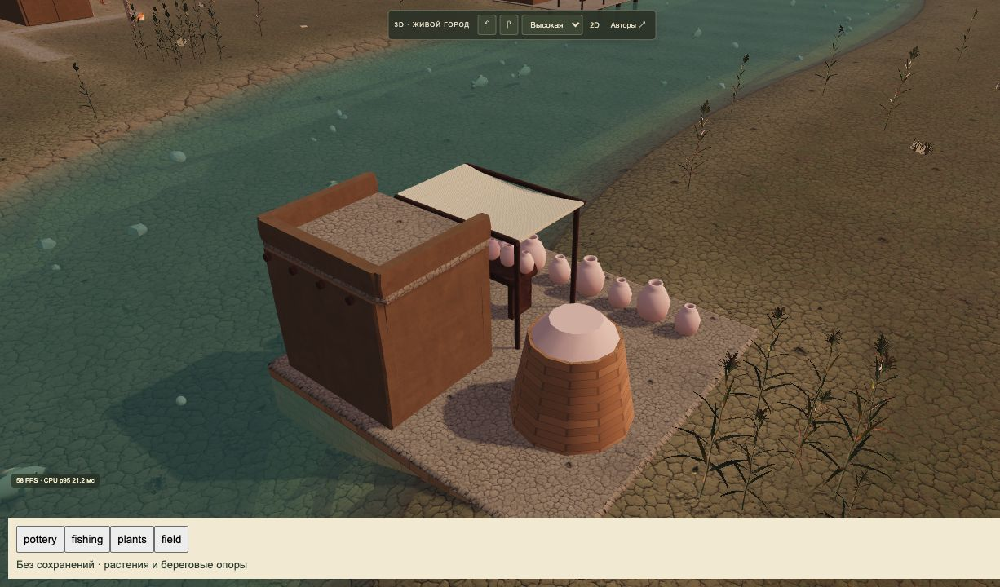
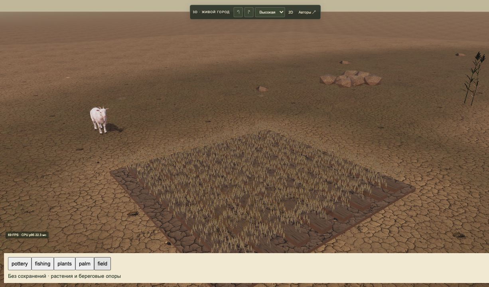
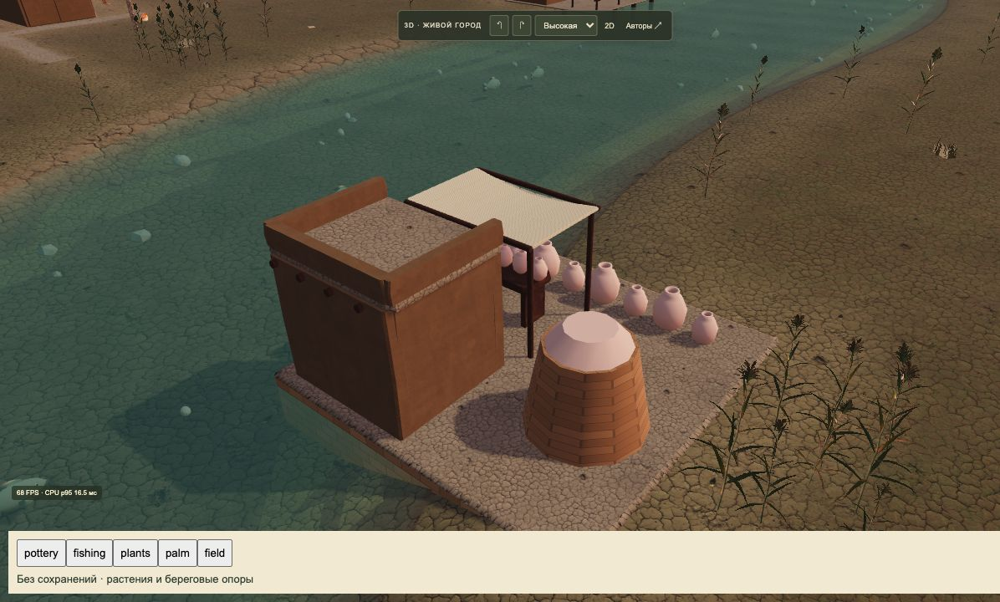

# Выпуск2026-10-22-05 · Живая долина и береговые опоры

- Статус: опубликовано в основной3Dигре.
- Идентификатор: `living-valley-20261022-1`.
- Коммит: `41d405e12f32ed2c727ec7aa4d8ce67358b0ec80`.
- [Игра](https://reinekes.github.io/new_babylon_demo/).
- [Pages39793279455](https://github.com/reinekes/new_babylon_demo/actions/runs/39793279455): build/deploy/report — success.
- SHA256 опубликованных страниц, модулей, всех8растительныхGLB, manifest и титров совпали22/22.

В основном3Dгороде убраны авторская коричневая коза, старые процедурные наземные птицы и видимые мыши/крысы. Скачанная коза и новые птицы сохранены. Исходная фауна, ID, порча запасов и защита кошками продолжают действовать: это смена изображения, не обнуление вредителей. Сравнительная мастерская сохраняет обе модели коз.

Подключены8подготовленныхGLB растений: финиковая пальма,3сухие травы,3тростника и художественный ячмень. Сохранены источники/авторы/CCусловия. Американский DesertShrubs, неопределённые декоративные пальмы и Standardgrass не включены. Из Wheat сохранена карточная геометрия, но колосья и длинные ости нарисованы заново; новой культуры/производственных правил нет. Старые зелёные ростки, борозды, уборка/снопы/порча и обрезание по берегу работают.

Здания у воды получают сплошное кирпично-земляное основание под нависающей частью; рыбацкие дворы/пристани — сваи до дна. Учтены река/сохранённые озёра, повороты, уровни, стройки,2×2. Поля/мосты/каналы исключены; вода/маршруты/сохранения26/учёт грузов не менялись. Опоры — художественная адаптация, не инженерная реконструкция шумерских построек на сваях.

Проверки: полный676/676; после окончательного материала листвы25/25профильных; manifest3/3, синтаксис и diffcheck пройдены. Независимое ревью без блокеров. Браузер выявил перевёрнутый ячменный рисунок — исправлен и проверяется поPNG/UV. Освещение тонких листьев настроено двусторонним PBR с умеренным оливковым прохождением света без emissive/unlit; кора/поля не затронуты. Проверены основания, сваи, пальма, зрелое поле.

Нагрузка:129зданий/209жителей4×,высокая графика,одна3Dвкладка —30FPS,CPU p9536,0мс,ошибок нет. CPUвремя не является FPS; один замер не гарантирует скорости других городов/устройств.

[Подробный отчёт: выполненное, исторические культуры, растения и следующие животные](../LIVING_VALLEY_REPORT_2026-10-22.md) · [Происхождение8растительных ассетов](../VALLEY_PLANTS_ASSETS_2026-10-22.md).

Публичная сцена показывает береговое основание и загруженную растительность без ошибок консоли. Основная игра загрузила прежний город8года с ожидающим решением праздника; решение пользователя не выбиралось.

