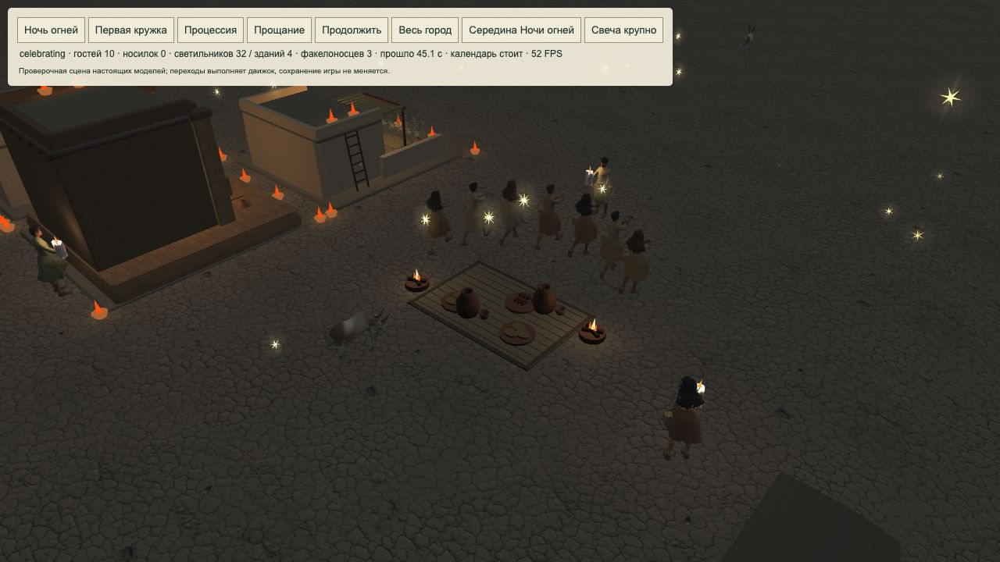

# 2026-10-28 · Бесплатные сцены, свечи и небесный свет

Выпуск: `festival-candles-tests-20261028-1`. Код: `8312c986c060385b2338e2859b1ad33f0b6de5cb`.

- Во вкладке «Тестирование» появились отдельные кнопки «Встреча кошки» и «Дыхание земли»: настоящие минутные сцены с музыкой, без веры, ожидания и перезарядки. Начало на 1×, ручное ускорение доступно. Активные церемонии не прерываются; обычные чудеса и знания не открываются.
- Если в городе ещё нет кошки, тест оставляет одну обычную кошку; это объяснено рядом с кнопками. Тест плодородия не выдаёт постоянный бонус. Личности, грузы и маршруты жителей сохраняются.
- Ручные факелы Ночи огней заменены подготовленной копией `candle_light.glb`: 24 484 байта вместо 2 591 368, 422 треугольника, одна текстура 256px, без скелета. Загрузка по необходимости, хват в правой ладони, небольшой огонь и свет. Исходник пользователя не изменён. Автор: al0sral0, CC BY 4.0; атрибуция сохранена.
- В середине Ночи огней (30–65 секунд из 90) над двором падают 72 маленькие золотистые снежинки света; появляется «Бог услышал их». Один 3D-пакет без теней/текстур, поддержаны 2D, пауза, ускорение, сохранение и отмена.

Проверки: **1217/1217 PASS**, **20 старых JSON** decode→encode→decode, **163 импорта**, независимая сверка требований без оставшихся блокеров. В браузере проверены нулевая вера, обе кнопки и песни, повторный запуск, 4×→1×, реальная модель свечи и свет над пиром; консоль без ошибок. Полный прогон сначала выявил устаревшие суммы художественного списка; после обновления манифеста финальный прогон полностью прошёл.

## Измерение 3D

Настоящий Babylon, 200 жителей/129 зданий, современная игровая скорость 4×, 1280×720, DPR 1, одинаковый seed, 3 секунды прогрева + 12 секунд измерения:

| Режим | FPS | Кадр p95 |
| --- | ---: | ---: |
| Высокое, близко | 19,04 | 74,8 мс |
| Высокое, общий вид | 17,96 | 66,8 мс |
| Близко, без теней | 21,05 | 66,7 мс |
| Близко, лёгкое | 23,43 | 50,0 мс |

CPU симуляции отдельно: медиана 4,7–5,2 мс. На высоком качестве вблизи 1872 вызова рисования, около 6222 объектов сцены и 98 скелетов. Главные следующие кандидаты: дальние модели/частота поз, объединение неподвижных деталей, ограничение теней, затем текстуры и загрузка. Эти улучшения **предложены, ещё не внедрены**.

Результаты относятся к локальному проверочному городу без DOM основной игры. Холодная сеть и другие устройства не измерены. [Полный аудит и сырые данные](../PERFORMANCE_3D_AUDIT_2026-10-28.md), [отчёт по этапам](../TEST_SCENES_CANDLES_PERFORMANCE_2026-10-28.md).

## Публикация и история

[Pages 40700395155](https://github.com/reinekes/new_babylon_demo/actions/runs/40700395155) — success. **39/39 опубликованных файлов совпали SHA256** с кодовым коммитом, включая GLB и новые модули. [Сверка](../screenshots/2026-10-28-candles-pages-sha.json). [Игра](https://reinekes.github.io/new_babylon_demo/).

Для Шумера III тысячелетия до н. э. подтверждены лампы ([Лувр AO 5679](https://collections.louvre.fr/ark%3A/53355/cl010166316)); подтверждение обычных восковых свечей не найдено. Свеча и небесный ответ — художественная условность игры.

