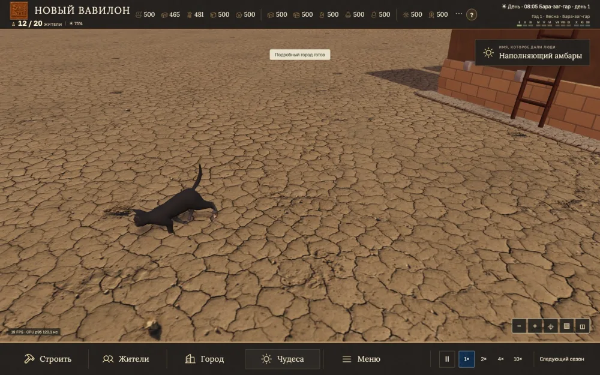
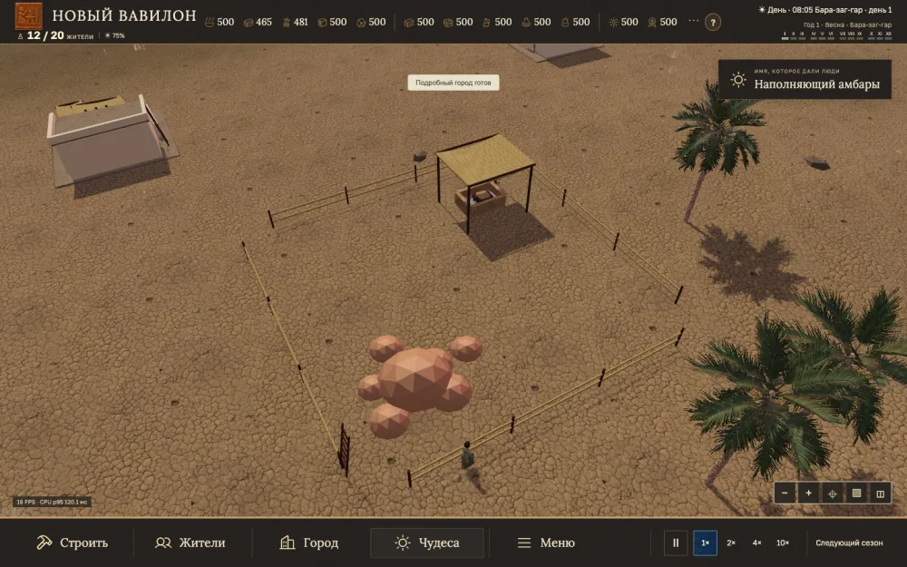
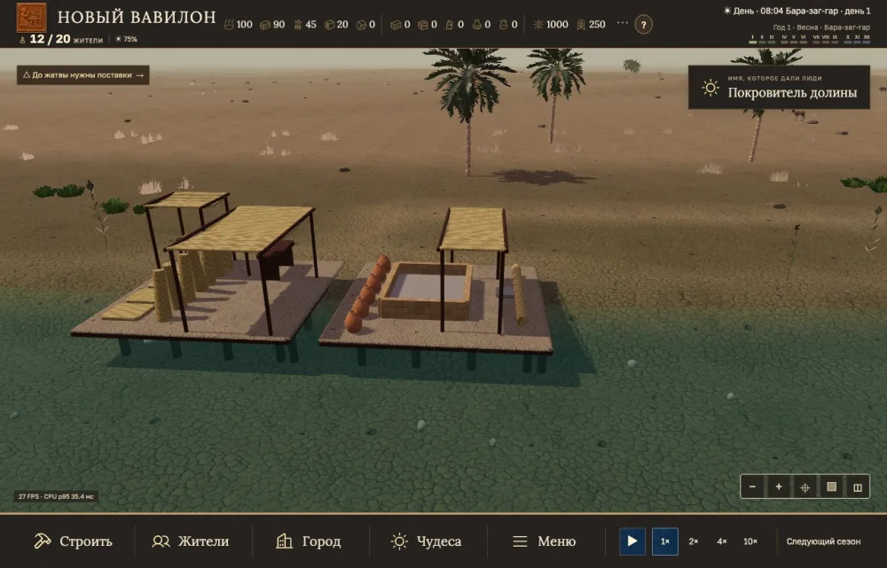
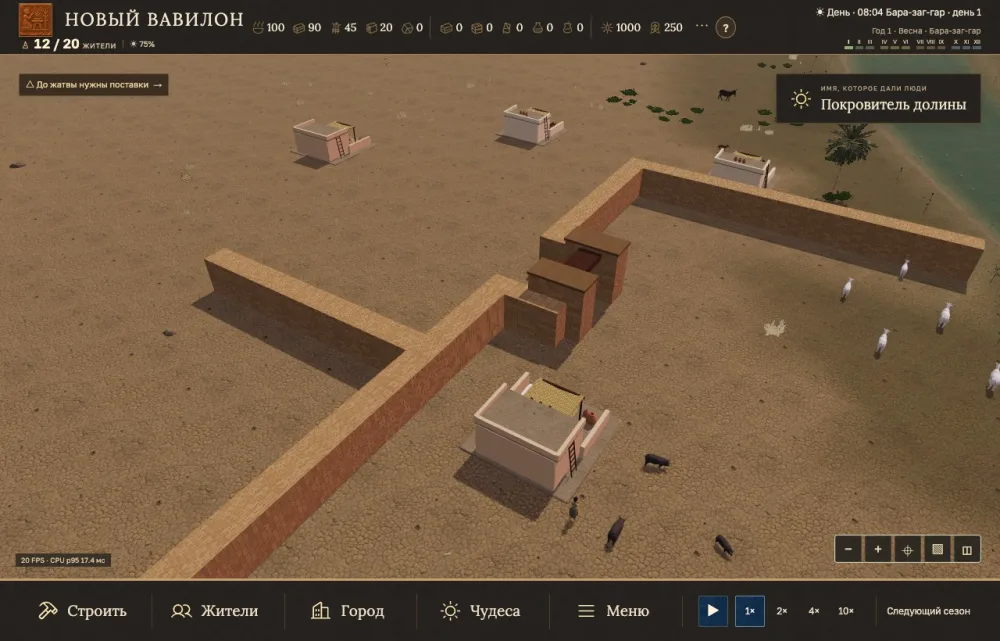
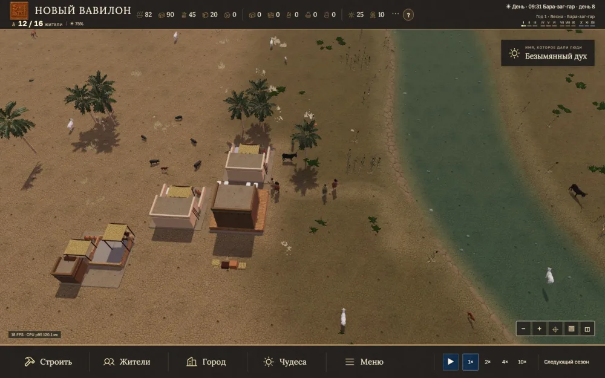
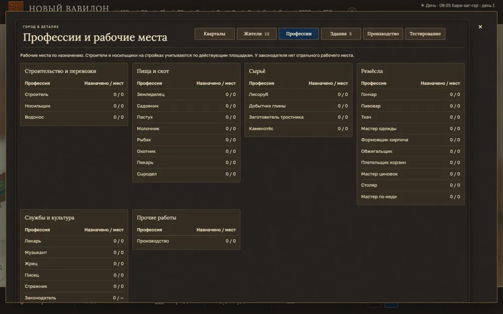
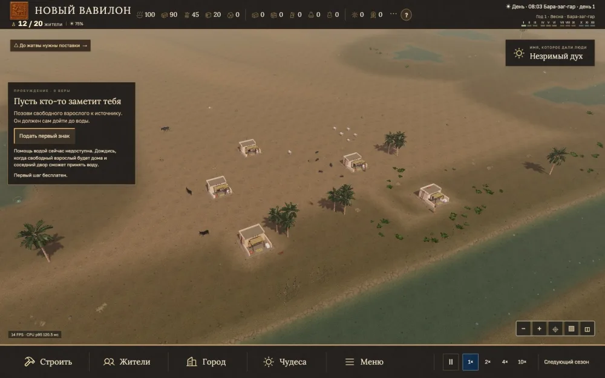

# 2026-11-13 · Большой город, модели животных и добывающие дворы

Выпуск `city500-fauna-courts-20261113`, коммит `d058bbc5`. На GitHub Pages 19 файлов совпали по SHA-256.

## Изменения

- Оптимизированы назначение работников, подготовка 3D-жителей, повторное использование геометрии ландшафта и обновление теней в полном обзоре. Прежнее разрешение 3D и обычный HUD сохранены.
- В подборке атласа видны все 16 присланных моделей и поиск по исходным именам. Семь GLB задействованы в городе, шесть доступны в резерве, три некоммерческие модели открываются у авторов. В обычной реке плавают оба присланных бычка как визуальные заменители местной рыбы. На сухой окраине используется присланная анимированная кобра. Для кошачьей охоты подключён уменьшенный GLB грызуна и показан момент поимки. Прежняя черепаха перемещена в резерв, морская бисса открывается у автора.
- Кряквы, козы, шакалы, свиньи и перепела появляются группами по 5–6 на проверенной карте. Овцы выходят с разными интервалами, пасутся и возвращаются в загон. У домашних свиней и диких кабанов разнесены остановки и движения.
- У жителя сохраняется небольшой изгиб привычного маршрута в обе стороны. Он совпадает с видимой протоптанной тропой. В сложных местах используются безопасные прямые участки.
- Стены стали уже и стыкуются на углах, развилках и с воротами. Уменьшены ворота, осевой проход проверен. Под выходящими над водой настилами установлены деревянные сваи.
- «Город → Профессии» показывает назначенных работников и вместимость по группам. Доступные чудеса помечены золотой рамкой и подписью.
- Глина, тростник, камень, дерево, финиковый сад и охотничий участок получают открытые дворы 2 × 2. Рабочий навес расположен в стороне от отмеченного ресурса. Ручной сбор глины, тростника, камня, дерева и фиников даёт 25% пригодного сырья, добыча со зданием сохраняет обычный выход. Для рыбалки остаётся отдельная механика водного участка.
- Новая партия начинается у реки в средней части долины. На берегу поселения есть небольшой лес с запасом 24 и камень с запасом 30. Прежние сохранения сохраняют свои координаты и объёмы.

## Проверки

- 2 019 тестов Node прошли. Дополнительно проверены актуальная геометрия поимки и сцена в Chrome. Публичные файлы проверены по SHA-256.
- Два полных замера на Apple M2 с 500 жителями и 250 зданиями, HUD, высоким качеством, тенями и 4× дали 31,58 и 32,75 FPS. Публичный повтор дал 33,20 FPS, p95 кадра 33,4 мс. По 10 автосохранений и побайтная загрузка в каждом прогоне. Отдельные задержки до 467 мс зафиксированы. [Отчёт о производительности](../PERFORMANCE_CITY_500_2026-11-13.md).
- Новый старт проверен на 67 зёрнах в обоих режимах, а в Chrome отдельно проверены 3D и 2D, интерфейс на 390 и 1440 px, стены и проход, сваи, движения овец и свиней, оба GLB рыб, кобра и поимка грызуна.

## Исторические границы

Залежи камня и древесина рядом со стартом, универсальная доля пригодного сырья, размер двора и сваи под каждым мокрым краем — игровые решения. Гавань Абу-Тбейры и учёт фиников подтверждены источниками. Кобра и бычки передают облик и движение животных, видовая принадлежность моделей условна для долины. [Абу-Тбейра](https://air.unimi.it/handle/2434/930285) · [Финиковый урожай в Умме](https://cdli.earth/artifacts/218066) · [Камень в Месопотамии](https://doi.org/10.2307/4200300) · [Рыбы Ирака](https://www.biotaxa.org/Zootaxa/article/view/zootaxa.5357.1.1).

## Кадры из проверок

