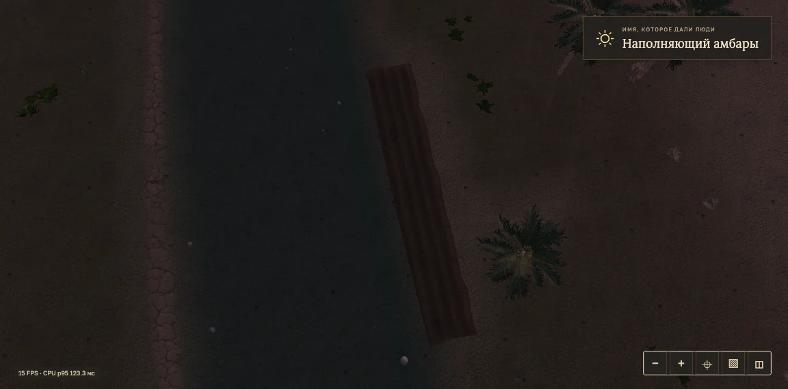

# 2026-11-16 · Отрисовка полей у воды

Выпуск `field-shore-draw-range-20261116`, игровой коммит `f18ab568`. Восемь файлов GitHub Pages совпали с коммитом по SHA-256.

- После обрезки по берегу поле могло сохранить старый диапазон отрисовки. На участке (36, 43) это оставляло 2 304 индекса из 15 558. При создании и при повторном подключении сетки диапазон теперь строится заново.
- В Chrome три соседние делянки видны до самой воды днём, ночью и после посева. Регрессионный тест проверил полный диапазон и повторное использование сетки. Прошли 40 профильных тестов, в том числе проверки версии с новой моделью тростниковых шалашей.
- Замер объединённой версии на 500 жителях и 250 зданиях при 4× дал 32,80 FPS, 49,9 мс p95 кадра, 100 мс максимального кадра и десять автосохранений с побайтной загрузкой.

[Отчёт со сравнением](../../roadmap/reports/2026-11-16-field-shore-draw-range.md).
