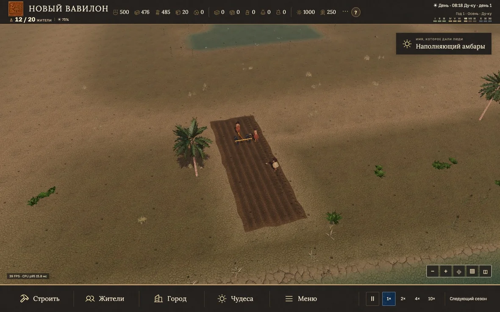
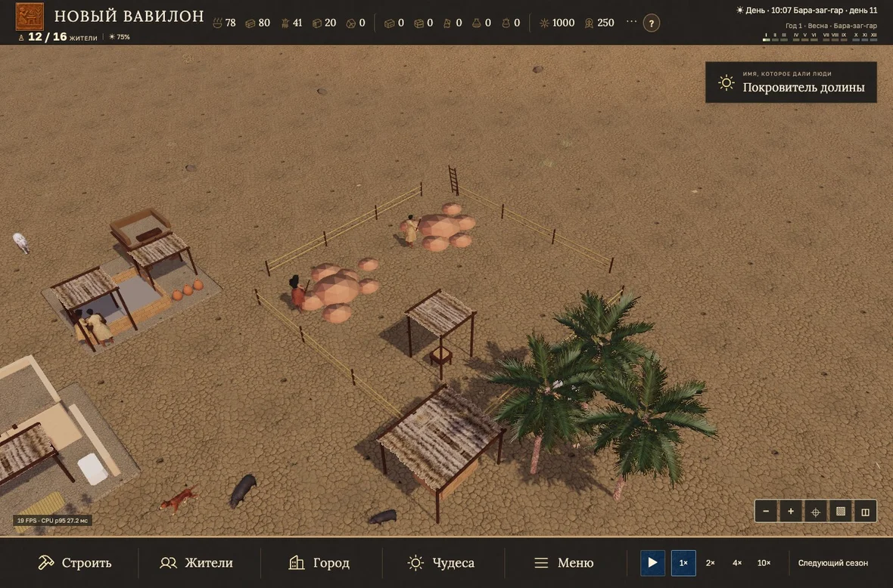

# 2026-11-16 · Общее поле, добывающие дворы и живая долина

Выпуск `living-fields-20261116`, игровой коммит `934fbba5`. GitHub Pages: 32 файла игры, атласа и roadmap подтверждены по SHA-256.

- Соседние готовые делянки образуют поле с общими бороздами, мягким краем и числом рабочих мест по площади. Упряжка волов и плуг идут по готовым к посеву участкам. Сохранены данные посева и происхождение урожая по клеткам.
- Добывающие дворы 2 × 2 оставляют отдельные залежи на месте. Рабочие идут к ним; расход виден по остатку. Финиковые грозди восстанавливаются осенью. Ручной сбор даёт 25%, двор работает без этой потери.
- Фактура присланной модели Nucity выделена в две общие карты для крыш и тростниковых плетений. Жилые навесы, временные жилища и святилище отрисовываются тонкими профилями со стеблями по краям.
- У коз независимые остановки и походка. Кряквы ходят по берегу и плавают, рыбы идут головой вперёд. В подходящих местах появились дополнительные группы рыб, газелей, перепелов и лягушек.
- На 4× при 500 жителях и 250 зданиях два локальных прогона дали 27,32 и 26,40 FPS. Самый длинный кадр — 116,7 и 133,3 мс против 483,3 мс на исходном коммите. По десять автосохранений, загрузка побайтная. Устойчивые 30 FPS пока открыты. [Методика и данные](../PERFORMANCE_CITY_500_2026-11-16.md).
- 2 030 тестов Node и 6 тестов сборки roadmap прошли. Chrome проверил 3D и 2D, общее поле, маршруты фауны, две залежи глины, истощение и сезонное восстановление фиников, навесы, атлас и roadmap. На публичной версии проверены атлас, 2D и мобильная ширина roadmap.

[Отчёт с остальными скриншотами](../../roadmap/reports/2026-11-16-living-fields.md).
