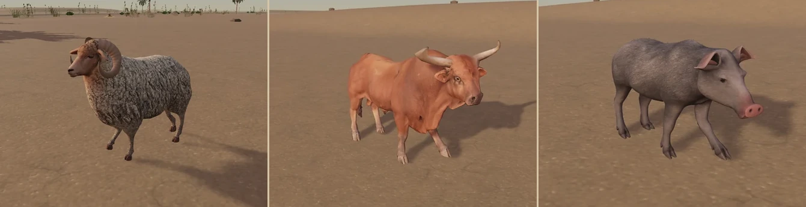

# 18 ноября 2026 · Стадо, ровный грунт и речная вода

Выпуск `river-herds-20261118`, игровой коммит [30584cb](https://github.com/reinekes/new_babylon_demo/commit/30584cb1bcb9bbbfacc83ad31fd5abf18bd8c9bf). [Публикация GitHub Pages](https://github.com/reinekes/new_babylon_demo/actions/runs/44312392144)

- Баран, бык и свинья переработаны по очереди. Для каждого сняты профиль, три четверти и три положения шага. Облик барана одобрен пользователем в первом проходе. У быка уточнены грудь, морда и опора копыт, у свиньи в отдельном третьем проходе исправлены пятачок и уши.
- В атласе 48 GLB животных. Все 45 прежних файлов и 25 карточек остальных типов сохранены. При принудительной блокировке новых GLB город загрузил и анимировал каждого из трёх прежних животных.
- Убран повторяющийся пятнистый рисунок поймы, смягчены полосы у дворов и дорог, исправлено выбеливание высохших стеблей. Для реки, озёр и каналов переработаны видимость дна, течение и отражение неба. У озёр уточнено ложе.
- Прошли 131 профильная проверка и 14 проверок дорожной карты. При 500 жителях, 250 постройках и скорости 4× средняя частота кадров на Apple M5 составила 30,33 FPS после правок и 29,86 FPS до. Сохранение, идентификаторы жителей, грузы и запасы прошли круговую проверку. [Локальный протокол](../benchmarks/2026-11-18-river-and-herds.json)
- В обычной опубликованной игре видны и движутся все три новые модели. В атласе через шесть прямых ссылок проверены три новые и три прежние. SHA-256 совпал у 101 публичных файлов. [Проверка публикации](../benchmarks/2026-11-18-river-and-herds-pages.json) · [Отчёт с кадрами до и после](../../roadmap/reports/2026-11-18-river-and-herds.md)
