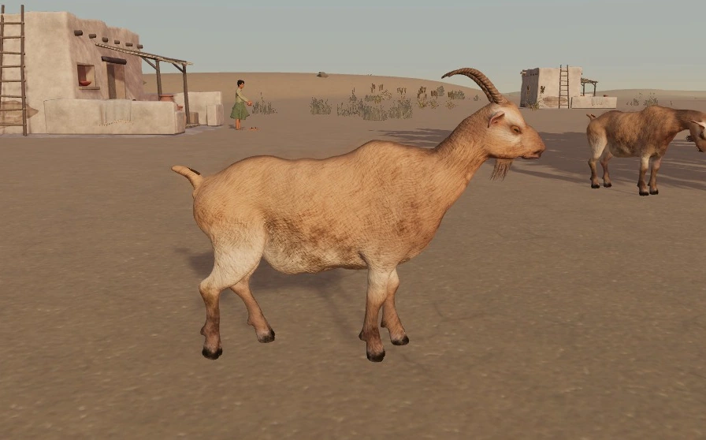

# 18 ноября 2026 · Пастбищная коза

Выпуск `pasture-goat-20261118`, игровой коммит [3310ecf](https://github.com/reinekes/new_babylon_demo/commit/3310ecf8db2881f16b8374e38c74e62b41a8a51c). [Публикация GitHub Pages](https://github.com/reinekes/new_babylon_demo/actions/runs/44317539999)

- Анатомия взрослой козы проработана в несколько проходов. Уточнены грудь, круп, голова и ноги, рога, уши и бородка. Камера в профиль и реальный городской маршрут использованы для проверки опоры каждого копыта.
- Одной моделью пользуются свободное стадо и индивидуальные козы симуляции. Сохранены индивидуальные идентификаторы, выпас и отдых. Пять прежних GLB коз совпали побайтно. Подмена при недоступной новой модели проверена в игре.
- При 500 жителях, 250 постройках и скорости 4× средние по двум 18-секундным прогонам дали 29,72 FPS до и 29,72 FPS после. При загрузке прежнего сохранения сохранились жители и грузы. [Протокол](../benchmarks/2026-11-18-pasture-goat.json)
- С GitHub Pages в игре и атласе проверены новая коза и прежние модели. Контрольные суммы 37 опубликованных файлов совпали с игровым коммитом. [Публичные проверки](../benchmarks/2026-11-18-pasture-goat-pages.json)
- [Посмотреть шаг в городе](../../roadmap/evidence/2026-11-18/pasture-goat/walk.mp4) · [Художественный отчёт](../../roadmap/reports/2026-11-18-pasture-goat.md)
