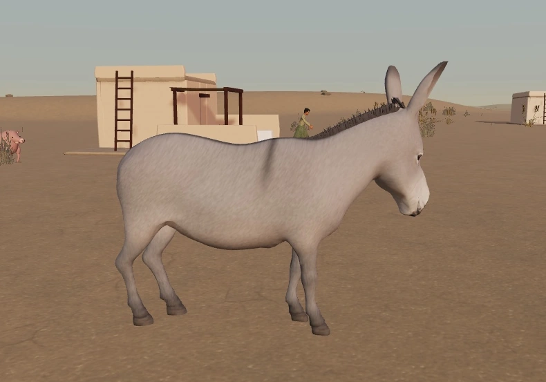

# 18 ноября 2026 · Домашний осёл

Выпуск `pasture-donkey-20261118`, игровой коммит [d3c4fc69](https://github.com/reinekes/new_babylon_demo/commit/d3c4fc69c96bbedddf74836c828cb80d2c86ce06). [Публикация GitHub Pages](https://github.com/reinekes/new_babylon_demo/actions/runs/44355475014)

- Новая модель используется у окраины и у купца. У осла длинные подвижные уши, короткая объёмная грива, светлая морда и четыре цельных копыта. Сумы следуют за спиной животного.
- В городе записаны 90 поз за 5,97 с, осёл прошёл 2,91 м. Завершены 77 профильных и 14 проверок roadmap. При 500 жителях, 250 зданиях и скорости 4× средние двух замеров составили 23,49 и 24,98 FPS. [Шаг в городе](../../roadmap/evidence/2026-11-18/pasture-donkey/walk.mp4) · [Измерения](../benchmarks/2026-11-18-pasture-donkey.json)
- С GitHub Pages открыты новая и прежняя модель. При блокировке новой четыре осла получили прежний GLB. Сверены контрольные суммы 31 опубликованного файла. [Публичные проверки](../benchmarks/2026-11-18-pasture-donkey-pages.json) · [Художественный отчёт](../../roadmap/reports/2026-11-18-pasture-donkey.md)
