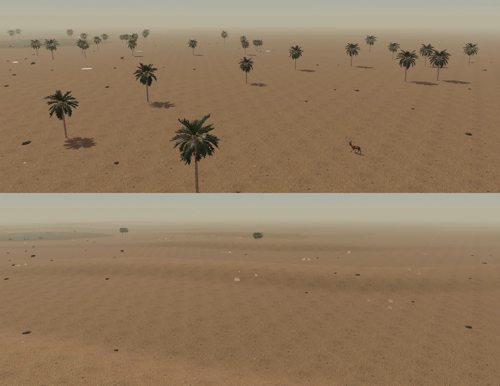

# Путь развития «Нового Вавилона»

Состояние на 13 ноября 2026 года. В датированных отчётах указаны опубликованные изменения и проверки. В открытом плане остаются задачи, которые ещё требуют работы или приёмки.

## Что уже составляет основу

Жители строят здания, переносят грузы и ведут хозяйство. Работают поля, каналы, рынок, пристань, речная торговля, развитие ремёсел, именованные сохранения и импорт архивов. Два режима начала позволяют играть за слабого бога без веры или за покровителя. Есть сюжетные цепочки чудес, реликвии, поздняя глава зиккурата и несколько финалов с возможностью продолжить историю.

Текущие модели и их применение показаны в [3D-атласе](../model-atlas/). Оба восточноазиатских бычка доступны в [тестовой сцене](../?fish-preview=1). В обычной исторической партии остаётся рыба долины.

## Этап 1. Убедиться, что в это удобно играть

В текущем публичном выпуске полный обзор большого города на 4× дал **28,53 FPS** с обычным HUD, тенями и 10 автосохранениями за 30 секунд (200 жителей, 129 зданий, Apple M2). Предыдущий контрольный замер перед выпуском — 22,27 FPS. Цель — два последовательных замера не ниже 30 FPS. [Отчёт о выпуске](../docs/versions/2026-11-13-05.md)

Открытый наблюдаемый плейтест ждёт участников. Для него уже есть протокол и контрольные сохранения. [Протокол](../docs/NEW_PLAYER_PLAYTEST.md)

## Этап 2. Слабый бог и первое настоящее открытие

Первый знак, первая помощь водой и история рыбака с кошкой уже доступны в «Пробуждении». Игрок ещё не всесилен: замечает человека, вдохновляет его, человек действует, свидетели связывают результат с божеством. Только после конкретного события открывается определённая помощь. Вера определяет возможность и цену использования, но не заменяет само открытие.

Состояние цепочек и свидетельства хранятся в сохранении. В датированных отчётах можно проследить, какие действия жителей открывают каждый дар. В игре эти условия должны читаться по подсказкам и летописи.

Дальнейшая проверка должна показать, находит ли игрок цепочку первого дара и понимает ли, какое действие жителей продвинуло историю.

## Этап 3. Чудеса приобретают характер

Для каждого дара разделить открытие, применение, последствие и память жителей. Вода оставляет влажный след, помощь ремесленнику видна в его действии, общественное событие имеет свидетелей. Эффект должен объяснять происходящее даже без музыки. Модельки и музыкальные мотивы можно добавлять позже через согласованный набор точек подключения.

У новых партий в «Пробуждении» уже есть отдельные условия доступа к дарам. Летопись и городские разделы показывают результаты труда, семейную память и обеты.

## Этап 4. Исторический облик без повторного строительства готовых систем

Новые партии используют профиль «Южный Шумер». В нём торговый караван идёт с ослами, а священный двор оформлен Вратами Инанны. Прежние сохранения продолжают использовать собственный профиль.

В игре есть оборонительные стены, тростниковые постройки, гончарные мастерские, поля и каналы. Их модели и материалы следует сверять с источниками для выбранной эпохи. Современные мудхиф и машуф дают ориентир по работе с тростником. Конкретный вид древних построек и лодок требует самостоятельного обоснования.

В сухой части долины появились низкие гряды, редкие группы травы и плавный переход к горизонту. Сухие холмы — художественный выбор; основа карты по-прежнему низкая пойма.

Результат: визуальная приёмка по датированным музейным или научным аналогам. В каждом спорном пункте сохраняется оговорка, где кончается подтверждение и начинается игровой выбор.

## Этап 5. Живой город и более глубокое хозяйство

Есть смена сезонов, обслуживание каналов, разливы, ученичество, ремёсла, внешние договоры и гости, семейная забота и общие трапезы. Следующие проверки должны показать, понимает ли игрок причину предупреждения и может ли исправить положение доступным действием.

Связывать системы через реальные запасы и труд. Перед любой миграцией отдельно проверять старые сохранения, личности и грузовые поручения. Крупные ветви страха, войны и региона оставить решениями дальней перспективы, пока основной путь доброжелательного слабого бога не проходит целиком.

## Этап 6. Приёмка, звук и выпуск

Музыка уже существует; требуется развитие взаимодействия со сценой, ремёслами и церемониями, а не новая музыка «с нуля». Индекс моделей опубликован. Следующие графические изменения нужно проверять вблизи и в полном обзоре большого города. После каждого согласованного игрового этапа: подходящие проверки, ручная приёмка, публикация Pages и новый неизменяемый снимок в docs/versions. Desktop/Steam — отдельные работы после устойчивости браузерного выпуска.

## Как выбирать следующую задачу

Сначала посмотрите P0 и незакрытые зависимости. Берите одну проверку или одну цепочку с наблюдаемым результатом. Критерий «Готово когда» определяет конец работы. Если задача оказалась слишком широкой, разделите её на новые стабильные ID и обновите зависимости. Закрывайте только проверенную часть: не удаляйте оставшиеся требования вместе с названием большой идеи.

Для каждого пункта используйте свой критерий приёмки. Исследование источников, решение о механике и её проверка в игре требуют разных подтверждений.

## Материалы для ближайшей записи

Откройте [«Звуки и ролики»](#materials). Там полный список для записи и съёмки, включая шаги, факел, вечернюю игру и ролики чудес.
