## audit-fixes-20261113 | Жизнь кварталов, рельеф и городской караул
date: 2026-11-13
type: release
release: audit-fixes-20261113
commit: 4a2e3a0b
publication: recorded
groups: graphics; simulation; ux; performance
completed: -
source: docs/versions/2026-11-13-05.md

### Результат

- Протоптанные тропы появляются от реальных проходов и постепенно стираются. Построенные вручную дороги остаются. В режиме «Дороги» видна вспомогательная сеть. Симуляция по-прежнему использует безопасные маршруты по узлам, включая диагонали; визуальные стыки троп сглажены. В старых сохранениях ручная дорога I уровня, совпавшая с автоматически проложенной, могла не иметь признака происхождения; II и III уровни сохраняются.
- Рыбаки, полевые работники, мастерские и рынок открываются в разное время. Жители одного заведения также выходят из домов и возвращаются с интервалами. Карточка показывает часы и текущий статус. Срочные действия и начатые доставки сохраняют приоритет.
- В сухой части долины добавлены низкие гряды, пологие холмы и группы сухой травы. Рельеф не меняет правила строительства и водную систему. Жилой берег сохраняет пальмы, сухие гребни остаются открытыми.
- Стадо получило разные варианты овец и фазы движения. На свободный плодородный выпас они выходят днём; к 17:30 возвращаются. Без доступного пастбища остаются в загоне. Зимний пеликан больше не использует старую модель полёта. На воде он сидит ниже, чередует гребки и скольжение; стоячие ноги скана скрыты ниже поверхности.
- По погребальной сцене: один компактный статус, разреженная процессия, носилки уходят на сухое место дальше от застройки, участники расходятся постепенно. Старые погребальные маршруты в сохранениях совместимы.
- Карточка «Покров Инанны» открывается внутри панели, годовая сводка производства заполняет ширину, верхняя строка ресурсов сокращается на узком экране. В атласе добавлены общий поиск и прямые разделы для рыбы, грызунов и змей; статус каждого варианта виден отдельно.
- В плане открыт разбор обычных зданий с возвратом материалов. Это будущая работа; уже действует отдельная разборка временных шалашей.
- В зрелом городе Южного Шумера с 48 жителями можно построить Караульный двор и назначить до двух взрослых. Ночью стражник обходит сухие проходы с факелом, днём второй держит пост; дежурный защищает ближайшие доступные склады от кражи зерна. При сближении обычные шакалы смещаются от ночного караульного. Погребальный обряд имеет свои правила.
- Ремесленные постройки разделены на четыре подкатегории. В открытом плане отдельно отмечены переезд выросших детей и ветшание пустых домов. [Список звуков и коротких роликов](../../docs/ASSET_BRIEF_2026-11-13.md) готов для подготовки исходников.

### Проверки

Полный набор Node: 2004/2004. Отдельно: 6 проверок сборщика roadmap и 6 JS-проверок его логики. Сохранения проверены во время троп, патруля, снабжения и на всех этапах обряда. Chrome подтвердил меню, поступление зерна, карту, атлас, часы заведений и караул. В одном контрольном дворе работники вышли в 06:18 и 06:37. На GitHub Pages сверены 17 файлов выпуска.

Публичный 30-секундный замер: 200 жителей, 129 зданий, полный обзор на 4×, обычный HUD, высокое качество, тени и автосохранение. Apple M2, 1440 × 900: **28,53 FPS**, p95 кадра **50,0 мс**, 10 автосохранений, ошибок страницы и остановок не было. До цели 30 FPS ещё не дошли. Предыдущий отдельный замер той же публичной сцены перед выпуском дал 22,27 FPS и 10 автосохранений; более ранний замер дал 16,60 FPS. Это короткие прогоны, а не гарантия скорости на любом устройстве.

### Скриншоты из игры

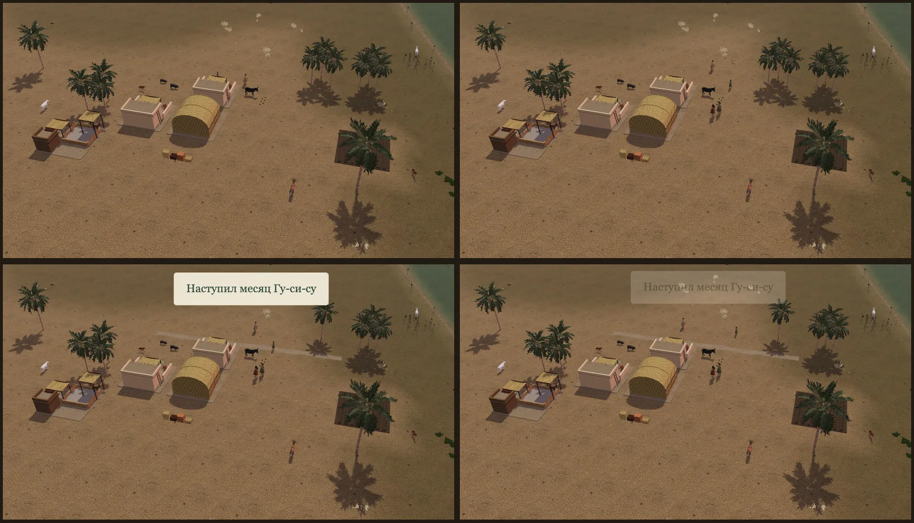

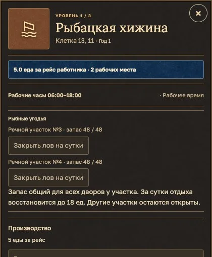

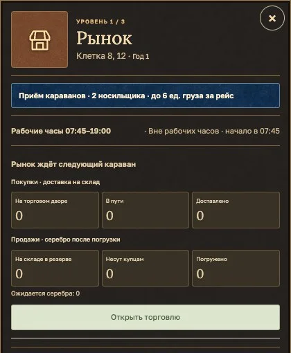

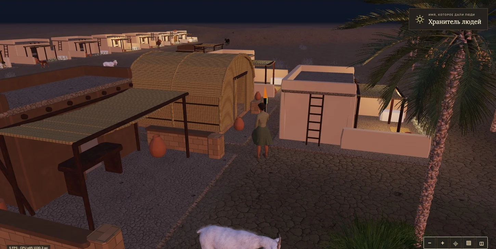

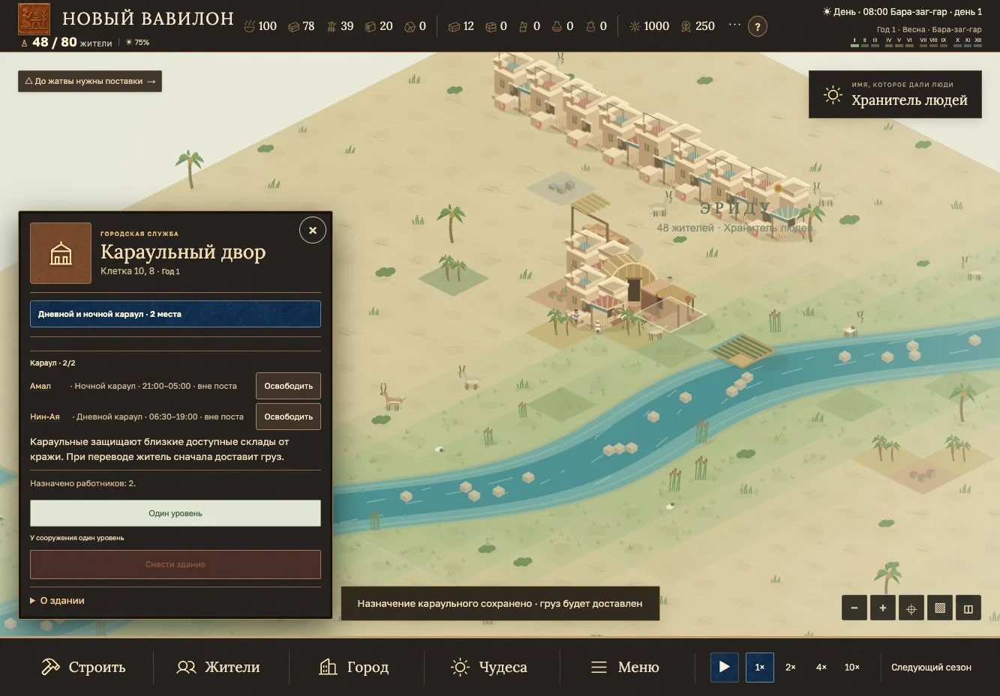

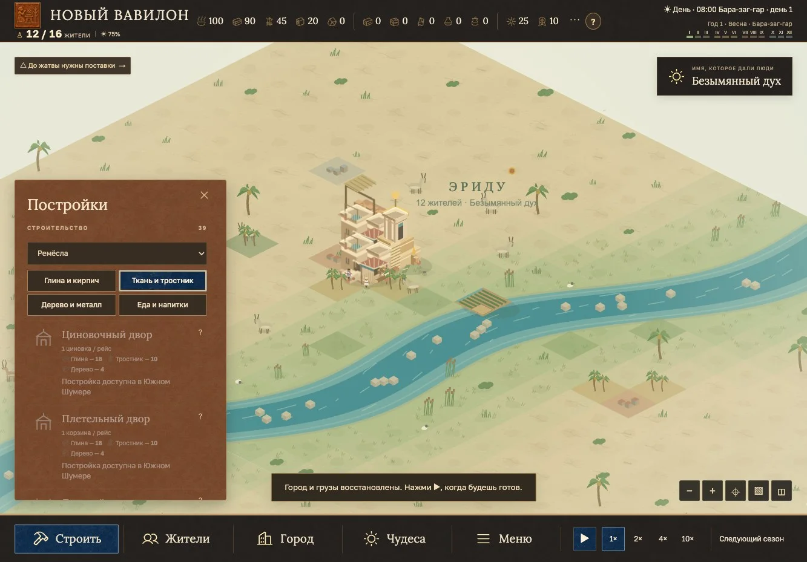

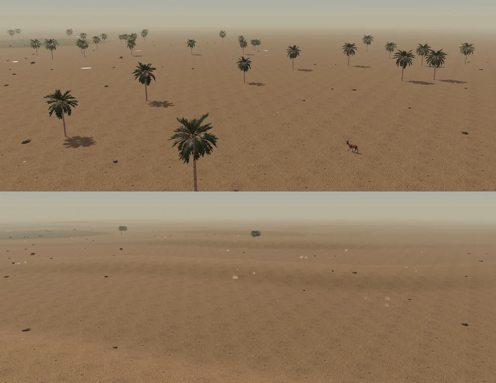

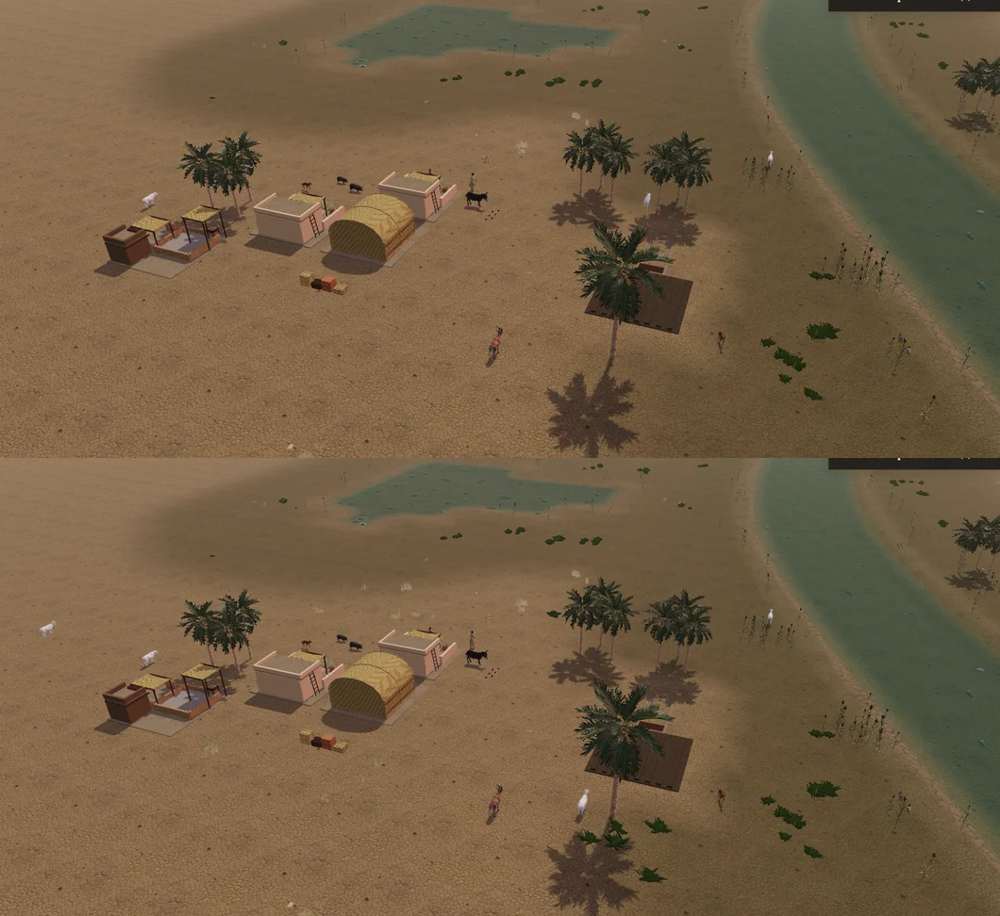

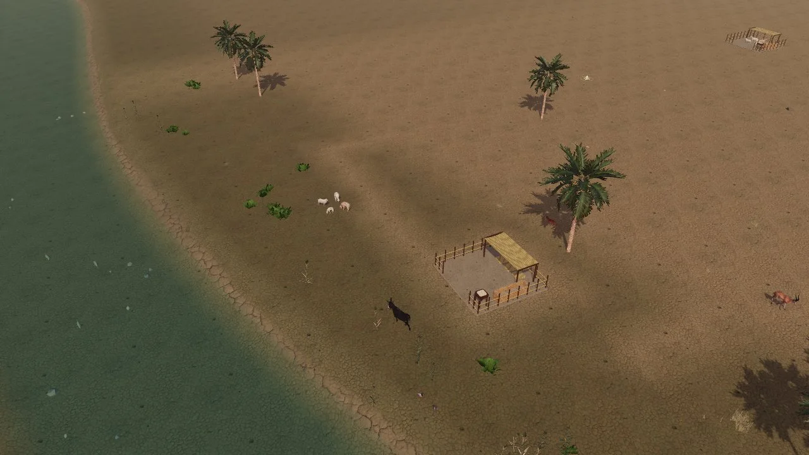

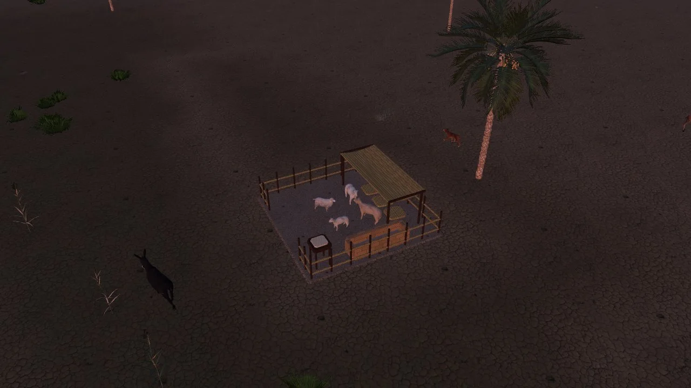

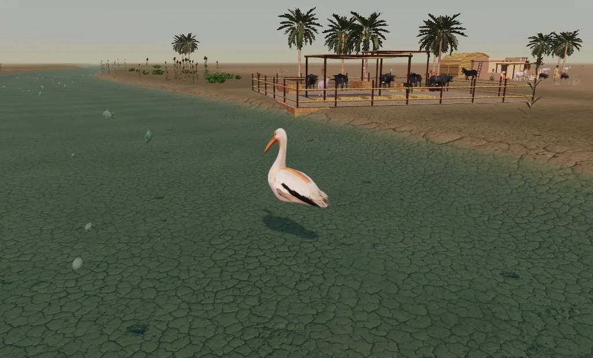

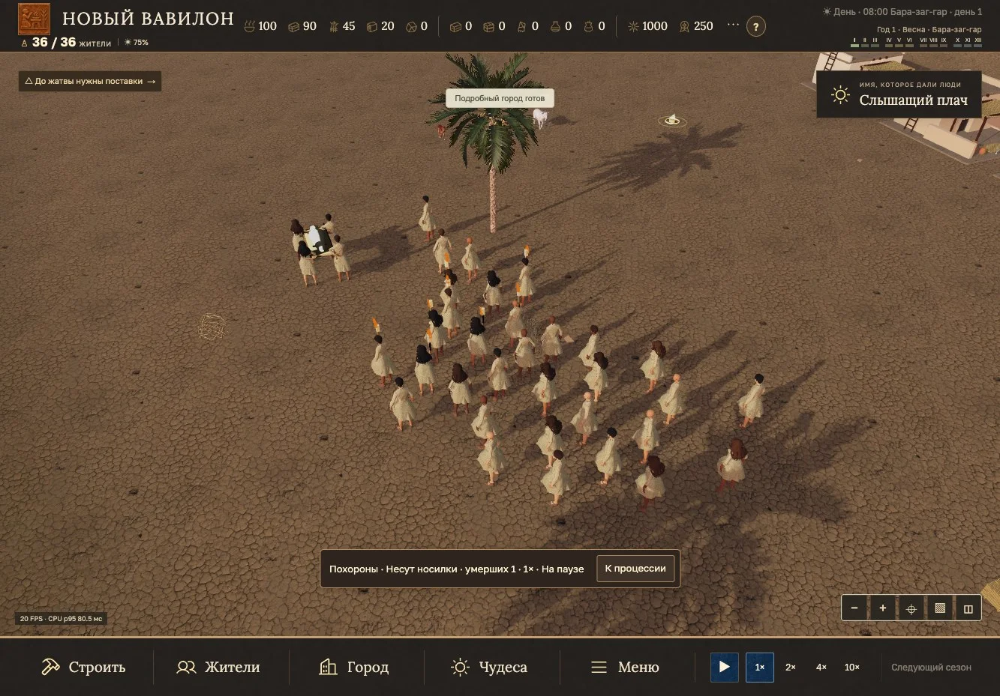

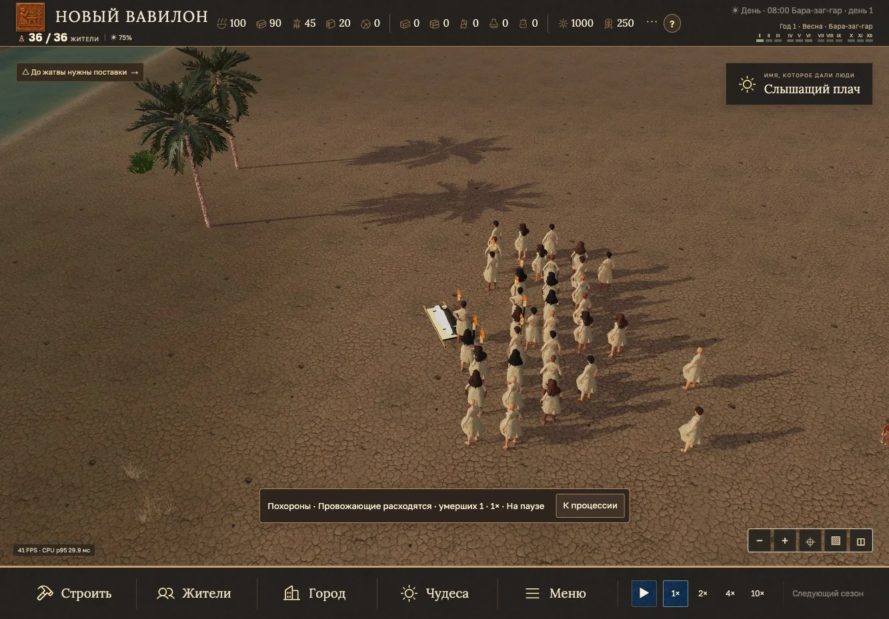

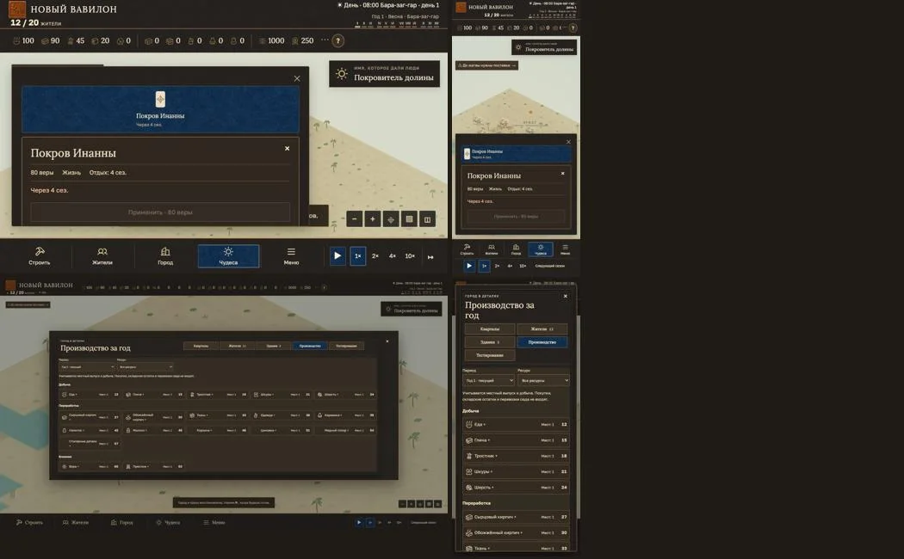

