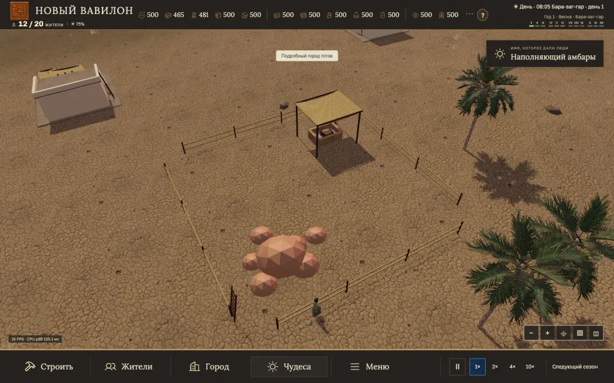
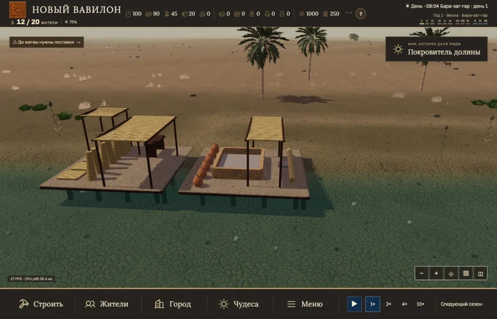
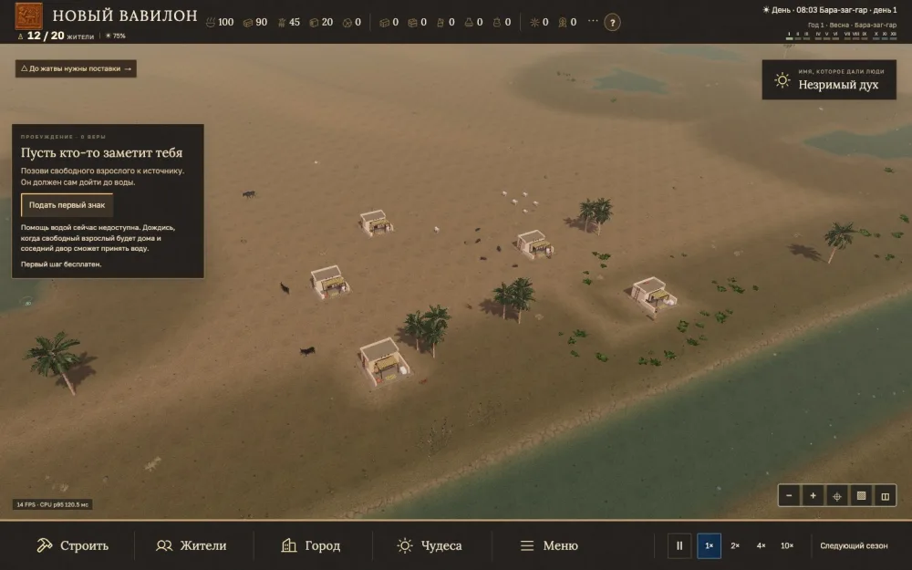

## city500-fauna-courts-20261113 | 500 жителей, фауна и открытые дворы
date: 2026-11-13
type: release
release: city500-fauna-courts-20261113
commit: d058bbc5
publication: verified
groups: performance; graphics; simulation; ux; economy
completed: audit-city-4x-live
source: docs/versions/2026-11-13-06.md

### Результат

При 500 жителях и 250 зданиях два контрольных замера полного обзора на 4× достигли 31,58 и 32,75 FPS. Публичный повтор дал 33,20 FPS. Подключены присланные GLB рыб, змеи и грызуна, исправлены движения стад, стыки стен, береговые опоры и тропы. Добавлены таблица профессий, подсветка чудес, открытые добывающие дворы 2 × 2, 25% выхода ручной добычи и старт у реки в середине карты.

### Проверка

Побайтная загрузка и десять автосохранений в каждом контрольном прогоне. Измерены также редкие длинные кадры. [Замеры и контрольный файл](../#performance). 2 019 тестов Node и браузерные проверки. 19 критических файлов опубликованной версии совпали по SHA-256.

