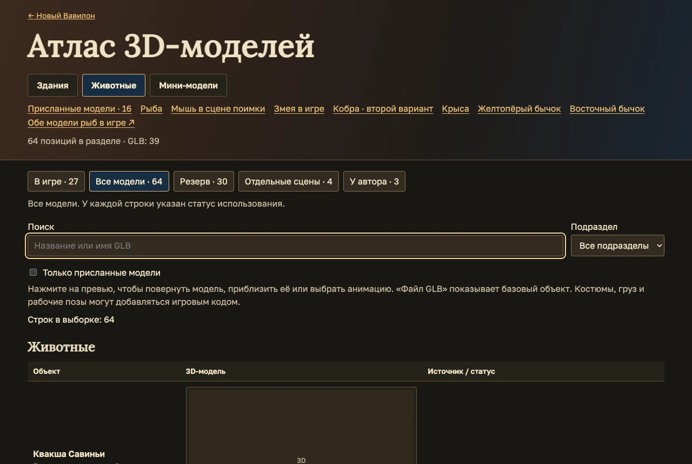
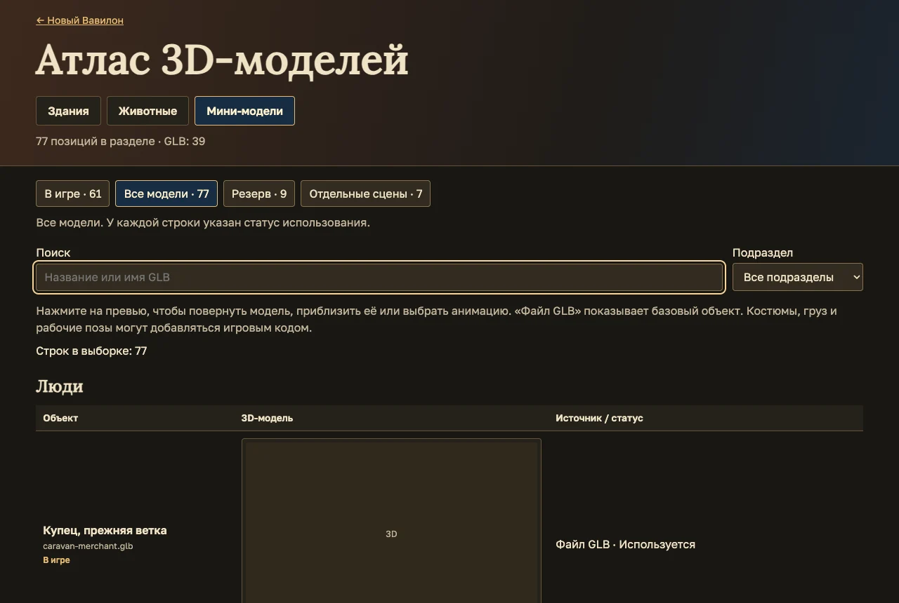

## atlas-sections-20261116 | Три отдельные вкладки атласа 3D
date: 2026-11-16
type: release
release: atlas-sections-20261116
commit: 4bd37781
publication: verified
groups: ux; performance
source: docs/versions/2026-11-16-08.md

### Изменения

«Здания», «Животные» и «Мини-модели» открываются по отдельным адресам. Мини-модели включают жителей, транспорт, растения, предметы и мифологические скульптуры. Поиск и статусы работают внутри выбранного раздела. Скриншоты ниже сняты на GitHub Pages.

### Проверки

Chrome подтвердил, что открытая вкладка получает только свой JSON. В трёх каталогах 51, 64 и 77 позиций. Размер файлов без сжатия составляет 27,6 КБ, 42,3 КБ и 36,7 КБ соответственно против 99,8 КБ общего индекса. Просмотр кувшинов обходится без GLB. Старые ссылки на виды и файлы открывают соответствующий раздел и модель. На ширине 390 px горизонтальной прокрутки страницы нет. Девять файлов опубликованного атласа сверены по SHA-256.
