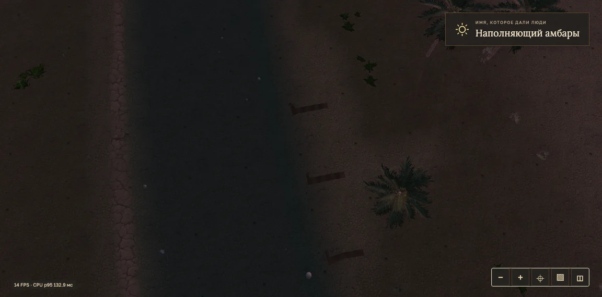
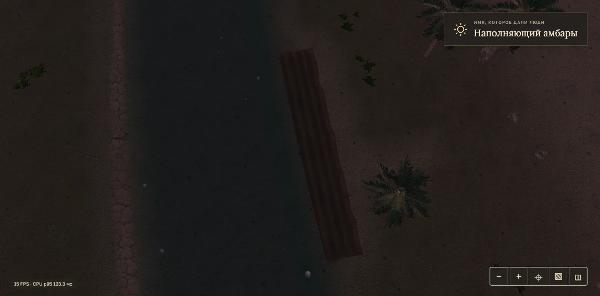

## field-shore-draw-range-20261116 | Поля у воды снова видны целиком
date: 2026-11-16
type: release
release: field-shore-draw-range-20261116
commit: f18ab568
publication: verified
groups: graphics
source: docs/versions/2026-11-16-03.md

### Что исправлено

После обрезки поля по берегу Babylon сохранял прежний диапазон отрисовки. На делянке (36, 43) диапазон содержал 2 304 индекса из 15 558, и на карте оставалась узкая полоса почвы. Теперь при создании и повторном использовании береговой сетки диапазон строится заново. Граница почвы по-прежнему совпадает с линией воды, а соседние делянки сохраняют общие борозды.

### Проверка

40 профильных тестов прошли. Регрессионный тест подтверждает полный диапазон отрисовки у трёх делянок и повторное использование той же сетки после посева. В Chrome проверены берега с руслами вдоль обеих осей карты, день, ночь и загрузка сохранения. При 500 жителях и 250 зданиях на 4× до объединения с выпуском шалашей получено 32,35 FPS, после объединения 32,80 FPS. В каждом прогоне было десять автосохранений с побайтной загрузкой. Восемь файлов GitHub Pages сверены по SHA-256.
