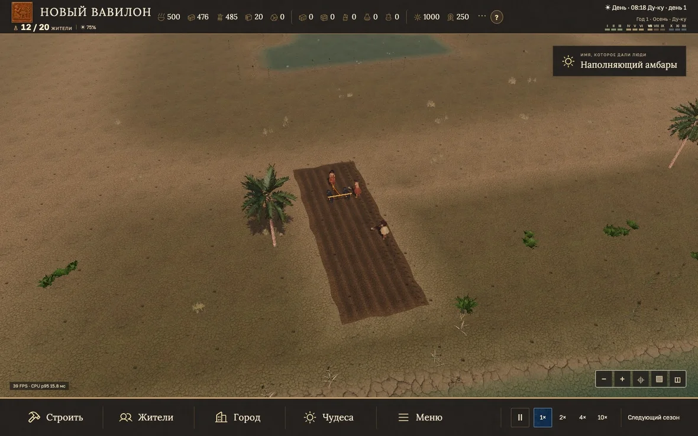
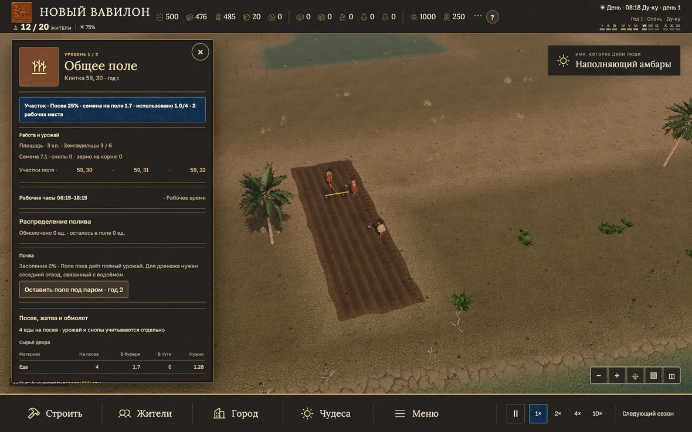
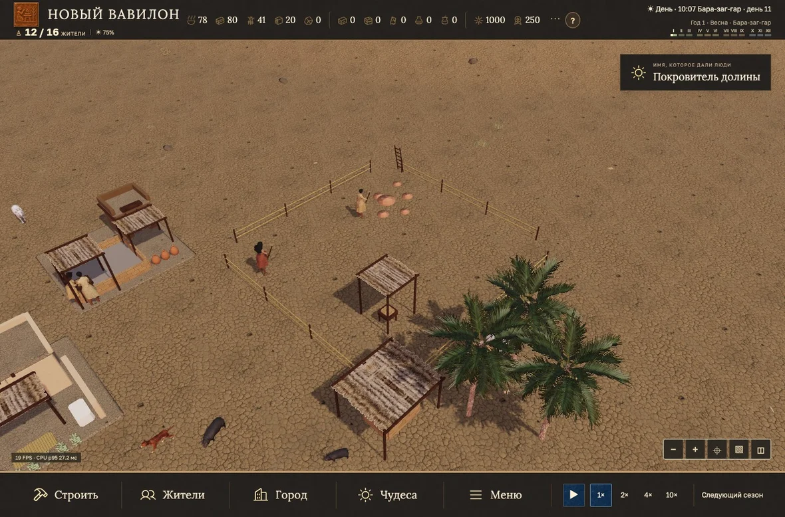
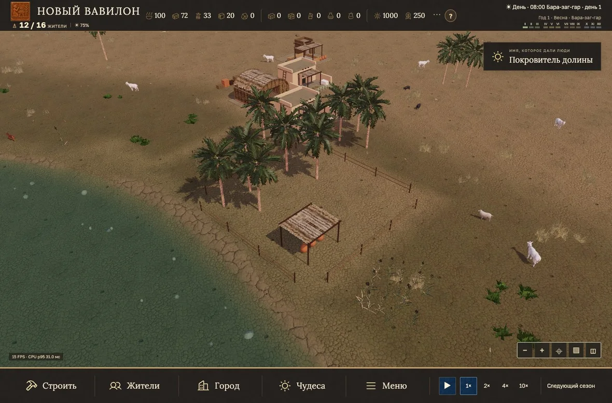
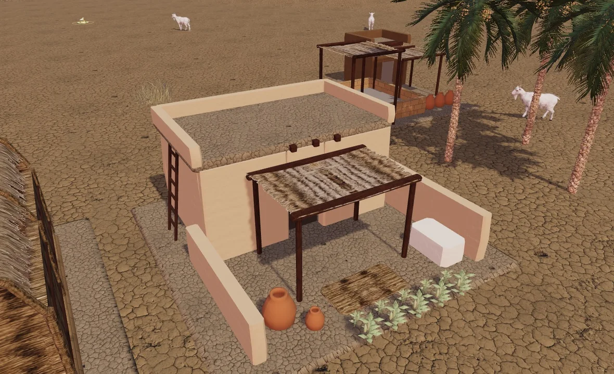
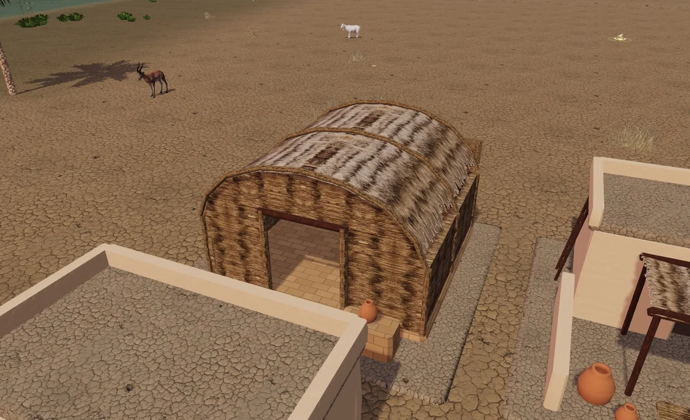
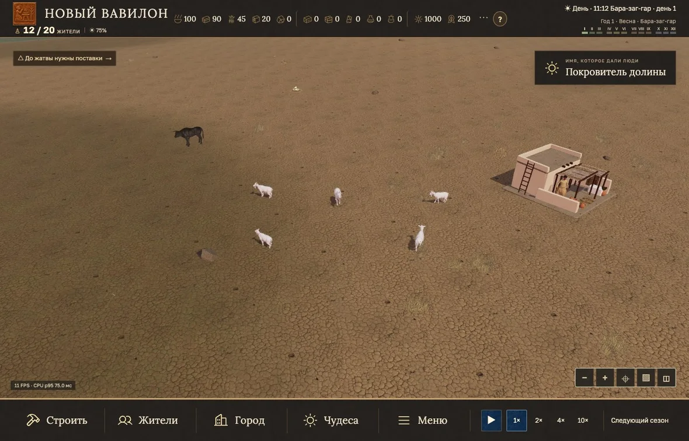
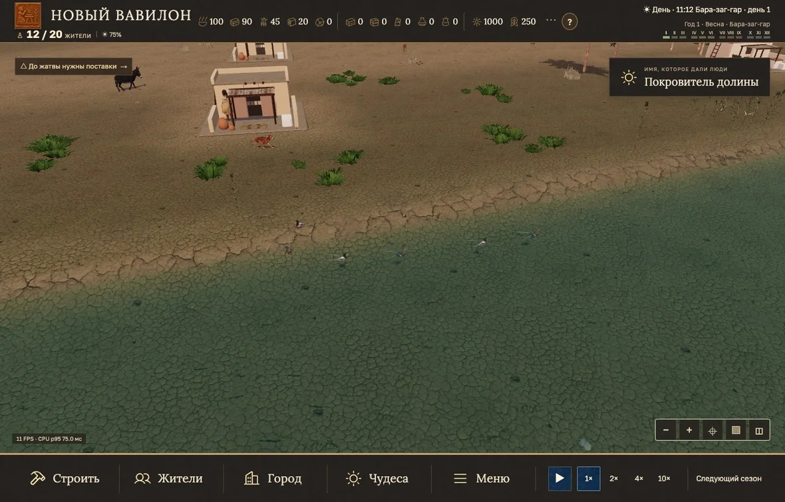
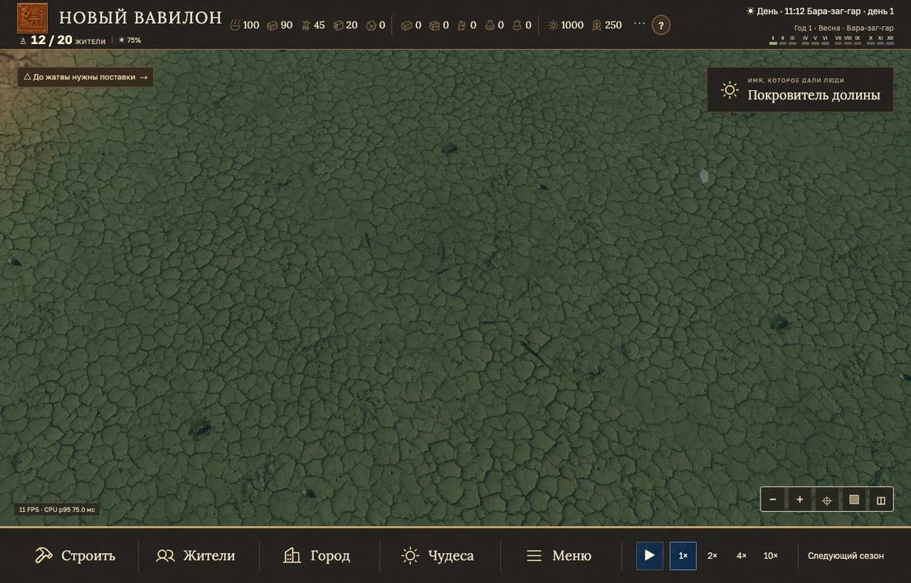

## living-fields-20261116 | Общее поле, добывающие дворы и живая долина
date: 2026-11-16
type: release
release: living-fields-20261116
commit: 934fbba5
publication: verified
groups: graphics; simulation; ux; economy; performance
source: docs/versions/2026-11-16.md

### Поля и упряжка

Готовые квадраты с общей стороной соединяются в одно поле. Борозды продолжаются через швы; наружная кромка переходит в землю. На общей карточке видны площадь, земледельцы и запасы; можно открыть каждую делянку. Мест два на клетку: три клетки дают шесть мест. Отдельные адреса, семена, посев, вода и происхождение урожая сохранены. Упряжка из двух волов проходит через соседние делянки в посевной сезон. В контрольной сцене прошла 7,02 м; клип шага следует пройденному расстоянию.

[Шумерские «Наставления земледельцу»](https://etcsl.orinst.ox.ac.uk/cgi-bin/etcsl.cgi?charenc=j&text=t.5.6.3) описывают работу с волами и плугом-сеялкой; [табличка из Уммы эпохи Ур III](https://cdli.earth/artifacts/208750) фиксирует учёт полевых работ. Две позиции на клетку и порядок обхода делянок — правила игры.

### Добыча внутри двора

Открытая ограда и навес обрамляют залежи своего вида внутри 2 × 2. Каждая остаётся на исходном месте, имеет отдельный остаток, и работники подходят к ней. Глина, камень, тростник и древесина редеют по остатку. У пальм уменьшаются грозди, деревья остаются, урожай возвращается осенью; 42 единицы на участок — игровой баланс. Ручной сбор сохраняет выход 25%, двор — полный выход; старые сады 1 × 1 сохраняют прежние правила. Места охоты сохраняют исходные метки, а охотники работают с живой дичью. [Учёт зрелых фиников из Уммы](https://cdli.earth/artifacts/218066).

### Тростник и фауна

Фактура присланного GLB Nucity используется на тонких крышах, навесах, циновках и экранах. Концы стеблей вырезаны прозрачностью; цельная тяжёлая модель не размножается по домам. [Автор и лицензия исходника](../../assets/art-courtyard/ATTRIBUTION.md). [Урукское корыто](https://artsandculture.google.com/asset/the-uruk-trough/kwFju0PVr9t1rg?hl=en) изображает тростниковые сооружения конца IV тысячелетия до н. э.; конкретная форма дворовых навесов — художественная адаптация.

Козы держатся рядом, но кормятся на разных участках, отдыхают и трогаются в разное время. Кряквы проходят вдоль берега, кормятся на мелководье и плавают. Обе модели рыбы повёрнуты головой по движению; рядом с городом заметнее косяки. Газели, перепела и лягушки появляются небольшими группами в подходящих местах. Дополнительные животные декоративны и не увеличивают запасы рыбы или число охотничьих целей. [Коза в шумерском искусстве](https://www.metmuseum.org/art/collection/search/324588) · [Газель на печати из Ура](https://collections.penn.museum/collections/object/156549).

### Большой город

[Замеры и сохранение для повтора](../../docs/PERFORMANCE_CITY_500_2026-11-16.md). Средние FPS и время длинного кадра указаны отдельно.

В двух локальных прогонах: **27,32 и 26,40 FPS**; самый длинный кадр **116,7 и 133,3 мс** против **483,3 мс** в сегодняшнем исходном замере. Десять автосохранений в каждом повторе, загрузка побайтная. Стабильные 30 FPS остаются в плане.

2 030 тестов Node и 6 тестов roadmap прошли. GitHub Pages: 32 файла совпали с игровым коммитом по SHA-256. В публичном Chrome проверены атлас, объединение поля и загрузка сохранения в 2D, вкладка замеров и узкая вёрстка roadmap.
