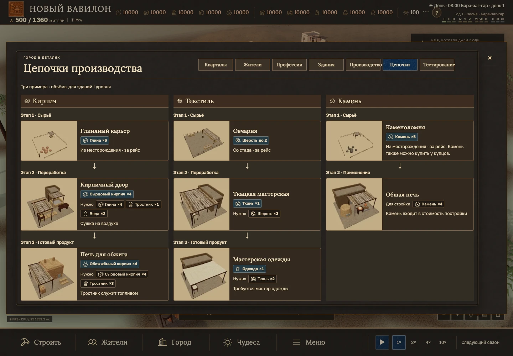
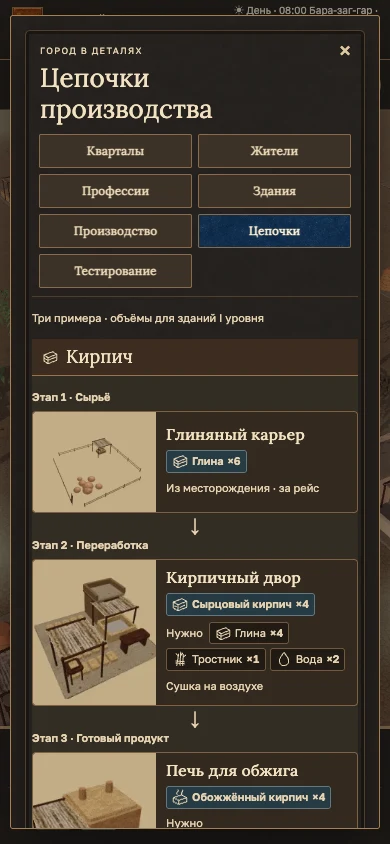

## production-chains-20261117 | Цепочки производства в меню города
date: 2026-11-17
type: release
release: production-chains-20261117
commit: 42df43f8
publication: verified
groups: ux; economy
source: docs/versions/2026-11-17-09.md

### Изменения

Новый пункт меню ведёт в схему с миниатюрами игровых зданий и значками ресурсов. В примере три ветки. Первая ведёт от глины через сырец к обожжённому кирпичу. Вторая показывает шерсть, ткань и одежду. Третья показывает камень как стройматериал для общей печи. Входные материалы указаны на одну партию для I уровня зданий. На узком экране ветки идут друг под другом.

### Проверки

41 профильный тест, Chrome при ширине 1440 и 390 px, восемь загруженных изображений, переход в годовой отчёт и возврат фокуса в меню. Снимки сделаны в опубликованной игре. Результат контрольного прогона большого города на 4× записан в снимке версии.
