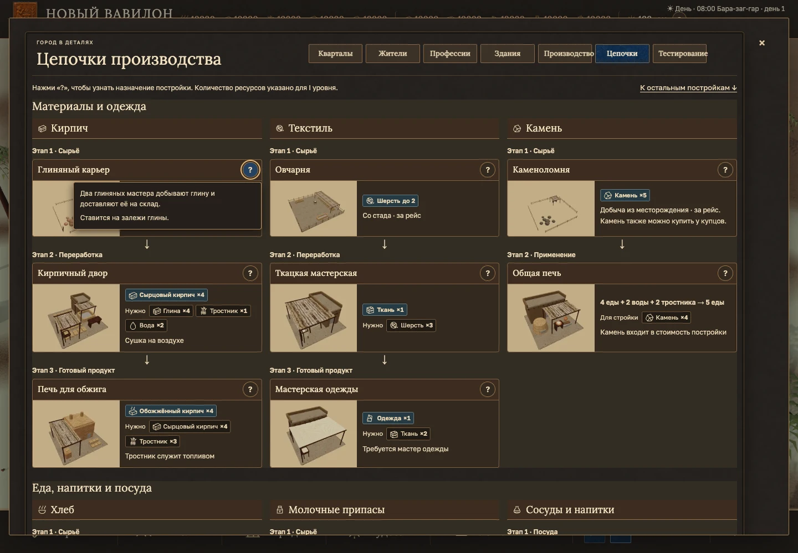
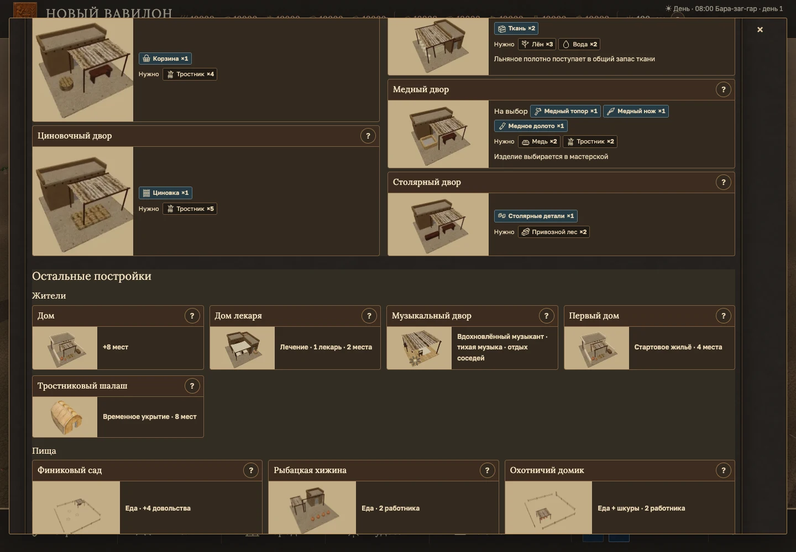

## production-guide-20261117 | Справочник всех построек
date: 2026-11-17
type: release
release: production-guide-20261117
commit: 5d9dedae
publication: verified
groups: ux; economy
source: docs/versions/2026-11-17-12.md

### Изменения

«?» над каждой карточкой объясняет назначение здания и условия его работы. Восемь схем показывают преобразование ресурсов и их применение. Все остальные постройки размещены ниже по группам. Справочник включает все 40 типов каталога, первый дом, временный тростниковый шалаш и дорогу.

### Проверки

42 профильных теста. В Chrome проверены все 43 миниатюры, открытие справки мышью и с клавиатуры, переход к остальным постройкам и ширина 390 px. Общий размер миниатюр 170 КБ, загрузка начинается при просмотре вкладки.
