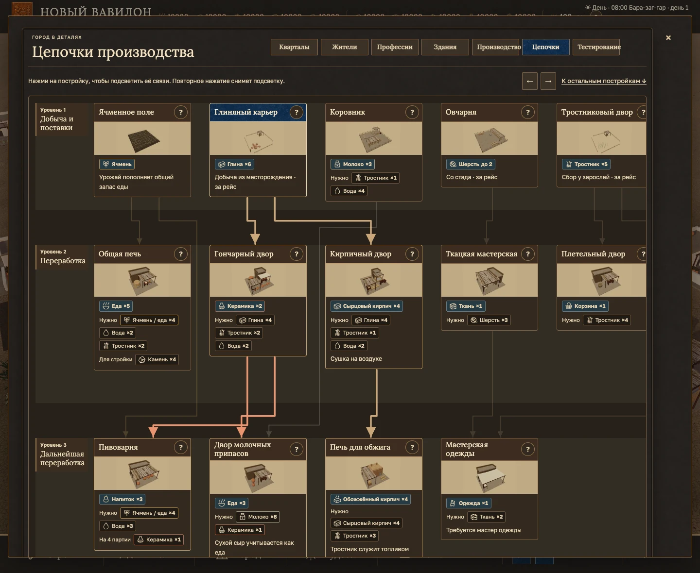
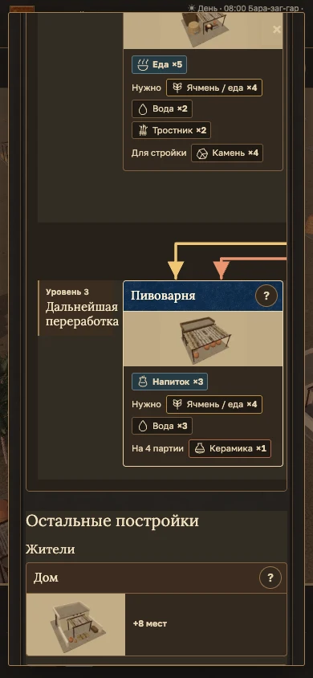

## production-highlight-20261117 | Подсветка производственных связей
date: 2026-11-17
type: release
release: production-highlight-20261117
commit: 67ee9c7b
publication: verified
groups: ux; economy
source: docs/versions/2026-11-17-14.md

### Изменения

Клик по карточке выделяет все входящие и исходящие маршруты выбранной постройки. Например, от глиняного карьера видны обе ветки, через гончарный и кирпичный дворы, и их продолжение. Повторный клик снимает подсветку.

### Проверки

20 профильных тестов. Chrome проверил направление стрелок, приглушение сторонних связей, справку «?», клавиатуру и горизонтальную прокрутку на двух ширинах.
