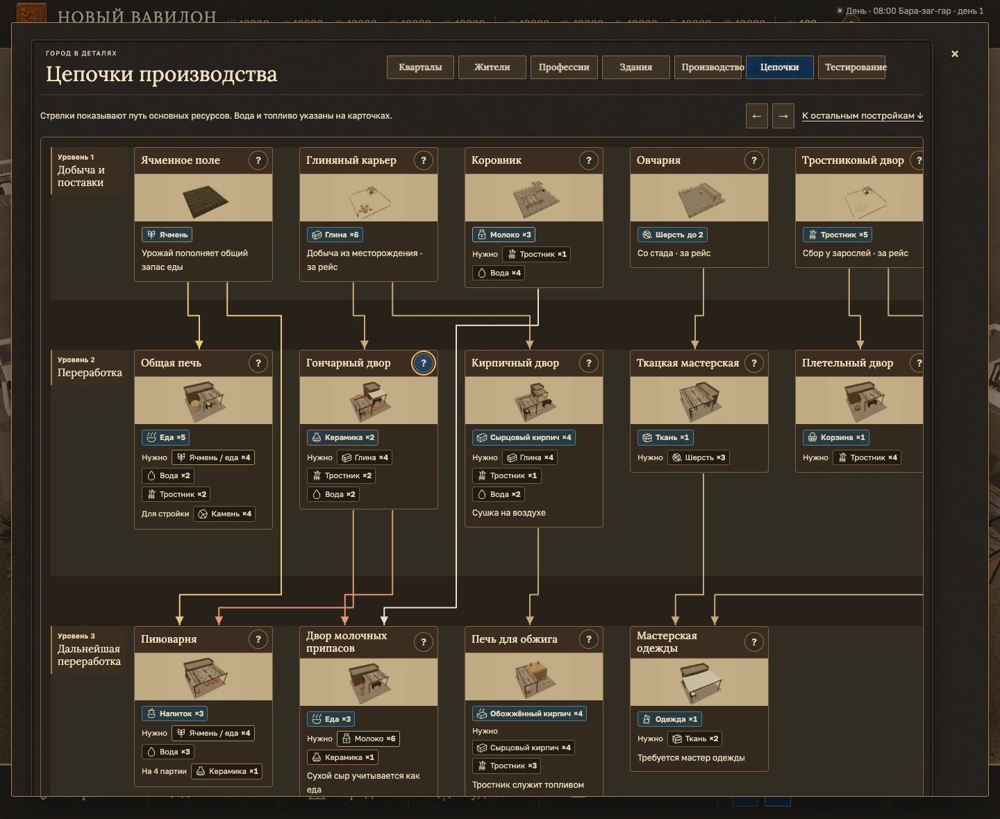
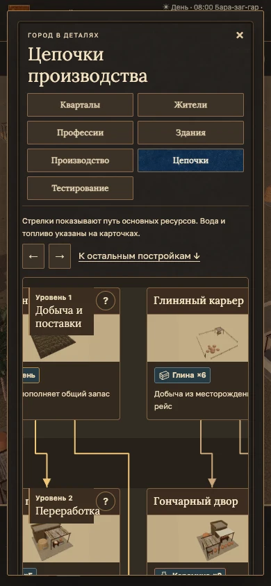

## production-levels-20261117 | Горизонтальные уровни производства
date: 2026-11-17
type: release
release: production-levels-20261117
commit: 8b80cd56
publication: verified
groups: ux; economy
source: docs/versions/2026-11-17-13.md

### Изменения

Вместо отдельных цепочек появилась одна горизонтальная схема. Карточки образуют три ряда, а стрелки соединяют исходные ресурсы с переработкой. К пивоварне сходятся ячмень и керамика, к молочному двору — молоко и керамика. Кнопки в начале вкладки прокручивают одновременно все ряды. Остальные постройки по-прежнему доступны ниже с миниатюрами и справками.

### Проверки

42 профильных теста. Chrome проверил 16 стрелок и 43 карточки, раскрытие «?», переход к остальным постройкам и боковую прокрутку на ширине 1440 и 390 px.
