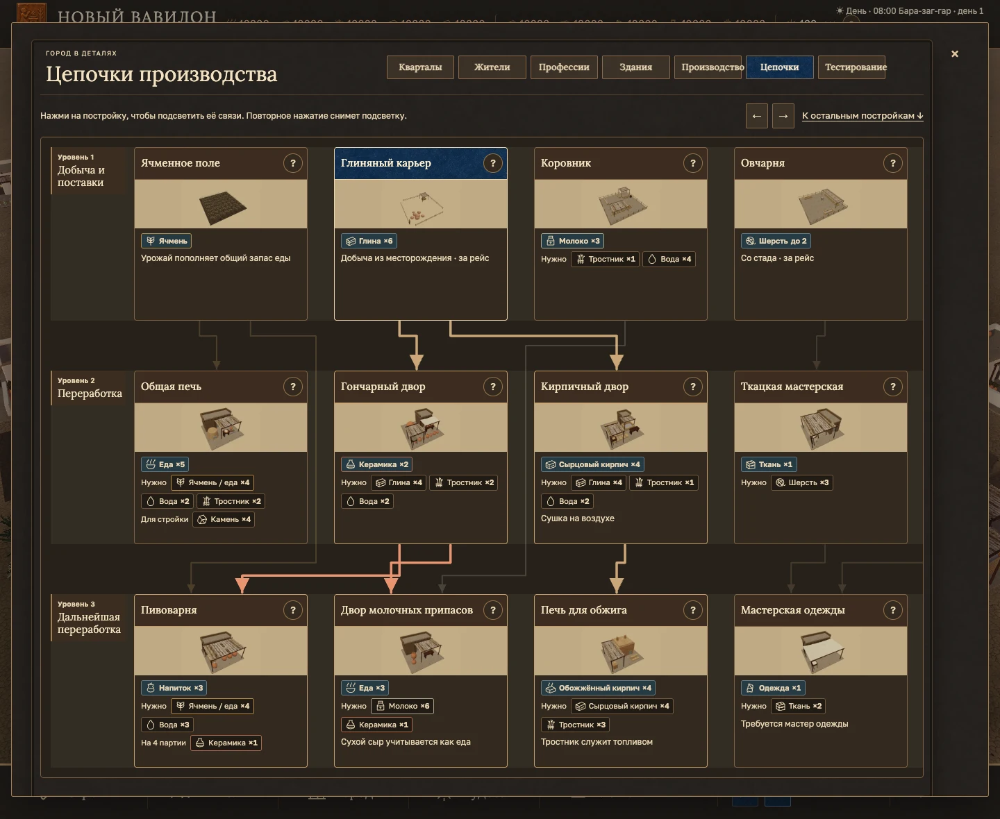
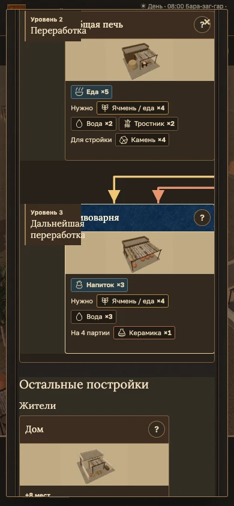

## production-squares-20261117 | Квадратные карточки производства
date: 2026-11-17
type: release
release: production-squares-20261117
commit: dd1946c9
publication: verified
groups: ux
source: docs/versions/2026-11-17-15.md

Все 43 карточки на схеме и в справочнике приведены к единому квадратному формату 250 × 250 пикселей. Иллюстрации и заголовки занимают одинаковые позиции. Названия, ингредиенты и количество продукции помещаются и в самых плотных карточках.

