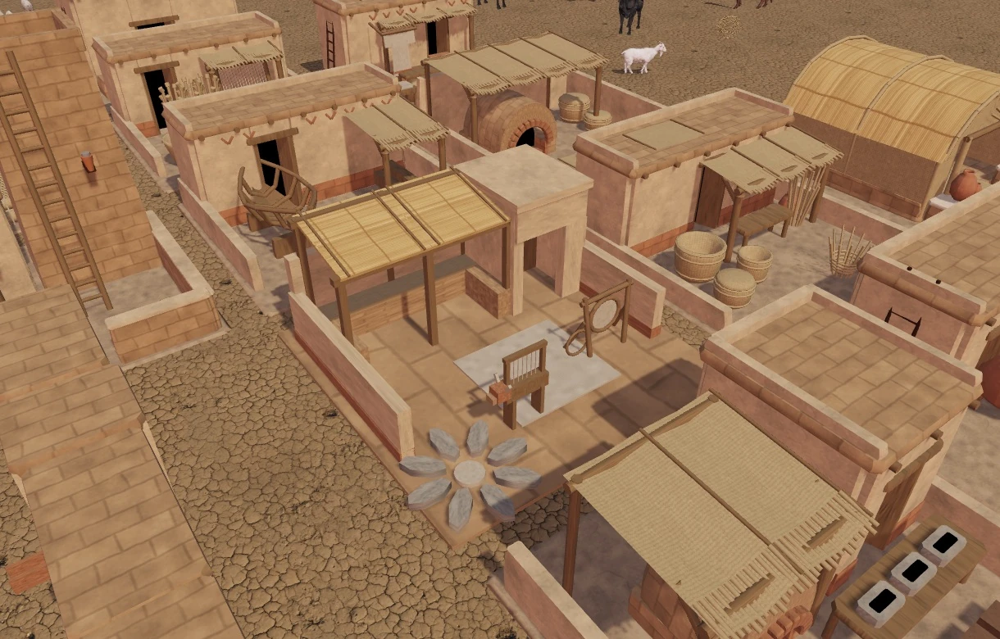
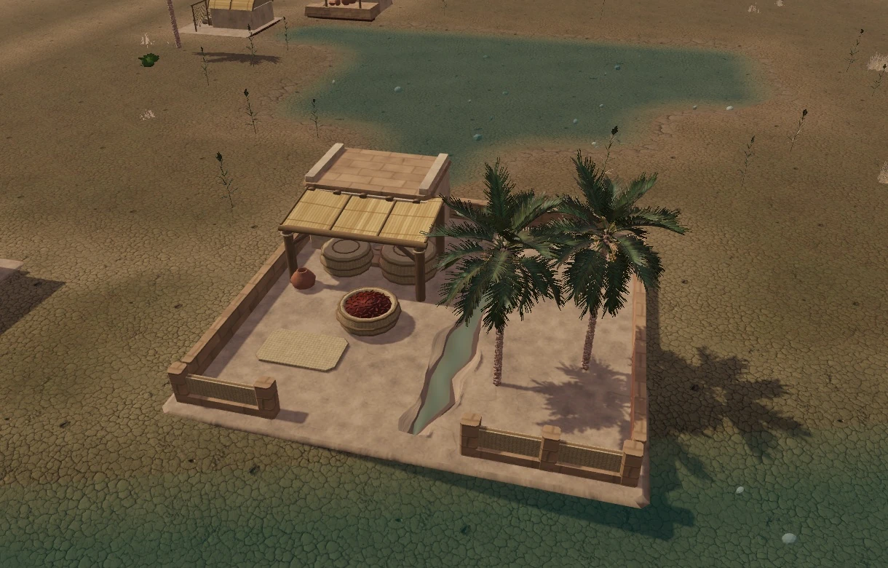

# Художественная проверка 45 игровых построек

18 ноября 2026 · Южная Месопотамия III тысячелетия до н. э.

**Итог.** В город встроены 44 переработанные модели и ранее одобренный дом I. Все 45 проверены в игровом WebGL и отдельным открытием GLB. Наиболее уверенно с обычной высоты камеры узнаются общая крыша двух стойл коровника, открытый музыкальный двор, ступени зиккурата и каркас лодки у столяра. На расстоянии прежде всего теряются тонкие детали — нити, сеть, прутья и ости.

**С чем сравнивали.** Для 39 типов использовали одобренные карточки. Для ячменя — фотографии и описание настоящего растения. Для домов II и III, стартового улья, шалаша и дороги отдельных рисунков в галерее нет. За образцы материала взяты дом I, плетёные постройки и грунт игровой серии. Пять будущих концептов дорожной карты в число игровых моделей не входят. [Галерея](../building-references.html) · [Признаки ячменя, Университет Висконсина](https://corn.aae.wisc.edu/Crops/Barley/Default.aspx) · [Фотографии зрелого колоса, USDA](https://www.nrcs.usda.gov/plantmaterials/wapmstn9835.pdf)

**Общий стиль.** Сырцовый порог, толщина стены и тень под навесом дают рядом стоящим постройкам общий масштаб. Печи и посуду выделяет терракота, промыслы — сложенный запас сырья, дома — затенённый вход. Уровни жилья мягче по кромкам и разнообразнее в цвете, чем некоторые процедурные мастерские. В иллюстрациях глубже тень и подробнее плетение. Сходство ниже указано словами по видимым признакам.

**Границы исторической оценки.** Табличка может подтвердить уход за скотом или работу на дамбе. Этого недостаточно для восстановления фасада конкретного коровника или поперечного профиля вала. Ниже отдельно указаны данные об эпохе и детали, выбранные для игры. Наибольшие допущения — местная каменоломня, масштаб доступного строевого леса, стартовый купольный дом и каменный музыкальный инструмент.

**Проверка в игре.** У каждой позиции проверены игровой кадр и скачиваемая модель. Для 40 сборных моделей сравнивались координаты с игровой сценой, для пяти видов жилья — отрисовка поставляемого GLB. Участок студии действительно содержит ячмень, у сада присутствуют стволы и кроны обеих пальм, в карточке зиккурата показан III уровень. В основной сборке при неподвижной камере за 533 мс ветер изменил 82 944 пикселя изображения ячменя. В контрольном кадре со скрытым ячменём изменилось 0 пикселей. На Apple M5 при 500 жителях и 250 постройках на 4× за один прогон получено 30,31 FPS, ранее в том же сценарии 29,92 FPS. [Проверка геометрии и WebGL](../../docs/benchmarks/2026-11-18-building-art-webgl.json) · [Запись замера](../../docs/benchmarks/2026-11-18-building-art-4x.json)

### Два участка в городе

Музыкальный двор снят в квартале рядом с караульной башней и ремесленными дворами.

В финиковом саду видны обе пальмы, плетёные лари у кладовой и вода в неглубокой канаве.

## Жители

| Постройка и кадры | Сходство с образцом | Видимое расхождение | Общий стиль | Уместность для эпохи |
|---|---|---|---|---|
| **Дом I · рабочий двор** · [Игра](../evidence/2026-11-18/building-art/house.webp) · [Концепт](../../docs/model-prototypes/sumer-building-set/house.webp) | Низкий сырцовый объём, неглубокий навес и посуда у входа. | У выбранного ранее дома появился ограждённый двор и лестница, в концепте передний край открыт. | Неровный парапет, тёплая глина, тёмный дверной проём задают масштаб серии. | Жилой двор и сырцовые стены известны по раскопкам Абу-Салабиха. Расстановка утвари художественная. [Раскопки Абу-Салабиха](https://www.archaeopress.com/Archaeopress/Products/9781803276694) |
| **Дом II · открытый двор** · [Игра](../evidence/2026-11-18/building-art/house-2.webp) | По общему образцу видны затенённая дверь и низкая рабочая зона внутри двора. | Отдельного концепта уровня II нет. Старый и новый силуэты близки, отличия лучше видны у порога и печи. | Циновка и плетёная тара связывают дом с мастерскими. | Двор и примыкающие комнаты имеют археологические параллели. Развитие дома в фиксированный уровень II задаёт игра. [Раскопки Абу-Салабиха](https://www.archaeopress.com/Archaeopress/Products/9781803276694) |
| **Дом III · верхняя терраса** · [Игра](../evidence/2026-11-18/building-art/house-3.webp) | С нижнего двора видна связь верхней комнаты со ступенями и террасой. | Для уровня III нет отдельной иллюстрации. С дальнего ракурса часть утвари верхнего этажа исчезает за парапетом. | Сохраняет семейство дома I при другой высоте и плотности застройки. | Сырцовый жилой комплекс уместен. Второй этаж, лестница и размер террасы конкретной семьи реконструированы условно. [Раскопки Абу-Салабиха](https://www.archaeopress.com/Archaeopress/Products/9781803276694) |
| **Стартовый дом-улей** · [Игра](../evidence/2026-11-18/building-art/starterHut.webp) | Заглублённый вход, небольшой козырёк, утоптанный порог и тара укладываются в общий масштаб жилья. | У округлого объёма нет утверждённой исходной иллюстрации. Купол заметно выделяется в квартале. | Сырцовая отделка и тростник связывают этот особый силуэт с остальным городом. | Улей — образ старого сценария. В выбранных источниках нет основания называть такой купол обычным городским домом Шумера. [Раскопки Абу-Салабиха](https://www.archaeopress.com/Archaeopress/Products/9781803276694) |
| **Временный тростниковый шалаш** · [Игра](../evidence/2026-11-18/building-art/reedCamp.webp) | Читаются гнутые дуги, наружные перевязи и открытый конец временного укрытия. | Отдельной иллюстрации нет. С дальнего плана маты всё ещё выглядят сравнительно ровным сводом. | Сочетается с рыболовной хижиной и тростниковым святилищем, ниже обоих. | Тростник уместен для южной поймы. Форма укрытия и конкретный шаг дуг — реконструкция. [Материалы древнего Ближнего Востока, Met](https://resources.metmuseum.org/resources/metpublications/pdf/Art_of_the_Ancient_Near_East_A_Resource_for_Educators.pdf) |
| **Дом лекаря** · [Игра](../evidence/2026-11-18/building-art/healer.webp) · [Концепт](../../docs/model-prototypes/sumer-building-set/healer.webp) | У входа видны широкий передний навес, полки с мелкими сосудами, место для пациента и боковая грядка. | В концепте у двери висят связки трав, под навесом стоят две небольшие скамьи. В игре обратная сторона фасада закрывает часть инвентаря, крупная светлая лежанка притягивает взгляд. | Сырцовый корпус и связанный тростник согласуются с жилыми дворами. В концепте тёмный дверной проём лучше отделяет фасад от двора. | Лечебная практика не определяет архитектуру отдельной клиники. Здесь двор, травы и скамья служат художественным обозначением профессии. [Раскопки Абу-Салабиха](https://www.archaeopress.com/Archaeopress/Products/9781803276694) |
| **Музыкальный двор** · [Игра](../evidence/2026-11-18/building-art/musicHouse.webp) · [Концепт](../../docs/model-prototypes/sumer-building-set/musicHouse.webp) | Открытая площадка, боковая комната и укороченный навес над задней скамьёй. Лира и оба рабочих места остались на виду. | Камни игрового литофона разложены радиально. В исходнике пластины образуют продольный ряд на подставке. | Сырец, перевязи матов и цветная полоса держат двор в общей палитре. | Лира подтверждена инструментом из Ура. Постоянный городской двор музыкантов и каменный литофон принадлежат игре. [Фрагмент лиры из Ура, Penn Museum](https://collections.penn.museum/collections/object/9347) |

## Пища

| Постройка и кадры | Сходство с образцом | Видимое расхождение | Общий стиль | Уместность для эпохи |
|---|---|---|---|---|
| **Ячменное поле** · [Игра](../evidence/2026-11-18/building-art/field.webp) · [Ботаника](https://burkeherbarium.org/imagecollection/taxon.php?Taxon=Hordeum+vulgare) | Вместо широколистного растения видны отдельные стебли с листьями и остями, корни посажены в один непрерывный рельеф. | Сравнение выполнено с живым ячменём. На общем плане ости тоньше пикселя, зелёный и зрелый этапы различаются сильнее по высоте, чем по цвету. | Приглушённая солома отделяется от тёмных борозд, верхушки получают слабый общий порыв ветра. | Посев и веяние ячменя засвидетельствованы. Ботаническая форма опирается на признаки вида, сорт и густота конкретного шумерского поля неизвестны. [Веяние зерна в Умме](https://cdli.earth/artifacts/105280).  [Издание клинописных текстов, CDLI](https://cdli.earth/articles/cdlb/2017-1) |
| **Финиковый сад** · [Игра](../evidence/2026-11-18/building-art/garden.webp) · [Концепт](../../docs/model-prototypes/sumer-building-set/garden.webp) | Две пальмы, поливной рукав, кладовая, две закрытые ёмкости и мелкие плоды в открытой корзине. | Кроны игрового сорта уже, чем на иллюстрации, и могут перекрываться в зависимости от поворота камеры. | Влажный ил, пальмовые волокна и глина придают саду ту же материальность, что соседним хозяйственным дворам. | Учётный текст эпохи III династии Ура перечисляет 140 пальм и садовника. Кладовая, два ларя и поливная канава составлены для изображения сада. [Учёт пальм эпохи III династии Ура, CDLI](https://cdli.earth/artifacts/206298) |
| **Рыбацкая хижина** · [Игра](../evidence/2026-11-18/building-art/fishing.webp) · [Концепт](../../docs/model-prototypes/sumer-building-set/fishing.webp) | Гнутая кровля укрытия, отдельная сеть на раме, верша и кувшин обозначают береговое занятие. | Сеть тоньше и хуже отделяется от земли, в игре есть боковая лестница. | Рёбра свода и связанный тростник роднят постройку с лёгким жильём. | Речное хозяйство уместно для поймы. Форма верши, рамы и жилья не восстанавливается по использованному источнику. [Исследование каналов Гирсу](https://www.cambridge.org/core/journals/radiocarbon/article/dating-ancient-canal-systems-using-radiocarbon-dating-and-archaeological-evidence-at-tellogirsu-southern-mesopotamia-iraq/DFCB7F569B744396C9E4BDA923A8EB07) |
| **Охотничий домик** · [Игра](../evidence/2026-11-18/building-art/hunting.webp) · [Концепт](../../docs/model-prototypes/sumer-building-set/hunting.webp) | У кладовой есть рабочий навес и под ним силуэт шкуры на раме. | Шкура темнее и меньше исходной, передняя часть участка свободнее. | Контраст рыжеватой кожи с плетёной кровлей отличает занятие от соседних промыслов. | Охота и обработка шкур уместны. Отдельный специализированный двор и рама для сушки — художественная планировка. [Документы о шерсти и шкурах, CDLI](https://cdli.earth/publications/153533) |
| **Коровник** · [Игра](../evidence/2026-11-18/building-art/cowshed.webp) · [Концепт](../../docs/model-prototypes/sumer-building-set/cowshed.webp) | Один продольный навес, два стойла, боковое корыто и открытый доступ со двора. | В модели шире пустая площадка и легче ограда. Неровный плотный плетень оригинала выражен слабее. | Опоры и сплошная задняя кровля задают нужный масштаб крупного скота. | Учёт скота и уход за ним засвидетельствованы. Размер стойл и устройство створок реконструированы. [Хозяйственные тексты Уммы, CDLI](https://cdli.earth/publications/12762) |

## Сырьё

| Постройка и кадры | Сходство с образцом | Видимое расхождение | Общий стиль | Уместность для эпохи |
|---|---|---|---|---|
| **Глиняный карьер** · [Игра](../evidence/2026-11-18/building-art/clay.webp) · [Концепт](../../docs/model-prototypes/sumer-building-set/clay.webp) | Участок узнаётся по ступенчатому срезу и навесу у края. | Откосы и ступени более регулярны и светлы по сравнению с обнажённым влажным грунтом исходника. | Местная глина совпадает по цвету с сырцом кирпичного двора. | Местная глина и сырцовое строительство подтверждены. Передвижение сырья по такому пандусу — игровая компоновка. [Кирпич Ур-Намму, Penn Museum](https://collections.penn.museum/collections/object/446712) |
| **Тростниковый двор** · [Игра](../evidence/2026-11-18/building-art/reed.webp) · [Концепт](../../docs/model-prototypes/sumer-building-set/reed.webp) | Высокая рама с тростником, охапки и закрытая часть двора выделены отдельно. | Заготовки на участке меньше исходных, на дальнем плане дом занимает большую долю силуэта. | Вязанки отличаются от гладких глиняных стен и связывают промысел с плетельней. | Пойменный тростник подходит как местный строительный материал. Специализированный двор с сушилкой — игровое решение. [Материалы древнего Ближнего Востока, Met](https://resources.metmuseum.org/resources/metpublications/pdf/Art_of_the_Ancient_Near_East_A_Resource_for_Educators.pdf) |
| **Лесорубная хижина** · [Игра](../evidence/2026-11-18/building-art/logging.webp) · [Концепт](../../docs/model-prototypes/sumer-building-set/logging.webp) | Хижина примыкает к навесу, у рабочего места лежат брёвна с открытыми торцами. | В игре реальные деревья и запасы занимают часть обзора. Штабель читается хуже, чем на постановочной иллюстрации. | Дерево и плетение кровли связывают промысел со столярным двором. | Дерево использовали, крупный строевой лес привозили. Доступный рядом с городом источник одинаковых прямых стволов упрощает снабжение. [Материалы южной равнины, Royal Ontario Museum](https://www.rom.on.ca/whats-on/exhibitions/mesopotamia-inventing-our-world).  [Торговля первых городов, Met](https://www.metmuseum.org/exhibitions/listings/2003/art-of-the-first-cities) |
| **Каменоломня** · [Игра](../evidence/2026-11-18/building-art/quarry.webp) · [Концепт](../../docs/model-prototypes/sumer-building-set/quarry.webp) | Срез породы расположен в глубине, отделённые камни и полозья лежат перед ним. | После замены ступеней у карьерной стенки остаётся более геометрическая линия уступов, чем у исходника. | Серый камень отделяет месторождение от карьерной глины. | Камень поступал на юг в том числе издалека. Постоянная выработка прямо на аллювиальной равнине — существенное географическое допущение. [Материалы южной равнины, Royal Ontario Museum](https://www.rom.on.ca/whats-on/exhibitions/mesopotamia-inventing-our-world).  [Торговля первых городов, Met](https://www.metmuseum.org/exhibitions/listings/2003/art-of-the-first-cities) |

## Ремёсла

| Постройка и кадры | Сходство с образцом | Видимое расхождение | Общий стиль | Уместность для эпохи |
|---|---|---|---|---|
| **Гончарный двор** · [Игра](../evidence/2026-11-18/building-art/pottery.webp) · [Концепт](../../docs/model-prototypes/sumer-building-set/pottery.webp) | У двора есть тростниковый навес, две полки с обожжённой посудой, рабочий круг и печь с открытым устьем. | Печь вынесена вперёд и почти равна кладовой по размеру. На концепте она небольшая и утоплена рядом с полками. | Ряд терракотовых кувшинов даёт ясный цветовой акцент, но одинаково крупные силуэты посуды утяжеляют фасад. | Сосуды из обожжённой глины типичны. Расположение круга и малая боковая печь образуют игровую мастерскую. [Материалы древнего Ближнего Востока, Met](https://resources.metmuseum.org/resources/metpublications/pdf/Art_of_the_Ancient_Near_East_A_Resource_for_Educators.pdf) |
| **Кирпичный двор** · [Игра](../evidence/2026-11-18/building-art/brickyard.webp) · [Концепт](../../docs/model-prototypes/sumer-building-set/brickyard.webp) | Сохранены открытая площадка, ряды сушащегося кирпича, прямоугольная форма и отдельный навес. | Игровой навес стоит у высокого заднего объёма и занимает больше места. На концепте над формой лёгкая кровля на свободных стойках. | Повтор рядов с проёмами между ними удачно показывает ремесло, хотя сырец и земля близки по цвету. | Сырцовый кирпич и его использование в стенах засвидетельствованы. Шаг сушки и форма на столе реконструированы. [Кирпич Ур-Намму, Penn Museum](https://collections.penn.museum/collections/object/446712) |
| **Печь для обжига** · [Игра](../evidence/2026-11-18/building-art/kiln.webp) · [Концепт](../../docs/model-prototypes/sumer-building-set/kiln.webp) | Высокую сводчатую камеру легко узнать по большому круглому устью, отдельному навесу и штабелям кирпича на площадке. | На референсе у основания видно второе боковое отверстие и связку топлива. В игровом ракурсе читается только центральное устье. | Кирпичная печь и низкий навес убедительно различаются по массе. Референс сильнее передаёт жар потемневшей кладкой внутри. | Обожжённый кирпич и керамика периода хорошо известны. Устройство вентиляции и размер этой печи предложены для игры. [Кирпич Ур-Намму, Penn Museum](https://collections.penn.museum/collections/object/446712) |
| **Овчарня** · [Игра](../evidence/2026-11-18/building-art/sheepfold.webp) · [Концепт](../../docs/model-prototypes/sumer-building-set/sheepfold.webp) | Длинная тень у задней стены, калитка, загон и корзина под склад шерсти. | У ограды меньше массы, а корзина хуже различима издалека. В пустом загоне сходство с коровником остаётся заметным. | Плетень, низкие стенки и тростник согласованы со скотным двором. | Учёт овец и овечьей шерсти подтверждён. Тип плетня, число овец и длина навеса условны. [Документы о шерсти и шкурах, CDLI](https://cdli.earth/publications/153533) |
| **Ткацкая мастерская** · [Игра](../evidence/2026-11-18/building-art/weaver.webp) · [Концепт](../../docs/model-prototypes/sumer-building-set/weaver.webp) | Открытую основу на рабочем станке дополняет готовое полотно с двумя красными зигзагами, каймой и бахромой. | В игре образец шире и стоит дальше от крытой рабочей зоны. На концепте он уже и прислонён к фасаду. | Узор из простой окрашенной нити узнаётся сразу и отделяет готовую ткань от натянутой основы. | Овечья шерсть и текстильное производство засвидетельствованы. Рама, натяжение полотна и узор каймы условны. [Документы о шерсти и шкурах, CDLI](https://cdli.earth/publications/153533) |
| **Мастерская одежды** · [Игра](../evidence/2026-11-18/building-art/tailor.webp) · [Концепт](../../docs/model-prototypes/sumer-building-set/tailor.webp) | Перед козырьком ясно видна свободно висящая туника с рукавами, вырезом и двойной красной каймой. Рядом лежат сложенные ткани. | В игре одежда висит на вынесенной перекладине перед столом, на концепте она подвешена ближе к фасаду и опирается зрительно на его тень. | Светлая ткань и повтор красного узора на изделии и фасаде объединяют ремесленную сцену. Складки и край читаются в общем ракурсе. | Шерстяная ткань уместна. Показ одежды на стене, фасон и рисунок отделки служат распознаванию мастерской. [Документы о шерсти и шкурах, CDLI](https://cdli.earth/publications/153533) |
| **Льняной двор** · [Игра](../evidence/2026-11-18/building-art/linenYard.webp) · [Концепт](../../docs/model-prototypes/sumer-building-set/linenYard.webp) | Лён показан на трёх этапах — стоящие стебли, прямоугольная ёмкость для волокна и ткацкая рама под навесом. | У оригинала высокие веерные снопы с заметными верхушками. В модели стебли тонкие, прямые и на фоне стены почти исчезают. | Глиняный фасад и мастерской двор соответствуют серии, но светлые инструменты по тону сливаются со светлой штукатуркой. | Работа с растительными волокнами уместна. Компоновка ванны, снопов и ткацкой рамы реконструирована. [Материалы древнего Ближнего Востока, Met](https://resources.metmuseum.org/resources/metpublications/pdf/Art_of_the_Ancient_Near_East_A_Resource_for_Educators.pdf) |
| **Плетельный двор** · [Игра](../evidence/2026-11-18/building-art/basketry.webp) · [Концепт](../../docs/model-prototypes/sumer-building-set/basketry.webp) | Плетёные ёмкости нескольких размеров, длинные прутья и стол под навесом образуют узнаваемый двор корзинщика. | На оригинале заметны наклонённая корзина и раскрытая радиальная основа на столе. На игровой картинке преобладают вертикальные цилиндры. | Низкие стены и матовые растительные материалы связывают двор с остальными мастерскими. Разницу между плетением, землёй и прутом хотелось бы видеть издалека. | Плетёные изделия согласуются с местными волокнами. Конкретные формы корзин и отдельная городская мастерская условны. [Материалы древнего Ближнего Востока, Met](https://resources.metmuseum.org/resources/metpublications/pdf/Art_of_the_Ancient_Near_East_A_Resource_for_Educators.pdf) |
| **Циновочный двор** · [Игра](../evidence/2026-11-18/building-art/matYard.webp) · [Концепт](../../docs/model-prototypes/sumer-building-set/matYard.webp) | Сохранены открытая середина двора, большая развёрнутая циновка, небольшой навес и сложенные рулоны. | На концепте три плотных рулона рядом с ковриком задают главный боковой акцент. В игре связки у переднего ограждения малы и почти скрыты. | Открытая планировка соответствует месту раскладки, но близкие цвета циновки и земли ослабляют её плетёную поверхность. | Циновки из пойменного тростника материально правдоподобны. Ширина рулонов и раскладка во дворе выбраны художником. [Материалы древнего Ближнего Востока, Met](https://resources.metmuseum.org/resources/metpublications/pdf/Art_of_the_Ancient_Near_East_A_Resource_for_Educators.pdf) |
| **Столярный двор** · [Игра](../evidence/2026-11-18/building-art/joineryYard.webp) · [Концепт](../../docs/model-prototypes/sumer-building-set/joineryYard.webp) | В открытом дворе хорошо различимы изгибающиеся шпангоуты корпуса лодки, продольные заготовки на козлах и крытая зона столяра. | На концепте пакет досок, раздвоенные козлы и боковая лестница делают видимыми разные стадии работы. На кадре вокруг корпуса гораздо меньше заготовок. | Тёмный деревянный остов выделяется на глиняном полу. Древесине корпуса и козел недостаёт тонального различия. | Дерево и речное сообщение уместны. Открытый каркас помогает прочесть сборку лодки, устройство киля и шпангоутов не установлено этим источником. [Исследование каналов Гирсу](https://www.cambridge.org/core/journals/radiocarbon/article/dating-ancient-canal-systems-using-radiocarbon-dating-and-archaeological-evidence-at-tellogirsu-southern-mesopotamia-iraq/DFCB7F569B744396C9E4BDA923A8EB07) |
| **Медный двор** · [Игра](../evidence/2026-11-18/building-art/coppersmith.webp) · [Концепт](../../docs/model-prototypes/sumer-building-set/coppersmith.webp) | У горна устроена рабочая зона с тремя литейными формами и рядом красноватых скошенных слитков на тёмной столешнице. | В концепте устье светится жаром, а в игре остаётся тёмным. Внимание первым делом привлекают вынесенные вперёд слитки. | Медь хорошо отличается от сырца и камня по цвету и пологим граням. Блик при дневном азимуте сдержанный. | Медные предметы подтверждает учётная табличка из Ниппура. Небольшой двор, оснастка и форма слитков игровая. [Табличка из Ниппура, Met](https://www.metmuseum.org/art/collection/search/325500) |
| **Общая печь** · [Игра](../evidence/2026-11-18/building-art/bakery.webp) · [Концепт](../../docs/model-prototypes/sumer-building-set/bakery.webp) | В открытом дворе видны подовая печь под навесом, круглая зернотёрка и лепёшки на прямоугольной подстилке. | На концепте светлые лепёшки сразу видны у входа. В игре они малы и почти совпадают по тону с циновкой. | Низкий округлый свод и зернотёрка хорошо передают масштаб домашней пекарни. Горячее устье выглядит ровно чёрным. | Обработка зерна соответствует хозяйственным текстам. Размер лепёшек и конструкция конкретной общей печи условны. [Издание клинописных текстов, CDLI](https://cdli.earth/articles/cdlb/2017-1) |
| **Пивоварня** · [Игра](../evidence/2026-11-18/building-art/brewery.webp) · [Концепт](../../docs/model-prototypes/sumer-building-set/brewery.webp) | Ряд крупных бродильных сосудов на переднем плане, зерновые корзины и крытая рабочая зона сразу обозначают пивоварню. | На референсе у сосудов широкие открытые горла и выраженные венчики. Игровая группа выглядит более округлой, обрамление устьев менее заметно. | Сочетание охристой глины и крупных тёплых сосудов удачно для серии. Габарит кувшинов здесь лучше читается, чем мелкие инструменты. | Ячменная хозяйственная цепочка соответствует эпохе. Конкретный процесс брожения, число сосудов и устройство мастерской требуют отдельного свидетельства. [Издание клинописных текстов, CDLI](https://cdli.earth/articles/cdlb/2017-1) |
| **Двор молочных припасов** · [Игра](../evidence/2026-11-18/building-art/dairyStore.webp) · [Концепт](../../docs/model-prototypes/sumer-building-set/dairyStore.webp) | Под навесом собраны открытые полки с молочными припасами, стол, посуда и высокий глиняный кувшин. | На концепте у стола заметны ткань, чаши и продукты разного размера. На кадре прежде всего видны два ряда одинаковых светлых кругов. | Светлые припасы выделяют специализацию среди терракотовых мастерских. Повтор размеров делает полку несколько схематичной. | Скотоводство засвидетельствовано. Современную зрительную ассоциацию с сырными головками и полкой следует считать условным обозначением молочных припасов. [Хозяйственные тексты Уммы, CDLI](https://cdli.earth/publications/12762) |

## Снабжение

| Постройка и кадры | Сходство с образцом | Видимое расхождение | Общий стиль | Уместность для эпохи |
|---|---|---|---|---|
| **Береговой водозабор** · [Игра](../evidence/2026-11-18/building-art/waterpoint.webp) · [Концепт](../../docs/model-prototypes/sumer-building-set/waterpoint.webp) | Широкая передняя лестница ведёт к площадке с кувшинами. Под боковым навесом и рядом с комнатой видны сосуды для воды. | Рисунок показывает воду у нижней ступени, плетёный экран и бухту верёвки. В изолированной карточке береговая вода не видна, крупные кувшины заметнее мелкой утвари. | Кувшины и навес визуально роднят водозабор с дворами хранения. В оригинале резче различаются обмазка и влажная кладка у захода в воду. | Связь города с искусственными водотоками подтверждена. Специализированная площадка для водоносов и её лестница реконструированы. [Исследование каналов Гирсу](https://www.cambridge.org/core/journals/radiocarbon/article/dating-ancient-canal-systems-using-radiocarbon-dating-and-archaeological-evidence-at-tellogirsu-southern-mesopotamia-iraq/DFCB7F569B744396C9E4BDA923A8EB07) |
| **Амбар и склад** · [Игра](../evidence/2026-11-18/building-art/granary.webp) · [Концепт](../../docs/model-prototypes/sumer-building-set/granary.webp) | Широкий складской объём, осевой вход со ступенями и зерновые корзины по бокам узнаются с первого взгляда. | Световые щели и распахнутые деревянные створки отчётливы на концепте. В игровом кадре вход выглядит почти плоским тёмным прямоугольником. | Ритм кровельных балок и тихий фасад подходят складу. Фактура мешков и зерна теряется на светлой площадке. | Поставка ячменя в амбар прямо записана в документах Уммы. Высота порога и закрытые ячейки — модель хранения для игры. [Хозяйственные тексты Уммы, CDLI](https://cdli.earth/publications/12762) |
| **Раздаточный двор** · [Игра](../evidence/2026-11-18/building-art/depot.webp) · [Концепт](../../docs/model-prototypes/sumer-building-set/depot.webp) | Перед кладовой устроен длинный открытый прилавок с отдельными зерновыми корзинами и козырьком. | Оригинал показывает посуду на полках в глубине и орнамент по стене двора. Игровую композицию почти полностью занимает высокий прилавок. | Горизонтальный силуэт хорошо отличает раздачу пайков от амбара, но корзины слабо отделяются от крышки прилавка. | Учёт зерна и рабочей силы документирован. Обслуживание у единого широкого прилавка — игровое упрощение. [Хозяйственные тексты Уммы, CDLI](https://cdli.earth/publications/12762) |
| **Рынок** · [Игра](../evidence/2026-11-18/building-art/market.webp) · [Концепт](../../docs/model-prototypes/sumer-building-set/market.webp) | Удлинённая кладовая замыкает площадь, с двух сторон стоят лавки под навесами, между ними остаётся широкий проход. | На концепте различимы красные и светлые полотнища, товары, плетёные корзины и выдача у задней стены. На карточке видны однотонные тенты и мало товара, есть пустые проёмы. | Размеры и материал связывают рынок с ремесленным кварталом. Сочетание матов и ткани выражено слабее исходника. | Торговля и дальние поставки подтверждены. Постоянные торговые ряды с отдельными тентами — реконструкция для игры. [Торговля первых городов, Met](https://www.metmuseum.org/exhibitions/listings/2003/art-of-the-first-cities) |

## Храмы

| Постройка и кадры | Сходство с образцом | Видимое расхождение | Общий стиль | Уместность для эпохи |
|---|---|---|---|---|
| **Святилище** · [Игра](../evidence/2026-11-18/building-art/shrine.webp) · [Концепт](../../docs/model-prototypes/sumer-building-set/shrine.webp) | Сводчатое тростниковое укрытие имеет широкий вход и две площадки с сосудами для приношений. | У исходника на фронтоне видны треугольные переплёты, в глубине стоит алтарь. На игровом кадре доминирует цельная поверхность свода, глубину помещения прочитать трудно. | Охристая оболочка и сырцовый цоколь узнаваемы. Нижний пояс росписи и связки стеблей в оригинале контрастнее. | Храмы и приношения документированы. Ритуальное назначение именно такого малого тростникового свода остаётся гипотезой. [Раскопки святилища в Гирсу, British Museum](https://www.britishmuseum.org/sites/default/files/2023-03/Lost_Royal_Sumerian_Palace_and_Temple_discovered_in_Iraqs_ancient_city_of_Girsu_0.pdf) |
| **Великий зиккурат** · [Игра](../evidence/2026-11-18/building-art/ziggurat.webp) · [Концепт](../../docs/model-prototypes/sumer-building-set/ziggurat.webp) | Три уступа, наклонные массивы стен, осевая лестница и маленькое верхнее святилище сохраняют силуэт. | Игровая нижняя лестница получила боковые подходы. Подступёнки и боковые грани почти одного тона, верхний храм лишён хорошо заметного тростникового завершения концепта. | Обожжённая кладка читается по цвету. Контраст лестницы и более светлых кромок террас в концепте лучше передаёт высоту. | Ступенчатая платформа уместна для эпохи III династии Ура, в конце III тысячелетия. План ступеней и завершение храма художественные. [Зиккурат Ура, Penn Museum](https://collections.penn.museum/collections/videos/video/1090) |
| **Врата Инанны** · [Игра](../evidence/2026-11-18/building-art/ishtarGate.webp) · [Концепт](../../docs/model-prototypes/sumer-building-set/ishtarGate.webp) | Высокие парные пилоны, тяжёлая перемычка и ограждённый прямой проход воспроизводят композицию ворот Инанны. | В концепте пилоны шире у основания, сверху открыты парапеты, у входа стоят сосуды. В игровом кадре башни прямоугольнее и выделяются две светлые передние площадки. | Тёплый сырец и простые фасадные ниши соответствуют облику остального города. | Игровые врата посвящены Инанне. Сырцовые пилоны допустимы как реконструкция, связи с конкретным памятником III тысячелетия не установлено. [Кирпич Ур-Намму, Penn Museum](https://collections.penn.museum/collections/object/446712) |

## Пути, вода и укрепления

| Постройка и кадры | Сходство с образцом | Видимое расхождение | Общий стиль | Уместность для эпохи |
|---|---|---|---|---|
| **Оросительный канал** · [Игра](../evidence/2026-11-18/building-art/canal.webp) · [Концепт](../../docs/model-prototypes/sumer-building-set/canal.webp) | Узкое русло во много раз длиннее своей ширины, с обеих сторон прослеживаются земляные края. | Референс показывает один прямой врез в квадратный грунт. Карточка изображает подключённый поворот с ответвлением, скруглёнными концами и светло-голубой гладкой водой. | В карточке граница воды и тёмной земли резче, чем на исходнике. Стыковку и цвет воды имеет смысл оценивать также у действующей реки. | Канальная сеть Гирсу подтверждена полевыми исследованиями и датированием. Привязка русла к сетке города — игровое упрощение. [Исследование каналов Гирсу](https://www.cambridge.org/core/journals/radiocarbon/article/dating-ancient-canal-systems-using-radiocarbon-dating-and-archaeological-evidence-at-tellogirsu-southern-mesopotamia-iraq/DFCB7F569B744396C9E4BDA923A8EB07) |
| **Береговой вал** · [Игра](../evidence/2026-11-18/building-art/levee.webp) · [Концепт](../../docs/model-prototypes/sumer-building-set/levee.webp) | Сечение сохраняет низкий земляной гребень и два распластанных откоса. | У концепта длинная ровная вершина и чёткий трапециевидный торец. В игровой карточке вершина короче, кромки расходятся и сливаются с рельефом. | Матовая земля подходит для насыпи. Кадр игры выглядит холоднее охристого исходника. | Земляные работы на дамбах засвидетельствованы текстами. Одинаковое сечение повторяемого модуля выбрано для игры. [Издание клинописных текстов, CDLI](https://cdli.earth/articles/cdlb/2017-1) |
| **Мост через реку** · [Игра](../evidence/2026-11-18/building-art/bridge.webp) · [Концепт](../../docs/model-prototypes/sumer-building-set/bridge.webp) | Плоский деревянный настил и ограждения соединяют два устоя с небольшими крытыми площадками. | Игровой пролёт намного длиннее и тоньше концепта, потому что тянется через ширину реки. Не так явно читаются концы брёвен и боковые связи перил. | Дерево, тростник и земляные основания совпадают с материалами пристани. При большом пролёте устои кажутся легче и меньше исходных. | В Гирсу сохранилось сооружение на древнем канале, известное в публикациях как «мост». Его точная функция дискутируется. Игровой деревянный пролёт самостоятелен. [Исследование каналов Гирсу](https://www.cambridge.org/core/journals/radiocarbon/article/dating-ancient-canal-systems-using-radiocarbon-dating-and-archaeological-evidence-at-tellogirsu-southern-mesopotamia-iraq/DFCB7F569B744396C9E4BDA923A8EB07) |
| **Речная пристань** · [Игра](../evidence/2026-11-18/building-art/harbor.webp) · [Концепт](../../docs/model-prototypes/sumer-building-set/harbor.webp) | Кладовая поднимается над погрузочной площадкой, над грузом есть навес. На краю настила стоят швартовые столбы, рядом спускается сходня. | На исходнике сходня длиннее, заметны отдельные плотно уложенные доски и подпорки на откосе. Карточка показывает более компактную площадку, часть груза скрывается под крышей. | Связанный мат и дерево дают пристани собственный силуэт. Полоса росписи и береговой откос в исходнике лучше выделяют кладовую. | Снабжение городов по водным путям соответствует географии. Предложенные деревянная рампа и частный склад — игровая планировка. [Исследование каналов Гирсу](https://www.cambridge.org/core/journals/radiocarbon/article/dating-ancient-canal-systems-using-radiocarbon-dating-and-archaeological-evidence-at-tellogirsu-southern-mesopotamia-iraq/DFCB7F569B744396C9E4BDA923A8EB07) |
| **Городская стена** · [Игра](../evidence/2026-11-18/building-art/cityWall.webp) · [Концепт](../../docs/model-prototypes/sumer-building-set/cityWall.webp) | Длинная прямая сырцовая секция с верхним покрытием и прямыми торцами подходит для непрерывной городской стены. | На исходнике заметны облупившиеся участки и обнажившаяся кладка. На карточке поверхность ровнее, видны верхние блоки и выступающий элемент у стыка. | Сдержанная глиняная палитра продолжает материалы городских ворот. С игровой высоты отдельные изъяны штукатурки теряются. | Городская стена названа в надписи Ур-Намму. Уклон, высота и форма повторяемой секции условны. [Кирпич Ур-Намму, Penn Museum](https://collections.penn.museum/collections/object/446712) |
| **Городские ворота** · [Игра](../evidence/2026-11-18/building-art/cityGate.webp) · [Концепт](../../docs/model-prototypes/sumer-building-set/cityGate.webp) | Два глухих объёма выдерживают широкий сквозной проезд. Над ним лежит деревянная перемычка. | На концепте выделяются ряды бойниц и наклон стен, игровой кадр сверху сильнее показывает крытый переход по стене, факелы и примыкающую секцию укрепления. | Профиль кладки совпадает с городской стеной. Башни на карточке светлее и менее фактурны исходника. | Ворота в системе городских стен уместны. Глубина пилонов и число верхних щелей — реконструкция. [Кирпич Ур-Намму, Penn Museum](https://collections.penn.museum/collections/object/446712) |
| **Караульный двор** · [Игра](../evidence/2026-11-18/building-art/watchHouse.webp) · [Концепт](../../docs/model-prototypes/watch-house/concept-v2.webp) | Высокая квадратная башня с приставной лестницей возвышается над низкой караулкой. Сбоку есть навес, спереди открыт ограждённый двор. | В кадре башня и комната поменялись сторонами относительно рисунка. На стене различим маленький светильник, вход при дневном свете виден слабее. | Строгое соотношение высокой башни и низкого жилья передано хорошо. У оригинала сильнее выражены тени и неровная кладка. | Караульная башня исторически возможна. Отдельный дворовый пост, постоянное освещение и число факелов — игровые решения. [Кирпич Ур-Намму, Penn Museum](https://collections.penn.museum/collections/object/446712) |
| **Дорога** · [Игра](../evidence/2026-11-18/building-art/road.webp) | На грунте видны более светлый вытоптанный центр и мягкая обочина. | Отдельного референса дороги нет. Короткая изолированная секция мало говорит о стыках в городе. | Цвет и слабый рельеф оставляют главным силуэт застройки. | Городские проходы и улицы известны по раскопкам. Ширина, степень износа и развитие дороги по уровням игровые. [Раскопки Абу-Салабиха](https://www.archaeopress.com/Archaeopress/Products/9781803276694) |

## Будущие постройки

Дом писца и архив, площадь праздников, двор водных работ, ток и двор общественного проекта существуют как эскизы. Их художественная приёмка последует при появлении собственной иллюстрации или согласованного устройства и рабочего объекта в городе.
