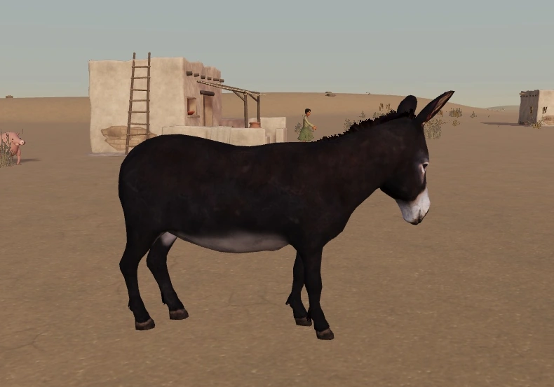
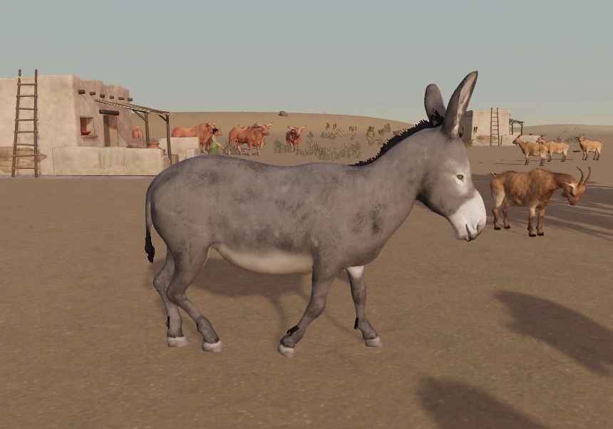
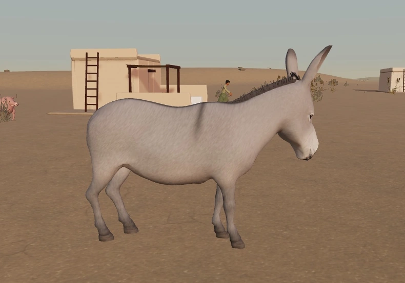
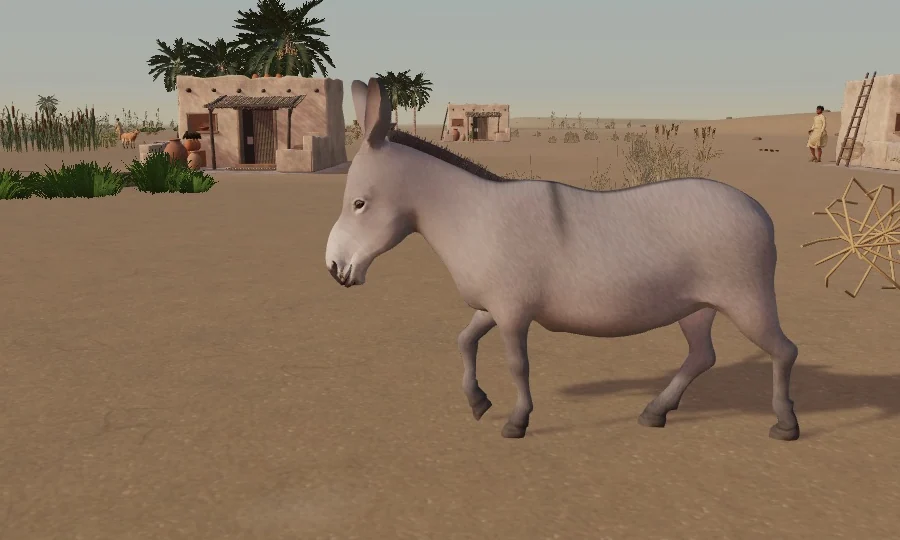
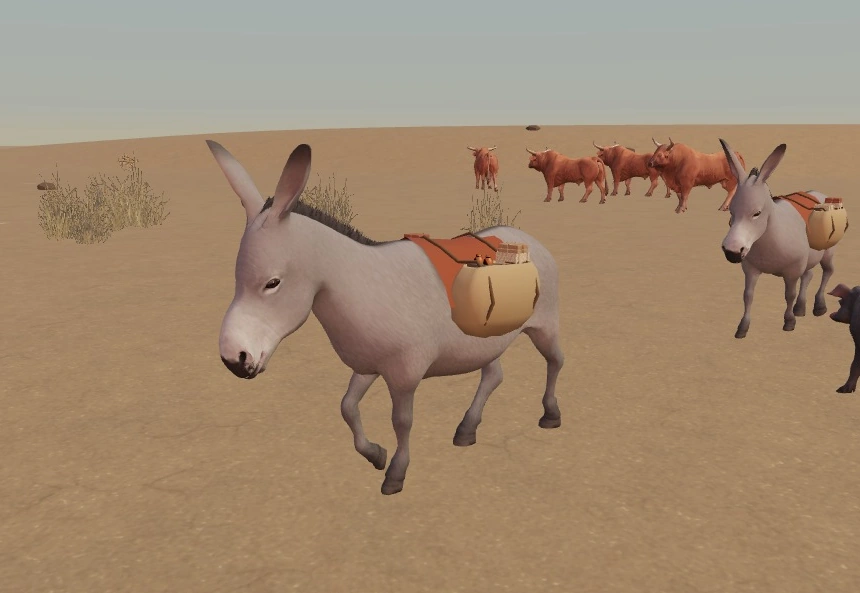

# Домашний осёл

18 ноября 2026 · Шумер III тысячелетия до н. э.

## Корпус, морда, уши и ноги

На первом кадре — прежний тёмный осёл на окраине города. В дневном свете хорошо видна светлая морда, но контур лопатки и переход от скакательного сустава к копыту теряются. Для сравнения обе модели сняты в одном игровом освещении.

В первом проходе обозначили холку, грудную клетку и подтянутый живот. Удлинили ушные раковины и развернули их под разными углами. На боковом кадре видны оба уха, пясть передней ноги и сгиб задней. Вблизи стали заметны резкая граница светлой шерсти на морде и тёмные пятна на боках.

Во втором проходе для пепельной шерсти сделали плавный переход к светлой переносице, оставили тёмную полосу вдоль спины и слабую поперечную отметину у лопатки. У глаза появились тёмная радужка, горизонтальный зрачок и блик. На последнем проходе короткой гриве придали объём, смягчили крап внутри уха и укоротили рисунок шерсти на щеке. У копыт убрали выступавшие плоские пряди.

[Рассмотреть голову и уши](../evidence/2026-11-18/pasture-donkey/head.webp) · [Открыть новую модель в атласе](https://reinekes.github.io/new_babylon_demo/model-atlas/?model=pasture-donkey.glb) · [Открыть прежнюю модель](https://reinekes.github.io/new_babylon_demo/model-atlas/?model=ambient-donkey.glb)

## Шаг и вьюк

[Запись ходьбы, MP4](../evidence/2026-11-18/pasture-donkey/walk.mp4)

В городе записали 90 поз с координатами осла и его костей. Боковая камера воспроизводит их в той же сцене. За 5,97 секунды осёл прошёл 2,91 м. По измерению над фактической поверхностью земли нижнее из четырёх копыт отклонялось от неё на −0,16…+0,51 мм. Между отдельными шагами ноги поднимались на 3,8–4,7 см.

Попону, сумы и товар приладили к спине вьючного осла. На первом варианте при повороте обе сумы оказывались с одного бока. После исправления их проверили на дороге с грузом из сохранённого визита. При блокировке нового файла два свободных и два вьючных осла получили прежнюю модель.

В окончательной модели 24 340 треугольников и 53 кости. Все 49 прежних моделей животных совпали с предыдущей версией побайтно. Прошли 77 профильных проверок и 14 проверок дорожной карты. В большом городе на 4× с 500 жителями и 250 постройками два замера прежней версии дали 24,90 и 22,09 FPS, а новой — 30,36 и 19,59 FPS. Разброс велик. Идентификаторы жителей, грузы и ресурсы сохранились. [Протокол замеров и проверки моделей](../../docs/benchmarks/2026-11-18-pasture-donkey.json)

## Исторический ориентир и авторство

В табличке A5234 из Уммы, датированной третьим годом царя Амар-Суэна, учтена выдача ячменя на корм ослам. Она подтверждает присутствие домашних ослов в хозяйстве южного Междуречья. Масть, пропорции этой особи и устройство игровых сум — художественная реконструкция. [Коллекция ISAC Чикагского университета](https://isac-idb.uchicago.edu/id/468817b6-9d05-4e8c-9df6-88e89bb970e1)

Новый GLB использует сетку и скелет осла AnimalMesh 3D по лицензии CC BY 4.0. Изменены форма, материалы и контакт копыт с землёй. Прежний файл доступен под исходным именем. [AnimalMesh 3D, исходная модель](https://sketchfab.com/3d-models/animated-realistic-donkey-3d-animal-model-32ce1c2f276a4e27bb26b8bb99439bb7) · [Атрибуция проекта](../../assets/art-courtyard/ATTRIBUTION.md)
