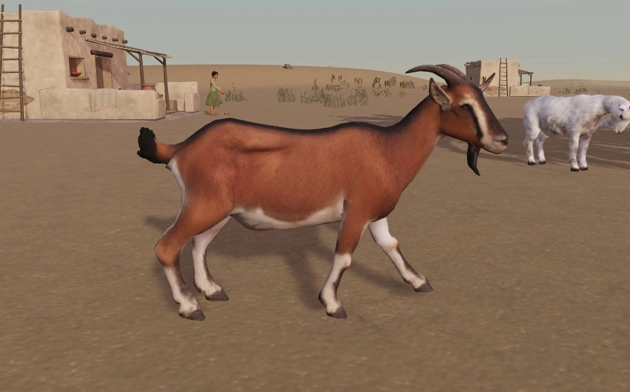
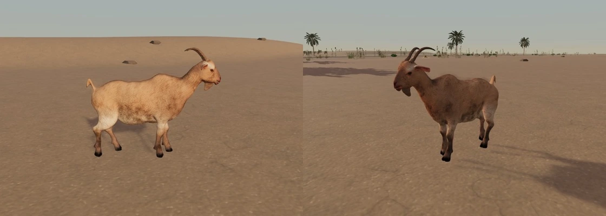
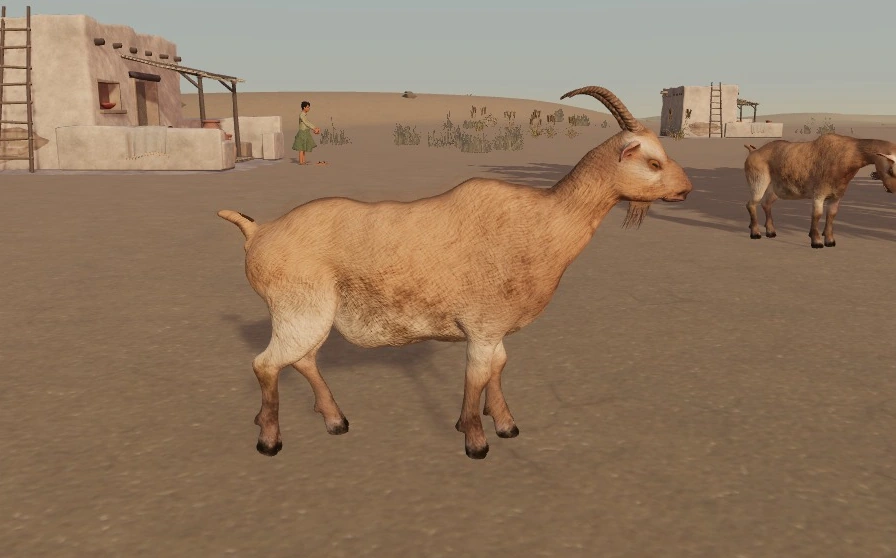
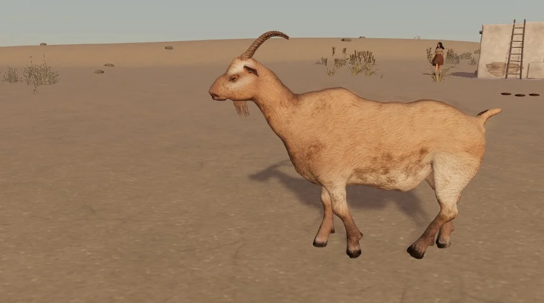

# Пастбищная коза

18 ноября 2026 · Южное Междуречье III тысячелетия до н. э.

## Работа над формой

В прежней игре у свободного стада были два облика. Сняли их сбоку на одной высоте камеры. У рыжей козы хорошо читаются линия спины и рога. У белой длинная шерсть закрывает переход от груди к ноге. Для новой взрослой самки выбраны более лёгкая голова, умеренные рога, узкая шея и отчётливый профиль лопатки.

В первом проходе уточнены грудная клетка, подтянутая часть живота, круп и переход шеи в голову. В городе стали различимы холка и сгибы ног. На боковом кадре обнаружились слишком резкий загиб хвоста и бородка с плоским треугольным краем. В тени терялись глаз и ноздря.

## Чистовой профиль и шаг

Во втором проходе бородку разделили на короткие пряди, уточнили основание хвоста, уши и раздвоение копыт. В последнем смягчили нижнюю губу и пересчитали движение таза по четырём подошвам. Для масштаба исходной козы полный цикл соответствует 0,410 м пути. В городе дистанция цикла меняется с размером особи.

[Голова вблизи](../evidence/2026-11-18/pasture-goat/head.webp) · [Вид в три четверти](../evidence/2026-11-18/pasture-goat/three-quarter.webp) · [Покрутить модель и выбрать анимацию](https://reinekes.github.io/new_babylon_demo/model-atlas/?model=pasture-goat.glb)

[Видео ходьбы MP4](../evidence/2026-11-18/pasture-goat/walk.mp4) · [Походка прежней козы](../evidence/2026-11-18/pasture-goat/before-walk.webp)

Записаны положения животного и скелета на его обычном маршруте. Эти же положения воспроизведены в городской сцене с боковой камерой. Остальные особи свободного стада скрыты для съёмки. За 3,60 секунды видимого отрезка коза проходит 1,75 м. На полном отрезке из 104 поз проверена высота опорной подошвы относительно полигонов земли. На склоне отклонение составило от −3,13 до +6,80 мм.

## Подключение

Новая коза используется в свободном стаде и для индивидуальных животных. У неё 41 682 треугольника, 34 кости, анимации шага, покоя, выпаса и отдыха. Обе группы пользуются одной загрузкой GLB. При принудительной блокировке нового файла индивидуальные козы получили прежнюю модель GerardoA400, а стадо — прежнюю модель TRELLIS. Обе сохранили движение. Все пять прежних файлов коз сверены побайтно.

## Исторический ориентир и исходная модель

В фондах Penn Museum хранится найденная в Уре фигурка козла, объедающего ветви, около 2450 года до н. э. Находка служит ориентиром для силуэта головы и рогов. Телосложение взрослой самки, масть и длина шерсти — реконструкция для игры. [Карточка предмета и фотографии](https://collections.penn.museum/collections/object/242250)

Модель основана на сетке и скелете козы GerardoA400, уже использованной в проекте по лицензии CC BY 4.0. [Исходная модель GerardoA400](https://sketchfab.com/3d-models/goat-5d7431517b634f4e9e8c0f3729cd9c59) · [Атрибуция проекта](../../assets/art-courtyard/ATTRIBUTION.md)

## Проверки

Прошли 56 профильных проверок и 14 проверок дорожной карты. На Apple M5, при 500 жителях и 250 зданиях на скорости 4×, средняя частота составила 29,72 FPS до замены и 29,72 FPS после. Каждую версию измерили дважды по 18 секунд в одном Chrome со штатным подбором детализации. Идентификаторы жителей, грузы и запасы совпали после сохранения и повторной загрузки. [Измерения, проверка контакта копыт, атлас и контрольные суммы прежних коз](../../docs/benchmarks/2026-11-18-pasture-goat.json)
