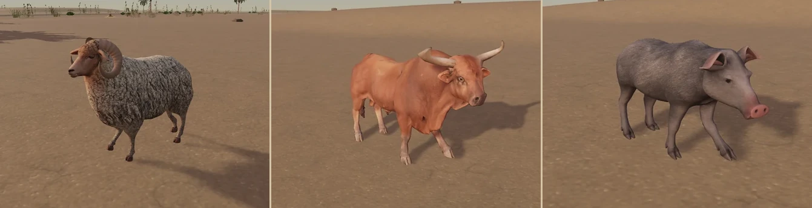
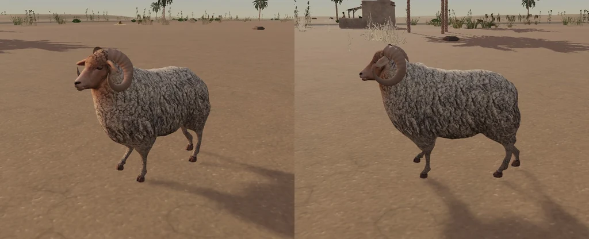
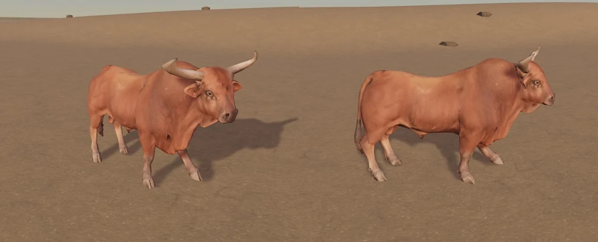
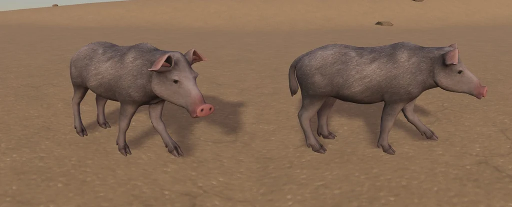
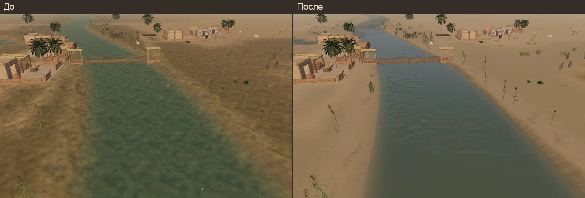

# Баран, бык и свинья на новой пойме

18 ноября 2026 · Художественная проверка моделей в игре

## Баран

Сбоку у прежнего барана были жёсткая линия брюха, тонкая морда и коротко обрезанная шерсть. В первом проходе появились выраженная грудь, шерсть с разной длиной прядей, лоб и толстое основание спирального рога. Пользователь одобрил этот облик. Во втором проходе ухо отделено от рога и опущен хвост. В трёх проверенных фазах шага нижняя точка опорного копыта проходила в пределах 0,3 мм от основания модели.

[Прежний баран](../evidence/2026-11-18/river-and-herds/ram-before.webp) · [Три фазы шага](../evidence/2026-11-18/river-and-herds/ram-stride.webp) · [Повернуть барана в 3D](../../model-atlas/?model=pasture-ram.glb)

## Бык

Прежний бык имел круглое бедро, узкие голени и почти одинаковую толщину ног до копыт. В первой версии переработаны грудная клетка, холка и переход от плеча к локтю. Во второй развернута морда, уточнены ноздри, посадка рогов и задние конечности. Два ракурса сняты на открытом грунте, где видны все четыре ноги, шаг отдельно проверен в трёх позах.

[Прежний бык](../evidence/2026-11-18/river-and-herds/bull-before.webp) · [Три фазы шага](../evidence/2026-11-18/river-and-herds/bull-stride.webp) · [Повернуть быка в 3D](../../model-atlas/?model=pasture-bull.glb)

## Свинья

На первом проходе уже читались спина, челюсть и суставы, но спереди пятачок выглядел как один раструб. Во втором проходе вылеплен носовой диск с двумя отдельными ноздрями, уточнены уши и щетина на спине. В третьем проходе срез диска приблизили к вертикали, смягчили переход к переносице и добавили внутреннюю складку ушной раковины. В профиль проверены линия брюха, постановка задних ног и контакт копыт в шаге.

[Прежняя свинья](../evidence/2026-11-18/river-and-herds/pig-before.webp) · [Три фазы шага](../evidence/2026-11-18/river-and-herds/pig-stride.webp) · [Повернуть свинью в 3D](../../model-atlas/?model=pasture-pig.glb)

## Земля

В прежнем городе один и тот же крупный узор повторялся поперёк пустырей. У дворов и дорог травяная подложка давала геометрические тёмные полосы. После трёх проб убран повторяющийся крупный рисунок, смягчена подложка, возвращены мелкие минеральные включения и слабая неоднородность суглинка. У высохших стеблей исправлена шероховатость поверхности, из-за которой целые куртины выбеливались под солнцем.

На одном открытом участке с одинаковой камерой стандартное отклонение яркости уменьшилось с 9,69 до 3,03 по шкале 0–255. На двух картах сверена геометрия сухой земли. Формула высот и посадка зданий сохранены. На склонах у озёр добавлены вершины, чтобы крупные треугольники берега точно повторяли профиль дна.

| Одинаковый ракурс | Раньше | Сейчас |
|---|---|---|
| Весь город | [Кадр](../evidence/2026-11-18/river-and-herds/ground-city-before.webp) | [Кадр](../evidence/2026-11-18/river-and-herds/ground-city-after.webp) |
| Улица и двор | [Кадр](../evidence/2026-11-18/river-and-herds/ground-street-before.webp) | [Кадр](../evidence/2026-11-18/river-and-herds/ground-street-after.webp) |
| Открытый грунт вблизи | [Кадр](../evidence/2026-11-18/river-and-herds/ground-patch-before.webp) | [Кадр](../evidence/2026-11-18/river-and-herds/ground-patch-after.webp) |
| Сухие стебли под солнцем | [Кадр](../evidence/2026-11-18/river-and-herds/ground-straw-before.webp) | [Кадр](../evidence/2026-11-18/river-and-herds/ground-straw-after.webp) |

## Вода

В середине русла прежняя поверхность просвечивала до камней. В устье канала накладывались две полупрозрачные поверхности. Теперь дно видно в мелкой воде, а взвесь и отражение неба закрывают его с глубиной. Два масштаба ряби движутся по изгибам реки, участки гладкой воды разбивают их рисунок. В канале и озере волны тише. Цвет разлива согласован с цветом речной взвеси.

[Течение в движении, 20 кадров](../evidence/2026-11-18/river-and-herds/water-flow.webp) · [С городской камеры](../evidence/2026-11-18/river-and-herds/water-city-before-after.webp) · [Берег озера](../evidence/2026-11-18/river-and-herds/water-lake-before-after.webp) · [Устье канала](../evidence/2026-11-18/river-and-herds/water-canal-before-after.webp)

В игре отражается HDR-небо. Отдельные дома и мост не отражаются. При проверке с фиксированной камерой за одну секунду симуляции изменились 76 913 пикселей в кадре реки и 27 847 в кадре озера. Повторный кадр с тем же временем дал ноль изменений. Отдельно проверены первая отрисовка до загрузки неба, переход на HDR и ночной свет.

## Исторические ориентиры

На раскопках Абу-Салабиха найдены останки овцы, молодого полорогого и свиньи. Изображения овец III тысячелетия на Ближнем Востоке дают ориентир для шерсти и завитка рога. Телосложение конкретных животных и масти — реконструкция для игры. [Отчёт раскопок Абу-Салабиха](https://www.cambridge.org/core/journals/iraq/article/abs/excavations-at-abu-salabikh-1975/5985D6AA5B9F0F3C238FD9406B10DC60) · [Исследование EVOSHEEP](https://www.cambridge.org/core/journals/antiquity/article/evosheep-the-makeup-of-sheep-breeds-in-the-ancient-near-east/9C2492EC4DD3481D2D43C63902FCD184)

В Абу-Тбейре исследованы извилистое речное русло, глинистый ил и мелкий песок. Они послужили ориентиром для сухой земли и взвеси в воде. Оттенки грунта, скорость течения и отражения при разном свете подобраны для игровой сцены. [Исследование отложений Абу-Тбейры](https://www.cambridge.org/core/journals/quaternary-research/article/paleoenvironment-and-depositional-context-of-the-sumerian-site-of-abu-tbeirah-nasiriyah-southern-mesopotamia-iraq/FE5F0F666EEF1BEC71C3C5AC58999322)

## Проверка в городе

В обычной игре каждый зверь загружен через меню «Взрослый бог». Для каждой модели сравнили два положения скелета в одной проекции и вид с отключённой моделью. У всех трёх меняются видимые пиксели корпуса и ног, есть отдельные анимации шага и покоя. Через ссылки в атласе открылись три новых и три прежних животных. Заголовки карточек, выбор анимации и движение моделей проверены в браузере.

| Животное | Прежняя модель, треугольников | Новая модель, треугольников |
|---|---:|---:|
| Баран | 35 468 | 16 360 |
| Бык | 40 812 | 14 512 |
| Свинья | 35 790 | 26 126 |

Атлас содержит 48 GLB животных. Все 45 прежних файлов сверены побайтно с версией до правки. Сохранились также 22 процедурные карточки и 3 карточки внешних источников. В обычном стаде первыми загружаются три новые модели, прежние версии этих трёх доступны для подмены при сбое. Все три новых адреса принудительно заблокированы в отдельном сеансе Chrome. Игра загрузила прежнего барана, быка и свинью, у каждого двигался скелет. Авторы исходной геометрии, лицензии и доработки указаны в [атрибуции](../../assets/art-courtyard/ATTRIBUTION.md).

На Apple M5 с 500 жителями, 250 постройками и скоростью 4× замеры прежней версии дали 30,00 и 29,72 FPS, новой — 30,58 и 30,08 FPS. Каждый замер длился 18 секунд, версии чередовались в одном браузере. Средние составили 29,86 и 30,33 FPS. Сохранение города прошло побайтный круговой тест до и после симуляции. Идентификаторы жителей, их грузы и городские запасы совпали. [Протокол WebGL, атласа и замеров кадров](../../docs/benchmarks/2026-11-18-river-and-herds.json)

В опубликованной игре все три новых зверя и речной шейдер загружены с GitHub Pages. В опубликованном атласе проверены шесть прямых ссылок и движение моделей. Контрольные суммы 101 публичных файлов совпали с игровым коммитом. [Публичный протокол WebGL и SHA-256](../../docs/benchmarks/2026-11-18-river-and-herds-pages.json) · [Снимок выпуска](../../docs/versions/2026-11-18-06.md)
