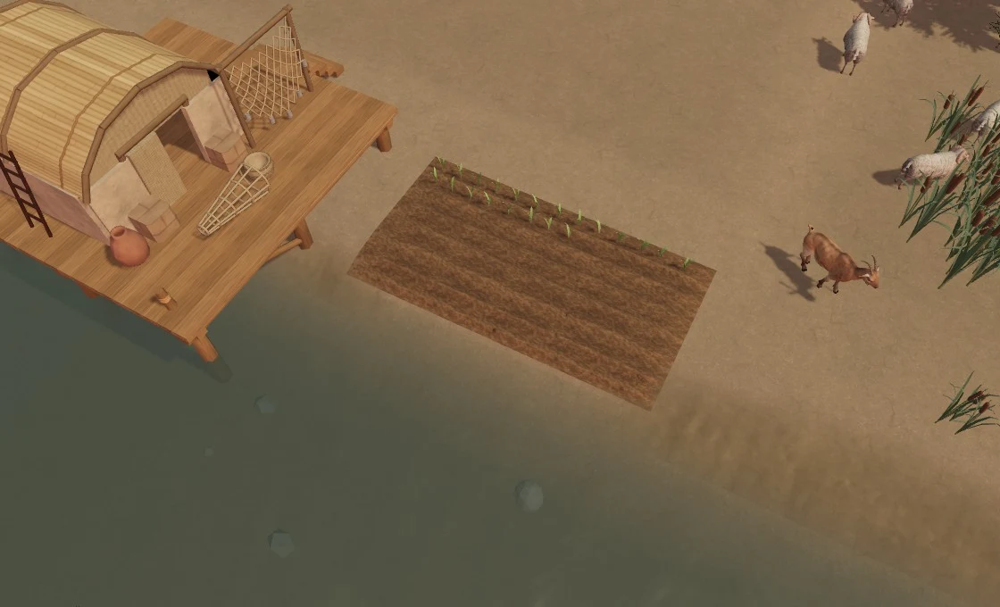
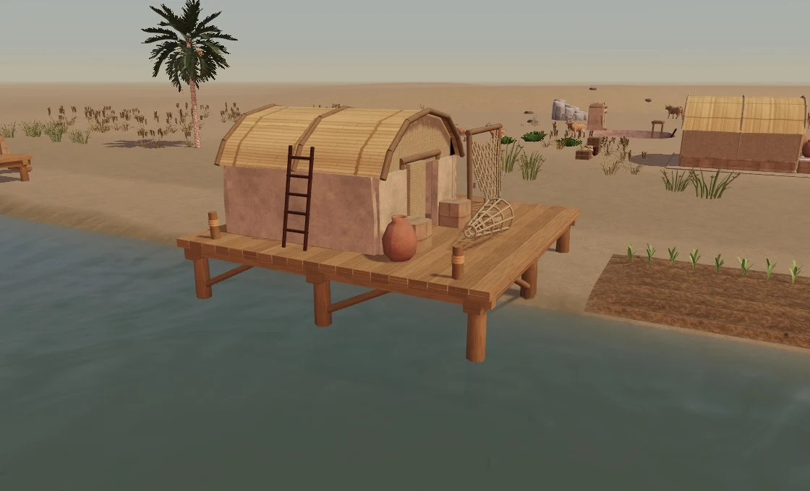
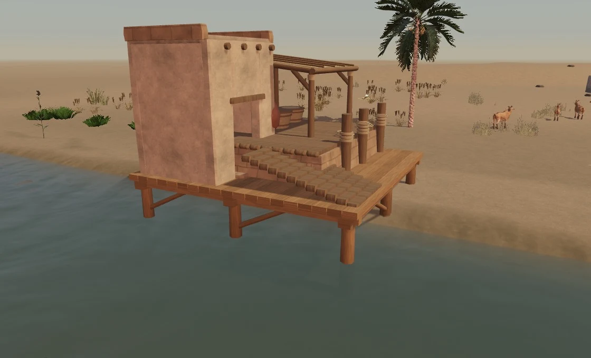
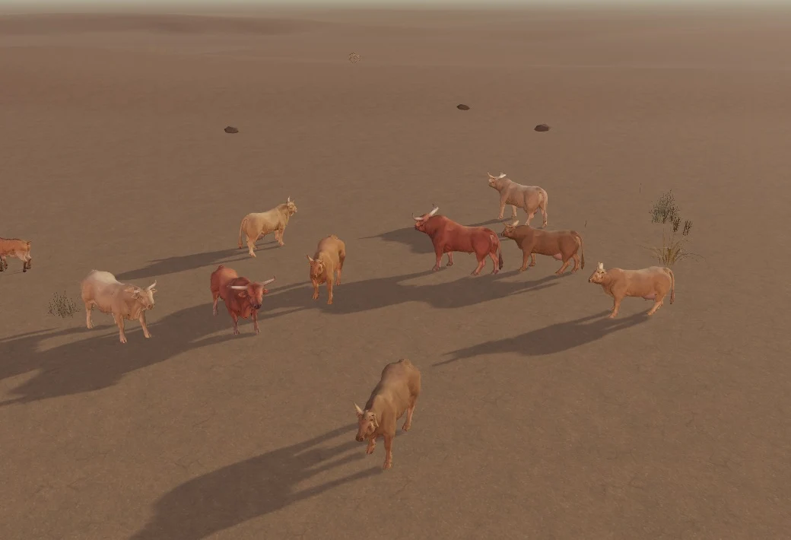
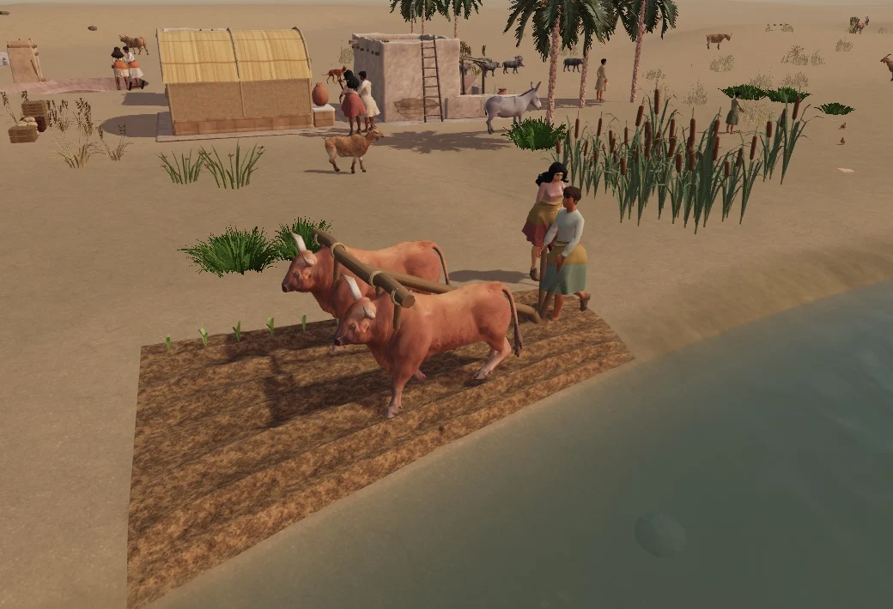
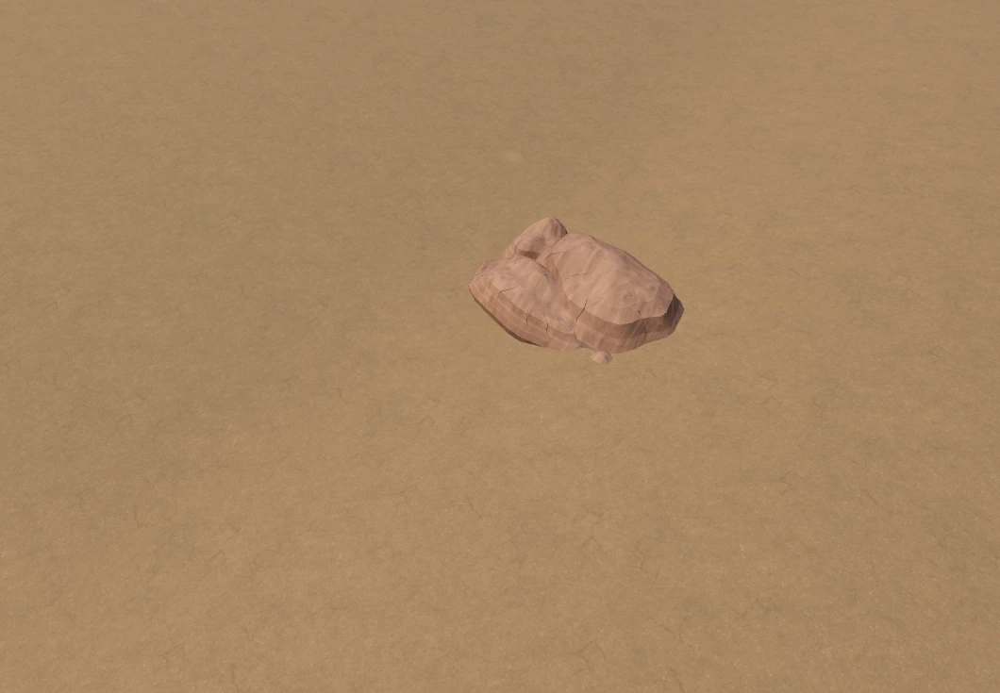
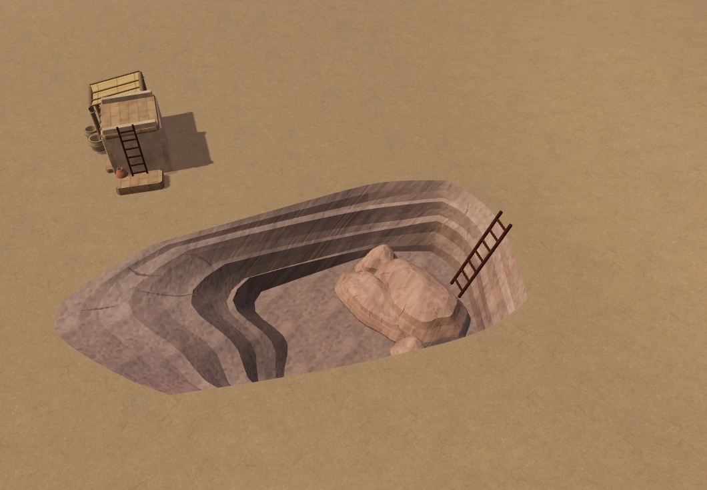
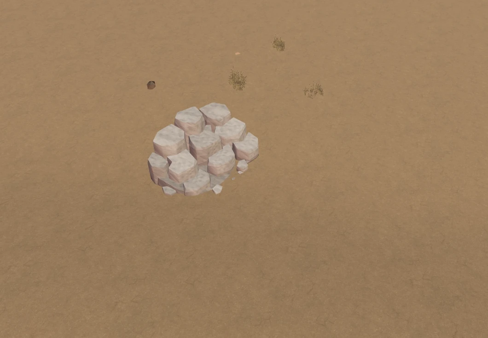
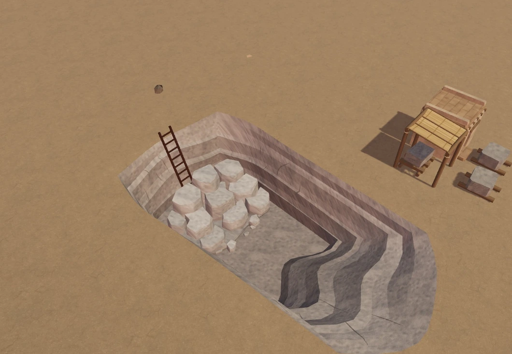

# Поле у реки, свайные постройки и глубокие карьеры

18 ноября 2026 · Кадры из игрового WebGL

## Малое поле у воды

Пашня занимает сухую часть участка вплоть до изгиба берега. На проверенном поле в одну клетку между почвой и водой в ближайшем сечении осталось 7,8 см. Короткие борозды заканчиваются у воды, а стебли ячменя растут внутри того же контура. [Поле до изменения](../evidence/2026-11-18/river-farms-and-pits/field-before.webp) · [Зрелый ячмень](../evidence/2026-11-18/river-farms-and-pits/field-barley.webp)

## Рыбацкая хижина и пристань

Дощатый настил опирается на сваи, связанные поперечинами и косыми подкосами. Между водой и настилом виден просвет. Ступени подходят к сухой стороне берега. У проверенных хижины, пристани и водозабора настил поднят на 0,8 м, под каждым девять свай и пять ступеней. [Хижина до изменения](../evidence/2026-11-18/river-farms-and-pits/fishing-before.webp) · [Ступени хижины со стороны суши](../evidence/2026-11-18/river-farms-and-pits/bank-steps.webp) · [Пристань до изменения](../evidence/2026-11-18/river-farms-and-pits/harbor-before.webp)

Над водой виден и настил водозабора. На кадрах из одного сохранения камера стоит в одной точке. [Водозабор до изменения](../evidence/2026-11-18/river-farms-and-pits/waterpoint-before.webp) · [Водозабор на сваях](../evidence/2026-11-18/river-farms-and-pits/waterpoint.webp)

## Стадо и пахота

У коровы легче плечи и шея, видны вымя и более тонкие рога. В одном проверенном стаде паслись шесть коров и один бык, во втором — семь коров и два быка. Прежние модели животных сохранены. [Крупный план коровы сбоку](../evidence/2026-11-18/river-farms-and-pits/pasture-cow-side.webp)

Два рабочих вола под общим ярмом тянут деревянный плуг. Пахарь идёт следом за рукоятью. В игре проверены подготовка почвы и посев у реки, для которых записано 317 и 403 положения упряжки соответственно. [Посмотреть пахоту у реки · видео, 6,7 с](../evidence/2026-11-18/river-farms-and-pits/river-plough.mp4) · [Предпосевная пахота](../evidence/2026-11-18/river-farms-and-pits/pre-sowing-plough.webp)

## Глиняный карьер и каменоломня

Обе природные залежи укрупнены. При строительстве та же модель опускается в настоящий вырез грунта. В игровом городе до и после постройки сверены вершины, треугольники, нормали, цвета, текстурные координаты, материал, поворот и масштаб. Смещение есть только по высоте. Запас сырья в клетке сохраняется.

| Место | Треугольников в залежи | Глубина дна от поверхности | Опора под ногами рабочего |
| --- | ---: | ---: | ---: |
| Глиняный карьер | 2 360 | 2,15 м | 2,15 м ниже поверхности, на дне |
| Каменоломня | 2 954 | 2,65 м | 2,4025 м ниже поверхности, на выступе породы |

У глины под сухой коркой открывается тёмный влажный слой. Лестница спускается к залежи. В отдельной проверке у реки между дном выемки и водой осталось более полуметра по горизонтали. [Прежний карьер](../evidence/2026-11-18/river-farms-and-pits/clay-before.webp) · [Карьер у самой реки](../evidence/2026-11-18/river-farms-and-pits/clay-riverbank.webp)

В каменоломне трещины разделяют крупные угловатые блоки, рядом с отколотыми гранями лежит мелкая осыпь. Те же сколы можно найти на поверхности до постройки. [Прежняя каменоломня](../evidence/2026-11-18/river-farms-and-pits/quarry-before.webp)

## Совместимость и модели

В 20 архивных сохранениях результаты по урожаю, учёту грузов и личностям жителей совпали с предыдущей версией. Шесть скачиваемых GLB выгружены из игрового города. В файле поля доступны две сцены — молодой ячмень и зрелый со снопами. В трёх береговых постройках сохранены настилы и сваи, в обоих карьерах — выемка и залежь. В городе их положение подстраивается под конкретный участок. [Поле](../../assets/3d/sumer-buildings/field.glb) · [Рыбацкая хижина](../../assets/3d/sumer-buildings/fishing.glb) · [Водозабор](../../assets/3d/sumer-buildings/waterpoint.glb) · [Пристань](../../assets/3d/sumer-buildings/harbor.glb) · [Глиняный карьер](../../assets/3d/sumer-buildings/clay.glb) · [Каменоломня](../../assets/3d/sumer-buildings/quarry.glb)

[Протокол проверки игрового города](../../docs/benchmarks/2026-11-18-river-farms-and-pits.json)

## Исторические ориентиры

На печати из Южной Месопотамии аккадского времени, около 2340–2140 гг. до н. э., изображены пахари, плуг и тягловое животное. Табличка эпохи III династии Ура, около 2040 г. до н. э., фиксирует поставки волов. Состав игрового стада и размеры свайных настилов выбраны для игры. [Лувр, печать AO 2330](https://collections.louvre.fr/ark:/53355/cl010148065) · [Метрополитен-музей, табличка 65.72](https://www.metmuseum.org/art/collection/search/325715)

Местная каменоломня на пойме — игровое допущение. Для диоритовых статуй Гудеа камень, вероятно, доставляли из района современного Омана. [Метрополитен-музей о диорите Гудеа](https://www.metmuseum.org/perspectives/immaterial-stone)

## Проверка игры и большой город

Прошли 2 070 тестов Node и 7 тестов Python для дорожной карты. В обычном городе проверены береговые постройки, обе залежи, опора ног добытчиков и ход упряжки. Отдельно проверена экономическая карта в 2D.

В большом городе на Apple M5 при 500 жителях, 250 зданиях и скорости 4× провели четыре чередующихся заезда по 18 секунд. Частота кадров составила 24,53 и 24,83 FPS до обновления, 25,08 и 24,85 FPS после. Средние — 24,68 и 24,96 FPS. Грузы и личности жителей сохранились при повторной загрузке. [Протокол замеров](../../docs/benchmarks/2026-11-18-river-farms-and-pits.json)

## river-farms-and-pits-20261118 | Прибрежные дворы, упряжка волов и глубокие карьеры

date: 2026-11-18
type: release
release: river-farms-and-pits-20261118
commit: f0e78ed884efb8713886fd5547fd2c34beee31fe
publication: verified
groups: graphics; economy; people
source: docs/versions/2026-11-18-13.md

В опубликованной игре проверены обе залежи до и после строительства, два занятых на добыче жителя, береговые здания и стада. В каждом из двух эпизодов пахоты волы прошли 0,95 м. При посеве лемех входил в землю на 1,7 см, при подготовке на 4,2 см. При одновременной загрузке нескольких тяжёлых вкладок один графический процесс Chrome перезапустился. В отдельном браузере обе городские сцены, работники, карта и вкладка моделей прошли повторную проверку без ошибок WebGL. Контрольные суммы 93 файлов совпали с игровым коммитом. [Версия игры](../../docs/versions/2026-11-18-13.md) · [Проверка на GitHub Pages](../../docs/benchmarks/2026-11-18-river-farms-and-pits-pages.json)
