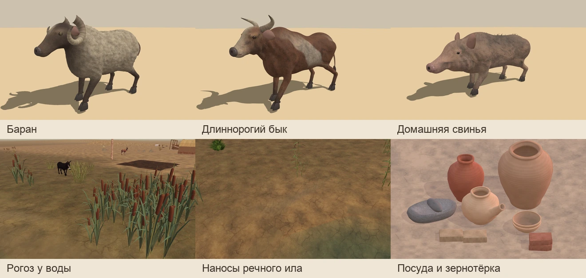

# Берег, растения, ремесленная утварь и стада

18 ноября 2026 · Южное Междуречье III тысячелетия до н. э.

| Что смотреть | Где в игре | На что обратить внимание |
|---|---|---|
| Земля | Сухая пойма, берег реки и озёр | На сухом грунте видны неглубокие трещины. Влажный ил темнее, у кромки воды есть низкие языки намыва. Рельеф берега подхватывает свет под косым углом. |
| Четыре растения | [Прибрежный тростник](../../model-atlas/?model=marsh-plumed-cane.glb), [рогоз](../../model-atlas/?model=marsh-cattail.glb), [камыш](../../model-atlas/?model=marsh-clubrush.glb), [сухой злак](../../model-atlas/?model=alluvial-awn-grass.glb) | У тростника видны узлы и метёлки, у рогоза — плотные тёмные початки, у камыша — небольшие группы колосков. У сухого злака тонкие наклонные стебли и ости. Растения занимают разные полосы влажности. |
| Керамика | [Гончарный двор](../../scripts/sumer-building-studio.html?model=pottery) и [пивоварня](../../scripts/sumer-building-studio.html?model=brewery) | Чаша, кувшин, сосуд с носиком и крупная тара различаются и по профилю, и по горловине. У носика есть сквозной канал, у чаши видны внутренний край и дно. |
| Кирпичи и зернотёрка | [Кирпичный двор](../../scripts/sumer-building-studio.html?model=brickyard), [печь](../../scripts/sumer-building-studio.html?model=kiln), [пекарня](../../scripts/sumer-building-studio.html?model=bakery) | У сырца плоская постель, слегка выпуклый верх и сбитый угол. После обжига меняются цвет и поверхность. У зернотёрки вогнутая рабочая дорожка и отдельный верхний камень. |
| Грузы | Складская площадка, караван и грузовая лодка с соответствующим товаром | Корзина плетёная насквозь. У свёрнутых циновок видны торцы, спирали и перевязи. Комья глины лежат друг на друге, кирпичи сложены отдельными рядами. Каждый вид груза опирается на свою высоту при укладке в несколько слоёв. |
| Три животных | Городские стада и карточки [барана](../../model-atlas/?model=alluvial-ram.glb), [быка](../../model-atlas/?model=alluvial-bull.glb), [свиньи](../../model-atlas/?model=alluvial-pig.glb) | У барана завитые рога и объёмная шерсть, у быка длинные рога, выраженные холка и плечи, у свиньи пятачок и редкая щетина. У каждой модели есть собственные ходьба и покой. |

С прежним выпуском побайтно сверены все 42 GLB из раздела животных. Также доступны 25 прежних вариантов предпросмотра, собранных кодом. В обычной игре проверены новые модели и семь прежних файлов стад. Ошибка при загрузке одного варианта позволяет использовать доступный вариант того же вида.

[Стадо в обычном городе](../evidence/2026-11-18/yard-props/mixed-herd.webp) · [Берег с рогозом](../evidence/2026-11-18/floodplain/marsh-cattail.webp) · [Посуда, кирпичи и зернотёрка крупным планом](../evidence/2026-11-18/yard-props/ware-and-tools.webp)

## Исторические основания

В отложениях Абу-Тбейры сохранились признаки болотной растительности. Для почвы взяты свойства аллювиальной поймы, для распределения растений — переход от влажной кромки к сухому берегу. Размеры каждой куртины, расположение конкретных наносов и количество растений в игре реконструированы. [Исследование отложений Абу-Тбейры](https://www.cambridge.org/core/journals/quaternary-research/article/paleoenvironment-and-depositional-context-of-the-sumerian-site-of-abu-tbeirah-nasiriyah-southern-mesopotamia-iraq/FE5F0F666EEF1BEC71C3C5AC58999322) · [Ландшафт Ахвара, ЮНЕСКО](https://whc.unesco.org/en/list/1481/)

Сосуд с трубчатым носиком найден в Ниппуре. Для кирпича взят раннединастический шумерский образец, место находки которого в музейной карточке указано с точностью до Месопотамии. Каменный инструмент из Ура служит ориентиром для формы зернотёрки. В городе предметам приданы размеры, при которых ими могли бы пользоваться жители. Оттенок обжига и расстановка во дворе выбраны художниками. [Сосуд, Metropolitan Museum](https://www.metmuseum.org/art/collection/search/325428) · [Кирпич, Metropolitan Museum](https://www.metmuseum.org/art/collection/search/325521) · [Зернотёрка, Penn Museum](https://collections.penn.museum/collections/object/40968)

Овцы, крупный рогатый скот и свиньи засвидетельствованы костными находками Абу-Салабиха. Масти, пятна, длина шерсти и конкретный разворот рогов — реконструкция облика отдельных животных. [Отчёт раскопок Абу-Салабиха](https://www.cambridge.org/core/journals/iraq/article/abs/animal-remains-from-abu-salabikh-preliminary-report/68037934423B75C0E5A3C08298C23C3F)

## Проверка в игре

Все пять дворов проверены на одной позиции камеры с предметами и со скрытыми предметами или зданием. Скачать каждый GLB можно из городской студии. Отдельная загрузка подтвердила совпадение координат геометрии, а версия в ссылке отличает обновлённый файл от прежнего в кеше.

В контрольной сцене на берегу 665 куртин четырёх новых видов. Крупный план содержит 537 898 треугольников растений. Для далёкой камеры тот же набор занимает 3 990 треугольников. При возвращении к берегу восстанавливается подробная геометрия. [Результаты проверки растений в WebGL](../../docs/benchmarks/2026-11-18-floodplain-botany-webgl.json)

Замер на Apple M5 выполнен в одном и том же городе при 500 жителях, 250 зданиях и скорости 4×. В контрольном прогоне предыдущей версии получено 30,11 FPS. После подключения подробных растений при свободном GPU получилось 27,42 FPS, после перехода на облегчённую геометрию при отдалении камеры — 29,95 FPS. Финальная сборка с картами кожи и шерсти 1536 × 1024 отрисовала 520 кадров за 18,02 секунды, в среднем 28,86 FPS. Каждое наблюдение длилось около 18 секунд. На другом устройстве частота кадров может отличаться. Идентификаторы жителей, ресурсы и переносимые грузы совпали после повторной загрузки сохранения. [Протокол моделей и замера](../../docs/benchmarks/2026-11-18-valley-and-herds.json)

На обычной высоте камеры у животных различимы силуэт, рога и рисунок масти. Отдельные волоски и складки у носа видны вблизи. У быка и свиньи для фактуры шерсти и кожи использован рельеф прежних проектных моделей. Новая геометрия тела, развёртка, скелеты и походки записаны в самостоятельные файлы. Баран содержит 35 468 треугольников, бык — 40 812, свинья — 35 790. У каждого по 20 костей и три карты материала размером 1536 × 1024.

В городской сцене по очереди отключены все девять карт цвета, рельефа и шероховатости трёх животных. Каждая изменила видимые пиксели, а повторный кадр с неподвижной камерой совпал полностью.
