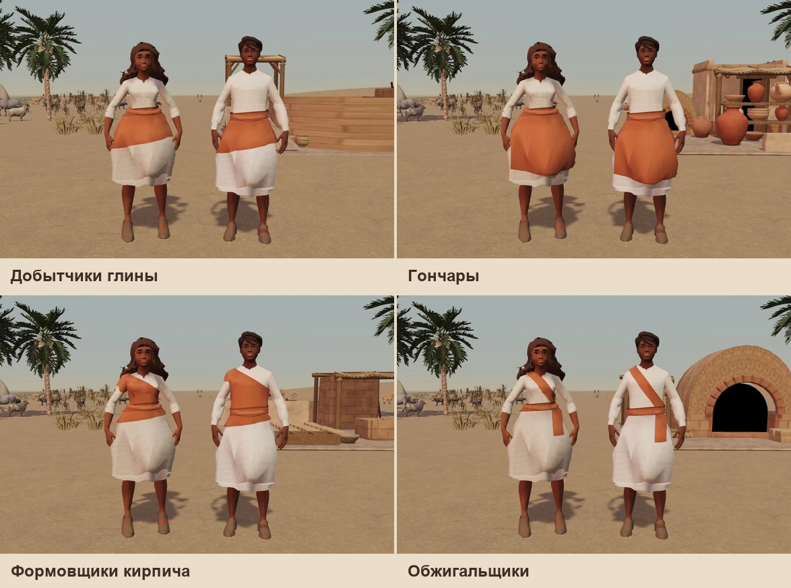
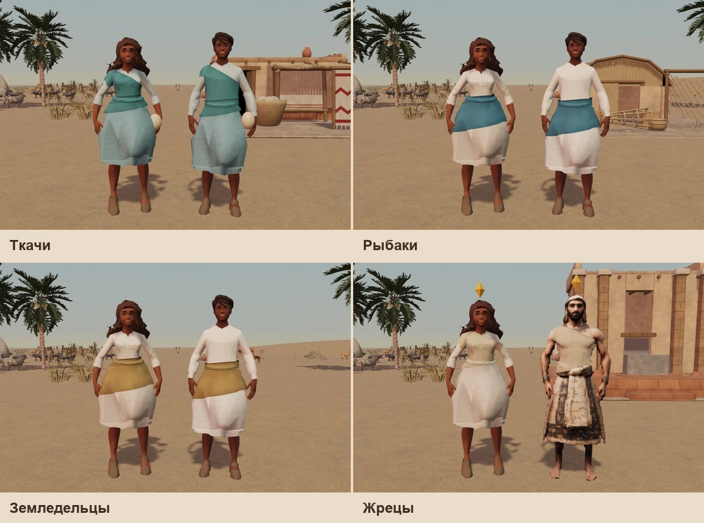
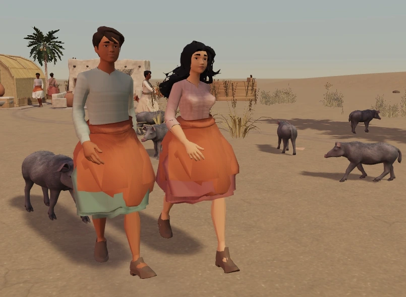
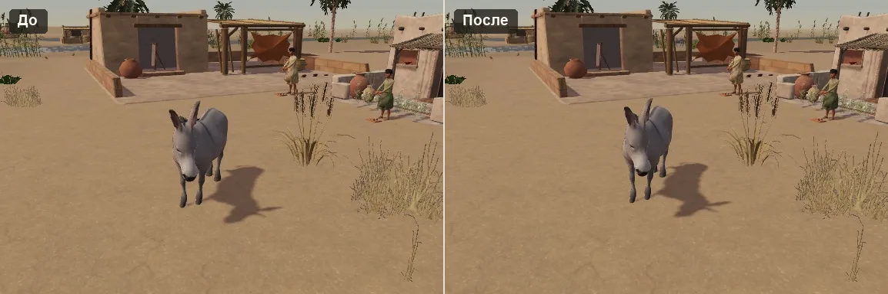

# Одежда жителей и повороты животных

## Как узнать занятие жителя

Вся глиняная цепочка носит один терракотовый цвет `#b46b42`. Добытчик глины носит короткую обмотку, гончар — передник, формовщик кирпича — ткань с широким запахом, работник печи — перевязь через плечо. Оттенок сохраняется между этапами, а крой позволяет различать работу вблизи.

| Работа | Что видно на жителе |
| --- | --- |
| Рыбак и водонос | Сине-зелёная короткая обмотка у рыбака, голубовато-серая перевязь у водоноса |
| Ткач и портной | Запах цвета морской зелени у ткача, серо-сливовый у портного |
| Земледелец, садовник и пастух | Охристая короткая обмотка, оливковый запах и светлая шерстяная перевязь |
| Плотник, медник и пекарь | Передники древесно-коричневого, медно-бурого и песочного тонов |
| Жрец и писец | Светлая накидка у жреца, серо-коричневая у писца |

Взрослый горожанин со свободным выбором профессии получает рабочую одежду по текущему назначению. Пока гончар относит посуду, на нём остаётся передник. На новом рабочем месте меняются цвет и крой. Лицо, возраст, имя, износ личной одежды и содержимое рук принадлежат тому же жителю. Детям остаётся их повседневная одежда. [Прежние модели у гончарной](../evidence/2026-11-18/profession-clothing/before-pottery.webp)

У фигур обоих полов профессиональный слой имеет собственную сетку, привязанную к костям. Отдельно проверены торжественные модели жреца и музыканта. Сравнительные изображения сняты в одной позе в городском WebGL. Кадр с обычного маршрута гончарки приведён отдельно.

При проверке ходьбы у гончарки нижняя юбка выступала перед передником на сгибе колена. Переднее полотнище удлинили и добавили свободу по бедру. На повторной проверке все 36 лучей в этой области попадали сначала в передник. При очень близкой камере у его нижней кромки видны грани складок.

На печати эпохи III династии Ура изображена одежда с бахромой, а табличка из Ура описывает получение партии готовых одежд. Пять выкроек и распределение цветов между городскими профессиями — художественное решение для игры. [Печать в Британском музее](https://www.britishmuseum.org/collection/object/W_1945-1013-32) · [Исследование таблички, Orient](https://www.jstage.jst.go.jp/article/orient/45/0/45_177/_article/-char/en)

## Как животное проходит поворот

В прежней игре животные свободного стада стояли на месте и вращали корпус, пока направление не совпадало с новым маршрутом. У осла угол мог измениться на 155,9° за 50 мс. Теперь осёл, козы, овцы, свиньи и быки поворачивают по дуге. Радиус зависит от размеров, а ноги проходят цикл шага по пройденному расстоянию. У остановившегося животного корпус сохраняет направление. Для входа в загон стадо последовательно проходит промежуточные точки до места внутри.

До и после изменений измерили 650 последовательных положений с интервалом 50 мс в одной сцене. До правки повороты неподвижного корпуса насчитали в 224 отсчётах у свиней, 271 у коз и 281 у быков. После правки таких отсчётов у всех пяти проверенных видов было ноль. Наибольший поворот осла за 50 мс составил 2,4°.

В парном эпизоде слева осёл сменил направление на 116° за 50 мс, пройдя 2,4 см. Справа он прошёл 1,30 м за 2,70 с и развернулся на 126°. Во всех 54 проверенных фазах расстояние от нижней опорной подошвы до фактического грунта на этом участке было между −2,76 и +0,03 мм. Видеоряд воспроизводит записанные положения корпуса и костей в городской сцене с дневными тенями. [Стоп-кадр поворота](../evidence/2026-11-18/ground-turns/donkey-turn-frame.webp)

## Проверки

Проверены все 32 варианта рабочей одежды у мужчины и женщины, смена назначения с грузом, переход от ближнего вида к дальнему и обратно, а также три архивных сохранения. Геометрию пяти выкроек используют 25 выбираемых взрослых профессий и рабочие места, требующие назначения по зданию. Прошли 242 профильные проверки и 14 проверок дорожной карты.

В городе с 500 жителями и 250 зданиями на скорости 4× четыре чередующихся замера по 18 секунд дали 16,30 и 26,20 FPS до обновления, 16,53 и 23,53 FPS после. Средние — 21,25 и 20,03 FPS соответственно. При одновременной видеосъёмке значения были ниже. После сохранения и загрузки совпали идентификаторы жителей, грузы и ресурсы. [Протокол измерений, модели и проверка подошв](../../docs/benchmarks/2026-11-18-work-clothes-and-ground-turns.json)
