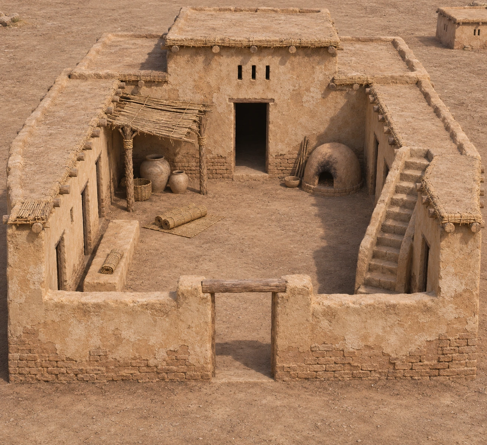
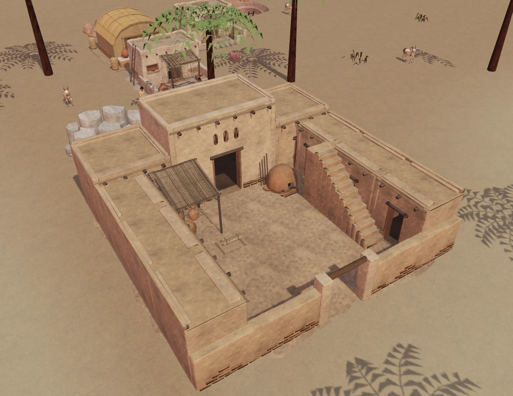

# Общинный дом и движение стад

В разделе строительства «Жители» появился общинный дом на 24 места. Он занимает участок 2×2. Стада свиней, коз, крупного рогатого скота и овец снова могут расходиться после долгого выпаса.

## От рисунка к игровому двору

Сначала подготовили художественный референс по планировке месопотамских домов с внутренними дворами. Такой принцип планировки описан в археологической публикации по раскопкам в долине Диялы. Облик конкретного здания, число жильцов и демографические правила выбраны для игры. [Публикация экспедиции](https://isac.uchicago.edu/research/publications/oip/oip-88-private-houses-and-graves-diyala-region)

| Исходный рисунок | Модель в игровом WebGL2 |
| --- | --- |
|  |  |

Из ворот видны вход в высокий общий зал, печь и лестница на крышу. Лавка и кувшины стоят под тростниковым навесом. У модели 15 006 треугольников и пять материалов. В четырёх поворотах дома проверены проход через ворота и совпадение маршрута с лавкой, ступенями и крышей. В игровом WebGL лавка находится на высоте 0,496 м, последняя ступень на 2,525 м, терраса на 2,531 м. [Вид из ворот](../evidence/2026-11-20/communal-house/game-front.webp) · [Открыть модель в городе](../../scripts/sumer-building-studio.html?model=communalHouse) · [Скачать GLB](../../assets/3d/sumer-buildings/communalHouse.glb)

## Как живут люди

- На стройку доставили 36 единиц глины, 24 тростника и 8 дерева. Жилые места открылись после завершения строительства. В заполненном доме интерфейс показывает 24 жильца из 24, общую кладовую и запас воды. Проверены оба режима карты, 2D и 3D.
- За первый сезон в дом доставили 38,4 единицы еды и 18 единиц воды. Жители поели вместе за вечерней трапезой. Снос переполненного дома блокируется, если город не может разместить всех жильцов.
- На время проживания довольство каждого жильца ниже на 8 пунктов. После переселения в частный дом этот штраф снимается. Носильщик с грузом завершает доставку перед переездом.
- У проверочной пары за 12 демографических проверок в общинном доме не родилось детей. После переезда в частный дом с теми же условиями розыгрыша родился ребёнок. Родство и идентификаторы родителей сохранились.

## Как воспроизвели остановку животных

В обычной игре на одном сохранении проверили четыре стада по семь голов. Сначала измеряли движение 10 секунд на 1×. Затем дали стадам сблизиться на 4× в течение 34 секунд и измеряли движение ещё 10 секунд. Считали животное движущимся, если его модель прошла по земле больше 2 см. После этого проверили двухсекундную паузу.

| Движение | Прошлый выпуск | С исправлением |
| --- | ---: | ---: |
| На 1× в начале наблюдения | 28 из 28 | 28 из 28 |
| На 4× после сближения стад | 4 из 28 | 28 из 28 |
| Овцы в том же интервале 4× | 0 из 7 | 7 из 7 |
| На паузе | 0 из 28 | 0 из 28 |

При тесном сближении животное могло выбрать свободную конечную точку, хотя первый поворот к ней был перекрыт соседом. Теперь оно проверяет место для дуги поворота. Если впереди тесно, животное может отступить на несколько шагов с обратным движением копыт. Отставшее животное может идти обратно к стаду. Дополнительно проверены шесть вариантов размещения за 15 минут симуляции каждый. [Координаты движения, проверка геометрии и данные сохранений](../../docs/benchmarks/2026-11-20-communal-house-and-herds.json)

## Частота кадров и сохранения

На общем плане одного города с 500 жителями и 250 зданиями проверили скорость 4×. В городе было 70/69/69 частных домов I/II/III. Заполненный общинный дом проверяли отдельно. Для каждого выпуска считали отрисованные кадры за 18 секунд после прогрева. Chrome 157, аппаратный WebGL2 на Apple M5, окно 1440×900 и игровой буфер 1440×780.

| Версия | Кадров | Время, с | FPS | Кадр p95, мс |
| --- | ---: | ---: | ---: | ---: |
| Предыдущий выпуск | 523 | 18,02 | 29,03 | 50,00 |
| С новым домом и движением стад | 534 | 18,05 | 29,59 | 50,00 |

В таблице только завершённые прогоны. Повторная серия прервалась при переходе компьютера в сон. В обоих завершённых прогонах проверены повторная загрузка, личности, грузы и ресурсы. Каноническая запись 20 архивных сохранений после загрузки совпала с предыдущим выпуском побайтно.

## communal-house-herds-20261120 | Общинный дом и движение стад

date: 2026-11-20
type: release
release: communal-house-herds-20261120
commit: c3d4e32ee103399c5e6d390fb6cd4bd5747bc9e2
publication: verified
groups: graphics; people; simulation
source: docs/versions/2026-11-20.md
