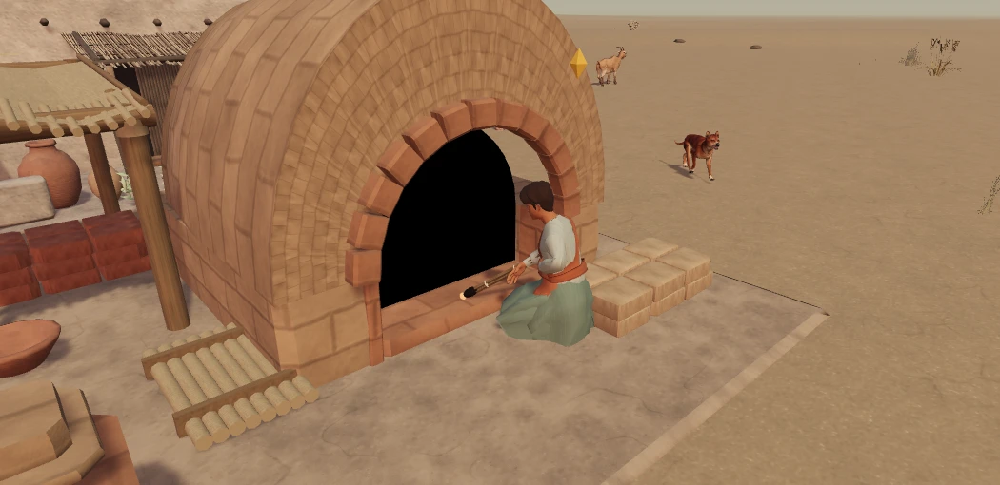
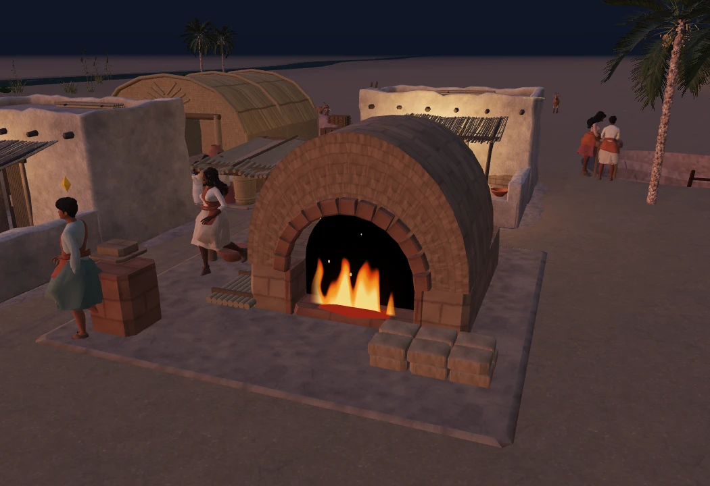
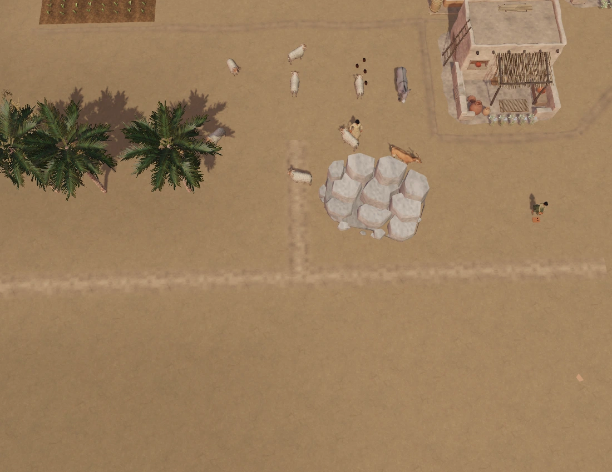
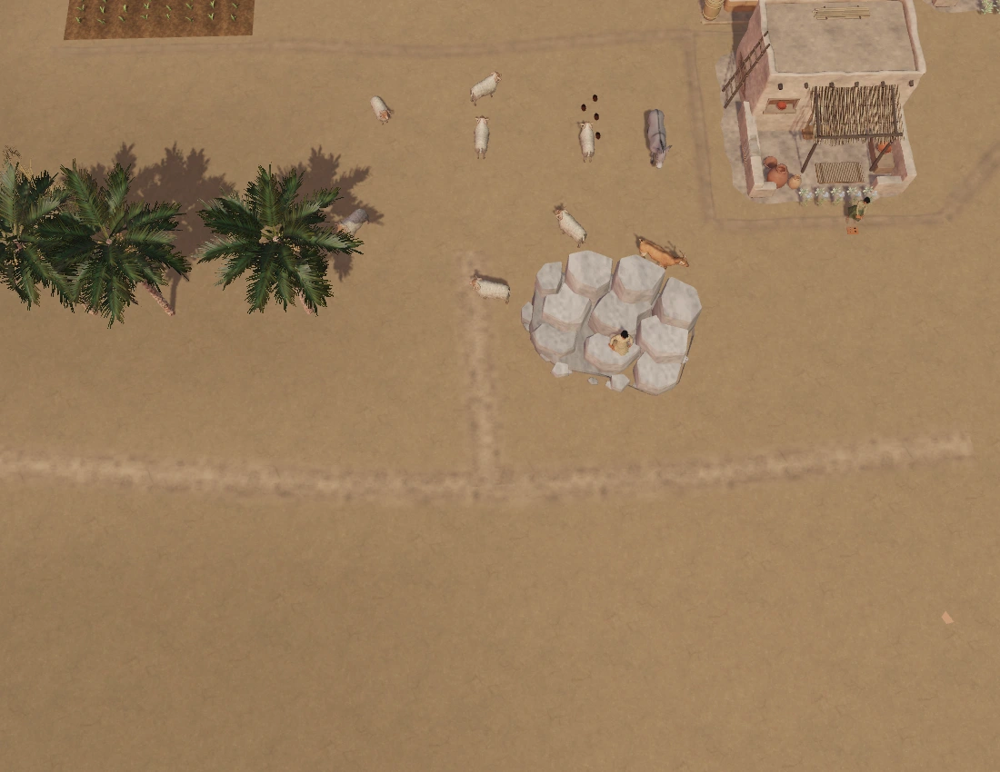

# Огонь, жизнь во дворе и движение города

## Розжиг печи

После доставки четырёх сырцовых кирпичей и трёх охапок тростника печник берёт тлеющий пучок, подходит к устью и поджигает топливо. Если у печи работают двое, второй остаётся у стола. В проверочной сцене житель прошёл с огнём 4,22 м. Перед розжигом кончик пучка оказался в 1,5 см от углей. После обжига печь выдала четыре кирпича. Проверены также выдача готовой партии и ремонт. [Замеры рук, топлива и выхода](../../docs/benchmarks/2026-11-20-kiln-ignition.json)

| Печник подносит огонь к топливу | Пламя и искры в горячей печи |
| --- | --- |
|  |  |

Пламя разгорается от основания, искры поднимаются и гаснут. При охлаждении видны угли. Огонь привязан к действующей операции в кирпичной печи, гончарной мастерской, пекарне и медной мастерской. Перенос тлеющего пучка поставлен для кирпичной печи. В трёх других мастерских проверили нагрев от начала до готовой партии в обычной игре на 4×. Пекарня выдала 5 единиц еды, медник — 1 топор, гончар — 2 сосуда. В каждом устье наблюдались движущиеся искры.

## Вечер в общинном доме

В заселённом доме вечером горят три глиняных светильника, а в узких проёмах зала видно тёплое освещение. Двое свободных соседей выходят из зала, садятся рядом на длинную лавку, поворачиваются друг к другу и по очереди жестикулируют. В сухой вечер третий житель может подняться на плоскую крышу. У обычных домов тоже учитывается погода.

В доме на 24 человека лавку заняли жители № 16 и № 17, а № 18 поднялся на крышу высотой 2,53 м. Когда пошёл дождь, он спустился по тем же ступеням. В опустевшем доме все светильники погасли. [Общий вид двора](../evidence/2026-11-20/evening-life/courtyard.webp) · [Соседи на лавке](../evidence/2026-11-20/evening-life/neighbours.webp)

## Кто вышел утром

В городе из 500 жителей и 250 зданий проследили за дверью каждого дома после одной обычной ночи. На рассвете внутри находились 452 взрослых и двое детей. Все 452 взрослых пересекли свой порог **между 05:03 и 08:58**. Дети вышли играть. Остальные 46 жителей уже были на городских маршрутах.

Каждый житель получает собственное время выхода из комнаты между 05:00 и 08:55. Несколько минут в конце оставлены на путь до дверного проёма. Свободный взрослый выходит во двор и возвращается домой. Если появляется работа, он продолжает путь от того места, где стоит. В дождь свободный житель останавливается под косяком. Восстановление сохранения около 07:00 вернуло жителя № 38 в то же положение и с тем же поворотом.

| Утро одного города, каждый житель учтён один раз | Жителей |
| --- | ---: |
| Вышли через домашнюю дверь по делу, часть успела и во двор | 88 |
| Вышли к себе во двор | 384 |
| Дети вышли играть | 2 |
| Продолжали путь с рассвета, в том числе 23 носили воду | 26 |
| **Всего** | **500** |

Младенцы, дежурные на посту, больные и присматривающий за младенцем взрослый сохраняют свои занятия. Перенос груза и экстренные поручения продолжаются по своим правилам.

## Переходы стад

На одной карте отслеживали всех 28 животных четырёх свободных стад. В таблице указано наибольшее удаление центра стада от начального места за 42 секунды на 4×. Последняя колонка показывает долю пути, которую животные прошли задом. У препятствия животное сначала ищет безопасный поворот, отступает на несколько шагов только при заторе.

| Стадо | Прежняя версия, м | Новая версия, м | Путь задом до → после |
| --- | ---: | ---: | ---: |
| Свиньи | 1,6 | 54,4 | 10,0% → 0,30% |
| Козы | 2,2 | 32,4 | 15,1% → 1,06% |
| Быки и коровы | 3,8 | 33,7 | 16,4% → 0,47% |
| Овцы | 2,1 | 32,7 | 13,3% → 0,47% |

Все 28 животных сменили место. На паузе стада остановились. В замере не было ни разворотов стоя, ни выхода на недоступный грунт. [У камня](../evidence/2026-11-20/grazing-herds/cattle-at-rock.webp) · [То же стадо дальше по маршруту](../evidence/2026-11-20/grazing-herds/cattle-past-rock.webp) · [Замеры по каждому стаду](../../docs/benchmarks/2026-11-20-pasture-migration.json)

## Скорость похоронной процессии

Замерили положение одного и того же жителя № 4 на ровной дороге в двух ситуациях. Носильщики подстраиваются под самого медленного в группе. Остальные идут к своим местам с обычной скоростью. Когда меняется этап обряда, толпа и носилки продолжают путь из своей текущей позиции.

| Скорость игры | Обычная ходьба, м/с | В процессии до, м/с | В процессии после, м/с |
| --- | ---: | ---: | ---: |
| 1× | 0,789 | 5,110 | 0,787 |
| 4× | 3,147 | 17,943 | 3,151 |

## Улицы и тропы

На открытой земле улица проходит по неглубокой дуге через несколько клеток. У ворот, между домами и на мосту путь вписывается в доступную ширину. Жители и носильщики воды следуют изгибу видимой дороги. На одном сохранении максимальное отклонение оси пяти построенных участков выросло с нуля до 0,81 м, а десяти участков тропы — с 0,20 до 0,41 м. У 2 408 проверенных кромок улиц и троп пересечений с препятствиями нет.

| Одна улица до изменения | Та же улица после |
| --- | --- |
|  |  |

## Производительность и сохранения

Один город с 500 жителями и 250 зданиями, включая 70/69/69 частных домов I/II/III уровня. Скорость 4×, одна обзорная камера, окно 1440×900, игровой буфер 1440×780, аппаратный WebGL 2 на Apple M5 в Chrome 158. После прогрева считались отрисованные кадры за 18 секунд. Порядок прогонов — прежний выпуск, новый, новый, прежний.

| Пара прогонов | До, FPS | После, FPS | До, p95 времени кадра | После, p95 времени кадра |
| --- | ---: | ---: | ---: | ---: |
| Первая | 31,00 | 29,64 | 50,0 мс | 50,0 мс |
| Вторая, обратный порядок | 30,69 | 29,34 | 50,0 мс | 50,0 мс |
| **Среднее** | **30,85** | **29,49** | | |

После утреннего выхода сотни жителей возвращаются домой. В промежуточной реализации движок продолжал обходить их невидимые модели. Теперь при возвращении домой игра убирает скелет и анимации из активной сцены и восстанавливает их при следующем выходе. В отдельной проверке на 24 моделях спящих жителей из расписания движка убраны 4 104 канала анимации, при пробуждении вернулись те же 24 экземпляра.

Прошли 2169 тестов Node и 7 тестов roadmap. Для 20 архивных сохранений результат миграции побайтово совпал с предыдущим выпуском, повторная загрузка также совпала. В четырёх нагрузочных прогонах проверены личности, грузы, запасы и повторная запись сохранения. [Полные замеры по сценам, сохранениям и кадрам](../../docs/benchmarks/2026-11-20-evening-life-and-pastures.json)

## Археологические ориентиры

Печи Ура раннединастического периода дают ориентир для вида зоны обжига, записи из Гирсу III династии Ура свидетельствуют о пастбищах. Дворы жилых домов известны по раскопкам поселений в долине Диялы. Время выхода до 09:00, вечерний разговор на лавке, траектории стад и движения печника выбраны для игры. [Печи Ура](https://cdli.earth/articles/cdlj/2015-2) · [Тексты о стадах и пастбищах](https://cdli.earth/articles/cdlj/2021-2) · [Жилые дома Диялы](https://isac.uchicago.edu/publications/private-houses-and-graves-diyala-region)
