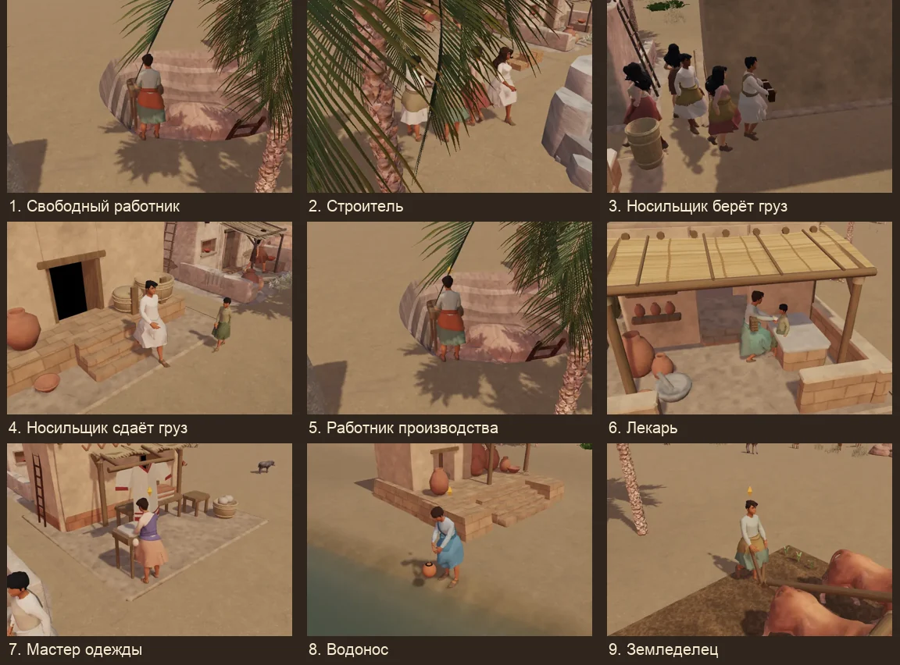
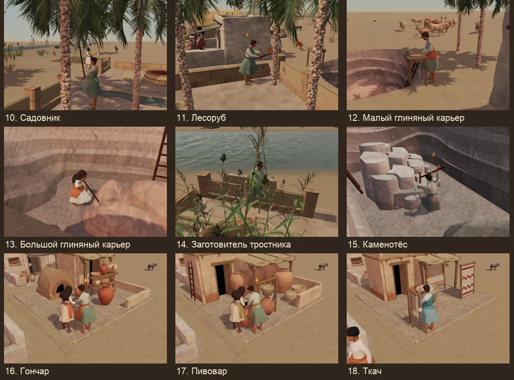
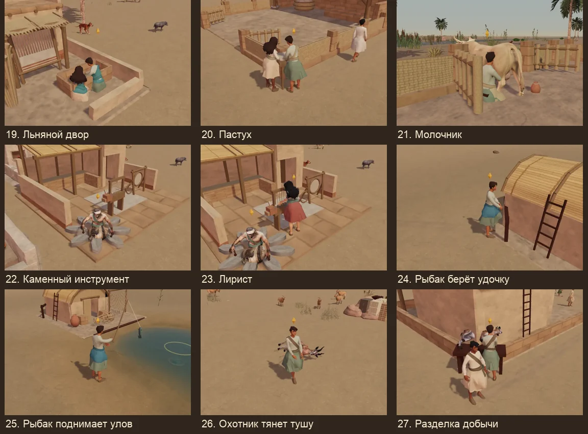
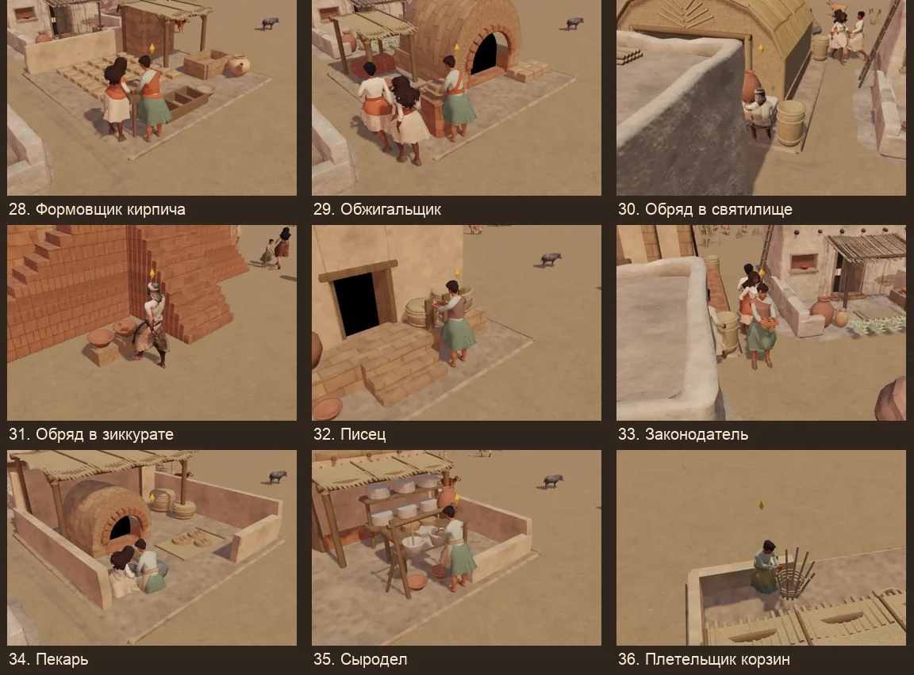
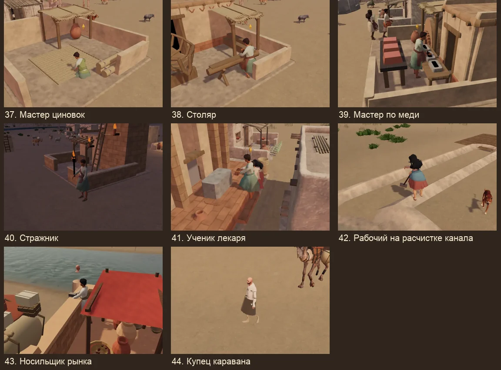

# Профессии и рабочие действия жителей · 20 ноября 2026

В обычной трёхмерной игре проверены **26 записей каталога профессий и 11 дополнительных должностей и занятий**. Для них записаны 44 сцены WebGL2 и 2240 кадров движения. [Протокол с ID работников и результатами](../../docs/benchmarks/2026-11-20-profession-actions.json)

## Что изменилось

В двухклеточных хозяйствах дорога заканчивалась у угла ограды. Работник получал экономический результат, но мог остаться далеко от коровы или шерсти. Сейчас доильное место и корова стоят с внутренней стороны открытых ворот. Молочник проходит через створки, садится на табурет и доит корову. Пастух работает за столом со стороны улицы, откуда можно передать шерсть носильщику. Стол и положение рук используют одни координаты.

При публикации свода игра тратила глину и сразу записывала автора. Теперь тот же житель в свободное дневное время у дома дописывает табличку стилусом. Он заканчивает начатую доставку, лечение или смену. Сохранение в процессе письма восстанавливает остаток времени. Место работы законодателя и её продолжительность — игровые допущения. Именованные писцы и учёт скота на глиняных табличках документированы для III династии Ура. [Музей искусств Толидо](https://emuseum.toledomuseum.org/objects/68876/sumerian-clay-tablet-recording-sheep-transactions)

## Как проверено

В исходных сценариях заданы здания, назначения взрослых и начальные материалы. Дорогу, начало работы, расход сырья и выдачу результата проводила обычная симуляция. Для отдельных кадров грузов, патруля и обучения использованы ранее сохранённые маршруты. Для каждого эпизода загружено сохранение через игровой index.html, камера наведена на нужную фигуру и записаны активная геометрия, движение тела или ладоней и ошибки.

Для коровника отдельно загружена точка перед возвращением молочника от реки с водой. Для овчарни — подход пастуха с дороги. За 23 секунды настоящего времени при 4× молочник находился у доильного места в **330** кадрах, пастух у стола — в **627**. Путь правой ладони во время контакта составил 1,28 и 2,44 м соответственно.

Для дойки отдельно проверены четыре соска на деформируемой модели коровы. В 12 последовательных замерах обе ладони работали на разных сосках. Максимальное расстояние от ладони до поверхности вымени составило 1,4 см. Игра ждёт загрузки коровы перед посадкой работника, а приходящее с пастбища стадо занимает остальные стойла. [Молочник у коровы](../evidence/2026-11-20/profession-actions/milking.webp)

Для сада, лесоруба и карьеров дополнительно сопоставлены геометрия орудия или ладони с поверхностью материала. Ближайший проход за цикл составил 6 мм от крюка до фиников, менее 1 мм от топора до коры, 12 мм от кирки до камня, менее 1 мм от мотыги до глины и 4,5 мм от ладони до кома в малом карьере.

Цифры выпуска ниже берутся из истории здания, передачи конкретной партии, состояния поля или здоровья пациента. Кадр показывает действие выбранного человека. Результат производства относится к смене здания и может включать работу второго назначенного жителя.

## Работники и должности

| Профессия или должность | Действие | Проверенный результат | Кадры |
| --- | --- | --- | --- |
| Свободный работник | Автораспределение привело жителя к глине, он работал у стола двора. | 18 ед. глины в истории здания. [Тест](../../tests/working-city.test.js) | [1](../evidence/2026-11-20/profession-actions/actions-1.webp) |
| Строитель | Пришёл к оплаченной стройке и работал инструментом у лесов после подвоза материалов. | Строительство одного дома завершилось. [Тест](../../tests/construction.test.js) | [2](../evidence/2026-11-20/profession-actions/actions-1.webp) |
| Носильщик | Взял древесину у источника и передал груз в приёмном дворе. | Один рейс №1, на приёмке 6 ед. древесины у жителя №8. [Тест](../../tests/carrier-depot.test.js) | [3](../evidence/2026-11-20/profession-actions/actions-1.webp) · [4](../evidence/2026-11-20/profession-actions/actions-1.webp) |
| Работник производства | Пришёл на назначенную работу и обрабатывал сырьё у оборудования. | 18 ед. глины в истории здания. [Тест](../../tests/professions.test.js) | [5](../evidence/2026-11-20/profession-actions/actions-1.webp) |
| Лекарь | Работал с волокнистой повязкой у конкретного пациента при запасах еды и тростника. | Здоровье пациента начало расти с 44 до 44,069. [Тест](../../tests/healer.test.js) | [6](../evidence/2026-11-20/profession-actions/actions-1.webp) |
| Мастер одежды | Доставленная ткань попала на рабочий стол, портной обрабатывал её обеими руками. | 1 предмет одежды. [Тест](../../tests/clothing.test.js) | [7](../evidence/2026-11-20/profession-actions/actions-1.webp) |
| Водонос | Пришёл к воде, наклонил сосуд у уреза и вышел на маршрут с водой. | В сосуде переносилось 12 ед. воды. [Тест](../../tests/water.test.js) | [8](../evidence/2026-11-20/profession-actions/actions-1.webp) |
| Земледелец | Дошёл до полосы посева и работал у земли с доставленными семенами. | На выбранном поле засеяно 100% площади. [Тест](../../tests/irrigated-harvest.test.js) | [9](../evidence/2026-11-20/profession-actions/actions-1.webp) |
| Садовник | Подошёл к плодоносящему участку и работал крюком у выбранной пальмы. | 3,675 ед. фиников в продовольствии, первая доставка на склад 1,225. [Тест](../../tests/orchard-maturity.test.js) | [10](../evidence/2026-11-20/profession-actions/actions-2.webp) |
| Лесоруб | Подошёл к выделенному дереву и работал топором. | 6 ед. древесины. [Тест](../../tests/forest-stock.test.js) | [11](../evidence/2026-11-20/profession-actions/actions-2.webp) |
| Добытчик глины | В малом дворе обрабатывал глину на площадке, в большом спустился к источнику и работал мотыгой. | 18 ед. в малом дворе, в большом подтверждена точка добычи на участке 9,6. [Тест](../../tests/clay-stock.test.js) | [12](../evidence/2026-11-20/profession-actions/actions-2.webp) · [13](../evidence/2026-11-20/profession-actions/actions-2.webp) |
| Заготовитель тростника | Подошёл к реальному участку и срезал стебли рабочим лезвием. | 10 ед. тростника. [Тест](../../tests/reed-stock.test.js) | [14](../evidence/2026-11-20/profession-actions/actions-2.webp) |
| Каменотёс | Дошёл до породной стенки и бил по выбранному источнику киркой. | 5 ед. камня. [Тест](../../tests/stone-stock.test.js) | [15](../evidence/2026-11-20/profession-actions/actions-2.webp) |
| Гончар | Пришёл к кругу, формовал сосуды из доставленного сырья, партия прошла сушку и обжиг. | 2 сосуда. [Тест](../../tests/artisan-integration.test.js) | [16](../evidence/2026-11-20/profession-actions/actions-2.webp) |
| Пивовар | Мешал содержимое чана после доставки припасов, воды и сосуда. | 3 ед. пива. [Тест](../../tests/artisan-integration.test.js) | [17](../evidence/2026-11-20/profession-actions/actions-2.webp) |
| Ткач | Работал на шерстяном станке. Во льняном дворе обрабатывал волокно перед ткачеством. | 1 ед. шерстяной ткани и 2 ед. льняной ткани в отдельных сценах. [Тест](../../tests/textiles.test.js) | [18](../evidence/2026-11-20/profession-actions/actions-2.webp) · [19](../evidence/2026-11-20/profession-actions/actions-3.webp) |
| Пастух | Дошёл до стола у наружного угла ограды и разобрал собранную шерсть. | 4 ед. шерсти. [Тест](../../tests/textiles.test.js) | [20](../evidence/2026-11-20/profession-actions/actions-3.webp) |
| Молочник | Прошёл через створки коровника, сел на табурет и доил закреплённую у стойла корову. | 3 ед. молока. [Тест](../../tests/dairy.test.js) | [21](../evidence/2026-11-20/profession-actions/actions-3.webp) |
| Музыкант | Первый играл на каменном инструменте, второй отдельно работал руками у струн лиры. | Два исполнителя вместе, первая завершённая партия принесла 0,12 престижа. [Тест](../../tests/music-workstation.test.js) | [22](../evidence/2026-11-20/profession-actions/actions-3.webp) · [23](../evidence/2026-11-20/profession-actions/actions-3.webp) |
| Рыбак | Взял удочку, вышел к рыбному месту и поднял улов. | Носильщик №6 передал 5 ед. рыбы в хранилище 9,8. [Тест](../../tests/harvest-handling.test.js) | [24](../evidence/2026-11-20/profession-actions/actions-3.webp) · [25](../evidence/2026-11-20/profession-actions/actions-3.webp) |
| Охотник | После охоты потянул ту же газель за верёвку и разделал её у стола. | Носильщик №7 доставил 4 ед. мяса в хранилище 9,8. [Тест](../../tests/harvest-handling.test.js) | [26](../evidence/2026-11-20/profession-actions/actions-3.webp) · [27](../evidence/2026-11-20/profession-actions/actions-3.webp) |
| Формовщик кирпича | Пришёл к форме, вдавил глину и оставил кирпичи сохнуть. | 4 сырцовых кирпича. [Тест](../../tests/brick-integration.test.js) | [28](../evidence/2026-11-20/profession-actions/actions-4.webp) |
| Обжигальщик | Обрабатывал загруженную партию у печи. | 4 обожжённых кирпича. [Тест](../../tests/kiln-integration.test.js) | [29](../evidence/2026-11-20/profession-actions/actions-4.webp) |
| Жрец | Подходил к жертвенной чаше в святилище и в зиккурате. | В обоих зданиях записаны вера и престиж. [Тест](../../tests/service-court.test.js) | [30](../evidence/2026-11-20/profession-actions/actions-4.webp) · [31](../evidence/2026-11-20/profession-actions/actions-4.webp) |
| Писец | Дошёл до рабочего места в амбаре и отмечал запасы стилусом на табличке. | Табличка подписана жителем №0 в момент симуляции 11,2. [Тест](../../tests/scribes.test.js) | [32](../evidence/2026-11-20/profession-actions/actions-4.webp) |
| Законодатель | После публикации оттискивал знаки на глиняной табличке у собственного дома. | У свода указан автор №0, израсходована одна единица глины. [Тест](../../tests/lawmaker-action.test.js) | [33](../evidence/2026-11-20/profession-actions/actions-4.webp) |
| Пекарь | Работал у зернотёрки, затем перешёл к печи с лопатой. | 5 ед. готовой пищи. [Тест](../../tests/artisan-integration.test.js) | [34](../evidence/2026-11-20/profession-actions/actions-4.webp) |
| Сыродел | У стола обрабатывал доставленные молоко и сосуд. | 3 ед. съестного запаса. [Тест](../../tests/artisan-integration.test.js) | [35](../evidence/2026-11-20/profession-actions/actions-4.webp) |
| Плетельщик корзин | Плёл тростник у заготовки корзины. | 1 готовая корзина. [Тест](../../tests/basketry.test.js) | [36](../evidence/2026-11-20/profession-actions/actions-4.webp) |
| Мастер циновок | Укладывал полосы тростника на низкой рабочей поверхности. | 1 готовая циновка. [Тест](../../tests/artisan-interaction.test.js) | [37](../evidence/2026-11-20/profession-actions/actions-5.webp) |
| Столяр | Работал теслом у верстака после доставки строевого леса. | 1 готовая столярная деталь. [Тест](../../tests/joinery.test.js) | [38](../evidence/2026-11-20/profession-actions/actions-5.webp) |
| Мастер по меди | Работал с тиглем у формы, куда поступила медь. | 1 готовый топор. [Тест](../../tests/copper-tools.test.js) | [39](../evidence/2026-11-20/profession-actions/actions-5.webp) |
| Стражник | Шёл ночным патрульным маршрутом от караульного двора. | Маршрут включал 3 точки, зафиксирован проход более 1 клетки. [Тест](../../tests/watch-house.test.js) | [40](../evidence/2026-11-20/profession-actions/actions-5.webp) |
| Ученик лекаря | Пришёл в храм и упражнялся стилусом на собственной табличке. | У счётчика обучения появился прогресс, исходный уровень 0. [Тест](../../tests/medical-education.test.js) | [41](../evidence/2026-11-20/profession-actions/actions-5.webp) |
| Рабочий на расчистке канала | Подошёл к заиленной кромке и счищал осадок инструментом. | Ил уменьшился с 0,99844 до нуля, вода дошла до нижнего поля. [Тест](../../tests/service-court.test.js) | [42](../evidence/2026-11-20/profession-actions/actions-5.webp) |
| Носильщик рынка | Взял закупку у рынка и принёс камень на склад. | №8 доставил все 3 ед. камня. [Тест](../../tests/trading.test.js) | [43](../evidence/2026-11-20/profession-actions/actions-5.webp) |
| Купец каравана | Шёл вместе с вьючным обозом по собственной торговой дороге. | 12 точек пути, торговля завершилась. [Тест](../../tests/trading.test.js) | [44](../evidence/2026-11-20/profession-actions/actions-5.webp) |

## Кадры из игры

