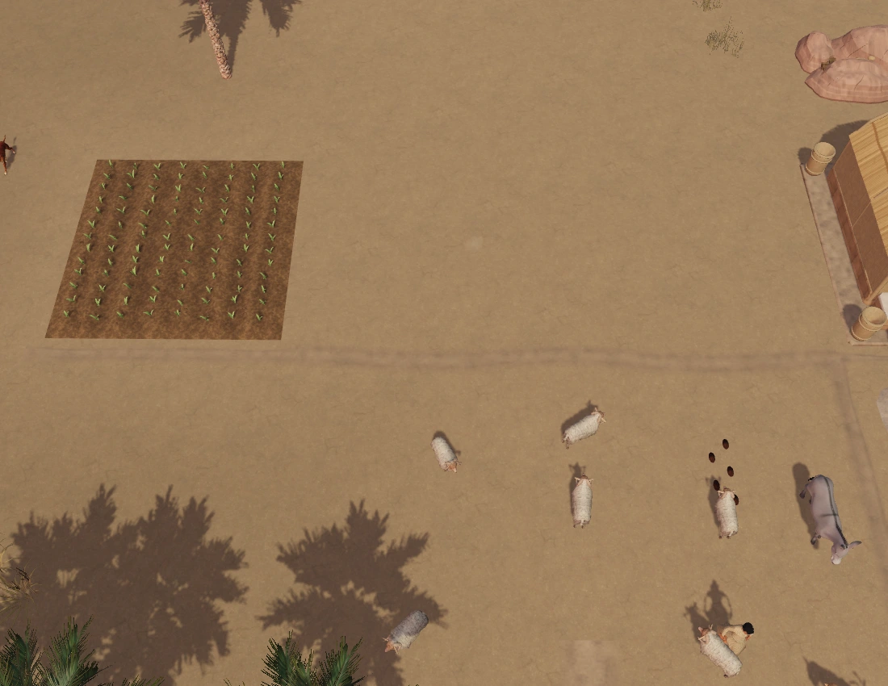

# Жители за работой, похоронная процессия и городские дороги

## Кто входит в храм

В городском обряде за телом идут до четырёх взрослых, для которых есть проход до храма. Другие провожающие дожидаются носилок на улице и присоединяются к процессии. При нескольких умерших за следующими носилками возвращаются носильщики. Жители за рекой без моста остаются на своём берегу. Если никто не может забрать тело, проходит короткое прощание на месте. В контрольном случае раньше носилки самостоятельно проезжали 32,43 м, теперь их смещение равно нулю. Один носильщик тянет полозья по земле. Двое берутся за петли с противоположных концов, трое держат носилки в трёх разных точках.

Прежде в проверочной сцене в храм заходили все 12 участников. После изменения вошли четверо. В обычном городе проверили обряд с 39 участниками и загрузку сохранений в пяти фазах. Похороны, начавшиеся в сохранении прежней версии, продолжаются с прежним распределением участников. Следующие похороны в том же городе используют новый порядок. Носильщики поднимают жерди руками, шакал хватает ткань зубами и стаскивает её с настила. За первые 50 мс тяги саван прежде смещался на 1,31 м, теперь на 0,076 м. Провожающие расходятся до появления шакалов. После ухода шакала саван больше не появляется.

[Ожидание у храма](../evidence/2026-11-20/funeral/temple.webp) · [Перенос носилок](../evidence/2026-11-20/funeral/carrying.webp) · [Шакал у края савана](../evidence/2026-11-20/funeral/jackal.webp)

## Что делают жители

В обычной игре проверены все 26 профессий из каталога и ещё 11 служебных назначений и ремёсел. В 44 эпизодах записали, куда приходит житель, каким предметом пользуется и что выдаёт работа. [Таблица занятий и результаты по каждому эпизоду](2026-11-20-profession-actions.md)

- Законодатель работает стилусом по глиняной табличке после издания закона. В коровнике 2×2 молочник входит через ворота и садится, когда доильная корова занимает стойло. В 330 кадрах доения подряд корова оставалась на месте. Обе ладони работают у разных сосков. Пастух работает у сортировочного стола овчарни.
- Садовник встаёт между оградой и пальмой, достаёт крюком до грозди. Лесоруб попадает лезвием в кору. В карьерах проверены обе пятки и оба носка на поверхности грунта, удар кирки по камню и работа с глиной на забое и у стола. Ближайшие положения крюка к финикам и кирки к камню за рабочий цикл составили около 6 и 12 мм. [Кадры с рабочих мест](../evidence/2026-11-20/profession-actions/actions-2.webp)
- Рыбак достаёт рыбу, охотник тащит ту же газель к месту разделки, затем носильщик доставляет четыре единицы мяса. [Цепочки добычи](2026-11-20-profession-actions.md)
- Носильщик доставил с рынка все три купленные единицы камня. Караван прошёл маршрут из 12 точек и открыл торговлю. Рабочий очистил русло, после чего вода снова дошла до поля.
- В игровом WebGL ребёнок шести лет и подросток двенадцати лет двигались и играли во дворе. К 22 часам оба ушли домой. Путь игры теперь огибает всю площадь многоклеточного дома. Проверены проходы с четырёх углов.
- Взрослые мужчина и женщина работали в гончарном дворе, 60-летний житель добывал глину. В случае с годовалым ребёнком симуляция зафиксировала уход родителя и ужин. Внешняя камера показала, что ребёнок остаётся внутри.

## Форма дорог

На одной карте сравнили 10 отрезков протоптанных троп и пять участков построенной дороги. У старой тропы изгиб менял сторону на каждой клетке. Теперь ось мягко отклоняется от прямой, а грунтовые кромки сужаются вдоль двора или берега. Мост сохраняет свой настил. Пройденную жителями линию одинаково используют 2D и WebGL.

| На том же сохранении | До | После |
| --- | ---: | ---: |
| Максимальное боковое отклонение тропы | 1,545 м | 0,201 м |
| Длина десяти отрезков тропы | 68,51 м | 62,54 м |
| Отклонение оси построенной улицы от маршрута | 0,107 м | 0 м |

| Дорога к полю до изменения | Та же дорога после |
| --- | --- |
|  |  |

Улицы и переулки известны по планам месопотамских поселений, погребения — по находкам из Ура, учёт рабочих дней — по шумерским табличкам. Степень изгиба тропы, число носильщиков, сцена с шакалом и конкретные движения работников выбраны для игры. [Раскопки жилых кварталов Диялы](https://isac.uchicago.edu/publications/private-houses-and-graves-diyala-region) · [Погребения Ура](https://penntoday.upenn.edu/news/iraq-s-ancient-past-rediscovering-ur-s-royal-cemetery-0) · [Ведомость работников из Ниппура](https://collections.penn.museum/collections/object.php?irn=569543)

## Нагрузка

Один город, 500 жителей и 250 построек, дневная обзорная камера, скорость 4×. Каждый прогон записывал показанные кадры в течение 18 секунд после прогрева в Chrome 158 на Apple M5. Размер окна 1440×900, игрового буфера 1440×780. Во всех прогонах проверялись также загрузка сохранения, личности и грузы.

| Серия | Предыдущий выпуск, FPS | Изменения, FPS |
| --- | ---: | ---: |
| Во время разработки, до последних поправок рабочих поз | 30,42 | 30,50 |
| Финальная сборка, одиночная пара | 16,70 | 14,35 |
| Финальная сборка, первая пара | 8,89 | 9,17 |
| Финальная сборка, вторая пара в обратном порядке | 14,93 | 13,93 |
| **Среднее двух пар с чередованием** | **11,91** | **11,55** |

В двух последних парах разница составила +3,2% и −6,7%, в среднем −3,0%. Во время финальных замеров компьютер работал от батареи, а отдельный процесс пользовательского Chrome занимал около одного ядра. Разброс не позволяет подтвердить прежний FPS с точностью до нескольких процентов. [Исходные замеры и протоколы игровых сцен](../../docs/benchmarks/2026-11-20-streets-and-residents.json)
