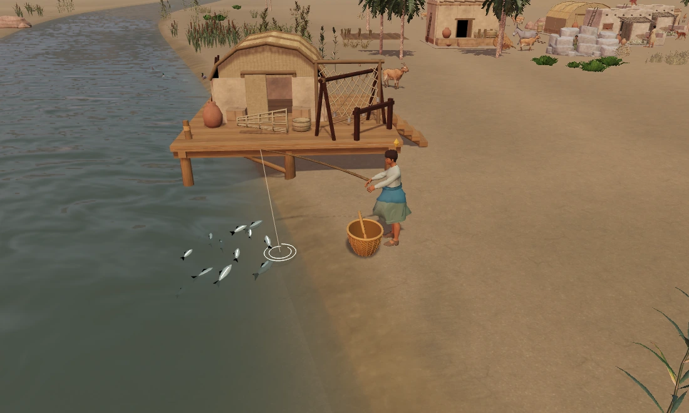
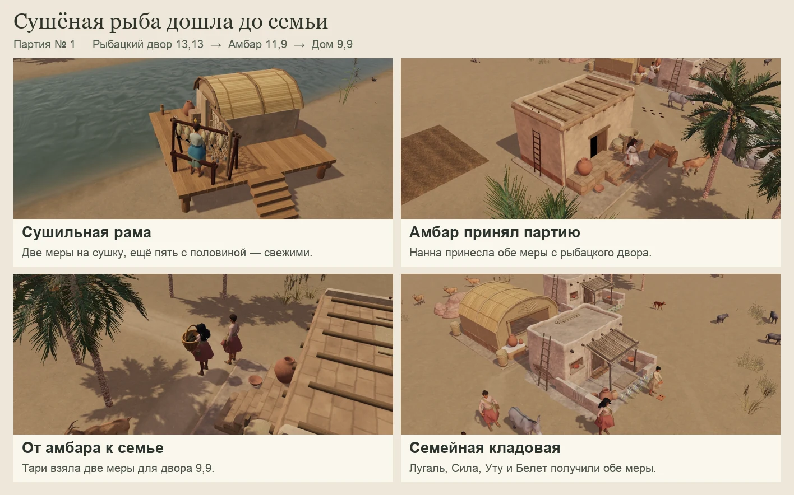

# Два улова у одного причала

Амал рыбачит у двора на клетке (13, 13). Обычная поклёвка принесла 5 мер еды, а первая после «Богатого улова» — 7,5. Перед подъёмом рыбы косяк одновременно сменил направление. Оба прогона начались из одного сохранения с одной камерой. В сохранении для сравнения уже открыто чудо, назначен рыбак и есть 40 веры. Улов и доставки происходят после запуска.

| Обычная поклёвка · 5 мер | Первый благословлённый улов · 7,5 меры |
| --- | --- |
| [Смотреть запись](../evidence/2026-11-21/fishery/ordinary-bite.mp4) | [Смотреть запись](../evidence/2026-11-21/fishery/rich-catch.mp4) |

Оба клипа записаны без звука, 1100 × 660, 25 кадров в секунду. В парном ролике обычная поклёвка завершается раньше, и её последний кадр остаётся слева до конца благословлённой сцены. [Посмотреть рядом](../evidence/2026-11-21/fishery/compare.mp4)

Снимок перед поклёвкой можно открыть через «Сохранения» → «Импорт из файла», затем загрузить импортированный город. Чтобы повторить сравнение, запустите первую поклёвку как обычно, снова загрузите исходный снимок и примените дар к двору (13, 13).

Рябь у выбранного двора подтверждает применение дара. Появление косяка, подъём рыбы и укладка в корзину привязаны к успешной поклёвке. Первый усиленный улов расходует один из шести зарядов. Длительность движения при обычной поклёвке — около 1,8 секунды, при первом благословлённом улове — около восьми секунд на 1× и на 4×.

## Что получила семья

| Место | Кто и что сделал | Что осталось |
| --- | --- | --- |
| Рыбацкий двор (13, 13) | Амал сдал 7,5 меры и повесил 2 на раму | 5,5 меры свежей рыбы в выпуске двора. На раме партия № 1 |
| Рама | Партия высохла. Нанна забрала обе меры | Готовых пайков этой партии у рыбака больше нет |
| Амбар (11, 9) | Нанна сдала партию № 1, затем Тари забрала её для выдачи | Было 2 меры отдельного резерва, после выдачи 0 |
| Дом (9, 9) | Тари доставила обе меры семье Лугаля и Силы, где также живут Уту и Белет | Семейная кладовая приняла 2 меры. В карточке дома видны исходный двор, амбар, партия и носильщик |

В рыбацком дворе нажмите **«Сушить часть следующих уловов»**. Свободная рама принимает две меры из улова величиной от четырёх мер. Пока идёт дождь, партия остаётся на месте. После сушки нужен связанный амбар и свободный носильщик. В карточке амбара кнопка **«Выдавать пайки семьям сейчас»** открывает запас. При нехватке обычной еды пайки выдаются автоматически. [Контрольное сохранение перед поклёвкой](../evidence/2026-11-21/fishery/fishery-before-bite.json) · [Журнал рейсов из браузера](../evidence/2026-11-21/fishery/browser-trace.json)

## Историческая основа

В хозяйственной табличке из Гирсу среди выданного улова перечислены 1800 сушёных рыб. Тростниковая рама, размер игровой партии и правила амбарного резерва реконструированы для города. [Издание таблички № 206](https://edizionicafoscari.unive.it/media/pdf/books/978-88-6969-413-4/978-88-6969-413-4-ch-04_MSLHnY2.pdf#page=104)

## Частота кадров при 4×

На Apple M5 в Chrome измерены интервалы между кадрами игрового WebGL 2 с HUD и автосохранением. Разрешение 1440 × 780, 500 жителей и 250 зданий в каждом прогоне. Для каждого ракурса сделано по три прогона на выпуске `50ee1a3b` и на новой сборке. Перед каждым запуском открыто то же сохранение и отведено восемь секунд на прогрев, затем записаны 20 секунд реального времени.

| Камера | До, FPS | После, FPS | 95-й перцентиль кадра, мс |
| --- | ---: | ---: | ---: |
| Обзор всей долины | 32,51 | 32,55 | 50 → 50 |
| Вблизи рыбацкого двора во время поклёвки | 20,60 | 14,16 | 100 → 150,10 |

Для ближнего замера использован контрольный город перед настоящей благословлённой поклёвкой. Рыбак закреплён за двором, дар в сохранении уже применён. На новой сборке запись включает поворот косяка, подъём рыбы, возвращение к раме и появление партии. Общий FPS рассчитан по сумме кадров и времени всех трёх прогонов. [Исходные интервалы и результаты каждого прогона](../../docs/benchmarks/2026-11-21-fishery-4x.json) · [Город для обзора](../../docs/benchmarks/2026-11-21-fishery-overview-save.json.gz) · [Город перед поклёвкой](../../docs/benchmarks/2026-11-21-fishery-fishing-save.json.gz)

**Повтор с прогревом движения.** Ближние замеры после паузы дали большой разброс. На прежней версии получилось 11,93–25,03 FPS, на новой 8,27–23,58 FPS. Для отдельной проверки проведён прогрев с работающей симуляцией. После 12 секунд движения при 4× загружено исходное состояние того же города в тот же рендерер, затем повторена поклёвка. По трём дополнительным прогонам на версию получено **24,52 → 23,69 FPS**, 95-й перцентиль **66,70 → 66,70 мс**. Диапазоны отдельных прогонов — 24,03–25,01 и 23,21–24,63 FPS соответственно. Обе серии и их исходные интервалы входят в протокол выше.

На общем плане и после прогрева движения разница укладывается в предложенные 5%. При старте у воды после паузы средний FPS по трём прогонам упал на 31%. Чтобы установить причину первых длинных кадров, потребуется профиль загрузки ресурсов, симуляции и отрисовки в этот момент.

## fishery-drying-and-rich-catch-20261121 | Рыбацкий двор и Богатый улов

date: 2026-11-21
type: release
release: fishery-drying-and-rich-catch-20261121
commit: 2e672f0fd7ed5a45ac217664d11a5a7733bd4c6e
publication: verified
groups: graphics; economy; godhood
source: docs/versions/2026-11-21-04.md
