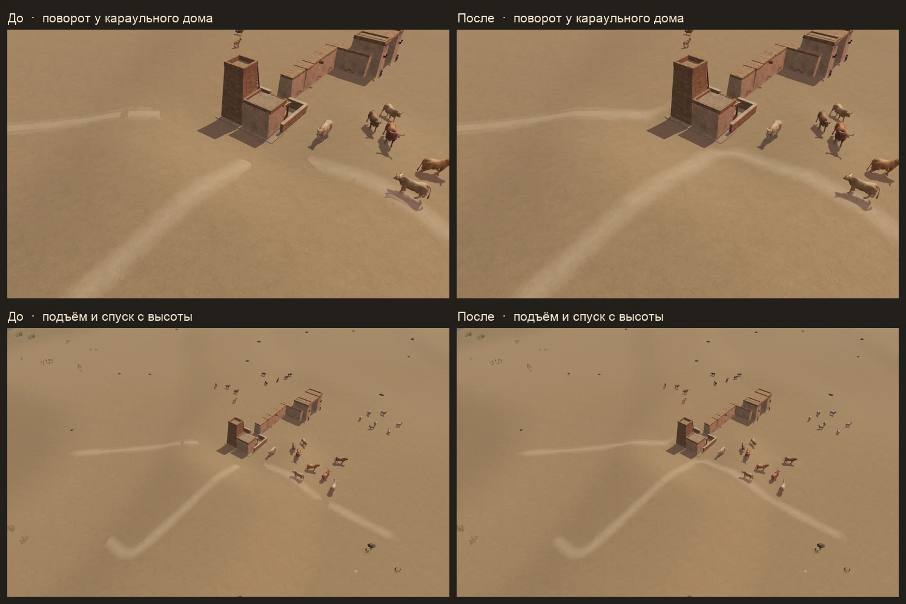
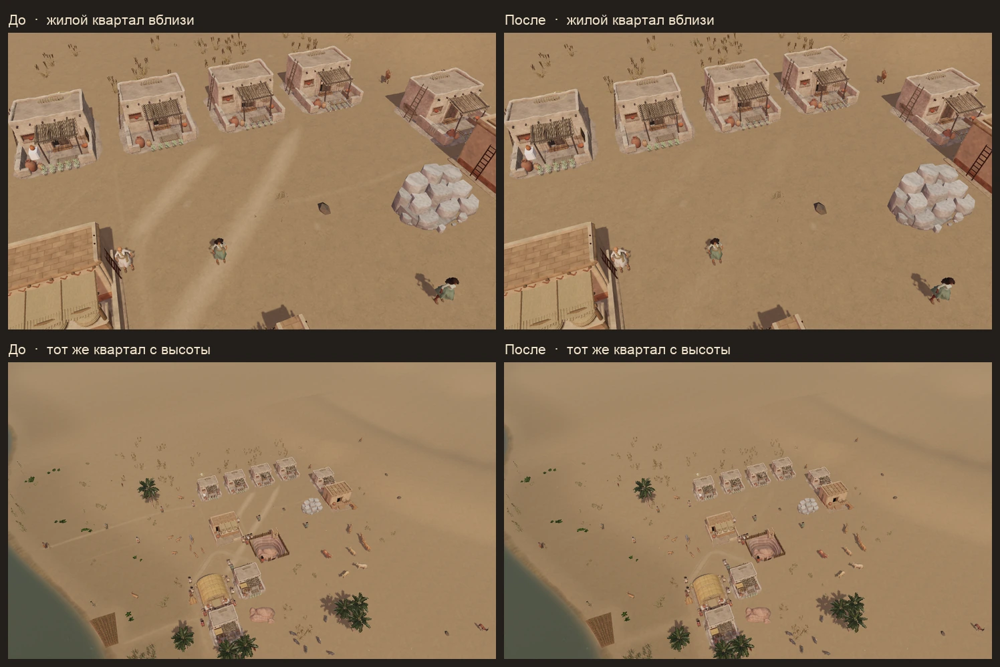

# Пешие тропы и дороги на холмах

## Что проверяли

- Насколько заметна примятая земля с высоты и вблизи, днём и в сумерках. Для контроля в кадре оставлены проходы с разной проходимостью.
- Как дорога ложится на подъём, гребень и спуск. На повороте у сторожевого дома проверяются середина, обочины и следы колёс.

## Что оставляют шаги

На ровном сухом участке от (3,5; 4,5) до (4,5; 4,5) измерена непрозрачность середины покрытия. Это доля наложенного дорожного слоя в контрольных вершинах. Видимый цвет также зависит от освещения и грунта.

| Покрытие | Медиана до | Медиана после |
| --- | ---: | ---: |
| Редкая пешая тропа | 28,6 % | 3,3 % |
| Самая натоптанная пешая тропа | 81,1 % | 10,2 % |
| Колея | 81,1 % | 81,1 % |
| Проложенная грунтовая улица | 83,7 % | 83,7 % |

В дневном игровом кадре с дальней камеры медианная разница яркости на участке следа снизилась с 13,86 до 2 уровней из 255, в сумерках с 9,28 до 1,21. С ближней камеры днём она составила 14,72 до и 2 после. Сравнивали одинаковые участки изображения с включённым и выключенным слоем троп.

Жители по-прежнему запоминают часто используемые пути. Изменён только вид следа.

[Тот же квартал в сумерках](../evidence/2026-11-21/footpaths-and-hills/dusk-comparison.webp) · [Вид в Canvas](../evidence/2026-11-21/footpaths-and-hills/canvas-comparison.webp) · [Сохранение жилого квартала](../evidence/2026-11-21/footpaths-and-hills/footpath-save.json)

## Почему дорога обрывалась

В прежней версии высота дорожной ленты вычислялась по формуле рельефа. Земля на экране соединяет отдельные замеры этой формулы плоскими треугольниками. На склоне в городе с зерном 137 у сторожевого дома (29, 18) поверхности разошлись. На диагональном проходе 273 из 480 проверенных точек оказались под землёй, местами на 19,36 см.

Режим прокладки воспроизвёл тот же дефект. На соседнем звене у подъёма под грунтом оказалось 199 из 401 точки направляющей, глубиной до 17,93 см. Выделение выбранной улицы местами уходило в грунт на 11,93 см.

Дорожное полотно теперь повторяет изломы тех же треугольников, которые видны на экране. В контрольной сцене прежняя дорога скрывалась до 16,84 см под землёй, колея до 15,43 см. После исправления над грунтом оказались все 16 397 проверенных точек проложенной дороги и все 9 629 точек троп и колей. У девяти проложенных улиц направляющая и выделение проходят над грунтом.

[Поворот крупно и склон в сумерках](../evidence/2026-11-21/footpaths-and-hills/hill-bend-and-dusk.webp) · [Сохранение со склоном](../evidence/2026-11-21/footpaths-and-hills/hill-save.json) · [Данные проверочных сцен](../evidence/2026-11-21/footpaths-and-hills/checks.json)

## Исторический ориентир

В Абу-Салабихе III тысячелетия до н. э. раскопки показывают широкие улицы и более узкие переулки между домами. Точный цвет тропы и её видимость с высоты выбраны для игры. [Николас Постгейт, публикация раскопок Абу-Салабиха](https://www.archaeopress.com/Archaeopress/download/9781803276694)

## Производительность

Одна копия города с 500 жителями и 250 зданиями, 529 звеньев в сети. Для замера на ней проложили 89 улиц и воспроизвели износ на 175 других участках, включая 59 колей. Один обзор в Chrome WebGL 2, 1440 × 780, скорость 4×. Перед каждым замером симуляция движется 12 секунд, затем открывается исходное сохранение и за 20 секунд записываются реальные интервалы кадров.

| Версия | Три прогона, FPS | Средний FPS по суммарному времени | p95 времени кадра |
| --- | --- | ---: | ---: |
| До | 21,07 / 16,54 / 20,12 | 19,24 | 83,3 мс |
| После | 19,12 / 14,54 / 20,28 | 17,98 | 83,4 мс |

Полный набор из 2220 тестов Node и семь тестов roadmap прошли. На 20 архивных городах сериализованные жители, здания, грузы и запасы совпали с прежней версией после загрузки и повторной записи. [Замеры и интервалы кадров](../../docs/benchmarks/2026-11-21-footpaths-and-slopes-4x.json) · [Сохранение для замеров](../../docs/benchmarks/2026-11-21-footpaths-and-slopes-city.json.gz)

## footpaths-and-slopes-20261121 | Пешие тропы и дороги на холмах

date: 2026-11-21
type: release
release: footpaths-and-slopes-20261121
publication: pending
groups: graphics; performance
completed: footpaths-subtle-ground; road-slope-breaks
source: roadmap/reports/2026-11-21-footpaths-and-slopes.md
