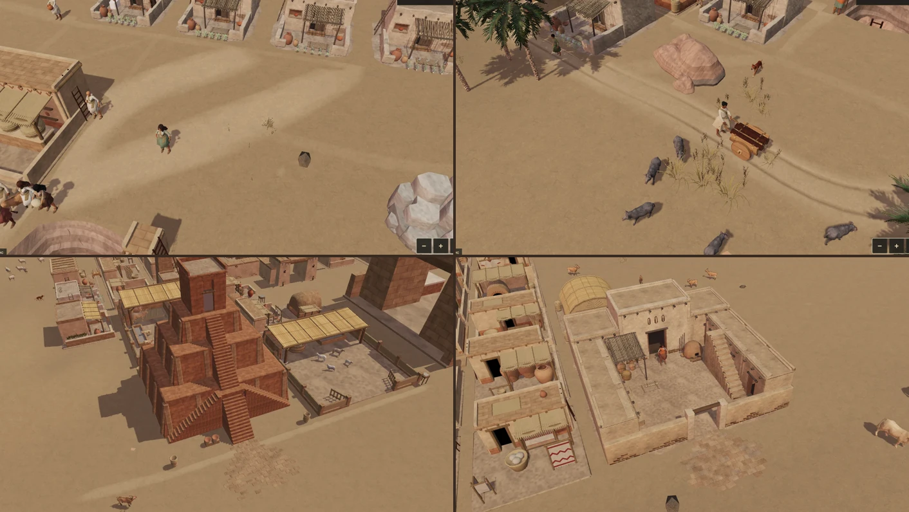

# Как улицы меняются от движения

На обычных улицах жители утаптывают светлую глину. На земляных маршрутах повозок к ней добавляются две неглубокие колеи с расстоянием около метра между колёсами. По мере новых проездов след усиливается, после прекращения движения постепенно исчезает. У входов в общинный дом, святилище и зиккурат лежит сырцовый кирпич. Ряды поворачиваются вместе с воротами или лестницей.

| Место | Кадр из игры |
| --- | --- |
| Тропа между жилыми дворами | [Жилая улица](../evidence/2026-11-21/porter-carts/street.webp) |
| Дорога между амбаром и складом | [Колея и гружёная тележка](../evidence/2026-11-21/porter-carts/ruts.webp) |
| Нижняя ступень лестницы храма | [Храмовая площадка](../evidence/2026-11-21/porter-carts/temple.webp) |
| Ворота общинного дома | [Площадка у ворот](../evidence/2026-11-21/porter-carts/communal.webp) |

## Как воспользоваться тележкой

Откройте «Снабжение семей» → «Склады и перевозки», выберите дворы, груз и количество, затем нажмите «Заказать перевозку». В действующих амбаре, складе и на рынке доступно по одной тележке. В карточке здания видно, свободна ли она. Для партии от четырёх единиц носильщик может взять её во дворе. При получении продукции из мастерской тележку может дать принимающий склад. Покупки на рынке, продажи и подвоз на стройку также учитывают доступность тележек.

С тележкой носильщик может везти до двух обычных партий. При районной перевозке это до 24 единиц за рейс, вручную — до 12. Учёт продолжает различать груз в пути, остаток заказа и запас у получателя. После разгрузки носильщик возвращает пустую тележку. [Модель вблизи](../evidence/2026-11-21/porter-carts/porter.webp) · [Поездка в игровом WebGL](../evidence/2026-11-21/porter-carts/porter.mp4)

## Исторический облик

Ориентир для сетки дорог — широкие улицы и узкие проходы Абу-Салабиха. Для модели колеса использован рельеф из Ура около 2600 г. до н. э. Сплошные деревянные колёса той эпохи собирали из трёх частей. Два колеса, размеры ручной тележки, выдача во дворе и расположение кирпичных площадок — игровая реконструкция. [Николас Постгейт, планировка Абу-Салабиха](https://www.jstor.org/stable/jj.14416283.9) · [Исследование колёс, рис. 9–10](https://books.ub.uni-heidelberg.de/propylaeum/catalog/view/1382/2485/115819#page=19)

## Проверка в игре

Жилая развилка возникла за 64 секунды симуляции в городе с 33 жителями и 12 зданиями. На снимке грузовой улицы между амбаром и складом исполнены три заказа по 60 единиц древесины. Житель № 4 везёт 24 единицы по четвёртому заказу. На обоих кадрах вид покрытия получен из движения жителей. Оба общественных входа сняты со штатным игровым рендерером в контрольном городе, для храма использован поворот на 90°. Проверены также режим Canvas и старый одноклеточный храм.

Отдельно проверили отмену заказа и стройки, смену профессии, смерть носильщика и загрузку сохранения на обоих плечах маршрута. При смене профессии житель сначала вернул тележку. При смерти гружёного носильщика дерево вернулось в местный запас, при смерти на обратном пути уже доставленный груз остался у получателя.

## Большой город при 4×

Один и тот же город с 500 жителями, 250 зданиями и 529 дорожными звеньями загрузили в прежней и новой сборках. Использовали обзорную камеру WebGL 2, разрешение 1440 × 780 и Apple M5. После восьми секунд прогрева повторно загрузили исходное сохранение. Каждый замер длился 18 реальных секунд. Средний FPS рассчитан по общему числу кадров и времени двух прогонов.

| Сборка | Первый замер, FPS | Второй замер, FPS | Средний FPS |
| --- | ---: | ---: | ---: |
| До изменений | 15,85 | 17,14 | 16,49 |
| С тележками и новыми покрытиями | 19,70 | 16,44 | 18,07 |

В первом последовательном прогоне показатели различались сильнее. Для итогового сравнения чередовали сборки в порядке «прежняя, новая, новая, прежняя». Снизили стоимость проверки дорожной геометрии на одном кадре с 0,437 до 0,093 мс CPU. Рейсы гружёной тележки проверены в отдельном поселении. [Все прогоны, интервалы кадров и контрольный рейс](../../docs/benchmarks/2026-11-21-porter-carts.json)
