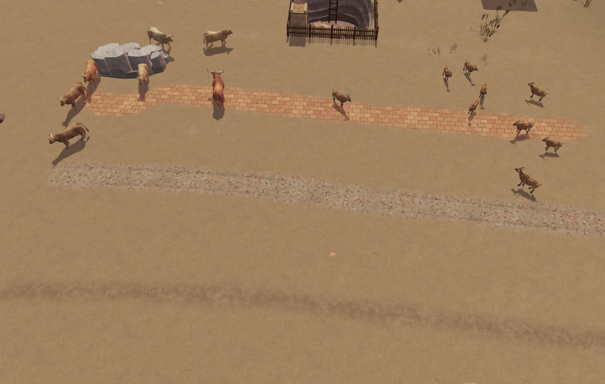
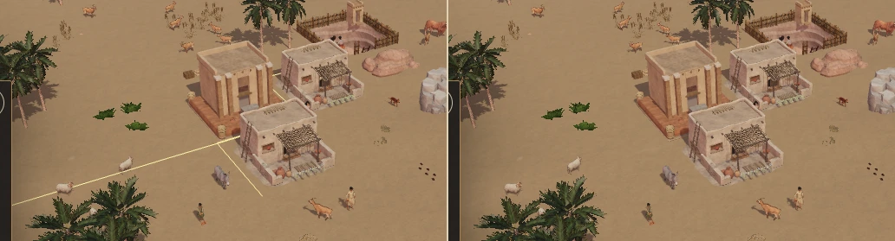
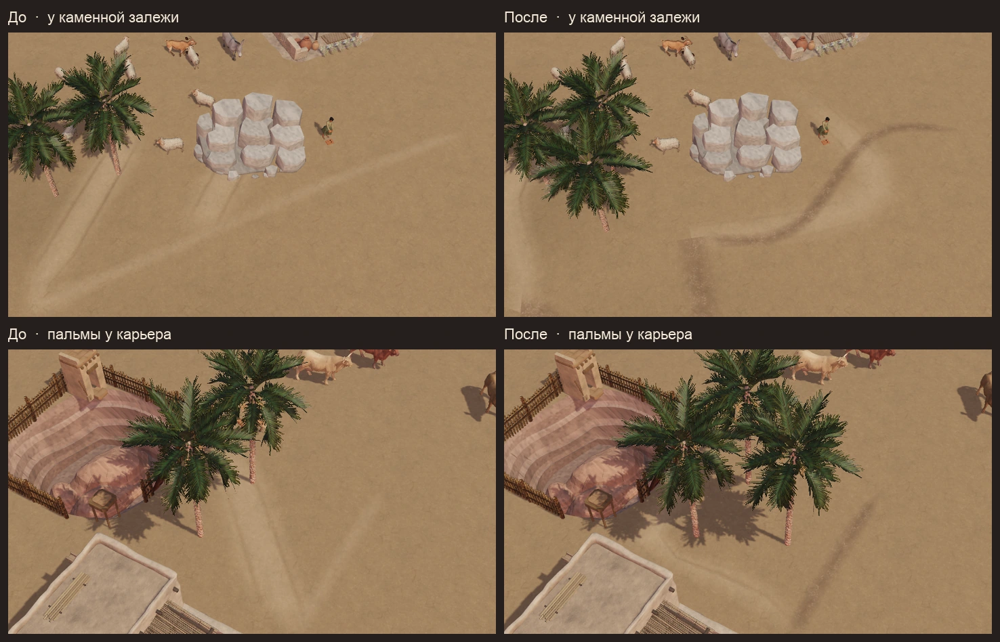
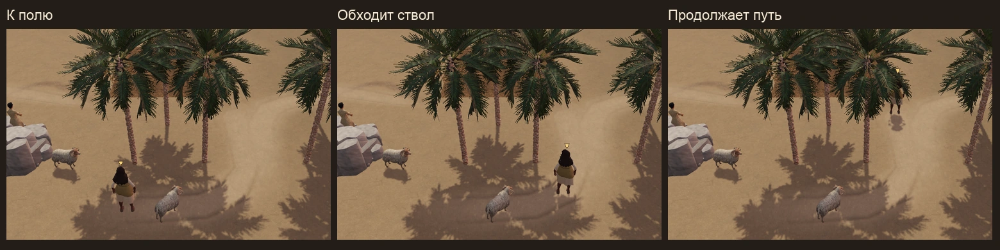

# Три покрытия и дороги в обход препятствий

## Как теперь выглядит улица

Случайные шаги оставляют слабые пятна на земле. У вручную проложенной улицы I уровня видна середина из утрамбованной глины. На II уровне появляется отсыпка из щебня и черепков. На III различимы ряды глиняного кирпича, швы и неравномерный обжиг. Грунт просвечивает у обочин.

[Фактура каждого уровня крупно](../evidence/2026-11-21/road-upgrades/materials-detail.webp) · [Сравнение на одной камере](../evidence/2026-11-21/road-upgrades/three-roads-comparison.webp) · [Режим 2D](../evidence/2026-11-21/road-upgrades/canvas-comparison.webp) · [Сохранение с 15 секциями](../evidence/2026-11-21/road-upgrades/roads-save.json)

## Почему оставалась жёлтая линия

Окончание строительного заказа обновляло покрытие, а интерфейс сохранял выбранный участок и включённый режим дорог. Оба слоя продолжали рисовать старое выделение. Теперь при принятии заказа временный выбор снимается. Карточка одиночного заказа остаётся открытой и показывает, как идут работы.

Проверены одиночное улучшение силами работников, заказ на несколько звеньев, отмена, закрытие карточки и Escape. При выборе маршрута игрок по-прежнему видит нужные звенья. После завершения в WebGL раньше оставалось два жёлтых слоя, теперь осталось ноль. Клик по изгибу в 53 см от прямой между узлами выбрал нужный участок в обоих видах. [Данные проверки выделения](../evidence/2026-11-21/road-upgrades/selection-checks.json)

## Что происходит у дерева и камня

В квартале со свободным каменным месторождением и финиковыми пальмами проверены 44 сочетания дорожного звена и препятствия. До правки диагональ проходила через середину камня. После правки середина каждого звена проходит снаружи. На четырёх маршрутах проверили и повозку в обоих направлениях. Между препятствием и наружной стороной колеса осталось минимум 0,32 м, до кузова — 0,29 м. [Геометрия дорог](../evidence/2026-11-21/road-upgrades/obstacle-numbers.json) · [Замеры тележки](../evidence/2026-11-21/road-upgrades/obstacle-cart-check.json).

Проверили также оба края дороги. На 34 участках построили пять вариантов покрытия и сравнили фактические полигоны в двух видах. До исправления 100 треугольников WebGL и 31 полигон Canvas заходили в препятствие. После исправления все 34 548 треугольников WebGL и 2 040 полигонов Canvas прошли проверку. Минимальный отступ внешней кромки в WebGL составил 13,9 см. В 148 допустимых вариантах постановки храма и общинного дома ни один из 10 274 кирпичей площадки у входа не пересёк дерево или камень. На открытой сцене после исчерпания глины площадка у входа расширилась с 45 до 83 кирпичей. [Смена геометрии](../evidence/2026-11-21/road-upgrades/apron-update.json) · [Замер до](../evidence/2026-11-21/road-upgrades/obstacle-edges-before.json) · [Замер после](../evidence/2026-11-21/road-upgrades/obstacle-edges-after.json).

Жительница Энлил обходит пальму по дороге на своё поле. Проход снят с одной камеры. На всех трёх кадрах её модель совпадает с изгибом тропы с точностью до миллиметра.

[Сохранение перед обходом пальмы](../evidence/2026-11-21/road-upgrades/walker-save.json) · [Координаты трёх кадров](../evidence/2026-11-21/road-upgrades/walker-check.json) · [Сохранение проверочного поселения](../evidence/2026-11-21/road-upgrades/obstacles-save.json)

## Исторический ориентир

В Уре археологи описали кирпичное мощение дворов в комплексе эпохи III династии. Приёмы кладки послужили образцом для третьего уровня. Последовательность трёх улучшений и сочетание материалов для каждой игровой улицы — художественная реконструкция. [Леонард Вулли, *Ur Excavations VI. The Buildings of the Third Dynasty*](https://etana.org/sites/default/files/coretexts/20260.pdf)

## Производительность и сохранения

В Chrome WebGL 2 один город с 500 жителями и 250 зданиями работал на 4× при разрешении 1440 × 780. В городе 89 проложенных участков трёх уровней и 175 протоптанных участков. Перед каждым 20-секундным замером игру прогревали и возвращали сохранение и камеру к одному состоянию.

[Сохранение нагрузочного города](../../docs/benchmarks/2026-11-21-road-levels-city.json.gz)

Прошли 2230 тестов Node. Все 20 архивных городов загрузились и после повторной записи совпали с результатом предыдущей сборки, включая личности жителей и учёт грузов.

## road-materials-and-detours-20261121 | Три покрытия и обход препятствий

date: 2026-11-21
type: release
release: road-materials-and-detours-20261121
publication: pending
groups: graphics; ux
completed: road-upgrade-marker; road-level-finishes; road-obstacle-curves
source: roadmap/reports/2026-11-21-road-upgrades.md
