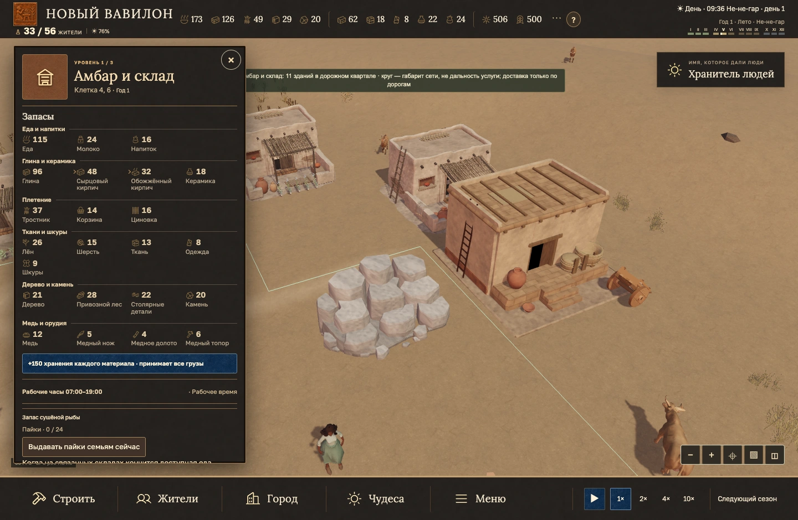

# Что лежит на складе

Сразу под названием открытого склада видны местные ресурсы и их количество. Еда, молоко и напиток занимают свою группу. В следующей строке рядом стоят глина, сырцовый кирпич, обожжённый кирпич и керамика. Ниже идут плетёные изделия, ткани и шкуры, древесина и камень, медь и орудия. Пустые позиции скрыты. У пустого хранилища сводка показывает «Пусто».

У амбара на клетке (4, 6) было 115 еды, 24 молока и 16 напитка. Городская строка в это время показывала 173 еды. В амбаре лежали 96 глины, 48 сырцовых кирпичей, 32 обожжённых и 18 керамики. Дополнительные расходы, домашние припасы и грузы в пути имеют собственные строки. [Крупно](../evidence/2026-11-21/store-cards/detail.webp) · [На телефоне](../evidence/2026-11-21/store-cards/mobile.webp) · [Загрузить этот город](../evidence/2026-11-21/store-cards/filled.json)

## Проверка в игре

- В игровом WebGL 2 открыты амбар, раздаточный двор и святилище. Сверены реальные остатки каждой постройки. В городском списке зданий и в разделе «Склады и перевозки» сводка стоит перед работниками, настройками и перевозками. В разделе «Кварталы» она также открывает карточку склада без приписанных домов. В торговых дворах складская строка учитывает оплаченную партию до получения носильщиком.
- На экране 1440 × 940 в амбаре отображались 23 позиции. На экране 390 × 844 сохранились четыре колонки по 81,75 пикселя. Ни одно название не вышло за пределы своей ячейки. Контраст названий в игровом кадре составил 6,97:1, чисел — 9,78:1.
- На 20 архивных городах сверены 244 личности жителей, 121 здание и весь сериализованный игровой учёт при импорте и повторной записи. В 24 исторических хранилищах 85 отображённых остатков совпали с исходными. Открытие карточек состояние не изменило.

## Историческая основа

Табличка из храмового архива Ниппура эпохи III династии Ура учитывает поступление и выдачу зерна. Группировка материалов по производственным цепочкам и сетка по четыре позиции — игровой способ читать такие остатки. [Табличка BE 03/1, 058, Пенсильванский музей / CDLI](https://cdli.earth/artifacts/105610)

## Производительность с открытой карточкой

500 жителей, 250 зданий, 4×, Chrome WebGL 2, 1440 × 780, одна камера и одно сохранение. В раздаточном дворе (29, 22) открыта карточка с 23 видами товаров. После семи секунд движущегося прогрева восстанавливали сохранение. Версии чередовали, данные каждой версии собирали в трёх прогонах.

| Версия | Три прогона, FPS | Средний FPS за суммарное время | Время кадра p95 |
| --- | --- | ---: | ---: |
| До | 46,73 / 44,90 / 41,88 | 44,50 | 33,4 мс |
| После | 47,02 / 45,16 / 42,09 | 44,76 | 33,4 мс |

[Интервалы кадров и условия измерения](../../docs/benchmarks/2026-11-21-store-cards-4x.json) · [Контрольный город](../../docs/benchmarks/2026-11-21-store-cards-city.json.gz)

## store-stock-cards-20261121 | Запасы вверху складских карточек

date: 2026-11-21
type: release
release: store-stock-cards-20261121
commit: 6c1d333af53b4365ab1b145c92349a33dbd29aa3
publication: verified
groups: ux; economy
completed: store-resource-summary
source: docs/versions/2026-11-21-06.md
