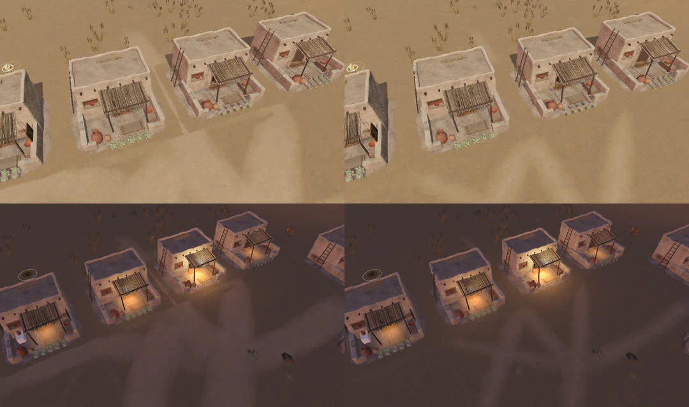

# Чек-лист новых правок

21 ноября 2026 · Переулки, карьерные дворы, пеликан и предложения по хозяйству

| Этап | Готово | Что должно увидеться в игре |
| --- | --- | --- |
| 1. Общая ширина дорог | [x] | Редкие тропы узкие, жилые улицы шире, главные грузовые выделяются. Колёсные следы лежат под колёсами. |
| 2. Граница дороги | [x] | От утоптанной середины до исходной земли есть мягкая обочина. Между глухой стеной и улицей видна полоса обычного грунта. |
| 3. Дорога между постройками | [x] | Между соседними дворами читается единый проход. Проверить примыкание и поворот с одной камеры днём и в сумерках. |
| 4. Пеликан | [x] | В WebGL птица идёт клювом по направлению движения, на повороте след остаётся за хвостом. [Смотреть игровой ролик](../assets/pelican-swim-2026-11-21.mp4) |
| 5. Ограждения двух карьеров | [x] | Глиняный и каменный дворы ограждены по периметру. У входа и спуска есть проём для идущего человека с грузом. |
| 6. Продолжение товарных цепочек | [x] | Предложены четыре заказа с работником, материалом, переносимым грузом и конкретным получателем. [План хозяйства](../../docs/PRODUCTION_AND_MIRACLES_2026-11-21.md) |
| 7. Как узнать чудо на карте | [x] | Для каждого из 17 даров описан свой жест или след в мире. Подготовлены три художественных кадра. [Концепты](../assets/three-miracle-concepts-2026-11-21.webp) |
| 8. Приёмка и публикация | [x] | Сравнить прежнюю и новую сборки на одном городе 500/250 при 4×, проверить загрузку сохранений, обновить дорожную карту и проверить опубликованную игру. |

Пункты 6 и 7 выполнены в объёме дизайна. Выбор следующей производственной цепочки и её игровая реализация остаются впереди.

**Выполнено позже.** [Запасы вверху складских карточек — проверка в игре](2026-11-21-store-cards.md).

## Отложено по просьбе игрока

- [ ] Сделать протоптанные жителями тропы едва заметными. На общем плане они почти сливаются с грунтом, вблизи читаются по примятой фактуре.
- [ ] Воспроизвести и исправить обрыв дороги на холмах. Проверить подъём, гребень и спуск с двух расстояний.

## Исторические ориентиры

В Абу-Салабихе дома разделяли улицы и переулки. Работа исследователей Абу-Тбейры описывает местное тростниковое плетение и названия оград. Конкретная ширина игровой дороги и установка заборов у разрезов выбраны для этого города. Зимний розовый пеликан опирается на современные полевые наблюдения в болотах Южного Ирака. [Раскопки Абу-Салабиха](https://www.jstor.org/stable/jj.14416283) · [Плетения Абу-Тбейры](https://exarc.net/issue-2019-1/ea/vegetable-plaiting-materials-site-abu-tbeirah-southern-iraq-third-millennium-bc-experimental) · [Полевой учёт птиц](https://doi.org/10.1155/2017/4198690)

## Переулок и ширина

На прежнем покрытии ограничение у дома сжимало переход между дорогой и землёй примерно до 18 см. При пересечении дорожных лент на этом месте появлялся светлый угол. Это воспроизвелось между двумя соседними домами. При отключении слоя натоптанных дорог клин исчезал.

В каждой паре совпадают сохранение, время и положение камеры. [Сохранение проверочного квартала](../evidence/2026-11-21/lanes-and-quarries/passage-save.json) Новая обочина постепенно переходит в землю. У основания дома остаётся свободная полоска. Были также проверены боковая дорожка к мастерской и две колеи на грунте. [Переулок крупным планом](../evidence/2026-11-21/lanes-and-quarries/lane-detail.webp) · [Дневной проход до](../evidence/2026-11-21/lanes-and-quarries/street-before.webp) · [Дневной проход после](../evidence/2026-11-21/lanes-and-quarries/street-after.webp) · [Сумерки](../evidence/2026-11-21/lanes-and-quarries/street-sunset.webp)

| Контрольное сечение | Прежняя ширина | Новая ширина |
| --- | ---: | ---: |
| Редкая тропа | 0,47 м | 0,34 м |
| Тихая жилая улица | 1,10 м | 0,80 м |
| Часто используемая жилая улица | 3,08 м | 2,15 м |
| Наезженная грунтовая улица | 2,86 м | 2,35 м |
| Расстояние между следами колёс | 1,04 м | 1,04 м |

Ширина дана по внешней геометрической границе конкретного сечения, включая обе обочины. Ширина меняется вдоль пути по трафику, поворотам и свободному месту.

## Два карьера

Сухая часть периметра получила стойки, вертикальные стебли разной высоты и два ряда перевязей. От улицы можно пройти с корзиной, у оголовка лестницы оставлен отдельный проём шириной 1,54 м. У воды ограда заканчивается на сухом берегу. Свободные месторождения остаются открытыми.

| Рабочий двор | До | После |
| --- | --- | --- |
| Глиняный | [Кадр](../evidence/2026-11-21/lanes-and-quarries/clay-before.webp) | [Кадр](../evidence/2026-11-21/lanes-and-quarries/clay-after.webp) |
| Каменный | [Кадр](../evidence/2026-11-21/lanes-and-quarries/quarry-before.webp) | [Кадр](../evidence/2026-11-21/lanes-and-quarries/quarry-after.webp) |

Во всех 64 проверенных рейсах добытчики вернулись с грузом. Проверяли оба двора 2×2, четыре положения залежи, четыре поворота и двух работников. После дополнительного отступа крайней стойки минимальное расстояние от центра идущего человека до ограды выросло с 0,211 до 0,425 м. Илду вернулся через проём с шестью мерами глины, Энлил — с пятью мерами камня. Ишме забрал у уличной стороны ворот 12 глины от двух добытчиков, Лугаль Отец — 10 камня. Оба носильщика доставили груз в амбар. Отдельно прослежены восемь доставок носильщиками до склада. На входе, выходе и маршруте тележек центры персонажей не пересекли ни одной секции ограды. В старых городах дворы 1×1 по-прежнему выдают груз у рабочего места возле улицы. Геометрию и снимки отдельно проверили в WebGL 2. Обе выгрузки GLB прошли glTF Validator без ошибок и предупреждений. [Работник несёт глину](../evidence/2026-11-21/lanes-and-quarries/clay-working.webp) · [Работник несёт камень](../evidence/2026-11-21/lanes-and-quarries/quarry-working.webp) · [Данные 64 рейсов добытчиков и восьми доставок](../evidence/2026-11-21/lanes-and-quarries/quarry-trips.json)

## Пеликан

Модель была развёрнута на 180° относительно касательной к пути. Исправлены ось модели и наклон при ловле. В игровом WebGL проверены 189 положений за оборот. Максимальное расхождение между клювом и направлением хода составило 1,01°, между следом и направлением назад — 0,46°. Девятисекундный ролик снят у рыбацкого двора с неподвижной камеры в двукратном ускорении. [Посмотреть](../assets/pelican-swim-2026-11-21.mp4)

## Большой город на 4×

Один и тот же город с 500 жителями и 250 постройками запускался в Chrome WebGL 2, 1440×780, с общим планом, обычным интерфейсом и автосохранением. В каждой попытке симуляцию прогревали 12 секунд, повторно открывали исходный город и измеряли реальные интервалы между кадрами за 20 секунд. Версии чередовались.

| Версия | Три прогона, FPS | FPS за суммарное время | Время кадра p95 |
| --- | --- | ---: | ---: |
| Прежняя | 11,23 / 27,13 / 26,01 | 21,45 | 100 мс |
| Новая | 12,49 / 28,15 / 27,21 | 22,62 | 83,4 мс |

[Исходные интервалы кадров](../../docs/benchmarks/2026-11-21-streets-quarries-4x.json) · [Сохранение нагрузочного города](../../docs/benchmarks/2026-11-21-fishery-overview-save.json.gz)

Прошли 2213 тестов Node и семь проверок сборки roadmap. Все 20 архивных городов совпали с предыдущей сборкой после импорта и повторной записи, включая личности и запасы.

На GitHub Pages проверены 48 файлов по SHA-256, четыре ракурса улиц и зимняя сцена с пеликаном в WebGL 2. [Снимок выпуска](../../docs/versions/2026-11-21-05.md)

## streets-quarries-pelican-20261121 | Переулки, карьерные ограды и пеликан

date: 2026-11-21
type: release
release: streets-quarries-pelican-20261121
commit: ef838026db6afc1e572b94024088a05e6a11dc13
publication: verified
groups: graphics; economy
source: docs/versions/2026-11-21-05.md
